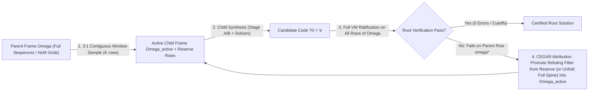

---
header-includes:
  - \usepackage{tikz}
  - \usetikzlibrary{arrows.meta,positioning,calc,shapes.geometric,fit,backgrounds}
---

# Lisploop Architecture Reference

This document is the authoritative architectural reference for the refactored `lisploop` Common Lisp kernel and milestone suite. The Common Lisp source code is authoritative; this reference synthesizes the implementation contracts of the **24 kernel modules** and **5 milestone modules** with the mathematical framework, design principles, and worked examples from [plan7.md](plan7.md), [plan7-recursion.md](plan7-recursion.md), [plan7-library.md](plan7-library.md), [plan7-higher-order.md](plan7-higher-order.md), and [plan7-m9-policy.md](plan7-m9-policy.md).

Current accounting constants are **Encoding Version 7** (`+encoding-version+` in `codec.lisp`), **Tariff Version 10** (`+tariff-version+` in `vm.lisp`), and **Simulator Version 6** (`+simulator-version+` in `vm.lisp`). Historical traces in `deprecated/` retain their original accounting versions.

---

## 1. Purpose, Design Principles, and Module Map

### 1.1 Hypothesis and Three Interacting Pillars

`lisploop` investigates a central hypothesis: **there are many levels of conservation, some of which are generated from different views of the same data and meta-data, especially different forms of causality. When conserved information or views are destroyed, hidden, or aliased, a fixed set of algorithms for inferring them suffices—and can bootstrap inferring algorithms, heuristics, languages, search policies, and search constraints that can infer or find them.**

Automated mathematical and algorithmic discovery in `lisploop` arises from three interacting pillars over finite prime fields $\mathbb{F}_p$ (`(:gf p)`) and unbounded signed integers $\mathbb{Z}$ (`:int`), alongside Booleans, tuples, homogeneous sequences, and quoted homoiconic code:

1. **Symmetry (Conservation Under Action and Across Observations):**
   Discovery begins by detecting what remains invariant when inputs, states, or syntax are transformed:
   - *Empirical level:* A synthesized program $e(X)$ conserves a target input-output relation $A_\omega(Y)$ across observation rows $\omega \in \Omega$ (M1), while an action invariant $h(X)$ is conserved along trajectory steps (`pairs`) yet varies across distinct orbits (`anchors`, M2).
   - *Operator and meta-data level:* Guarded algebraic laws $G(X) \implies e_1(X) = e_2(X)$ are certified exhaustively across finite domain grids $D^\Gamma$ (M3A), retyped across prime fields and `:int` (`retype-law`, `retype-function-definition`), and factored into shared syntactic skeletons and higher-order library combinators (`discover-library-abstractions`, M3B, M6, R5).
2. **Algebra (Converting Passive Conservation into Generative Models and Backward Solvers):**
   A conserved relation $R(X, Y)$ or step invariant $C(H, Z, Y) = c_0$ is initially a passive test. Algebra turns passive conservation into **active generation and backward constraint propagation**:
   - Reorienting which coordinates of a recorded relation serve as known inputs vs. unknown targets (`orient-observations`, `orient-arithmetic-requirements`).
   - Synthesizing explicit inverse witness functions $q(K, C)$ and solvability guards $G(K, C)$ (`solve-witness-law`, `solve-uniqueness-law`, M4), syntax-to-syntax rule transformers (`learn-knowledge-transformer`), and second-order functorial solvers (`induce-functorial-solvers`, L2, H4).
   - Pulling parent requirements $A_\omega(Y)$ backward through first-order decoders $Y = d(X, Z)$ (`pullback-frame`) or 1-to-many higher-order/recursive templates (`lift-frame`), interleaved with conservative constant folding (`fold-constants`) and dual-grade requirement propagation (`propagate-requirements`).
3. **Interacting Views of Data & Meta-Data, and Inferring Hidden or Aliased Information:**
   Because object-language programs, row requirement predicates $A_\omega(Y)$, algebraic laws, deduction clauses (`nogood-clause`), behavioral descriptors, and priority predictors are all homoiconic S-expressions executed on the same metered VM, the system projects runtime data and symbolic meta-data through interchangeable views:
   - Deduplicated lookup tables and equivalence classes (`quotient-values`, `partition-rows`).
   - Observable Boolean regime splits `(if G branch_1 branch_2)` (`discover-partition-views`, Stage B `heuristic-decompositions`) and latent regime parameters $Z = a_{j(r)}$ inferred via bounded branch-and-bound fiber clustering (`infer-fibers`, M5, M7).
   - Inductively lifted recursive sequence contexts (`lift-inductive-sequence-context`, `start-recursive-synthesis`), 1-to-many call-site fibers with partial window sampling (`*max-active-lifted-rows*`, CEGAR refinement), and persistent relational knowledge graphs (`knowledge-library`).

### 1.2 Three Distinct Resource Quantities and the 3:1 Reserve Principle

Throughout the kernel, three resource quantities are tracked and kept strictly distinct:

$$
S(M), \qquad W_{\mathrm{run}}(M), \qquad W_{\mathrm{search}}(P).
$$

- **$S(M)$ (`description-size`):** The exact self-delimiting packet bit length of a model (header + body) under Encoding v7.
- **$W_{\mathrm{run}}(M)$ (`ledger-total` during evaluation):** The structural runtime work charged by the VM tariff to validate and execute $M$ on inputs. A tiny recursive or arithmetic program can be expensive to run.
- **$W_{\mathrm{search}}(P)$ (`ledger-total` across a search/synthesis job):** The cumulative discovery work spent enumerating, folding, lifting, verifying, and consolidating hypotheses.

Useful decompositions are often **non-monotonic**: introducing a feature basis, conditional guard, outer decoder shell, or recursive subproblem may temporarily increase syntax bits or local work before enabling downstream compression. To guarantee that tentative shortcuts, heuristic agendas, or locality biases never permanently starve sound search within configured bounds, `lisploop` enforces a ubiquitous **3:1 Reserve Schedule**:
- Every 4th scheduling quantum in `resume-synthesis` reserves the active root search (`reserved-turn-p`).
- Every 4th child selection under `:policy :heuristic` explores active agenda actions in round-robin order rather than greedy full-path price.
- Every 4th quantum in `start-propagation-search` steps the un-narrowed fallback frame when tentative (`unique-p = nil`) solvers are used.
- Every 4th pair selection in `:locality` subexpression abstraction (`schedule-occurrence-pairs`) falls back to canonical occurrence order, and `select-active-fiber-rows` combines a $\lceil \frac{3}{4} K \rceil$ co-local contiguous fiber window with a $\lfloor \frac{1}{4} K \rfloor$ canonical diversity reserve.

### 1.3 Architecture Layout: 24 Kernel Modules + 5 Milestone Modules

The codebase was refactored from an earlier 9-file layout into **24 focused kernel modules** and **5 self-contained milestone experiment modules** under `milestones/`. The load order in [`load.lisp`](file:///home/tlh24/sandbox/team/tlh/lisploop/load.lisp) is strict—the kernel never calls into `milestones/`:

#### Kernel Modules (`load.lisp` order)

| # | Module | Primary Responsibilities |
| :- | :--- | :--- |
| 0 | [`package.lisp`](file:///home/tlh24/sandbox/team/tlh/lisploop/package.lisp) | `#:lisploop` package definition and public symbol exports |
| 1 | [`ast.lisp`](file:///home/tlh24/sandbox/team/tlh/lisploop/ast.lisp) | Types, `schema`, pooled symbols (`var`, `hole`, `op`, `lit`, `app`), weak-key `*node-meta*`, 26 primitives + dynamic functions, declarative type patterns, structural totality (`provably-total-p`, `analyze-function-body-totality`), `body-size`, surface `term` builder |
| 2 | [`knowledge.lisp`](file:///home/tlh24/sandbox/team/tlh/lisploop/knowledge.lisp) | Declarative `define-knowledge-kind` registry, `knowledge-entry`, `knowledge-library`, `with-knowledge-library`, active function table (`define-function`, `set-function-active-implementation`) |
| 3 | [`codec.lisp`](file:///home/tlh24/sandbox/team/tlh/lisploop/codec.lisp) | Encoding v7 self-delimiting bitstream packets (`encode-model`, `decode-model`), `header-size`, `description-size`, canonical syntax order `expression-less-p` |
| 4 | [`vm.lisp`](file:///home/tlh24/sandbox/team/tlh/lisploop/vm.lisp) | Tariff v10 / Simulator v6 `ledger`, `with-work-limit`, resumable `evaluation` machine, `validated-program`, zero-copy lexical call dispatch, `:unresolved` oracle handling |
| 5 | [`evidence.lisp`](file:///home/tlh24/sandbox/team/tlh/lisploop/evidence.lisp) | Transitive `expression-dependencies`, `knowledge-statement-snapshot`, `attest-knowledge-entry`, and currency check `knowledge-evidence-current-p` |
| 6 | [`persistence.lisp`](file:///home/tlh24/sandbox/team/tlh/lisploop/persistence.lisp) | Generic S-expression library serialization (`serialize-knowledge-library`, `deserialize-knowledge-library`, `save-knowledge-library`, `load-knowledge-library`, `knowledge-library-storage-bits`) |
| 7 | [`requirements.lisp`](file:///home/tlh24/sandbox/team/tlh/lisploop/requirements.lisp) | Budgeted conservative AST reducer `fold-constants` (`:equivalent` vs. `:necessary` contracts, call unfolding, `:cons` spine rationing, conjunction/membership/tuple simplification) |
| 8 | [`frame.lisp`](file:///home/tlh24/sandbox/team/tlh/lisploop/frame.lisp) | `row`, `frame`, `frame-conflict-p`, `pullback-frame`, `compose-model`, 1-to-many `lift-frame`, `compose-lifted-model`, M9 partial fiber window `select-active-fiber-rows`, `probe-frame-coordinates`, `orient-observations`, quotients/partitions, correction packets & smooth `:seq` residual pricing, `relational-linkage-residual` |
| 9 | [`enumerate.lisp`](file:///home/tlh24/sandbox/team/tlh/lisploop/enumerate.lisp) | `language`, tiered bottom-up `enumerator`, shared `row-job` engine, exact `search-job` (`start-search`, `resume-search`), empirical `observation-job` (`start-observation-search`, `observation-bucket`, `observation-invariants`) |
| 10 | [`unify.lisp`](file:///home/tlh24/sandbox/team/tlh/lisploop/unify.lisp) | Pattern matching (`match-pattern`), typed first-order/operator `anti-unify`, `compile-au-constructor`, `shared-subterm-cover`, and positional `:code` abstraction `abstract-over-subterms` |
| 11 | [`fibers.lisp`](file:///home/tlh24/sandbox/team/tlh/lisploop/fibers.lisp) | `tighten-same-input-requirements`, bounded branch-and-bound fiber clustering `infer-fibers`, `fiber-pairs-and-anchors` |
| 12 | [`laws.lisp`](file:///home/tlh24/sandbox/team/tlh/lisploop/laws.lisp) | Guarded `law` discovery (`propose-observed-laws`, `start-guard-search`), finite-domain `start-law-validation` (`law-certificate`), `retype-law`, VM-compiled `rewrite-library` (`compile-rule-transformer`), M4 witness/uniqueness solver certification (`validate-arithmetic-solver`), dual-grade `propagate-requirements`, `:law` and `:solver` kinds |
| 13 | [`templates.lisp`](file:///home/tlh24/sandbox/team/tlh/lisploop/templates.lisp) | Polymorphic type template inference (`infer-function-template`, `retype-function-definition`), syntax-to-syntax `:transformer` learning (`learn-knowledge-transformer`, `induce-solvers-from-transformers`) |
| 14 | [`bootstrap-inverters.lisp`](file:///home/tlh24/sandbox/team/tlh/lisploop/bootstrap-inverters.lisp) | Second-order `:functor` kind and `induce-functorial-solvers` (`:map` elementwise inverters, refactored unary inverters, pointwise binary sequence/parameter inverters, involution law solvers) |
| 15 | [`condense.lisp`](file:///home/tlh24/sandbox/team/tlh/lisploop/condense.lisp) | Stage A heuristic condensation (`heuristic-model`, `start-heuristic-search`, `resume-heuristic-search`, `condense-heuristic`, `stage-a-observation-language`) |
| 16 | [`abstraction.lisp`](file:///home/tlh24/sandbox/team/tlh/lisploop/abstraction.lisp) | `:function` knowledge kind, control-spine `anti-unify-for-library`, `abstract-function-bodies`, `discover-library-abstractions`, `consolidate-library-functions` |
| 17 | [`descriptors.lisp`](file:///home/tlh24/sandbox/team/tlh/lisploop/descriptors.lisp) | `:descriptor` knowledge kind, `list-recursion-shape`, `compute-function-descriptor`, 5-facet / 3-tier `*descriptor-table*`, secondary compositional addressing (`derive-compositional-name`, `find-knowledge-entries-by-address`), `evaluate-frame-descriptors`, `score-entry-by-descriptors` |
| 18 | [`relations.lisp`](file:///home/tlh24/sandbox/team/tlh/lisploop/relations.lisp) | `:relation` knowledge kind, hybrid program constructor `compose-hybrid-residual-program`, delayed residual structure discovery `consolidate-residual-relations` |
| 19 | [`synthesize.lisp`](file:///home/tlh24/sandbox/team/tlh/lisploop/synthesize.lisp) | Anytime synthesis DAG controller (`start-synthesis`, `resume-synthesis`), `staged-work`, `prepare-synthesis-node`, scope-cache DAG sharing, full-path heuristic agenda routing, deferred proposal promotion, root verification, and CEGAR fiber refinement |
| 20 | [`nogoods.lisp`](file:///home/tlh24/sandbox/team/tlh/lisploop/nogoods.lisp) | Homoiconic `nogood-clause`, `collect-frame-nogood-clauses`, `check-parent-nogoods`, UIP conflict generalization (`anti-unify-nogood-clauses`), DIP context repair (`propose-dip-context-bindings`, `dip-repaired-decompositions`) |
| 21 | [`decompose.lisp`](file:///home/tlh24/sandbox/team/tlh/lisploop/decompose.lisp) | Stage B residual decompositions (`heuristic-decompositions`: additive Path B1, conditional Path B2, single-sequence `lift-inductive-sequence-context`, multi-sequence `lockstep-inductive-sequence-decomposition`), `start-heuristic-synthesis`, `start-recursive-synthesis` |
| 22 | [`proposals.lisp`](file:///home/tlh24/sandbox/team/tlh/lisploop/proposals.lisp) | `:decoder-template` kind, `library-decompositions` (with polymorphic retyping, descriptor scoring, `filter-map-decompositions`, `partial-library-decompositions`, `learned-decoder-decompositions`), `dependency-proposals`, `start-selector-search`, `library-expander`, `heuristic-expander`, `combine-expanders` |
| 23 | [`consolidate.lisp`](file:///home/tlh24/sandbox/team/tlh/lisploop/consolidate.lisp) | `:nogood-schema`, `:dip-feature`, and `:heuristic` kinds, `synthesis-episode-returns`, `make-search-trace-frame`, `condense-search-heuristic`, `commit-synthesis-job`, `consolidate-policy-descriptors`, `consolidate-knowledge-library` |
| 24 | [`explain.lisp`](file:///home/tlh24/sandbox/team/tlh/lisploop/explain.lisp) | Structured causal provenance inspection (`explain-synthesis-node`, `explain-synthesis-job`, `explain-knowledge-library`) |

#### Milestone Experiment Modules (`milestones/`)

| # | Module | Primary Responsibilities |
| :- | :--- | :--- |
| 25 | [`milestones/corpus.lisp`](file:///home/tlh24/sandbox/team/tlh/lisploop/milestones/corpus.lisp) | M3B/M6 law and AST corpus compression (`propose-law-compressions`), subtree occurrence indexing (`collect-tree-occurrences`), locality-scheduled correspondence search (`discover-subexpression-abstractions`) |
| 26 | [`milestones/views.lisp`](file:///home/tlh24/sandbox/team/tlh/lisploop/milestones/views.lisp) | M7 observable Boolean regime splits (`evaluate-guard-partition`, `synthesize-supplied-partition-view`, `discover-partition-views`, `price-view-combinations`) |
| 27 | [`milestones/algebra-discovery.lisp`](file:///home/tlh24/sandbox/team/tlh/lisploop/milestones/algebra-discovery.lisp) | M4 arithmetic relation observation (`observe-arithmetic-relations`, `orient-arithmetic-requirements`) and standalone inverse solver discovery (`discover-arithmetic-solvers`, `discover-arithmetic-propagators`) |
| 28 | [`milestones/propagation-search.lisp`](file:///home/tlh24/sandbox/team/tlh/lisploop/milestones/propagation-search.lisp) | M4 standalone 3:1 primary-vs-fallback propagation search (`start-propagation-search`, `resume-propagation-search`, `propagation-search`) |
| 29 | [`milestones/dependency-search.lisp`](file:///home/tlh24/sandbox/team/tlh/lisploop/milestones/dependency-search.lisp) | M5 two-stage observational feature discovery + synthesis (`start-dependency-search`, `resume-dependency-search`) |

---

## 2. Representation, Encoding, and VM Execution Contracts

### 2.1 Domains, Types, and Schemas (`ast.lisp`)

A `schema` $\Gamma = (D, X_0{:}\tau_0, \ldots, X_{m-1}{:}\tau_{m-1} \to \tau)$ is constructed by `(make-schema :domain domain :inputs inputs :target target :lookup-p lookup-p)`. `inputs` is an ordered association list `((id . type) ...)` sorted by non-negative integer variable IDs; `make-schema` infers the ambient scalar domain (`:int` or `(:gf p)`) from `inputs` and `target` unless explicitly supplied.

| Type S-Expression | Runtime Value Representation | Notes & Validation (`valid-type-p`, `value-of-type-p`) |
| :--- | :--- | :--- |
| `:int` | Arbitrary-precision signed integer | Ordered by `:<`; integer division `:/` truncates toward zero |
| `(:gf p)` | Integer in $0, \ldots, p-1$ | Constructed via `(gf p)`, which checks `prime-p` ($p \ge 2$); division uses `field-reciprocal` |
| `:bool` | `nil` or `t` | Conditionals (`:if`) are lazy in their branches |
| `(:tuple t1 ...)` | Proper list `(v1 ...)` | Fixed length $\ge 1$; indexed via bounds-checked `:at` with literal index |
| `(:seq type)` | Proper list `(v0 v1 ...)` | Homogeneous elements; supports `:cons`, `:tail`, `:at`, `:length`, `:concat`, `:gather`, `:member`, `:lookup` |
| `(:code inputs sort)` | Quoted AST or operator symbol | `inputs` is `((id . type) ...)`; `sort` is a value type or `(:fn (arg-types...) ret-type)` |

**First-class syntax without `eval`:** A quoted syntax literal `(lit (code-type inputs sort) expression)` evaluates to the syntax object itself without executing it. Explicit execution of a `:code` value occurs exclusively through the `:code-eval` primitive on the resumable VM stack under the active work budget. There is no host `eval` or arbitrary host-function escape hatch in the object language.

### 2.2 Zero-Copy Homoiconic ASTs, Pooled Symbols, and `*node-meta*` (`ast.lisp`)

Programs, requirement predicates $A_\omega(Y)$, algebraic laws, rewrite rules, nogood clauses, and descriptors are represented as **native Common Lisp S-expressions** whose structural metadata (`ast-meta`) is attached in a weak-key `eq` hash table `*node-meta*`, paired with canonical symbol pooling in `*typed-symbol-pool*`:

- **Variables (`(var id type)`):** Pooled uninterned symbol `X0`, `X1`, ... keyed by `(:var id type)`. `non-var-bits = 2`, `var-count = 1`, `syntax-work = 1`, `total-p = t`.
- **Holes (`(hole id sort)`):** Pooled uninterned symbol `?0`, `?1`, ... keyed by `(:hole id sort)`, where `sort` is either a value type or `(:fn (arg-types...) return-type)` for operator holes. `non-var-bits = 2`, `var-count = 0`, `syntax-work = 1`.
- **Operators (`(op name operand-type)`):** Pooled uninterned symbol `+`, `*`, `:FA`, ... keyed by `(:op name operand-type)`. `non-var-bits = 2 + (operator-bit-size name operand-type)`.
- **Literals (`(lit type value)`):** Two-element list `(QUOTE value)` whose head is a pooled per-type symbol keyed by `(:quote type)`. `non-var-bits = 2 + (value-bit-size value type)`. Because a quoted `:code` literal's payload `value` is already an S-expression over canonical positional variables `X0, X1, ...`, converting between code and data is **zero-copy**.
- **Applications (`(app operator &rest args)`):** Ordinary cons cell `(operator arg1 arg2 ...)`. `compute-app-meta` validates operator arity and argument types, computes `non-var-bits = 2 + operator-bits + sum(arg-non-var-bits)` and `var-count = sum(arg-var-counts)`, unions `free-vars`, and caches conservative totality `total-p`.

Because symbols with identical `(kind, id/name, type)` are pooled in `*typed-symbol-pool*`, `eq` and `equal` agree on AST atoms, and `ensure-ast-meta` can reconstruct metadata for any copied cons cell by inspecting its pooled head symbol.

For human-readable construction in tests and rules, the surface builder **`(term expr &key inputs domain target)`** (and serialization pair `ast->sexp` / `sexp->ast`) infers operator `operand-type` parameters bidirectionally from argument types and expected return types:

```lisp
;; Surface `term` automatically resolves `:+` and literals to `(:gf 5)`:
(term '(+ X0 (+ X1 '2)) :inputs `((0 . ,(gf 5)) (1 . ,(gf 5))))
```

### 2.3 The 26 Primitives, Declarative Type Patterns, and Dynamic Functions (`ast.lisp`, `knowledge.lisp`)

The fixed primitive table `+primitives+` in [`ast.lisp`](file:///home/tlh24/sandbox/team/tlh/lisploop/ast.lisp#L75-L120) defines **26 operators** in 4-bit opcode order, followed dynamically by registered homoiconic functions in `*registered-function-names*` (`:fa`, `:fb`, ...):

1. **Single-nibble opcodes (indices 0..14):**
   `:+`, `:*`, `:=`, `:tuple`, `:member`, `:lookup`, `:gather`, `:-`, `:/`, `:if`, `:concat`, `:code-kind`, `:code-child`, `:code-operator`, `:code-apply`.
2. **Extended opcodes (indices 15..25+, encoded as `1111` + Elias delta of `index - 14`):**
   `:code-match`, `:code-bind`, `:code-subst`, `:code-total`, `:code-less`, `:at`, `:cons`, `:tail`, `:length`, `:<`, `:code-eval`, plus dynamic library functions `:fa`, `:fb`, ....

#### Declarative Type Patterns and Target-Directed Bit Savings
Each primitive specifies its type discipline declaratively via `(arg-patterns -> return-pattern)` in `+primitives+` (processed by `match-type-pattern`, `encoded-variable`, `operator-encoded-type`, and `compute-operator-signature`). Crucially, **an operator application in the bitstream only encodes type parameters of `operand-type` that are not already determined by the expected return type (`target-type`) of the parent context**:
- Arithmetic (`:+`, `:*`, `:-`, `:/`), conditionals (`:if`), sequences (`:cons`, `:tail`, `:concat`, `:gather`), and `:tuple` have `encoded-variable = nil`: their operand type is completely determined by the surrounding expected type, costing **0 extra type bits** at the call site!
- Comparison (`:=`, `:<`), `:member`, `:lookup`, `:at`, `:length`, and `:code-*` consume an intermediate type that disappears from their Boolean or integer result, so `operator-encoded-type` emits only that erased parameter type.
- Registered functions (`:fa`, `:fb`, ...) have fixed monomorphic signatures in `*function-definitions*`, so calling `:fa` emits **0 type bits**—only the 2-bit `:app` tag and the operator opcode.

### 2.4 Static Totality (`provably-total-p`) and Homoiconic Closure Capture (`:code-subst`)

#### Why Static Totality Exists: Definedness Preservation
Evaluating an expression in `vm.lisp` terminates in one of four states: `:value`, `:error` (division by zero, out-of-bounds `:at`/`:gather`, `:tail` on `'()`, missing `:lookup` key), `:unresolved` (missing key in a partial `:oracle-table`), or `:unknown` (`:cutoff` when the step budget ends).

Whenever `fold-constants` (`requirements.lisp`) simplifies a pulled-back requirement or `laws.lisp` rewrites an AST, it must preserve **error behavior (definedness)**: erasing or reordering a subexpression that could error (such as `(/ '1 X0)` when `X0 = 0`) would unsoundly turn an erroring program into a valid one. `provably-total-p` (`ast.lisp`) is a conservative static check cached in `ast-meta-total-p`:
- **Always-total primitives:** `:var`, `:lit`, and total operators (`:+`, `:*`, `:-`, `:<`, `:=`, `:tuple`, `:cons`, `:length`, `:concat`, `:member`, `:code-kind`, `:code-total`, `:code-less`, `:code-apply`, `:code-match`, `:code-subst`) are total whenever all their arguments are total.
- **Conditionally-total primitives:** `(/ a b)` is total iff `a` is total and `b` is a non-zero literal; `(at seq i)` is total iff `seq` is total and `i` is a non-negative literal statically in bounds (e.g., `< tuple-length`, `< literal-length`, or `'0` on `(:cons h t)`); `(tail seq)` is total iff `seq` is a non-empty literal or a total `(:cons h t)`.
- **Branch-sensitive non-empty tracking (`expr-total-under-non-empty-p`):** Inside `(if (= Xi '()) then else)`, `Xi` is added to `branch-non-empty-vars` on the `else` branch, certifying `(at Xi '0)` and `(tail Xi)` as provably total inside `else`.
- **Structural recursion (`analyze-function-body-totality`):** When `define-function` registers `:fa`, it verifies that every recursive self-call occurs under a non-empty guard `(= Xi '())` and decreases `Xi` via `(tail Xi)` (supporting lockstep multi-sequence recursion when secondary sequence parameters also decrease or remain invariant). Whenever a function is defined, `recompute-registered-functions-totality` runs a transitive fixed-point pass and `invalidate-app-meta` evicts stale `:app` entries in `*node-meta*`.
- **Higher-order totality (`conditional-code-params` & `provably-total-code-arg-p`):** A combinator like `:map` (`:fa`) records which `:code` parameter indices it passes to `:code-eval` in `function-definition-conditional-code-params`. A call `(:fa xs code-arg)` is certified `provably-total-p` iff `xs` is total and `code-arg` is either a quoted `:code` literal whose inner AST is `provably-total-p`, or a `:code-subst` specialization of a total template over total bindings.

#### Capturing Outer Variables Without Closure Structs via `:code-subst`
Because all expressions use canonical positional variables `X0, X1, ...`, an inner `:code` expression passed to `:map` (`(:code ((0 . :int)) :int)`) has its own lexical environment `((0 . elem))` when executed by `:code-eval`. Introducing an ML-style closure struct `(code-ptr, env)` would break homoiconicity. Instead, `lisploop` uses **homoiconic partial specialization (quasiquotation)** via `:code-subst`:

Suppose an outer scope has `X0 : (:seq :int)` and `X1 : :int` (e.g., `X1 = 5`), and we want to map "add `X1` to each element of `X0`":
1. Start with a binary `:code` template `'(+ X0 X1)` of type `(:code ((0 . :int) (1 . :int)) :int)`.
2. Apply `:code-subst` to the template and binding tuple `(tuple 'X0 X1)`:
   - Slot 0 is `'X0` (`(:code ((0 . :int)) :int)`), keeping `X0` as the open element parameter of the new unary function.
   - Slot 1 is `X1` (`:int`), a runtime value lifted into a typed literal `(lit :int 5)` (`'5`) and spliced in place of `X1`.
3. Evaluating `(:code-subst '(+ X0 X1) (tuple 'X0 X1))` at `X1 = 5` yields the plain S-expression `:code` value `'(+ X0 '5)` of type `(:code ((0 . :int)) :int)`.
4. During backward synthesis, `try-unfold-call` in `requirements.lisp` looks symbolically through `(:code-eval (:code-subst 'template (tuple ...)) elem)` even when a captured binding is an unknown child variable `Z`, unfolding `(:map X0 (:code-subst '(* X0 X1) (tuple 'X0 Z)))` on `'(3 5) -> '(6 10)` directly into `(and (= (* '3 Z) '6) (= (* '5 Z) '10))`.

### 2.5 Bitstream Codec (`codec.lisp`, Encoding v7)

`encode-model` serializes any typed AST with its `inputs` signature into a self-delimiting bit vector (`#*...`); `decode-model` reconstructs the exact AST and input signature (`(values expression inputs target-type bit-length)`). `lookup-model`, `quotient-model`, `partition-model`, and `corpus-abstraction-model` all return ordinary ASTs serialized by the exact same codec.

- **Variable-length integers:** Positive integers use Elias delta coding (`emit-positive`, `positive-bit-size` $L_+(n)$); signed integers use zigzag mapping (`signed-code`: $0 \mapsto 1, -1 \mapsto 2, 1 \mapsto 3, -2 \mapsto 4, \ldots$).
- **Header (`header-size`):** Encodes `+encoding-version+` (7), `|inputs|`, each `(id . type)` pair, and the output `target-type`.
- **Body (`body-size`):** Variable references use 0-based positions in the sorted `inputs` alist. Once validated in `inputs` scope, `body-size` is computed in $O(1)$ from cached `ast-meta`:

$$
S_{\mathrm{body}}(e) = \mathrm{nonvarbits}(e) + \mathrm{varcount}(e)\,\mathrm{integer\text{-}length}(\max(0, m - 1)),
$$

and `description-size` is $S(e, \text{inputs}) = S_{\mathrm{header}}(\text{inputs}, \tau) + S_{\mathrm{body}}(e)$. `expression-less-p` defines the canonical total order on syntax: smaller `description-size` first, tie-breaking lexicographically by the first differing bit of `encode-model`.

```lisp
(let* ((field (gf 5))
       (inputs (list (cons 0 field) (cons 1 field)))
       (x0 (var 0 field))
       (x1 (var 1 field))
       (expression (app (op :+ field) x0
                        (app (op :+ field) x1 x1))))
  (values (body-size expression inputs)
          (description-size expression inputs)
          (length (encode-model expression inputs))))
;; => 21, 44, 44
```

### 2.6 Resumable Virtual Machine and Work Tariff (`vm.lisp`, Tariff v10, Simulator v6)

All execution runs through a single resumable state machine (`evaluation` struct with status `:unknown | :value | :error | :unresolved`, explicit `tasks` continuation stack, `stack` value list, lexical `environment`, and `remaining-cost`).

1. **Static Validation vs. Runtime Execution:**
   `start-program-validation` type-checks and scope-checks an AST once under the ledger tariff, returning a `validated-program`. `start-validated-evaluation` reuses that static preparation across any number of input rows while still charging `value-work` to validate each row's input values.
2. **Prepaid Instruction Tariff (`pay-debt`):**
   When the VM pops a task (`:validate-program`, `:validate`, `:eval`, `:branch`, `:restore-env`, `:apply`), it computes `instruction-cost` into `evaluation-remaining-cost` and drains that debt unit-by-unit against the active `ledger` and budget *before* `execute-instruction` runs. Stepping 1 work unit at a time via `advance-evaluation` is bit-for-bit identical to uninterrupted execution, including on runtime errors and budget cutoffs.
   - Small prime fields ($p \le 257$) pay unit primitive arithmetic cost (`1`).
   - Unbounded `:int` addition/subtraction pay $\max(\text{width}(a), \text{width}(b))$; multiplication and division pay $\text{width}(a) \cdot \text{width}(b)$ (e.g., multiplying two 129-bit integers prepays $129^2 = 16641$ units). Larger fields add the modular reduction penalty in `arithmetic-cost`.
3. **Zero-Copy Lexical Call Dispatch:**
   Calling a registered function `(:fa a_0 ... a_{k-1})` or `(:code-eval code-val a_0 ... a_{k-1})` requires **zero AST copying, zero alpha-renaming, and zero host-stack recursion**:
   - Pop evaluated arguments $(v_0, \dots, v_{k-1})$ from `evaluation-stack`.
   - Push `(:restore-env current-environment)` onto `evaluation-tasks` (1 unit).
   - Set `evaluation-environment` to the positional alist `((0 . v_0) ... (k-1 . v_{k-1}))` (1 unit for the call step).
   - Push `(:eval body-ast)` onto `evaluation-tasks`.
4. **Partial Oracle Tables and Lazy `:unresolved` Propagation:**
   During de novo recursive synthesis (`start-recursive-synthesis`), a recursive function can be backed by a partial `oracle-table` extracted from the specification frame (`frame-oracle-table`). Calling the function on an input key absent from `oracle-table` signals `unresolved-evaluation`, terminating the evaluation with status `:unresolved` (neither `:value` nor `:error`). When `:unresolved` is passed as a child binding value in `evaluate-row-bindings`, the VM allows `:unresolved` during `:validate-inputs` and only signals `unresolved-evaluation` lazily if a `:var` bound to `:unresolved` is actually demanded by `:eval`.

---

## 3. Frames, Requirements, Pullback, and 1-to-Many Lifting (`requirements.lisp`, `frame.lisp`)

### 3.1 Nomenclature and Key Conceptual Distinctions

Uppercase $X, Y, Z$ denote symbolic variables; lowercase $\mathbf{x}_\omega, y_\omega, z_\omega$ denote concrete runtime values.

| Symbol | Meaning | Kernel Representation |
| :--- | :--- | :--- |
| $\Gamma, D, \tau$ | Schema, ambient arithmetic domain, semantic type | `schema` struct and type S-expressions |
| $\Omega, \omega$ | Observation frame and occurrence row | `frame` (`schema`, `rows`, `pairs`, `anchors`), `row` (`key`, `known`, `requirement`) |
| $A_\omega(Y), B_\omega(Z)$ | Parent and pulled-back child row requirements | Boolean ASTs over target variable `(var 0 target-type)` |
| $M(e, \omega)$ | Candidate evaluation outcome on row $\omega$ | VM `evaluation` outcome (`:value`, `:error`, `:unresolved`, `:cutoff`) |
| $\mathrm{Fiber}(\omega)$ | Accepted target values $\{z : B_\omega(z) = \mathrm{true}\}$ | Requirement predicate, or explicit witness list from `extract-allowed-values` |
| $\Omega_k, j_\omega$ | Proposed row block and block index | `partition`, `fiber-class` structs, label list |
| $p, \theta_\omega$ | Shared reconstruction template and per-instance substitutions | AU pattern + substitutions (`unify.lisp`) or quotient/table index (`frame.lisp`) |
| $d(X, Z)$ | Outer decoder mapping child target $Z$ to parent target $Y$ | Typed AST with fresh variable `(var child-id child-type)` |
| $q(K, C), G(K, C)$ | Inverse solver witness and applicability guard | Synthesized ASTs in `arithmetic-propagator` / `:solver` `knowledge-entry` |
| $\hat{\pi}, \varepsilon$ | Stage A heuristic program and training residual packet list | `heuristic-model` (`condense.lisp`) |

#### Eight Governing Distinctions

1. **Strict Input Availability (`row-key` vs. `row-known` vs. `row-requirement`):**
   Each row $\omega = (\mathrm{key}_\omega, \mathbf{x}_\omega, A_\omega(Y))$ separates occurrence identity (`row-key`, used only by the harness to keep duplicate inputs distinct and index `pairs`/`anchors`), candidate runtime inputs (`row-known`, passed to the candidate program in `schema-inputs` order), and the checker predicate (`row-requirement`, a Boolean AST over `(var 0 target-type)`). Candidate programs cannot read `row-key`; constants baked into $A_\omega(Y)$ by `pullback-frame` are visible only to the checker, never to the child program.
2. **Unary Requirements vs. Cross-Row Conservation (`pairs` and `anchors`):**
   Exact search (`start-search`) checks each row's unary predicate $A_\omega(Y)$ independently and ignores `pairs` and `anchors`. Observation search (`start-observation-search`) and heuristic search (`start-heuristic-search`) additionally evaluate cross-row relations:
   $$\mathrm{invariant}(e) \iff \mathrm{pairs} \ne \varnothing \;\land\; \forall (a, b) \in \mathrm{pairs},\; e(\mathbf{x}_a) = e(\mathbf{x}_b),$$
   $$\mathrm{informative}(e) \iff \mathrm{invariant}(e) \;\land\; \text{at least two anchor outputs differ}.$$
   `relational-linkage-residual` prices both intra-fiber pair drift and cross-fiber anchor collisions in bits.
3. **Pullback vs. Inversion:**
   Both move a parent constraint backward through an outer decoder $Y = d(\mathbf{x}_\omega, Z)$, but with different semantics:
   - **Pullback (`pullback-frame`):** Substitutes the decoder expression directly into the parent predicate to form $B_\omega(Z) = A_\omega(d(\mathbf{x}_\omega, Z))$. This requires no inverse function and preserves empty, unique, and multi-valued fibers (e.g., integer division $Z / 2 = 1 \implies Z \in \{2, 3\}$).
   - **Inversion (`propagate-requirements`):** Uses a learned witness solver $z = q(k, c)$ (`laws.lisp`) to rewrite an equation inside $B_\omega(Z)$ into `(= Z 'z_w)`. When $d$ is many-to-one (`unique-p = nil`), picking a single witness drops other valid solutions, so the synthesizer retains an un-narrowed `:fallback` sibling.
4. **Factorization vs. Partition Hypothesis:**
   Factoring concrete values or syntax (`quotient-values`, `anti-unify`) immediately yields a template $p$ and substitutions $\theta_\omega$ whose exact reconstruction $\mathrm{Apply}(p, \theta_\omega) = t_\omega$ is verified on the spot. By contrast, when `infer-fibers` merges pulled-back predicates $B_\omega(Z)$ into a row block $\Omega_k$, it only checks that $\bigwedge_{\omega \in \Omega_k} B_\omega(Z)$ does not fold to `nil`. That grouping remains an unresolved **partition hypothesis** (`:feasibility :unresolved`) until downstream synthesis finds concrete witnesses, synthesizes an intensional selector over `row-known`, and verifies the composed model at the root.
5. **Value Fibers vs. Row Blocks:**
   A **value fiber** $\mathrm{Fiber}(\omega) = \{z : B_\omega(z) = \mathrm{true}\}$ is the set of allowed target values for a *single* row $\omega$. A **row block** $\Omega_k \subseteq \Omega$ is a set of *rows* grouped to share one latent value $c_k$, which is satisfiable iff $\bigcap_{\omega \in \Omega_k} \mathrm{Fiber}(\omega) \ne \varnothing$.
6. **Extensional vs. Intensional Descriptions:**
   `quotient-values` and `partition-rows` return extensional descriptions (representatives plus physical row indices/permutations). Deploying an intensional runtime program requires either synthesizing a selector expression over `row-known` or paying the bit cost to embed an explicit lookup/gather table (`lookup-model`, `quotient-model`, `partition-model`).
7. **Reconstruction Residuals vs. Heuristic Exceptions:**
   In lossless factorization (Operation 2), the residual $\theta_\omega$ is *part of the deployed program*. In Stage A heuristic condensation (Operation 4), the exception residual $\varepsilon$ is a list of training correction packets paid during search ($J(h) = S(h) + S(\varepsilon) + \lambda_{\mathrm{run}} W_{\mathrm{run}}(h)$) to guide Stage B decomposition, whereas deploying `(heuristic-program h)` alone omits $\varepsilon$.
8. **Inter-Frame Comparison via Root Reconstruction:**
   Because competing child frames under different projections or outer decoders live in incommensurable target spaces (e.g., an conditional branch where covered rows fold to `'t` looks locally trivial while hiding outer-decoder bits), branches are always compared in a single currency at the root: during search via **full-path price** (Stage A candidate composed through all ancestor decoders to the root + child residual bits), and at completion via root verification (`synthesis-verification-step`).

\begin{figure}[htbp]
\centering
\resizebox{\textwidth}{!}{%
\begin{tikzpicture}[
  >=Latex,
  every node/.style={font=\small\sffamily},
  data/.style={
    draw=black!75, thick, rounded corners=4pt, fill=gray!8,
    text width=4.6cm, minimum height=1.15cm, align=center, inner sep=5pt
  },
  op/.style={
    draw=blue!75!black, thick, rounded corners=3pt, fill=blue!6,
    text width=4.6cm, minimum height=1.25cm, align=center, inner sep=5pt
  },
  store/.style={
    draw=teal!75!black, thick, cylinder, shape border rotate=90, aspect=0.22,
    fill=teal!8, text width=4.3cm, minimum height=1.15cm, align=center, inner sep=4pt
  },
  flow/.style={->, thick, draw=black!80},
  feedback/.style={->, thick, dashed, draw=blue!75!black},
  lbl/.style={font=\scriptsize\sffamily, fill=white, inner sep=1.5pt, align=center}
]

  % Top center: Frame and Grammar
  \node[data] (frame) at (0, 0) {
    \textbf{Observation Frame $\Omega$ \& Schema $\Gamma$}\\
    {\scriptsize Rows $\omega = (\mathrm{key}, \mathbf{x}_\omega, A_\omega(Y))$,\\ Grammar $\mathcal{L}(\Gamma)$}
  };

  % Center: Resumable VM & Outcome Matrix
  \node[data, fill=yellow!12] (matrix) at (0, -3.2) {
    \textbf{Resumable VM \& Outcome Matrix $M(e, \omega)$}\\
    {\scriptsize $\mathrm{Eval}(e, \mathbf{x}_\omega) \in \mathcal{V}_\tau \cup \{\bot_{\mathrm{err}}, \bot_{\mathrm{unresolved}}, \bot_{\mathrm{cutoff}}\}$\\ (\texttt{vm.lisp})}
  };

  % Operation 1: Left
  \node[op] (op1) at (-7, -3.2) {
    \textbf{Op 1: Observational Conservation}\\
    {\scriptsize Unary synthesis, cross-row buckets,}\\
    {\scriptsize action invariants, guards $G(X)$ \& laws}
  };

  % Operation 3: Right
  \node[op] (op3) at (7, -3.2) {
    \textbf{Op 3: Pullback, Lift \& Propagation}\\
    {\scriptsize $B_\omega(Z) = \mathrm{Fold}(A_\omega(d(\mathbf{x}_\omega, Z)))$}\\
    {\scriptsize 1-to-many \texttt{lift-frame}; $\iff$ / $\Leftarrow$ 3:1}
  };

  % Stores below Op 1 and Op 3
  \node[store] (laws) at (-7, -7.3) {
    \textbf{Persistent Knowledge Library}\\
    {\scriptsize Laws, Solvers, Functors, Combinators,}\\
    {\scriptsize Descriptors, Relations, Heuristics}
  };

  \node[data] (fibers) at (7, -7.0) {
    \textbf{Child Frame $\Omega_C$ \& Fibers}\\
    {\scriptsize $\mathrm{Fiber}(\omega) = \{z \mid B_\omega(z) = \mathrm{t}\}$}\\
    {\scriptsize Active window + CEGAR reserve}
  };

  % Operation 2: Bottom Center-Left
  \node[op] (op2) at (-3.6, -11.0) {
    \textbf{Op 2: Factorization ($S$ Compression)}\\
    {\scriptsize Right-inverse of $\mathrm{Apply}(p, \theta_\omega) = t_\omega$:}\\
    {\scriptsize AU, Higher-Order Library AU, \texttt{infer-fibers}}
  };

  % Operation 4: Bottom Center-Right
  \node[op] (op4) at (3.6, -11.0) {
    \textbf{Op 4: Heuristics \& Orchestration ($W$ Control)}\\
    {\scriptsize $\min_{\hat{\pi}} S(\hat{\pi}) + S(\varepsilon) + \lambda_{\mathrm{run}} W_{\mathrm{run}}(\hat{\pi})$}\\
    {\scriptsize Stage B residuals, UIP/DIP nogoods, 3:1 DAG}
  };

  % Primary Data Flows
  \draw[flow] (frame) -- node[lbl, right=2pt] {enumerate \& step} (matrix);
  \draw[flow] (matrix) -- node[lbl, above=2pt] {outcome\\vectors} (op1);
  \draw[flow] (frame.east) -| node[lbl, pos=0.3, above] {decoder $Y = d(X, Z)$} (op3.north);
  \draw[flow] (op1) -- node[lbl, right=2pt] {certify / register} (laws);
  \draw[flow] (op3) -- node[lbl, right=2pt] {narrowed $B_\omega(Z)$} (fibers);

  % Cross-coupling between Op 1 / Laws and Op 3
  \draw[flow] (laws.north east) -- node[lbl, sloped, pos=0.3, above] {solvers, functors \& descriptors} (op3.south west);

  % Flows into Op 2 (S Compression)
  \draw[flow] (laws.south) |- node[lbl, pos=0.3, left] {quoted \texttt{:code}\\bodies \& laws} (op2.west);
  \draw[flow] (fibers.south) -- node[lbl, sloped, pos=0.4, above] {pulled-back $B_\omega(Z)$} (op2.north east);

  % Flow from Op 2 to Op 4
  \draw[flow] (op2) -- node[lbl, below=4pt] {combinators \&\\fiber labels $j_\omega$} (op4);

  % Feedback loops back to Frame / Search / Pullback
  \draw[feedback] (op2.north) -- ++(0, 1.6) -| node[lbl, pos=0.25, above] {lifted templates $p$, views \& child frames} (matrix.south);
  \draw[feedback] (op4.east) -| (10.2, 1.6) -| node[lbl, pos=0.25, above] {selectors $\hat{\pi}(X)$, DIP repairs \& decompositions (3:1)} (frame.north);

\end{tikzpicture}%
}
\caption{Data flow and feedback loops connecting the Observation Frame $\Omega$, the resumable VM outcome matrix $M(e, \omega)$, the Persistent Knowledge Library, and Operations 1--4 across \texttt{lisploop}.}
\end{figure}

### 3.2 Budgeted Conservative Simplification (`fold-constants` in `requirements.lisp`)

`(fold-constants expr &key (budget 64) ledger (contract :equivalent) max-fibers)` simplifies an AST under a single `fold-state` budget (`remaining`, `ledger`, `contract`, `max-fibers`, `spine-depth`). It returns `(values folded-expr remaining-budget)`:

1. **Definedness Preservation:**
   Closed subtrees (`(null (free-vars term))`) that are `unfoldable-parts-p` are evaluated in the VM under `remaining`. If evaluation errors, hits `:unresolved`, or exhausts `remaining`, the original subexpression is kept intact—**runtime errors and cutoffs never simplify to `nil` (false)**. Similarly, `non-total-args-preserved-p` (`demanded-vars`) prevents unfolding a function call if the unfolded body would drop a non-total argument along a taken branch.
2. **Structural Reduction Rules (`*fold-rules*`):**
   - `(:at (tuple a0 ...) 'i) -> ai` when all skipped elements are `provably-total-p`; `(:at (cons h t) '0) -> h` when `t` is `provably-total-p`; `(:at (cons h t) 'i) -> (:at t '(i-1))` for $i > 0$ when `h` is total; `(:at 'seq 'i)` inverts 1D array indexing `(= (at 'x_w I) 'y_wj)` into `(:member I '(matching-indices...))`.
   - `(:tail (cons h t)) -> t` when `h` is `provably-total-p`; `(:length (cons h t)) -> (+ '1 (:length t))` when `h` is total.
   - Tuple and sequence equality splitting:
     - `(= (tuple a0 ...) '(v0 ...))` $\longrightarrow$ `(and (= a0 'v0) ...)`
     - `(= (cons H T) '(v0 v1 ...))` $\longrightarrow$ `(and (= H 'v0) (= T '(v1 ...)))`, and `(= (cons H T) '())` $\longrightarrow$ `'nil` (provided `H` and `T` are `provably-total-p`).
   - Conditional reductions for `:filter` and piecewise pullbacks:
     - Substitutes `cond -> 't` in `then` and `cond -> 'nil` in `else` when `cond` is a `:code-eval` call inside `(if cond then else)`.
     - Rewrites `(if cond 'nil no)` to `(and (= cond 'nil) no)` and distributes `(= (if cond then else) 'seq-lit)` into `(if cond (= then 'seq-lit) (= else 'seq-lit))` when `cond` is a `:code-eval` call.
3. **Guarded Call Unfolding (`call-unfolding`, `try-unfold-call`):**
   Unfolds calls to registered functions, `(:code-eval 'body a0 ...)`, and `(:code-eval (:code-subst 'template (tuple ...)) a0 ...)` one step at a time when guards reduce or `spine-depth < max-fibers`.
4. **`:equivalent` vs. `:necessary` Contracts and Partial Spine Rationing (M9.1):**
   - Under `:contract :equivalent` (default for general simplification), an equality `(= (cons H T) '(v0 . vs))` reverts to its unsplit form if budget `remaining` runs out mid-tail.
   - Under `:contract :necessary` (used by `frame-conflict-p` and `lift-frame` with `:max-fibers`), `fold-constants` increments `spine-depth` along `:cons` chains, reserves half of `remaining` for the head fiber `(= H 'v0)` so tail unfolding can never starve the head, and when `spine-depth > max-fibers` or budget runs out in the tail, replaces the unexpanded tail conjunct with `'t` while **retaining all already-folded head fibers**.
5. **Conjunction Analysis (`simplify-conjunction`):**
   Propagates `(= term 'c)` across sibling conjuncts (when `term` is `provably-total-p`), filters finite `:member` candidate sets against mentioning predicates (`filter-membership`), and reassembles complete coordinate equalities `(= (at V 'i) 'v_i)` into `(= V '(v_0 ...))`.

`frame-conflict-p` folds all row requirements under `:contract :necessary` and intersects requirements of rows sharing identical complete `row-known` tuples via `join-same-input`. It returns `(values conflict folded-frame)` without mutating its input frame: `conflict` is either a `frame-conflict` (`:unsatisfiable-row` or `:incompatible-rows`) or `nil`.

### 3.3 First-Order Pullback (`pullback-frame`) vs. 1-to-Many Higher-Order Lifting (`lift-frame`)

#### First-Order Pullback (`pullback-frame`, `compose-model` in `frame.lisp`)
Given parent frame $\Omega$, decoder $d(X, Z)$ with child target variable `(var child-id child-type)`, and child input bindings `((id_0 . e_0(X)) ...)`:
- `pullback-frame` substitutes each row's known parent inputs $\mathbf{x}_\omega$ into $d(X, Z)$ and $d(\mathbf{x}_\omega, Z)$ into $A_\omega(Y)$, remapping `child-id` to `(var 0 child-type)`:
  $$B_\omega(Z) = A_\omega(d(\mathbf{x}_\omega, Z)), \qquad \mathbf{x}^C_\omega = (e_0(\mathbf{x}_\omega), \ldots, e_r(\mathbf{x}_\omega)).$$
- **Dead-branch & `:unresolved` resilience:** If $A_\omega(Y)$ is already unconstrained `'t` (e.g., on the covered branch of a conditional decoder), `evaluate-row-bindings` substitutes canonical type defaults without evaluating potentially partial bindings (such as `(at X0 '0)` on `X0 = '()`). If a binding hits an `:unresolved` oracle entry on a constrained row, `:unresolved` is recorded in `row-known`; if the outer decoder $d(\mathbf{x}_\omega, Z)$ itself depends on an `:unresolved` binding, the child row requirement is relaxed to `'t`.
- `pullback-frame` preserves 1-to-1 `pairs` and `anchors` linkage and does **not** call `fold-constants` (callers invoke `frame-conflict-p` or `fold-constants` explicitly).
- `compose-model` reconstructs $M_{\mathrm{parent}}(X) = d(X, e_C(e_0(X), \ldots, e_r(X)))$ by AST substitution.

```lisp
;; Worked Pullback Example (plan7.md §3.2):
;; Parent requirement A(Y) = (= Y '1), X0 = 2, decoder d(X0, Z) = (+ (+ X0 X0) Z)
;; 1. `pullback-frame` produces raw requirement:
;;    (= (+ (+ '2 '2) Z) '1)
;; 2. `fold-constants` simplifies closed subtrees to:
;;    (= (+ '4 Z) '1)
;; 3. `propagate-requirements` (with M4 solver for :+) narrows to:
;;    (= Z '-3)  (over :int) or (= Z '2) (over (:gf 5))
```

#### 1-to-Many Higher-Order Lifting (`lift-frame`, `compose-lifted-model` in `frame.lisp`)
When the child target `child-id` has higher-order code type `(:code ((0 . t0) ... (m-1 . tm-1)) ret)` (as in `:map`, `:foldr`, `:filter`, or a learned `:decoder-template`), a single parent row $\omega$ unfolds into **multiple call occurrences** of `Z`:

1. **Pullback & Calibrated Spine Unfolding:**
   `lift-frame` runs `pullback-frame` and folds each row requirement under `:contract :necessary` with `max-fibers` set to `max-fibers-per-row` ($\max(4, \lceil 2 K / |\Omega| \rceil)$ when `max-active-rows` $K$ is active).
2. **Cross-Row Congruence Closure (`congruence-close-code-evals`):**
   Because the unknown function $Z$ is pure, ground equations extracted from shorter rows (e.g., `(= (code-eval Z '0 '3) '3)` from a 1-element fold row) are substituted into nested call terms in longer rows (e.g., `(= (code-eval Z (code-eval Z '0 '3) '5) '8)` $\longrightarrow$ `(= (code-eval Z '3 '5) '8)`) whenever the rows agree on captured extra `bindings`. This decouples prefix-closed fold data without combinator-specific rules!
3. **Ground vs. Coupled Fiber Extraction (`flatten-lifted-conjuncts`, `code-call-row`, `coupled-fallback-rows`):**
   - Ground calls `(:code-eval Z 'a_0 ... 'a_{m-1})` constrained by a conjunct become child rows with `known = (a_0 ... a_{m-1} . extra-binding-values)` and requirement $B_{\omega,j}(Y_{\mathrm{call}})$.
   - If a row still contains nested or multi-call conjuncts that did not decouple, `coupled-fallback-rows` emits `:unresolved` placeholder rows so downstream synthesis knows the frame is only partially decoupled (`:status :coupled` when $< 2$ ground rows decouple).
4. **Same-Input Tightening & M9 Contiguous Window Selection (`select-active-fiber-rows`):**
   Identical lifted input tuples across occurrences are intersected by `tighten-same-input-requirements` (immediately catching symmetry conflicts such as trying to solve `reverse` with an element-only `:map`). When the number of distinct constrained fibers exceeds `max-active-rows` (default `*max-active-lifted-rows* = 16`), `select-active-fiber-rows` partitions them into an active frame and `reserve-rows` using the **3:1 locality-to-canonical contiguous window** (M9.1):
   - **Pass 1:** Any unsatisfiable row (for immediate conflict refutation).
   - **Pass 2 ($\lceil \frac{3}{4} K \rceil$ co-local slots):** For each parent row, selects **contiguous left-boundary fibers** `(index 0, index 1)` plus the right boundary `(index L-1)`, preserving adjacent first differences $\Delta_j = f(j+1) - f(j)$ and local stencils.
   - **Pass 3 ($\lfloor \frac{1}{4} K \rfloor$ canonical diversity slots):** Distinct interior first-argument values `k0` not yet covered by Pass 2.
   - Remaining fibers are stored in `reserve-rows` for on-demand CEGAR promotion (`refine-lifted-node-from-counterexample`).
5. **Coordinate-Targeted Probes (`probe-frame-coordinates`):**
   For sequence or 2D grid frames, `probe-frame-coordinates` projects parent requirements at selected coordinates (`'((0) (1))` for 1D or `'((0 0) (0 1) (1 0) (1 1))` for 2D) into necessary element equalities `(= (at Y 'i) 'v_i)` before full spine unfolding.
6. **Closure Reification (`compose-lifted-model`):**
   When a child expression `child-expr` is found for the lifted frame:
   - Trailing extra `bindings` not referenced in `(free-vars child-expr)` are trimmed so unused parent context costs 0 bits.
   - If no extra bindings are referenced, `child-expr` is wrapped directly as `(lit child-type child-expr)`.
   - If outer bindings $b_0, \ldots, b_{r-1}$ are referenced, `compose-lifted-model` synthesizes the `:code-subst` specialization `(code-subst (lit full-code-type child-expr) (tuple 'X0 ... 'X_{m-1} b_0 ... b_{r-1}))`.

---

## 4. The Four-Operation Mathematical Framework

### 4.1 Operation 1: Grammar Enumeration and Observational Conservation (`enumerate.lisp`, `laws.lisp`)

#### Tiered Bottom-Up Enumeration (`language`, `enumerator` in `enumerate.lisp`)
A `language` specifies `domain`, `inputs`, `operators` (default `(:+ :*)`), `literals` (`:all` or an explicit list), and `constants`. `(make-enumerator language target-type max-body-size)` generates well-typed ASTs in nondecreasing `body-size` tiers without materializing eager Cartesian products:
- Within each `target-size` tier ($2 \le S_{\mathrm{body}} \le \text{max-body-size}$), the cursor steps deterministically through `:variables -> :literals -> :booleans -> :constants -> :applications`.
- Integer payload intervals for a given bit-size tier are inverted exactly by `literal-range`.
- Multi-argument applications decompose the remaining bit budget across argument slots via `first-composition` / `next-composition`.

#### Shared `row-job` Engine: Exact `search-job` vs. Empirical `observation-job`
Both `search-job` (`start-search` / `resume-search`) and `observation-job` (`start-observation-search` / `resume-observation-search`) inherit from `row-job` and advance through `row-job-step`:
1. **`search-job` (Unary Exact Synthesis):**
   Evaluates each enumerated (or caller-supplied `:expressions`) candidate across all frame rows and checks $A_\omega(M(e, \omega)) = \mathrm{true}$.
   - Optional `:rewrite-library` filters non-normal-form candidates via `rewrite-filter-step` before row evaluation while preserving original syntax alternatives.
   - Partial/oracle evaluations returning `:unresolved` are skipped without failing the candidate, provided the number of resolved constrained rows meets `(frame-min-resolved-rows frame)`.
   - Accepted candidates are stored in `search-job-results` and ranked by `candidate-score`:
     $$J_{\mathrm{exact}}(M) = S(M) + \lambda_{\mathrm{run}} W_{\mathrm{run}}(M).$$
2. **`observation-job` (Empirical Equivalence & Action Invariants):**
   Evaluates candidates over a frozen `observation-scope` (`make-observation-scope`) and groups expressions that produce identical error-free output vectors across all rows into `observation-bucket`s:
   $$e_1 \sim_\Omega e_2 \iff \forall \omega \in \Omega,\; M(e_1, \omega) = M(e_2, \omega) \in \mathcal{V}_\tau.$$
   Each bucket is classified by `classify-observation-bucket` (`constant-p`, `invariant-p`, `informative-p`) and priced on `pairs` and `anchors` via `relational-linkage-residual` (`pair-bits`, `anchor-bits`, `residual-bits`). `observation-invariants` returns informative invariant buckets (or all invariant buckets when `:include-constants-p t`).
3. **Guarded Law Discovery and Exhaustive Certification (`laws.lisp`):**
   - `propose-observed-laws` pairs distinct expressions within each `observation-bucket` into unconditional equations and pairs partially agreeing expressions across buckets by constructing a Boolean `support-frame` and running `start-guard-search` to synthesize exact domain guards $G(X)$.
   - `start-law-validation` / `resume-law-validation` checks a `law` $(G(X) \implies e_1(X) = e_2(X))$ either over explicit `:samples` (at most `:conjecture`) or exhaustively across the complete finite product grid $D^\Gamma$ (`finite-type-p`, `finite-type-cardinality`, `law-assignment` supporting `(:gf p)`, `:bool`, and nested tuples thereof). An exhaustive check with `active > 0` guard-satisfying assignments produces a `:validated` `law-certificate`.

### 4.2 Operation 2: Factorization, Higher-Order Library AU, and Fiber Proposals (`unify.lisp`, `abstraction.lisp`, `fibers.lisp`)

For any collection of witnessed objects $t_\omega$, Operation 2 seeks a shared template $p$ and per-instance residuals $\theta_\omega$ such that $\mathrm{Apply}(p, \theta_\omega) = t_\omega$:

#### First-Order & Operator Anti-Unification (`unify.lisp`)
`anti-unify` computes the typed least general generalization (LGG) of two or more ASTs, memoizing repeated disagreement tuples `(t_1 ... t_k)` in a shared hash table so correlated mismatches reuse the same hole `(hole id sort)`:
- When `:operator-holes-p t`, applications with different operators of identical signature `(:fn arg-types ret-type)` generalize their head to a function-sorted hole `(hole id '(:fn ...))`.
- `compile-au-constructor` lowers an AU pattern with holes into a VM-executable `:code-*` constructor program (`:code-subst` or nested `:code-apply`).

#### Stitch-Style Top-Down Higher-Order Library Discovery (`unify.lisp`, `abstraction.lisp`)
In lambda-calculus library learners (such as DreamCoder), abstracting over bound variables requires bottom-up version spaces because de Bruijn indices shift under every binder. In `lisploop`, **canonical positional variables (`X0, X1, ...`) make higher-order anti-unification zero-copy**:

1. **Guarded-Equality & Self-Call Normalization (`normalize-guarded-equalities`, `infer-self-operator-name`):**
   Before comparing recursive function bodies of matching signature, `normalize-guarded-equalities` canonicalizes `(= 'c Xi) -> (= Xi 'c)` and substitutes `Xi -> 'c` inside the `then` branch (aligning `(if (= X0 '()) X0 ...)` and `(if (= X0 '()) '() ...)`), while self-calls are normalized onto temporary symbol `:__au_self__`.
2. **Control-Spine Anti-Unification (`anti-unify-for-library`):**
   Recurses along the shared recursive control spine (`:if` with non-hole guards, direct self-calls sharing an argument like `(tail X0)`, and constructors wrapping self-calls), opening a single expression hole `?h` when a step expression wraps a recursive call in diverging operators (e.g., `sum`'s `(+ (at X0 '0) (:self (tail X0)))` vs. `product`'s `(* (at X0 '0) (:self (tail X0)))`).
3. **Positional `:code` Extraction (`shared-subterm-cover`, `abstract-over-subterms`):**
   For each hole in the LGG pattern:
   - If no filler references outer parameters or `:__au_self__` (e.g., base-case `'0`, `'0`, `'1` in `:foldr`), the hole becomes a **first-order parameter** `X_p : tau`.
   - If fillers reference outer parameters or `:__au_self__`, `shared-subterm-cover` extracts the maximal shared subterms $A_0, \ldots, A_{m-1}$ covering all bound units (canonically ordered with non-recursive subterms like `(at X0 '0)` before recursive calls `(:__au_self__ (tail X0))`).
   - `abstract-over-subterms` replaces each $A_j$ in every filler with `(var j tau_j)` (`X0, X1, ...`), producing closed `:code` literals directly in the positional scope expected by `:code-eval`, and replaces the hole in the combinator body with `(:code-eval X_f A_0 ... A_{m-1})`.
4. **Exact MDL Verification (`finalize-library-abstraction`, `discover-library-abstractions`):**
   A candidate combinator $L$ must pass `analyze-function-body-totality` and achieve strictly positive net description-length gain across its subset of corpus definitions $\{p_i\}$:
   $$\Delta S = \sum_i S(p_i) - \Bigl(S(L) + \sum_i S(p_i \mid L)\Bigr) > \text{min-gain}.$$

```lisp
;; Worked R5 Trace (plan7-recursion.md Appendix A.4):
;; Corpus Group 1 (`((0 . (:seq :int))) -> (:seq :int)`, 305 total bits):
;;   copy       (89b): (if (= X0 '()) '() (cons (at X0 '0) (:fa (tail X0))))
;;   inc-all   (100b): (if (= X0 '()) X0  (cons (+ (at X0 '0) '1) (:fb (tail X0))))
;;   double-all(116b): (if (= X0 '()) X0  (cons (+ (at X0 '0) (at X0 '0)) (:fc (tail X0))))
;;
;; 1. `normalize-guarded-equalities` unifies all base cases to `'()`.
;; 2. `anti-unify-for-library` extracts LGG:
;;      (if (= X0 '()) '() (cons ?0 (:__au_self__ (tail X0))))
;; 3. `shared-subterm-cover` finds A_0 = (at X0 '0); `abstract-over-subterms` maps A_0 -> X0,
;;    yielding closed `:code` literals: 'X0, '(+ X0 '1), '(+ X0 X0).
;; 4. Discovered combinator `:map` (127 bits, conditional-code-params = '(1)):
;;      (if (= X0 '()) '() (cons (code-eval X1 (at X0 '0)) (:map (tail X0) X1)))
;;    Refactored calls (80 bits total):
;;      (:map X0 'X0) [20b], (:map X0 '(+ X0 '1)) [32b], (:map X0 '(+ X0 X0)) [28b]
;;    Net MDL Gain = 305 - (127 + 80) = +98 bits.
```

#### Bounded Branch-and-Bound Fiber Clustering (`infer-fibers` in `fibers.lisp`)
When pullback or reorientation leaves rows with relational or multi-valued predicates $B_\omega(Z)$, `(infer-fibers frame &optional ledger (budget 50000) (branch-limit 2048))` searches for a partition of the rows into blocks $\Omega_k$ that can share a single latent witness $c_k$:
1. **Same-input tightening (`tighten-same-input-requirements`):** Conjoins requirements of rows with identical complete `row-known` tuples (skipping rows containing `:unresolved`), isolating any row that folds to `'nil` as an explicit conflict.
2. **Associative branch-and-bound search:** Rather than a single greedy pass (which on fibers $\{1,2\}, \{2,3\}, \{1,4\}, \{3,5\}$ can greedily merge $\{1,2\} \cap \{2,3\} = \{2\}$ and strand three blocks instead of finding the two-block split $\{1,2\} \cap \{1,4\} = \{1\}$ and $\{2,3\} \cap \{3,5\} = \{3\}$), `infer-fibers` explores merging each group into an existing compatible block or opening a new block, ranking complete partitions lexicographically by:
   1. Fewest blocks $K$.
   2. Fewest total requirement body bits $\sum_k |\Omega_k|\,S_{\mathrm{body}}(B_{c_k})$.
   3. Largest block-size concentration $\sum_k |\Omega_k|^2$.
3. Returns `(values classes labels refined-frame partition status)` with `:feasibility :unresolved`.

### 4.3 Operation 3: Reorientation, Rewriting, Dual-Grade Solvers, and Functorial Inverters (`laws.lisp`, `templates.lisp`, `bootstrap-inverters.lisp`)

#### Causal Reorientation (`orient-observations` in `frame.lisp`, `orient-arithmetic-requirements` in `milestones/algebra-discovery.lisp`)
`orient-observations` re-projects recorded tuples onto a chosen list of `known-columns` and a `target-column` without re-simulation, preserving every occurrence row. `orient-arithmetic-requirements` reorients a forward operator table $(x_0, x_1, y = f(x_0, x_1))$ to treat operand `unknown-position` ($0$ or $1$) as the target constrained by `(= (f 'k Z) 'c)`.

#### VM-Compiled Syntax Rewriting (`rewrite-library` in `laws.lisp`)
`prepare-rewrite-library` compiles `:validated` laws whose RHS is strictly smaller than their LHS under `expression-less-p` (and preserves `free-vars` and `provably-total-p` under unconditional `'t` guards) into `:code-*` VM programs via `compile-rule-transformer` (`:code-match`, `:code-bind`, `:code-subst`, `:code-total`, `:code-less`). `rewrite-expression` applies these compiled transformers bottom-up on the VM to normalize ASTs without host-side pattern matching.

#### Dual-Grade Requirement Propagation (`propagate-requirements` in `laws.lisp`)
An `arithmetic-propagator` (or `:solver` `knowledge-entry`) for `(domain, operator, position)` consists of a solvability guard $G(K, C)$ and witness expression $q(K, C)$. `validate-arithmetic-solver` checks two separate laws (`solve-witness-law` and `solve-uniqueness-law`):
- **Witness soundness ($G(k, c) \implies f(k, q(k, c)) = c$):** Exhaustive finite-domain validation sets `certified-p = t`.
- **Fiber uniqueness ($G(k, c) \implies [f(k, z) = c \iff z = q(k, c)]$):** Validation (or error-free sampled agreement) sets `unique-p = t`.

During child node preparation, `propagate-requirements` scans each row's top-level `AND` conjuncts (never under negation) for `(= (op args...) 'c)` or singleton `(member (op args...) '(c))` where all arguments except `position` evaluate to closed constants `'k` and the open argument `T` is `(var 0 ...)`, `(at Z 'i)`, or a nested call:
- `solve-learned-equality` evaluates $G(k, c)$ and $q(k, c)$ in the VM (and if `certified-p = nil`, forward-verifies `(= (op 'k 'w) 'c)` on the spot), rewriting the conjunct to `(= T 'w)` and looping until nested operators unwind.
- **Epistemic safety (Certified vs. Tentative):**
  - If every applied rule has `unique-p = t`, narrowing is an exact equivalence replacement (`propagation-fallback = nil`).
  - If any applied rule has `unique-p = nil` (e.g., integer division $Z / 2 = 1 \implies \{2, 3\}$ where $q$ picks $Z = 2$, or a heuristic linear-algebra parameter estimator), `propagate-requirements` returns the un-narrowed frame in `propagation-fallback`, and `prepare-synthesis-node` automatically spawns a `:fallback` sibling node!

#### Polymorphic Templates, Learned Transformers, and Functorial Solvers (`templates.lisp`, `bootstrap-inverters.lisp`)
1. **Polymorphic Type Templates (`infer-function-template`, `retype-function-definition` in `templates.lisp`):**
   Infers parametric type variables (`?T0`, `?T1`, ...) across a function's inputs, return type, and body, allowing learned 1D combinators (`:map`, `:foldr`, `:filter` over `:int`) to be automatically instantiated at new element and accumulator types (`(:seq (:seq :int))`, `(:gf p)`, `(:tuple ...)`) during `library-decompositions`.
2. **Syntax-to-Syntax Rule Transformers (`learn-knowledge-transformer`, `induce-solvers-from-transformers` in `templates.lisp`):**
   Anti-unifies pairs of `(source-ast . target-ast)` across solver or law families and compiles a verified `:code-*` transformer (`:transformer` kind) that maps new operator equations directly into their inverse witness ASTs.
3. **Second-Order Functorial Solver Induction (`induce-functorial-solvers` in `bootstrap-inverters.lisp`):**
   Anti-unifies across connected relational edges (`:refactored-by`, `:inverts`) in `*knowledge-library*` to bootstrap new `:solver` entries without running search:
   - **Functorial `:map` inversion (`:functor` kind):** Once `:map` has $\ge 2$ inverted instances (or via `build-functorial-map-inverter`), compiles a VM-executable `:code-*` meta-program that inspects any call `(:map X0 'step)` and, given an elementwise `:solver` for `'step`, constructs the sequence inverse `(:map X1 'step-inv)` and fold-conjunction guard.
   - **Pointwise binary sequence & parameter solvers (`extract-pointwise-binary-step`):** When a binary function `(fn xs param)` is refactored as `(:map xs (code-subst 'step (tuple 'X0 param)))`, automatically induces both the **position-0 sequence inverter** (`:INVERT-0`, inverting `xs` from `y` and `param`) and the **position-1 parameter solver** (`:INVERT-1`, solving scalar `param` from `(at xs '0)` and `(at y '0)` when non-empty).
   - **Involution solvers (`induce-involution-solvers`):** Scans `:law` entries for validated involutions `(= (f (f X0)) X0)` (such as `:reverse` or `:transpose`) and registers certified unary `:solver` entries with witness `(f X0)`.

### 4.4 Operation 4: Stage A Heuristic Condensation and Smooth Sequence Pricing (`condense.lisp`, `frame.lisp`)

`start-heuristic-search` / `resume-heuristic-search` (and synchronous wrapper `condense-heuristic` in `condense.lisp`) evaluate candidates from `stage-a-observation-language` (which filters out partial sequence destructors/oracles when the frame contains empty-sequence rows) against the original frame requirements under a single cumulative ledger.

For each candidate $h$, rows where $A_{\omega_i}(M(h, \omega_i)) = \mathrm{true}$ (or where $A_{\omega_i}$ is `'t` or evaluation returns `:unresolved`) pay $0$ unary residual bits (except `:unresolved` rows, which pay the MDL witness size of their allowed values so partial oracle calls cannot artificially underprice total expressions). On each missed row $i \in I_{\mathrm{miss}}$, `select-closest-witness` selects $w \in \mathrm{Allowed}(A_{\omega_i})$ minimizing `correction-bit-size`:

$$
S_{\mathrm{rows}}(\varepsilon) = \sum_{i \in I_{\mathrm{miss}}} \Bigl[ L_+(i + 1) + \min_{w \in \mathrm{Allowed}(A_{\omega_i})} S_{\mathrm{corr}}(\hat{y}_i, w, \tau) \Bigr],
$$

where `correction-packet` / `correction-bit-size` (`frame.lisp`) price domain-aware displacements (and round-trip exactly via `apply-correction-packet`):
- **`:int`:** Signed difference $\delta = w - \hat{y}_i$ costing $L_+(\mathrm{signed\text{-}code}(\delta))$ bits.
- **`(:gf p)`:** Centered modular Lee displacement $\delta \in [-\lfloor p/2 \rfloor, \lceil p/2 \rceil - 1]$ costing $L_+(\mathrm{signed\text{-}code}(\delta))$ bits.
- **`(:tuple ...)`:** Sum over coordinates of `1` bit when $\hat{y}_{i,j} = w_j$, else $1 + S_{\mathrm{corr}}(\hat{y}_{i,j}, w_j, \tau_j)$.
- **`(:seq elem-type)` (M9.2 Smooth Sequence Pricing):** When $\hat{y}_i$ and $w$ are both lists, encodes the length delta $\Delta L = |w| - |\hat{y}_i|$ (`1` bit if $\Delta L = 0$, else $1 + L_{\mathrm{int}}(\Delta L)$), plus elementwise corrections over the shared prefix $\min(|\hat{y}_i|, |w|)$ (`1` bit per matching element, $1 + S_{\mathrm{corr}}(\hat{y}_{i,k}, w_k, \tau_{\mathrm{elem}})$ per differing element), plus literal bits for any missing suffix of $w$, capped at `value-bit-size(w, (:seq elem-type))`. Thus predicting `'(2 4 6 8)` for `'(2 4 6 9)` pays only a single element delta rather than full sequence replacement!

Combined with `relational-linkage-residual` ($S_{\mathrm{pairs}}(\varepsilon) + S_{\mathrm{anchors}}(\varepsilon)$), the total Stage A objective is:

$$
J_{\mathrm{heuristic}}(h) = S(h) + \begin{cases} 0, & \mathcal{R} = \varnothing, \\ L_+(|\mathcal{R}| + 1) + S_{\mathrm{rows}}(\varepsilon) + S_{\mathrm{pairs}}(\varepsilon) + S_{\mathrm{anchors}}(\varepsilon), & \mathcal{R} \ne \varnothing \end{cases} + \lambda_{\mathrm{run}} W_{\mathrm{run}}(h).
$$

`condense-heuristic` retains runner-up models in `heuristic-alternatives` (up to 4 distinct programs) so Stage B (`heuristic-decompositions`) can branch on alternative base expressions when the top Stage A program is a constant empty list `'()`.

---

## 5. Anytime Synthesis Controller, Decompositions, Nogoods, and CEGAR (`synthesize.lisp`, `decompose.lisp`, `proposals.lisp`, `nogoods.lisp`, `explain.lisp`)

### 5.1 Resumable Synthesis DAG, Staged Accounting, and Agenda Scheduling (`synthesize.lisp`)

`start-synthesis` / `resume-synthesis` orchestrate multi-level top-down decomposition alongside direct enumeration in a single anytime DAG (`synthesis-job`):

1. **Deterministic Staged Work Preemption (`staged-work`):**
   Host-side preparation (`prepare-synthesis-node`), lazy node expansion (`expand-synthesis-node`), ancestor reconstruction (`stage-parent-reconstructions`), and CEGAR refinement (`refine-lifted-node-from-counterexample`) run atomically in a private ledger, wrap their output in a `staged-work` record (`kind`, `node`, `remaining`, `payload`), and drain `remaining` unit-by-unit via `pay-staged-work` before publishing results. Stepping `resume-synthesis` 1 unit at a time produces bit-for-bit identical results, messages, and ledger totals to batched execution.
2. **Node Preparation Pipeline (`prepare-synthesis-node`):**
   When preparing a child node from a `decomposition` proposal:
   - **Deductive Nogood Check (`check-parent-nogoods`):** Before running pullback or folding, tests whether the proposal's normalized lifted decoder or context bindings match any recorded `nogood-clause` or library `:nogood-schema`. Matching nodes are immediately refuted (`:reused-nogood t`, `known-conflicts = 1`).
   - **Pullback / 1-to-Many Lift & Fiber Refinement:** Calls `lift-frame` when `(decomposition-lift-p proposal)` is true (storing unsampled fibers in `reserve-rows`) or `pullback-frame` otherwise (optionally clustering via `infer-fibers` when `fiber-p` is true).
   - **Conflict Check & Dual-Grade Solver Propagation:** Runs `frame-conflict-p` to fold requirements and detect contradictions, then runs `propagate-requirements` using the job's `:library` plus any branch `solver`. If narrowing succeeded via a non-unique (`unique-p = nil`) rule, spawns a `:fallback` sibling node carrying the un-narrowed frame.
   - **Subproblem Scope-Cache DAG Sharing (`child-scope-signature`, `follow-canonical-node`):** Canonicalizes the prepared `(frame, language)` signature (quotienting lifted frames up to row-order isomorphism). If an equivalent child subproblem already exists in `synthesis-job-scope-cache`, the node attaches as a follower (`:subproblem-reused`) and reconstructs all candidates discovered by the canonical node through its own parent decoder.
   - **Stage A Lookahead & Fast-Path Promotion (`node-stage-a-model`, `exact-heuristic-program`):** Condenses a Stage A `heuristic-model` on the child frame (scaling `condense-budget` by $2\times$ on `:lift-p t` nodes) and computes the node's **full-path priority**:
     $$P(\text{node}) = S\bigl(M_{\mathrm{root}}(\hat{\pi}_{\mathrm{node}})\bigr) + S(\varepsilon_{\mathrm{node}}) + \lambda_{\mathrm{run}} W_{\mathrm{run}}(\hat{\pi}_{\mathrm{node}}) + 128 \cdot |\text{coupled-requirements}| + \Delta J_{\mathrm{policy}}.$$
     If $\hat{\pi}_{\mathrm{node}}$ is already exact (`heuristic-exact-p`) and no ancestor uses a non-total or `:lift-p` decoder requiring full root replay, `exact-heuristic-program` immediately stages the composed candidate for root verification!
3. **3:1 Reserve Agenda & Deferred Proposal Promotion (`select-synthesis-lane`, `select-agenda-action`):**
   - Every 4th scheduling turn (`reserved-turn-p`) steps the active root search job directly.
   - Other turns prioritize: (1) pending root verifications (`pending-verifications`), (2) unprepared primary nodes, (3) in-progress `staged-work`, and (4) active search and `(:expand . node)` actions ranked across the entire tree by `action-priority` (giving `:expand` a $-1/2$ tie-breaker over searching the same node, with a 1-in-4 round-robin exploration turn).
   - When all primary prepared lanes finish, `promote-next-deferred-proposal` materializes the highest-priority deferred proposal from `node-deferred-proposals`.

### 5.2 Stage B Residual Decompositions and Oracle Self-Lifting (`decompose.lisp`)

`heuristic-decompositions` (wrapped by `heuristic-expander`, `start-heuristic-synthesis`, and `start-recursive-synthesis`) bridges Stage A heuristic condensation to Stage B recursive synthesis by converting a non-exact `heuristic-model` $(\hat{\pi}, \varepsilon \ne \varnothing)$ into child `decomposition` proposals:

1. **Path B1 — Additive / Displacement Residual (`:heuristic-additive`):**
   When $\hat{\pi}(X)$ is total across the frame (`heuristic-total-p`) over `:int`, `(:gf p)`, or tuples thereof, constructs outer decoder $d(X, Z) = \hat{\pi}(X) + Z$, exposing the displacement $Z = Y - \hat{\pi}(X)$ as the child target.
2. **Path B2 — Conditional Exception-Patching (`:heuristic-conditional`):**
   Converts the row hit/miss mask of $\hat{\pi}$ into a Boolean `support-frame`, runs `find-sound-exception-guard` (grouping candidate guards observationally to find the most covering sound hit guard $G(X)$ or miss guard $G_{\mathrm{miss}}(X)$), and pulls $\Omega$ back through $d(X, Z) = (\texttt{if } G(X)\; \hat{\pi}(X)\; Z)$ (or $(\texttt{if } G_{\mathrm{miss}}(X)\; Z\; \hat{\pi}(X))$). Covered rows fold via `fold-constants` to `'t` ($0$ residual bits), focusing child synthesis strictly on the uncovered exception rows.
3. **Inductive Sequence Context Lifting (`lift-inductive-sequence-context` & `lockstep-inductive-sequence-decomposition`):**
   - **Single-sequence recursion:** When Path B2 discovers an emptiness guard `(= Xi '())` (`invert-p = nil`), `Xi` is guaranteed non-empty on the `else` branch. `lift-inductive-sequence-context` automatically lifts the head `(at Xi '0)` and recursive tail call `(:self ... (tail Xi) ...)` into the `else` child's `bindings` and grammar!
   - **Multi-sequence lockstep recursion (Milestone H1):** When two or more sequence inputs `(X0, X1, ...)` have matching lengths across all constrained rows, `lockstep-inductive-sequence-decomposition` advances all lockstep sequences simultaneously via `(:self (tail X0) (tail X1) ...)` and exposes `(at X0 '0), (at X1 '0), ...` in the step child frame (enabling `zip-add` and `dot-product`).
4. **Oracle Self-Lifting for De Novo Recursive Synthesis (`start-recursive-synthesis`):**
   To synthesize a recursive function `self-name` (e.g. `:fa`) directly from I/O examples $\Omega$:
   - `start-recursive-synthesis` registers `self-name` with `:oracle-table (frame-oracle-table frame)` and delegates to `start-heuristic-synthesis`.
   - During subproblem exploration, evaluating `(:fa (tail X0))` looks up `(tail X0)` in `oracle-table` (returning the table value if present, or `:unresolved` on trace-incomplete inputs).
   - During root verification (`synthesis-verification-step`), `activate-job-candidate-body` uses `set-function-active-implementation` to swap `self-name` from `oracle-table` to the actual candidate AST body and executes the full recursion from scratch in the VM on all rows of $\Omega$ under per-row step budget `row-budget`. Circular or oracle-only fits (`(:fa X0)`) hit the step cutoff and are deterministically rejected; winning bodies are finalized via `define-function`.

### 5.3 Higher-Order Library Proposals, Comprehensions, and Reentrant 2D Lifting (`proposals.lisp`)

`library-decompositions` and `library-expander` (combined with `heuristic-expander` via `combine-expanders`) propose higher-order decompositions from `*knowledge-library*`:

1. **Candidate Combinator Selection & Polymorphic Retyping (`candidate-library-definitions`):**
   Collects higher-order functions from `:library-abstractions`, `language-operators`, and `*registered-function-names*`. When a parent frame's sequence inputs or target use nested sequence types `(:seq (:seq :int))`, tuples, or `(:gf p)` that differ from a learned combinator's base element type, `retype-function-definition` automatically instantiates a type-matched clone in `*auto-retyped-functions*`.
2. **First-Order Argument Population & Empty-Row Filtering (`candidate-fo-argument-expressions`, `library-decoder-compatible-with-empty-rows-p`):**
   Populates extra first-order parameters (such as a fold accumulator `init` or secondary sequence in `:zip-with`) from empty-sequence row targets, unused parent inputs, grammar constants, or type defaults, and verifies in the VM (`step-limit = 64`) that empty-sequence rows evaluate to their exact targets before lifting.
3. **Filter & Filter-Map List Comprehensions (`filter-map-decompositions`, Milestone H1/H2):**
   - Pure `:filter` combinators unfold directly in `lift-frame` via `fold-constants`'s conditional-equality distribution rules (pruned in $O(|\Omega|)$ by `function-body-subsequence-filter-p` if any target row is not a subsequence of its input).
   - For composed `[f(x) for x in xs if p(x)]` tasks (`|out| <= |in|` on all rows, `|out| < |in|` on some row, and `out` not a pure subsequence of `in`), `filter-map-decompositions` searches atomic element predicates (and bounded observation buckets) via `aligned-filter-predicate` to find predicates $p(x)$ whose filtered length matches $|Y_\omega|$ and whose induced element mapping is functionally consistent, proposing composed `(:map (:filter X_seq pred) Z_mapper)` `:lift-p t` decompositions.
4. **Reentrant Multi-Axis Lifting for 2D Grids, Outer Products, and `einsum` (Milestone H2):**
   `node-may-expand-p` allows a `:lift-p t` node to expand reentrantly into second-level library or heuristic decompositions whenever its target is a `:seq` type or its inputs still contain an unconsumed `:seq` parameter. Thus 2D outer products ($C_{ij} = u_i \cdot v_j$), matrix-vector products ($(Av)_i = \langle A_{i,\cdot}, v \rangle$), and matrix contractions ($C_{ik} = \sum_j A_{ij} B_{jk}$) flatten into a 2-level chain of ordinary 1D lifted frames composed with nested `:code-subst` closures:
   ```lisp
   ;; Reentrant 2D Outer Product synthesized via 2-level :map + :code-subst:
   (:map_seq X0 (code-subst '(:map X1 (code-subst '(* X1 X0) (tuple 'X0 X0)))
                            (tuple 'X0 X1)))
   ```
5. **Remembered Decoder Templates (`:decoder-template`, `remember-decoder-template`):**
   Successful multi-step outer decoders are abstracted into reusable `:decoder-template` entries in `*knowledge-library*` and re-proposed on compatible schemas by `learned-decoder-decompositions`.

### 5.4 Deductive Leaf Nogoods (CDCL / UIP / DIP) and Sampled-Fiber CEGAR (`nogoods.lisp`, `synthesize.lisp`)

#### Homoiconic Conflict Clauses, UIP Generalization, and DIP Context Repair (`nogoods.lisp`)
When a pulled-back or 1-to-many lifted frame fails `frame-conflict-p`, `collect-frame-nogood-clauses` records a `nogood-clause` for *every* colliding input bucket across the frame:
- **Deductive Sibling & Descendant Pruning (`check-parent-nogoods`):** Records both the child-scope S-expression `clause-expr` (e.g., `(and (= X0 '1) (not (= '2 '3)))`) and `parent-clause-expr`, plus the normalized lifted decoder (`normalize-proposal-decoder`). Any sibling or descendant with the same normalized decoder and bindings (`same-lifted-decoder-p`) or matching binding fiber is pruned before `lift-frame` or `fold-constants`.
- **UIP Anti-Unification (`anti-unify-nogood-clauses`):** When multiple leaf conflicts accumulate on a node, `anti-unify-nogood-clauses` anti-unifies their `clause-expr` ASTs into a generalized `:uip-clause` pattern (e.g., `(and (= X0 ?0) (not (= ?1 ?2)))`), evaluated in the VM by `clause-expr-matches-known-p` (treating hole-containing conjuncts as wildcards).
- **DIP Context Variable Introduction (`propose-dip-context-bindings`, `dip-repaired-decompositions`):** When a `:lift-p t` node fails because two distinct parent rows $(\omega_a, \omega_b)$ collide on the same lifted element input (such as trying to solve `add-len` $x_i + |X|$ with element-only `(:map X0 ?0)`), `propose-dip-context-bindings` searches 0-step parent variables and 1-step total parent-language applications (`candidate-dip-context-expressions`, prioritized by any `:dip-feature` entries linked via `:repairs` in `*knowledge-library*`) for minimal expressions that take distinct values on all colliding parent row pairs. `dip-repaired-decompositions` automatically spawns a `:dip-repair` sibling with the separating expression (e.g. `(length X0)`) appended to `bindings`!

#### Sampled-Fiber Attribution and CEGAR Refinement (`refine-lifted-node-from-counterexample` in `synthesize.lisp`)
When `*max-active-lifted-rows*` caps the active child frame of a `:lift-p t` node to $K$ sampled fibers, child synthesis runs in $O(K)$ work while keeping unsampled fibers (and unexpanded tail spines) in `synthesis-node-reserve-rows`:



If a candidate `'e` passes on $\Omega_{\mathrm{active}}$ and is enqueued for root verification, `synthesis-verification-step` runs the composed root program on **every full row of the root frame $\Omega$**. If verification fails on parent row $\omega^*$:
1. `refine-lifted-node-from-counterexample` tests `'e` against `synthesis-node-reserve-rows` (and if needed calls `unfolded-reserve-rows` with `:max-fibers nil` to unfold the full spine of $\omega^*$ on demand).
2. It promotes the refuting fiber row(s) into the child node's active `frame`, calls `restart-revised-node` to filter invalidated candidates and resume child search with the tightened constraints, and emits a `:cegar-refinement` message.

---

## 6. Persistent Knowledge Library, Compositional Descriptors, and Consolidation (`knowledge.lisp`, `evidence.lisp`, `persistence.lisp`, `descriptors.lisp`, `relations.lisp`, `consolidate.lisp`)

### 6.1 Declarative Metaprogramming (`define-knowledge-kind`) and the 11 Knowledge Kinds (`knowledge.lisp`)

All persistent knowledge lives in a `knowledge-library` (`*knowledge-library*`), structured as a single chronological list of homoiconic `knowledge-entry` records cross-linked by typed relational edges and backed by $O(1)$ hash-table indexes (`by-id`, `by-kind`, `incoming-edges`, `compositional-index`, `functions`, `rewrite-libraries`, `propagator-libraries`, `descriptors`).

Every knowledge kind is defined declaratively via **`define-knowledge-kind`**, which registers `:priority` and four lifecycle hooks—`(:validate (entry library))`, `(:install (entry library ledger))`, `(:consume (entry context ledger))`, and `(:consolidate (entries library ledger))`:

| Priority | Kind | Module | Primary AST (`expression`) & Role |
| :- | :--- | :--- | :--- |
| `10` | `:function` | `abstraction.lisp` | Named recursive function or higher-order combinator body (`:fa`, `:fb`, ...); synchronized with `*function-definitions*` |
| `15` | `:descriptor` | `descriptors.lisp` | VM-executable Boolean behavioral probe or structural invariant over inputs and `Y` |
| `25` | `:relation` | `relations.lisp` | First-order or second-order bare `:lookup` / `:member` residual table $\varepsilon$ |
| `30` | `:law` | `laws.lisp` | Guarded algebraic equation `(= lhs rhs)` under `guard`, with compiled `auxiliary-code` rule transformer |
| `35` | `:solver` | `laws.lisp` | Inverse witness $q(K, C)$ under solvability `guard` $G(K, C)$ for `:operator` at `:position` |
| `40` | `:transformer` | `templates.lisp` | Learned syntax-to-syntax `:code-*` meta-program mapping source ASTs to target/witness ASTs |
| `40` | `:functor` | `bootstrap-inverters.lisp` | Second-order `:code-*` inverter synthesizing sequence/combinator solvers from elementwise `:inverts` edges |
| `40` | `:decoder-template` | `proposals.lisp` | Reusable outer decoder shell $d(X, Z)$ learned from successful multi-step decompositions |
| `45` | `:nogood-schema` | `consolidate.lisp` | Generalized UIP conflict pattern `clause-expr` pruning incompatible lifts/projections |
| `50` | `:dip-feature` | `consolidate.lisp` | Context-binding feature expression linked via `(:repairs :nogood-id)` to resolve lift collisions |
| `60` | `:heuristic` | `consolidate.lisp` | Condensed search-trace priority predictor $\hat{\pi}(X_{\mathrm{trace}})$ |

#### Evidence Snapshots and Generic Persistence (`evidence.lisp`, `persistence.lisp`)
- **Statement-Snapshot Currency (`knowledge-evidence-current-p`):** Every `knowledge-entry` certificate stores a `knowledge-statement-snapshot` (`evidence.lisp`) capturing `+simulator-version+`, `+encoding-version+`, schema, ASTs, solver context, and the transitive closure of referenced function definitions (`expression-dependencies`). Consumers (`as-rewrite-library`, `as-propagator-library`, `library-function-descriptor-compatible-p`) always call `knowledge-evidence-current-p`—a `:validated` status symbol alone never authorizes semantic elimination if a dependency was redefined or a certificate was forged.
- **Generic Persistence (`serialize-knowledge-library`, `deserialize-knowledge-library`):** Converts every entry's AST slots via `ast->sexp` / `sexp->ast`. During deserialization, all `:function` signatures are pre-declared first so mutually recursive or forward-referenced functions validate cleanly, entries are installed in kind-priority order, and chronological order is restored. `knowledge-library-storage-bits` measures the exact UTF-8 bit length of the canonical serialized packet.

### 6.2 Five-Facet Behavioral Descriptors, Compositional Addressing, and Deferred Proposals (`descriptors.lisp`, `proposals.lisp`)

To avoid opaque library symbols (`:fa`, `:DECODER-TEMPLATE-0`) and prevent blind unfolding of every stored template, M9.3/M9.4 (`descriptors.lisp`) equips every `:function`, `:decoder-template`, `:law`, `:solver`, and `:transformer` entry with a **Compositional Descriptor Profile** (`descriptor-clause` list) and a **Secondary Compositional Address** (`knowledge-entry-compositional-name`, indexed in `knowledge-library-compositional-index` and queryable via `find-knowledge-entries-by-address`):

1. **Five Facets Across Four Cost Tiers (`*descriptor-table*`):**
   - **Facet 1 — `:type` (Tier 0, $O(1)$):** Signature shape (`SEQ->SEQ`, `CODE+SEQ->SEQ`, `SEQ2->GRID`, `SEQ->INT`, `INT->INT`).
   - **Facet 2 — `:shape-delta` (Tier 1, $O(R)$):** Input/output length and rank relations (`:DESC/LEN-EQ`, `:DESC/LEN-LE`, `:DESC/LEN-DEC-1`, `:DESC/OUTER-SHAPE-2D`, `:DESC/SCALAR-REDUCTION`).
   - **Facet 3 — `:boundary` (Tier 1, $O(R)$):** Base-case behavior (`:DESC/EMPTY->EMPTY`, `:DESC/EMPTY->ZERO`, `:DESC/EMPTY->ONE`, `:DESC/ZERO->ZERO`).
   - **Facet 4 — `:sampled-content` (Tier 2, $O(k_0)$ fiber probe):** Sampled element/minor invariants (`:DESC/SUBSET-ELEMENTS`, `:DESC/CONSTANT-STEP-DELTA`, `:DESC/RANK1-2X2-MULT-MINOR` $Y_{00}Y_{11} = Y_{01}Y_{10}$, `:DESC/RANK1-2X2-ADD-MINOR` $Y_{00}+Y_{11} = Y_{01}+Y_{10}$, `:DESC/ADJACENT-DIFF-DEP`, `:DESC/SUM-INVARIANT`).
   - **Facet 5 — `:algebraic` (Tier 3, relational graph):** Graph-neighborhood tags (`:DESC/INVOLUTION`, `:DESC/COMMUTATIVE`, `:DESC/ASSOCIATIVE`, `:DESC/FUNCTORIAL-MAP`).
   - Compositional names combine these facets into human- and machine-addressable tokens such as `:COMB/CODE+SEQ->SEQ/LEN-EQ/EMPTY->EMPTY/POINTWISE` or `:FN/SEQ2->GRID/OUTER-SHAPE-2D/EMPTY->EMPTY/RANK1-2X2-MULT-MINOR`.
2. **Overlapping Policy Scoring (`evaluate-frame-descriptors`, `score-entry-by-descriptors`):**
   For any frame $\Omega$, Tier 1–2 descriptors are evaluated once on a sample of rows (`:all-true`, `:some-false`, `:indeterminate`). Each candidate entry $e$ with clauses $\{(d_i, \text{status}_i, w_{e,i})\}$ receives a policy bit adjustment:
   $$\Delta J_{\mathrm{policy}}(e \mid \Omega) = \sum_i \begin{cases} +\infty \text{ (prune)}, & \text{status}_i = \text{:necessary} \land d_i(\Omega) = \text{:some-false}, \\ -w_{e,i} \text{ (bonus)}, & d_i(\Omega) = \text{:all-true}, \\ +\lceil w_{e,i}/2 \rceil \text{ (penalty)}, & \text{status}_i = \text{:empirical} \land d_i(\Omega) = \text{:some-false}, \\ 0, & d_i(\Omega) = \text{:indeterminate}. \end{cases}$$
3. **Deferred Proposal Queue (`*max-eager-proposals-per-node*`, `node-deferred-proposals`):**
   In `expand-synthesis-node`, proposals failing a `:necessary` descriptor ($\Delta J_{\mathrm{policy}} = +\infty$) are pruned before `pullback-frame` or `lift-frame`. When non-primary template/fallback proposals exceed `*max-eager-proposals-per-node*` (`3`), only the top-ranked primary proposals are prepared eagerly; the rest are stored on `node-deferred-proposals` and promoted lazily by `promote-next-deferred-proposal` if primary lanes do not solve the task.

### 6.3 Hybrid `:relation` Residuals, Search-Trace Heuristics, and Closed-Loop Consolidation (`relations.lisp`, `consolidate.lisp`)

1. **Hybrid Residual Programs & Cryogenic Structure Discovery (`relations.lisp`):**
   - When `commit-synthesis-job` commits a non-exact `heuristic-model` $(\hat{\pi}, \varepsilon)$ with `:allow-residual-p t`, `register-knowledge-relation` stores the exception rows $\varepsilon$ as a persistent `:relation` entry (`(:has-residual :rel-id)`) and `compose-hybrid-residual-program` builds the executable hybrid AST `(if (member key 'keys) (lookup key 'residual-table) \hat{\pi}(X))`.
   - **Delayed structure discovery (`consolidate-residual-relations`):** An exception table $\varepsilon_1$ from a single task may be too small to justify a new intensional rule on its own. When multiple tasks deposit compatible `:relation` entries $\varepsilon_1, \varepsilon_2, \ldots$, `consolidate-residual-relations` pools their rows into a combined frame and runs exact and Stage A synthesis; once a shared rule achieves positive net MDL gain ($\Delta S > 0$), the bare tables are condensed into a new intensional `:function` or reduced `:relation` (`:condensed-from`).
2. **Search-Trace Priority Condensation (`make-search-trace-frame`, `condense-search-heuristic` in `consolidate.lisp`):**
   Packages exploration trace tuples `(program-bits residual-bits depth constrained-rows [is-lift-bit descriptor-bonus]) -> realized-cost` into an integer `frame` and runs `condense-heuristic` to synthesize a compact VM-executable priority predictor AST $\hat{\pi}(X_{\mathrm{trace}})$ registered as a `:heuristic` entry (supporting both 4-input and 6-input feature vectors safely via `evaluate-priority-predictor-expr`).
3. **Closed-Loop Consolidation (`consolidate-knowledge-library` in `consolidate.lisp`):**
   Iterates over `*knowledge-kind-specs*` in priority order under one shared `ledger`, running:
   - `:function` (`consolidate-library-functions`): Normalizes `:function` bodies with the library's rewrite rules, discovers higher-order combinators (`discover-library-abstractions`), refactors existing `:function` entries in place, and attaches behavioral descriptors.
   - `:relation` (`consolidate-residual-relations`): Condenses individual and pooled residual tables when $\Delta S > 0$.
   - `:law` & `:solver` (`consolidate-laws-and-solvers`): Validates pending laws and retyped conjectures, refreshes rewrite libraries, and certifies new solvers.
   - `:transformer` & `:functor` (`learn-knowledge-transformer`, `induce-functorial-solvers`): Induces syntax-to-syntax solver transformers and second-order functorial/pointwise/involution solvers.
   - `:nogood-schema`, `:dip-feature`, `:heuristic`, & `consolidate-policy-descriptors`: Extracts UIP/DIP repair schemas, updates empirical descriptor weights $w_{e,i}$ from positive/negative synthesis traces, and refreshes the priority predictor.

---

## 7. Milestone Experiments, Epistemic Grades, and Verification Matrix

### 7.1 Milestone Experiment Modules (`milestones/`)

The five modules in `milestones/` implement standalone experimental drivers and baselines for Milestones M3B–M7 without coupling the 24-module kernel to experiment-specific orchestration:

- **[`milestones/corpus.lisp`](file:///home/tlh24/sandbox/team/tlh/lisploop/milestones/corpus.lisp) (M3B & M6):**
  `make-law-corpus` and `propose-law-compressions` compress collections of guarded laws via literal packets, quotient deduplication, and aligned AU templates. `collect-tree-occurrences` and `discover-subexpression-abstractions` index subtrees across unaligned AST corpora, schedule candidate occurrence pairs using `compute-tree-locality-positions` and `schedule-occurrence-pairs` (`:canonical`, `:locality` with 3:1 reserve, or `:locality-only`), and construct exact reconstructing corpus models (`corpus-abstraction-model`).
- **[`milestones/views.lisp`](file:///home/tlh24/sandbox/team/tlh/lisploop/milestones/views.lisp) (M7):**
  `evaluate-guard-partition` splits a frame by a Boolean guard $G(X)$ into true/false subframes and returns a linked parent frame. `synthesize-supplied-partition-view` and `discover-partition-views` enumerate guards, deduplicate equivalent/complement splits, run independent branch synthesis and supplied shared-decoder synthesis, and rank assembled `(if G branch_1 branch_2)` combinations via `price-view-combinations` (description bits first, runtime work second).
- **[`milestones/algebra-discovery.lisp`](file:///home/tlh24/sandbox/team/tlh/lisploop/milestones/algebra-discovery.lisp) & [`milestones/propagation-search.lisp`](file:///home/tlh24/sandbox/team/tlh/lisploop/milestones/propagation-search.lisp) (M4):**
  `observe-arithmetic-relations` and `discover-arithmetic-solvers` synthesize and validate inverse witnesses and guards across arithmetic operators and positions. `start-propagation-search` / `resume-propagation-search` schedule primary narrowed search, original-frame verification, and a 1-in-4 fallback reserve quantum.
- **[`milestones/dependency-search.lisp`](file:///home/tlh24/sandbox/team/tlh/lisploop/milestones/dependency-search.lisp) (M5):**
  `start-dependency-search` / `resume-dependency-search` run a two-stage pipeline that first enumerates and observationally buckets candidate feature expressions over the frame, then launches `start-synthesis` with direct root search plus the induced feature projections (`dependency-proposals`).

### 7.2 Epistemic Status and Claim Reference

`message` structs carry `call-id`, `claim`, and producer-specific `evidence`. Epistemic claims are strictly graded:

| Status or Claim | Meaning and Authority Boundary |
| :--- | :--- |
| `:replayed-observations` | Empirical agreement over a frozen `observation-scope`; never a universal law certificate |
| `:conjecture` | Sampled law/solver check with active support (`active > 0`), or domain-retyped law awaiting validation |
| `:vacuous` | Completed law check where the guard was never satisfied (`active = 0`) |
| `:refuted` | Witnessed counterexample or evaluation error on a guard-active input |
| `:validated` | Exhaustive finite-domain validation with `active > 0` and current `knowledge-statement-snapshot` |
| `:cutoff` | Work budget exhausted; resumable jobs preserve exact continuation state, synchronous helpers return partial status |
| `:bounded-exhaustion` | Grammar and agenda exhausted within declared size/depth bounds |
| `:partition-proposal` | Bounded `infer-fibers` proposal; `:feasibility` remains `:unresolved` until witness + selector verification |
| `:subproblem-reused` | Child `(frame, language)` attached to an existing canonical node in `synthesis-job-scope-cache` |
| `:cegar-refinement` | Counterexample on full root verification promoted refuting reserve fiber(s) into a sampled `:lift-p` node |

### 7.3 Milestone Summary Matrix

| Milestone | Implemented Capabilities | Primary Modules & Test Suites |
| :--- | :--- | :--- |
| **M1** | Typed ASTs, Encoding v7, resumable VM (Tariff v10), first-order pullback, quotient/partition models, exact search | `ast`, `codec`, `vm`, `frame`, `enumerate` (`tests/core.lisp`, `tests/codec.lisp`) |
| **M2** | Empirical observation buckets, transition probes, pair invariance, anchor diversity, metric linkage residuals | `frame`, `enumerate` (`tests/observations.lisp`, `tests/visualizer.lisp`) |
| **M3** | Guarded law discovery, finite-domain certificates, law retyping, law corpus compression, VM-compiled rewrites | `laws`, `milestones/corpus` (`tests/laws.lisp`, `tests/guards.lisp`, `tests/compression.lisp`, `tests/symbolic.lisp`, `tests/amortization.lisp`) |
| **M4** | Causal reorientation, witness/uniqueness solver certification, dual-grade `propagate-requirements` with 3:1 fallback | `laws`, `milestones/algebra-discovery`, `milestones/propagation-search` (`tests/algebra.lisp`, `tests/propagation.lisp`) |
| **M5** | Bounded branch-and-bound `infer-fibers`, context-label projection, selector and dependency synthesis | `fibers`, `proposals`, `milestones/dependency-search` (`tests/lifting.lisp`, `tests/refactor.lisp`) |
| **M6** | Typed first-order/operator AU, unaligned subtree occurrence correspondence search with 3:1 locality scheduling | `unify`, `milestones/corpus` (`tests/abstraction.lisp`) |
| **M7** | Observable Boolean guard views, branch/shared-decoder reassembly, Stage A residual/linkage pricing | `milestones/views`, `condense`, `frame` (`tests/views.lisp`, `tests/refactor.lisp`) |
| **M8** | Anytime synthesis DAG, Stage A $\to$ Stage B additive/conditional residual pullback, child scope-cache DAG reuse, episode returns | `synthesize`, `decompose`, `consolidate` (`tests/refactor.lisp`) |
| **R1–R6** | Inductive sequences (`:cons`, `:tail`, `:length`, `:<`), `:code-eval`, `:unresolved` oracle self-lifting (`start-recursive-synthesis`), Stitch-style higher-order library AU (`discover-library-abstractions`), homoiconic UIP/DIP nogoods, trace priority condensation | `ast`, `vm`, `requirements`, `frame`, `unify`, `abstraction`, `synthesize`, `nogoods`, `decompose`, `proposals` (`tests/recursion.lisp`) |
| **L1–L4** | Declarative `define-knowledge-kind` store (`*knowledge-library*`), generic persistence, statement-snapshot currency, hybrid `:relation` residuals & delayed condensation, `:transformer` & `:functor` solver induction, `consolidate-knowledge-library` | `knowledge`, `evidence`, `persistence`, `templates`, `bootstrap-inverters`, `descriptors`, `relations`, `consolidate` (`tests/library.lisp`) |
| **H1–H4** | Polymorphic combinator retyping (`retype-function-definition`), `:filter` & `filter-map-decompositions`, lockstep multi-sequence recursion, reentrant 2D grid/`einsum` lifting, sampled-fiber CEGAR refinement, pointwise binary & involution solvers | `templates`, `bootstrap-inverters`, `requirements`, `frame`, `decompose`, `proposals`, `synthesize` (`tests/higher-order.lisp`) |
| **M9.1–M9.4** | Calibrated partial spine unfolding (`:max-fibers`), 3:1 contiguous fiber windows, `probe-frame-coordinates`, smooth `:seq` residual pricing, 5-facet compositional descriptors & secondary addressing, overlapping policy scoring, deferred proposal queues | `requirements`, `frame`, `descriptors`, `proposals`, `synthesize`, `consolidate` (`tests/library.lisp`, `tests/higher-order.lisp`, `tests/audit.lisp`) |

### 7.4 Verification and Benchmark Commands

From `/home/tlh24/sandbox/team/tlh/lisploop`:

```bash
# Run all 18 core test suites and the visualizer exporter suite:
make test

# Run specific milestone aliases or module test suites via tests/run.lisp:
sbcl --script tests/run.lisp m1 m2 m3 m4
sbcl --script tests/run.lisp m5 m6 m7 m8 m9
sbcl --script tests/run.lisp r1 r2 r3 r4 r5 r6
sbcl --script tests/run.lisp l1 l2 l3 l4
sbcl --script tests/run.lisp h1 h2 h3 h4
sbcl --script tests/run.lisp audit

# Run bounded GF(5) search scaling and VM dispatch benchmarks:
sbcl --script benchmark.lisp meter
```

`tests/run.lisp` loads [`load.lisp`](file:///home/tlh24/sandbox/team/tlh/lisploop/load.lisp) and [`tests/support.lisp`](file:///home/tlh24/sandbox/team/tlh/lisploop/tests/support.lisp), resolving any combination of the 18 suite names (`core`, `observations`, `codec`, `laws`, `guards`, `compression`, `symbolic`, `amortization`, `algebra`, `propagation`, `lifting`, `abstraction`, `views`, `refactor`, `recursion`, `library`, `higher-order`, `audit`) or milestone aliases (`m1`–`m9`, `r1`–`r6`, `l1`–`l4`, `h1`–`h4`).
