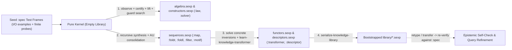
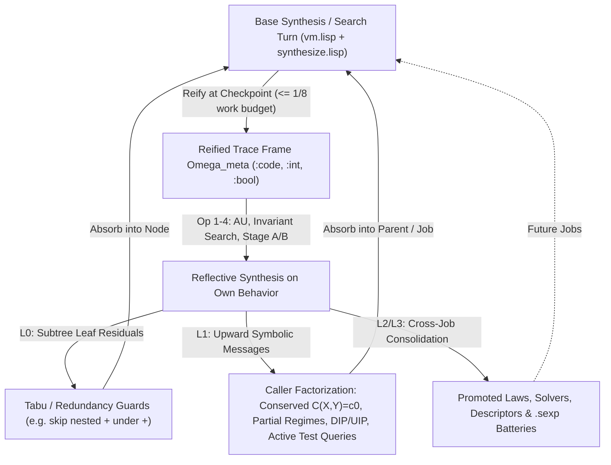

# Bootstrapped `.sexp` Batteries & Lisp-3 Reflective Synthesis

> [!NOTE]
> Grounded in the authoritative Common Lisp kernel on branch `reflective` at commit `7a0d6bf` (`196` kernel tests / `928,751` checks and `40` milestone tests / `186,771` checks green), cross-referencing [plan8.md](file:///home/tlh24/lisploop/plan8.md), [plan9.md](file:///home/tlh24/lisploop/plan9.md), [plan9-audit.md](file:///home/tlh24/lisploop/plan9-audit.md), [prompt4.md](file:///home/tlh24/lisploop/prompt4.md), [architecture2.md](file:///home/tlh24/lisploop/architecture2.md), and `plan7/*.md`, plus live scratch probes run against the current image ([probe-bootstrap.lisp](file:///home/tlh24/.gemini/antigravity-cli/brain/82e4ed73-d369-4112-a990-6f7d7b3803de/scratch/probe-bootstrap.lisp)).

---

## 1. Baseline Calibration: What Already Landed vs. What Remains from Plan 9

Commit `7a0d6bf` already landed the bulk of `P9.1`'s soundness and consolidation fixes (verified in [audit.lisp](file:///home/tlh24/lisploop/tests/audit.lisp#L430-L685)):

- **Already landed:**
  1. Least-fixed-point totality reset ([knowledge.lisp](file:///home/tlh24/lisploop/knowledge.lisp#L499-L534)) + undefined-callee rejection preserving primitives ([ast.lisp](file:///home/tlh24/lisploop/ast.lisp#L723-L733)).
  2. Sound `pointwise-map-decoder-p` gate on persisted `:nogood-schema` positional zipping ([nogoods.lisp](file:///home/tlh24/lisploop/nogoods.lisp#L282-L335), [descriptors.lisp](file:///home/tlh24/lisploop/descriptors.lisp#L78-L103)).
  3. `:relation` member-table exclusion + snapshot-keyed failed-fit memoization ([relations.lisp](file:///home/tlh24/lisploop/relations.lisp#L11-L20), [relations.lisp](file:///home/tlh24/lisploop/relations.lisp#L116-L140)).
  4. Single-call consolidation convergence loop ([consolidate.lisp](file:///home/tlh24/lisploop/consolidate.lisp#L922-L997)).
  5. $O(1)$ `(operator, positions)` propagator dispatch index ([laws.lisp](file:///home/tlh24/lisploop/laws.lisp#L671-L685)) + automatic `*knowledge-library*` consumption ([synthesize.lisp](file:///home/tlh24/lisploop/synthesize.lisp#L192)) + exact metered closures ([vm.lisp](file:///home/tlh24/lisploop/vm.lisp#L87-L98), [plan-exec.md](file:///home/tlh24/lisploop/plan-exec.md)).

- **Remaining true kernel bugs from `plan9.md` / `plan9-audit.md` that should land regardless:**
  1. **Descriptor error-swallowing ([descriptors.lisp](file:///home/tlh24/lisploop/descriptors.lisp#L230-L247)):** Rows where `:expr` errors (`:status :error`) are skipped by `(and (eq status :value) (null val))`, allowing an out-of-bounds descriptor to error on 2/3 rows and still score `:satisfied` (`plan9-audit.md` §8.2). Every guard-selected row must evaluate `:expr` cleanly to `t` for `:satisfied`.
  2. **Incomplete DIP on first-order projections ([nogoods.lisp](file:///home/tlh24/lisploop/nogoods.lisp#L181), [synthesize.lisp](file:///home/tlh24/lisploop/synthesize.lisp#L487)):** `dip-repaired-decompositions` ([nogoods.lisp](file:///home/tlh24/lisploop/nogoods.lisp#L552)) admits `pure-projection-decomposition-p`, but `collect-frame-nogood-clauses` and `node-dip-repairs` still gate on `decomposition-lift-p`, stranding multi-collision first-order projections.
  3. **MDL overwrite in `node-priority` ([synthesize.lisp](file:///home/tlh24/lisploop/synthesize.lisp#L460), [consolidate.lisp](file:///home/tlh24/lisploop/consolidate.lisp#L39-L42)):** A learned `:heuristic` predictor currently *replaces* analytical full-path MDL instead of adding a clamped signed residual $\hat{\Delta}$ around analytical MDL.
  4. **Fresh AST consing in `metric-delta` ([laws.lisp](file:///home/tlh24/lisploop/laws.lisp#L1240)):** Allocating a new `(app operator ...)` node per replay churns the `eq`-keyed `*closures*` cache (`plan9-audit.md` §11.5); a parallel `heuristic-packets` slot on `heuristic-model` also avoids re-running the solver in Stage B.
  5. **Target-duplicating simplification in `solve-equality-symbolically` ([laws.lisp](file:///home/tlh24/lisploop/laws.lisp#L809-L837)):** Needs unsimplified fallback when `simplify-symbolic-expr` duplicates `target-id` (`plan9-audit.md` §8.5).
  6. **Sequence-state retyping gap in `candidate-library-definitions` ([proposals.lisp](file:///home/tlh24/lisploop/proposals.lisp#L47)):** Stripping `(:seq ...)` from `target` prevents instantiating combinators whose state/return type is itself a sequence (`plan9-audit.md` §11.6).

Almost everything else in `plan9.md`—hand-coded charts, bespoke `bootstrap-inverters.lisp` builders, `filter-map-decompositions`, hardcoded descriptor concept tables, and manual Stage A/B branch heuristics—is **incidental host complexity** encoding conserved properties of the DSL or of search trajectories that belong in bootstrapped libraries and reflective synthesis.

---

## 2. Goal 1: Generalizing the VM & Bootstrapping `.sexp` Batteries from Tests

### 2.1 Four Small VM / Kernel Generalizations That Unlock Library Abstraction

While experimenting with [probe-bootstrap.lisp](file:///home/tlh24/.gemini/antigravity-cli/brain/82e4ed73-d369-4112-a990-6f7d7b3803de/scratch/probe-bootstrap.lisp), two structural limitations in the VM/kernel surfaced immediately alongside two clean unification opportunities:

1. **Heterogeneous Product Projections in `:at` ([ast.lisp](file:///home/tlh24/lisploop/ast.lisp#L268-L284), [ast.lisp](file:///home/tlh24/lisploop/ast.lisp#L486)):**
   - *Finding (ran):* `:tuple` constructs arbitrary heterogeneous Cartesian products `(:tuple :int (:seq :int))` or `(:tuple :int :bool (:code ...))`, **yet `:at` rejects heterogeneous tuples** via `homogeneous-tuple-type-p`! That single restriction prevents:
     - Joint multi-position `:cons` solvers `(:position '(0 1))` whose witness has type `(:tuple elem (:seq elem))`,
     - Heterogeneous `component-bindings` ([proposals.lisp](file:///home/tlh24/lisploop/proposals.lisp#L545)),
     - Reified reflective trace records `(node-id : :int, decoder : :code, conflict-p : :bool)`.
   - *Fix (zero new opcodes):* Just as `:code-child` ([ast.lisp](file:///home/tlh24/lisploop/ast.lisp#L505-L507)) carries `(tuple-type parent-type child-type)` as its operator parameter, allow `(op :at (tuple-type tup-type slot-type))` on heterogeneous tuples when the index argument is a literal `i` with `(nth i (rest tup-type)) = slot-type` (checking static index typing in `compute-app-meta` / `expression-type` while keeping `operator-encoded-type` compatible). Products in the VM become true categorical products.

2. **Completing Conditional Propagator Fiber Logic with `:necessity` ([laws.lisp](file:///home/tlh24/lisploop/laws.lisp#L687-L755), [laws.lisp](file:///home/tlh24/lisploop/laws.lisp#L1085-L1131)):**
   - Currently a `:solver` attests two obligations:
     - **`:witness` (sufficiency):** $G(k, c) \implies f(k, W(k, c)) = c$
     - **`:uniqueness` (at-most-one):** $G(k, c) \implies [f(k, z) = c \iff z = W(k, c)]$
   - Adding the dual obligation **`:necessity` (image / solvability guard)**:
     $$f(k, z) = c \implies G(k, c) \qquad (\text{equivalently } \neg G(k, c) \implies \mathrm{Fiber}(k, c) = \varnothing)$$
     completes the Galois connection on fibers:
     - When $G(k, c)$ evaluates to `nil` on a solver with current `:necessity` evidence, `solve-learned-equality` rewrites `(= (f k Z) 'c)` directly to **`'nil` (checked conflict)**. When `:necessity` has `:sampled` evidence (e.g., integer divisibility `(= (* (/ c k) k) c)` on `:*`), it suggests `'nil` on the primary lane while preserving the 3:1 `propagation-fallback`!
     - Pair this with bounded single-unknown finite-set propagation `(member (f k Z) '(c_1 ... c_m))` ($m \le 8$) in `solve-learned-equality`.

3. **Polymorphic Retyping Across All `knowledge-entry` Kinds ([templates.lisp](file:///home/tlh24/lisploop/templates.lisp#L36-L216), [persistence.lisp](file:///home/tlh24/lisploop/persistence.lisp#L89-L157)):**
   - Look at why [batteries.lisp](file:///home/tlh24/lisploop/batteries.lisp) had to invent a custom `(:battery ...)` surface syntax with `sublis` over `?n` / `?a`: `serialize-knowledge-library` ([persistence.lisp](file:///home/tlh24/lisploop/persistence.lisp#L89)) saves concrete typed `knowledge-entry` packets, while `infer-function-template` ([templates.lisp](file:///home/tlh24/lisploop/templates.lisp#L36)) only generalizes `:function` entries!
   - Generalizing `infer-function-template` $\to$ **`instantiate-entry-template`** across `:function`, `:solver`, `:law`, `:descriptor`, `:transformer`, and `:decoder-template`—re-running `certify-solver-entry` / `validate-law` on finite target instantiations (`(:gf p)`, `:bool`) so certificates are *computed, never trusted*—lets batteries be **plain `save-knowledge-library` `.sexp` packets** loaded via `load-knowledge-library`! The bespoke surface parser in [batteries.lisp](file:///home/tlh24/lisploop/batteries.lisp) can then be retired completely.

4. **Rank-Environment Static Totality ([ast.lisp](file:///home/tlh24/lisploop/ast.lisp#L701-L883)):**
   - Generalizing `non-empty-vars` to track `(tail^k X)` length bounds (`1 <= d <= k+1`), `(at (tail^j X) 'r)` bounds, per-slot sum/lexicographic recursion (`merge`), bounded integer descent/ascent (`shift-seq`, `best-shift`), and closed `:code-eval` redexes (`fix-seq`) belongs in the VM's static semantics so bootstrapped recursive functions are certified `provably-total-p` without oracle crutches.

---

### 2.2 What Moves from Host Lisp Source into Bootstrapped `.sexp` Batteries?

> [!IMPORTANT]
> **Empirical Proof-of-Concept (Ran on `7a0d6bf` in [probe-bootstrap.lisp](file:///home/tlh24/.gemini/antigravity-cli/brain/82e4ed73-d369-4112-a990-6f7d7b3803de/scratch/probe-bootstrap.lisp)):**
> 1. **`plan9-audit.md` §4.6's Functorial-Inverter Roadblock Solved:** `plan9-audit.md` noted that anti-unifying unary witnesses `(map Y '(- X0 1))` and `(map Y '(- X0 2))` only yields `(map Y ?code)`, failing to link step operators to element solvers. When posed instead as an ordinary 2-input synthesis frame `(forward-step-code, element-solver-code) -> inverse-step-code`, **`learn-knowledge-transformer` de novo synthesizes the exact homoiconic `:code-subst` + `:code-child` functorial inverter in `52,751` work (`157` body-bits)**—with zero host AST builders!
> 2. **`:cons` Destructuring via Library `:solver`s:** Single-position `:cons` solvers (`:solve-cons-0`, `:solve-cons-1`) already narrow `(= (cons X0 '(20 30)) '(10 20 30))` $\to$ `(= X0 '10)` in `propagate-requirements` (`narrowed = 1`, `fallback = nil`), and with heterogeneous `:at` + `:necessity`, a single joint `:cons` solver at `:position '(0 1)` subsumes `fold-equal-cons` ([requirements.lisp](file:///home/tlh24/lisploop/requirements.lisp#L324-L341))—both spine splitting and `'()` conflict detection!

| Kernel Complexity Today | Host File & LOC | What Stays in Kernel (Minimal Semantics) | What Moves to Bootstrapped `library/*.sexp` |
| :--- | :--- | :--- | :--- |
| **Hand-written batteries** | `batteries.lisp` + `library/*.lisp` (`439` LOC) | `save-knowledge-library` / `load-knowledge-library` + polymorphic `instantiate-entry-template` | Replaced by **synthesized** `.sexp` packets emitted by a bootstrap test curriculum (`make bootstrap`) |
| **Conditional propagators & solver guards** | `library/arithmetic.lisp`, `laws.lisp` | Generic `propagate-requirements`, `solve-learned-equality`, `certify-solver-entry`, `induce-conditional-solvers`, `induce-law-solvers` | `library/algebra.sexp`: field solvers certified on `GF(5)`/`GF(7)`, lifted to `:int`, + synthesized `:int` divisibility guards (`(= (* (/ c k) k) c)`, sharper than hand-written `(not (= k 0))`!) |
| **Constructor / destructor fold rules** | [requirements.lisp](file:///home/tlh24/lisploop/requirements.lisp#L245-L398) (`~155` LOC) | Variadic `:tuple`, lexical `:code-subst` / `:code-apply`, closed evaluation, `:if` branch definedness | `library/constructors.sexp`: `:cons` solvers (`0`, `1`, `'(0 1)` with `:necessity`) & destructor laws `(at (cons h t) 0) = h`, `(tail (cons h t)) = t`, `(length (cons h t)) = (+ 1 (length t))` |
| **Second-order functorial inverters** | [bootstrap-inverters.lisp](file:///home/tlh24/lisploop/bootstrap-inverters.lisp) (`292` LOC) | Generic `:transformer` execution + `induce-law-solvers` (certified involutions & cancellation pairs) | `library/functors.sexp`: synthesized `:transformer` ASTs mapping `(combinator-call, elem-solver) -> lifted-solver` (**retiring `bootstrap-inverters.lisp`!**) |
| **Hardcoded I/O `:descriptor` builders** | [descriptors.lisp](file:///home/tlh24/lisploop/descriptors.lisp#L356-L546) (`~190` LOC) | `evaluate-frame-descriptors`, `score-entry-by-descriptors`, `list-recursion-shape` soundness check | `library/descriptors.sexp`: reusable relational `:descriptor` ASTs discovered by observational/contrastive synthesis over the combinator suite |
| **Combinators, scans, motifs, & metrics** | `library/sequences.lisp`, `scans.lisp`, `sequence-shift.lisp`, `filter-map-decompositions` | `discover-library-abstractions`, `induce-fold-motifs`, `metric-decoders`, multi-hole `:code` product lift | `library/sequences.sexp`, `library/metrics.sexp`: `:map`, `:foldr`, `:foldl`, `:filter`, `:map-adjacent`, `:scan`, `:foldr=:foldl` `:motif`, shift/product/moment metric decoders, comprehension `:decoder-template`s |

### 2.3 Bootstrapping Batteries *Through* First-Class `:spec` Test Entries

As you noted, *"testing is also a way of better knowing what you know."* Right now tests live solely as imperative Common Lisp `deftest` code outside the library. Introducing a declarative knowledge kind **`:spec`** (a serialized `frame` of I/O or relational test rows + optional negative/boundary rows, linked via `(:verifies spec-id entry-id)` edges) serves **three** roles simultaneously:

1. **Zero-Hand-Coding Bootstrap (`bootstrap/` $\to$ `library/*.sexp`):** A standalone bootstrap runner starts with `(make-knowledge-library)` (completely empty!), runs the pure kernel on seed `:spec` tasks (e.g., the 6-task list corpus `copy`, `inc-all`, `double-all`, `sum`, `length`, `product` $\to$ `discover-library-abstractions` $\to$ emergent `:map` and `:foldr`), discovers laws, conditional solvers, functor `:transformer`s, and `:descriptor`s, and writes canonical `.sexp` packets via `save-knowledge-library`.
2. **Evidence Re-Validation Across Retyping & Domain Transfer:** When a polymorphic entry from a `.sexp` battery is instantiated at a new type or domain, its linked `:spec` entries automatically replay on the VM (and run `propose-disambiguating-query` when two candidate generalizations agree on existing rows!), upgrading or refuting conjectures with zero human intervention.
3. **Kernel Regression Gate:** `make test` verifies both that `library/*.sexp` deserializes and passes all invariants, *and* (in a dedicated bootstrap test) that the kernel still regenerates equivalent `.sexp` batteries from scratch within bounded work.

---

## 3. Goal 2: Lisp-3 Reflection & Reentrant Search-Over-Own-Behavior

### 3.1 Why Plan 9 Accumulated Incidental Complexity—and How Reflection Replaces It

In `plan8.md`, `plan9.md`, and `plan9-audit.md`, external human/AI agents repeatedly ran the same meta-loop *by hand*:
1. Run `start-heuristic-synthesis` on a probe,
2. Inspect the execution trace (`explain-synthesis-job`, Stage A quantum trajectories, repeated failed `:relation` fits, redundant nested `(+ base1 (+ base2 Z))` proposals, colliding projections),
3. Notice a conserved pattern or invariant in the *search behavior itself*, and
4. Hand-code a specialized Lisp patch into `synthesize.lisp`, `proposals.lisp`, or `relations.lisp`.

In **3-Lisp** terms, `lisploop` is already *reentrant* (synthesis calls observation search, guard search, and child synthesis on the same VM) and *homoiconic* (`:code` values are zero-copy ASTs), **but it is not yet genuinely *reflective***: the active search state (`agenda`, `ancestor-spine`, `candidate-stream`, `ledger-deltas`, `outcomes`) is locked inside opaque Common Lisp structs (`synthesis-node`, `synthesis-job`, `nogood-clause`) rather than exposed as `frame` data that the synthesizer can run Operation 1–4 on mid-flight!

### 3.2 Three Components of a Clean Reflective Architecture

#### Component 1: Zero-Copy Reification ($\uparrow$) into Standard `frame`s
With heterogeneous `:tuple` projection (§2.1.1), any slice of the kernel's own execution reifies directly into an **ordinary `frame` $\Omega_{\mathrm{meta}}$** with zero new data structures:

- **Branch / Proposal Trace Frame:** Each prepared or closed node contributes a row whose `known` inputs include `(parent-decoder : :code, proposal-decoder : :code, child-inputs-sig : :int, stage-a-prog : :code, residual-bits : :int, delta-work : :int)` and whose target/outcome is `(status : :bool/:int, conflict-clause : :code, scope-sig-repeated-p : :bool)`.
- **Intra-Node Candidate / Rewrite Trace Frame:** During enumeration or Stage A, evaluated candidates form rows `(candidate-ast : :code, bucket-id : :int, metric-work : :int, residual-vector : (:seq :int))`, linked by `pairs` across observationally equivalent candidates!

#### Component 2: Generalized Reentrant Upward & Lateral Messages (Beyond UIP/DIP)
Right now, `nogood-clause` (UIP/DIP) is the *only* upward symbolic channel from a child branch back to its caller—communicating only *"this projection collided on rows $(r_1, r_2)$."* Making `synthesis-message` actionable across **four symmetric message classes** turns the search DAG into a cooperative deductive-inductive network:

1. **Negative / Redundancy Messages (Generalized UIP + Leaf Tabu Residuals):**
   - *Row-collision nogoods (existing UIP):* "Any sibling projection agreeing on $P(X)$ conflicts."
   - *Algebraic / scope-equivalence leaf residuals (new!):* When expanding grandchild $d_2$ under parent $d_1$ (e.g., additive `(+ base2 Z2)` under `(+ base1 Z1)`, or involution `(reverse (reverse Z))`, or re-applying a failed partial chart), reification observes either that `child-scope-signature` is isomorphic or that `d_1(d_2(X, Z))` rewrites under `:associative`/`:involution` laws to a single-step decoder `d_1'(X, Z)` already in the parent's space! It emits a **leaf residual pattern** `(code-match '(+ ?a (+ ?b ?z)) composed-decoder) -> :redundant`, preventing repeated rule applications *without* hand-coding special cases like `decompose.lisp:439`!
2. **Positive Conservation Messages (*Factorizing the Caller's Search Space!*):**
   - Today, if a child branch runs Stage A or observation search and discovers a non-trivial **conserved quantity** $C(X, Y) = c_0$, an **informative feature bucket** $b(X)$ (`(at s 0)`, `(- X1 X2)`), or an **exact sub-regime hit** `(expr, hit-mask)` covering half the rows—and that branch later stalls or conflicts on the remaining rows—**all of that discovered information is thrown away!**
   - With upward `:conserved` messages:
     - Discovering $C(X, Y) = c_0$ propagates up to the caller, which immediately applies `orient-conserved-quantity` / `solve-equality-symbolically` (or attaches $C(X, Y) = c_0$ as a hard fiber filter!), collapsing an exponential search space in one step.
     - Discovered informative feature buckets bubble up to a **job-wide feature pool**, curing the exact pathology in `plan9-audit.md` §4.1 where the root's Stage A yielded `0` buckets while a sibling/child held the exact separator needed by DIP or Path B2 guard pairing!
     - Partial regime hits `(expr, hit-mask)` bubble up to seed piecewise `(if G expr Z)` splits at the caller.
3. **Epistemic / Active Test-Suite Messages (*Propagating Information Quality Backward*):**
   - Generalizing CEGAR ([synthesize.lisp](file:///home/tlh24/lisploop/synthesize.lisp#L1134-L1163)): when a child search finds two non-equivalent small candidates $e_1 \neq e_2$ that agree on all currently active fiber rows (aliasing / under-determined specification), the child runs `propose-disambiguating-query(e_1, e_2)` and sends a symbolic **`:disambiguate x*`** message upward!
   - If the caller holds reserve rows (partial fiber window), an executable parent combinator, or a `:spec` oracle, it evaluates at $x^*$ and pushes the new test row down—literally *synthesizing better test suites mid-search* to sharpen downstream generators!
4. **Tariff / Cost-Geometry Messages:**
   - Reifying the ledger category breakdown per node (`:observation` vs. `:heuristic-metric` vs. `:simplification`) lets the controller see *why* work is being spent (e.g., in `plan9-audit.md` Appendix B, `1` metric check costs `3,334` VM units so `2,000` budget evaluates `0` candidates!) and pace quanta by *information yield per candidate* rather than blind raw work constants.

---

### 3.3 Solving the Hard Part: Clean Scoping & Non-Divergent Absorption ($\downarrow$)

You put your finger on the central design challenge:
> *"It will require some intelligent means of scoping the pattern application, plus the right means of applying the synthesized expressions; the former seems a bit less well defined and will require experimentation / thinking-though."*

#### A. The Four-Level Lexical × Epistemic Scope Lattice
Why do naive reflective rules either under-generalize (mere memo tables) or over-generalize (false pruning / library pollution)? Because **structural scope** (what free constants/decoders a rule depends on) and **epistemic grade** (proved vs. empirical) get conflated! Separating them defines a strict **4-level scope lattice**:

| Level | Scope Container | What Lives Here | Automatic Placement & Promotion Rule | Application / Soundness Contract |
| :--- | :--- | :--- | :--- | :--- |
| **L0: Spine / Subtree** | `synthesis-node` (inherited by descendants) | **Leaf residuals & tabu patterns** (`:relation` member sets of failed ASTs/guards, nested decoder-pair blocks `d1 ∘ d2`) | Placed at L0 whenever the synthesized pattern references the current ancestor decoder spine | Exact dedup if backed by a certified `:law` (`(+ a (+ b z)) = (+ (+ a b) z)`); otherwise **soft priority parking** (3:1 reserve preserved!) |
| **L1: Problem / Episode** | `synthesis-job` (shared across all branches of 1 task; GC'd at job end) | **Task-specific conserved quantities** $C(X,Y)=c_0$, job-pooled Stage A feature buckets, UIP clauses, partial regime hits `(mask, expr)`, active test rows | Placed at L1 whenever the expression mentions task `schema-inputs`, task literals, or holds only on the current root `frame` | **Hard constraint / exact rewrite** if verified across all root `frame` rows; **agenda heuristic / candidate seed** if partial |
| **L2: Conditional Theory** | `*knowledge-library*` gated by `trigger` / `:describes` / `:licensed-by` | Domain metrics, conditional solvers, `:decoder-template`s, contrastive `:descriptor`s, `:motif` transfers, learned M8D residual $\hat{\Delta}$ | **Promoted L1 $\to$ L2 at consolidation** *only* when anti-unified across $\ge 2$ jobs with zero task-specific constants AND positive Levin net utility $\Delta S - \lceil \log_2(1 + W_{\mathrm{fail}} + N) \rceil > 0$; trigger = LGG of frame descriptors! | Retrieved in $O(1)$ via compositional address; uncertified narrowings always retain 3:1 `propagation-fallback` |
| **L3: Universal Battery** | `library/*.sexp` (`:exhaustive` or `:derived` evidence) | Certified algebra & `:cons` solvers, cancellation/involution laws, functor `:transformer`s, proved structural redexes | **Promoted L2 $\to$ L3** when `certify-solver-entry`, exhaustive `validate-law`, or algebraic derivation from certified laws succeeds | Full fallback-free narrowing, symbolic unwinding, and AST normalization |

#### B. Preventing Infinite Meta-Regress & Preserving Unit-Step Resumption
1. **Bounded Depth-1 Reflective Tower (`*reflective-depth*` $\in \{0, 1\}$):**
   Base search runs at `*reflective-depth* = 0`. Reflective synthesis on a reified trace frame $\Omega_{\mathrm{meta}}$ runs with `*reflective-depth* = 1` (which uses existing L2/L3 library rules, AU, and Stage A, **never** spawning a depth-2 meta-meta-trace!).
2. **Metered `staged-work` Quanta (Preserving `check-anytime-resumption`):**
   Reflective synthesis is scheduled as an ordinary agenda action (`(:reflect . scope)`) capped at a fixed fraction (e.g., $\le 1/8$) of cumulative job work and published via `stage-work` / `pay-staged-work` ([synthesize.lisp](file:///home/tlh24/lisploop/synthesize.lisp#L44-L58)). Stepping 1 work unit vs. 97 work units remains bit-for-bit identical!
3. **Where Goals 1 & 2 Meet (Bootstrapping Global Search Laws via Reflection!):**
   During the battery-bootstrap curriculum (`make bootstrap`), running with L1$\to$L3 reflection enabled lets the kernel **discover its own universal search-pruning laws from trace data**! For instance:
   - Observing across 2 additive tasks that `(:heuristic-additive (:heuristic-additive ...))` yields zero new solutions beyond depth 1 $\xrightarrow{\text{AU + law check against `:associative`}}$ induces a **universal L3 decoder-composition law**: *"any associative binary residual decoder $d(x, d(y, z)) = d(d(x, y), z)$ is idempotent under Stage B pullback!"*
   - Observing across `:map` lift conflicts that element collisions refute sibling lifts $\xrightarrow{\text{UIP + `pointwise-map-decoder-p`}}$ exports the general pointwise nogood schema directly into `library/sequences.sexp`!

---

## 4. Suggested Incremental Experimentation Roadmap

1. **Step 0 — Land Remaining Small Soundness Fixes (`Zero-Drift Hygiene`):**
   Fix the 6 concrete bugs listed in §1 (descriptor error verdict, pure-projection DIP collection, additive M8D residual around MDL, zero-alloc `metric-delta` + `heuristic-packets`, `solve-equality-symbolically` fallback, sequence-state retyping) with unit tests in `tests/audit.lisp`.
2. **Step 1 — VM Product & Fiber Completeness + Polymorphic `.sexp` Persistence:**
   Enable heterogeneous `:tuple` `:at` projections in `ast.lisp`/`vm.lisp`/`codec.lisp`, add `:necessity` to `:solver` (`certify-solver-entry` + `solve-learned-equality`), extend rank-environment totality in `ast.lisp`, and generalize `templates.lisp` so standard `save-knowledge-library` `.sexp` packets instantiate polymorphically across all knowledge kinds (retiring `batteries.lisp`'s custom surface reader).
3. **Step 2 — First-Class `:spec` Kind & Self-Bootstrapping `library/*.sexp`:**
   Build `bootstrap/build-batteries.lisp` starting from an empty `knowledge-library` + seed `:spec` test frames to synthesize `algebra.sexp`, `constructors.sexp`, `sequences.sexp`, `functors.sexp`, `descriptors.sexp`, and `metrics.sexp`—then retire `bootstrap-inverters.lisp`, hand-coded `library/*.lisp`, and redundant host fold/descriptor builders once all `196 + 40` tests pass at comparable budgets.
4. **Step 3 — Reified Trace `frame`s, Upward Conservation/Query Messages, & L0–L3 Reflective Scoping:**
   Implement depth-1 `reify-search-frame`, upward `:conserved` / `:regime-hit` / `:disambiguate` messages, and L0–L3 scoped absorption (starting with L0 nested-decoder redundancy residuals and L1 job-pooled conservation/features, then feeding universal L3 search laws back into Step 2's bootstrap!).
