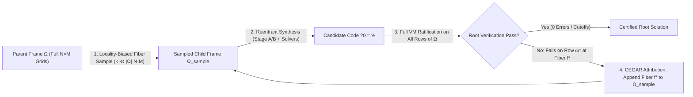

# `lisploop` --- Plan 7H: List Comprehensions, Reentrant Meta-Programming for Multidimensional Spaces, Sampled-Fiber Attribution, and Linear-Algebraic Inverses

> **Status**: Proposed (`plan7-higher-order.md`). Follows the completion and audit of [plan7-recursion.md](plan7-recursion.md) (Milestones R1--R6) and [plan7-library.md](plan7-library.md) (Milestones L1--L4), in strict alignment with [plan7.md](plan7.md), [prompt4.md](prompt4.md), and [architecture.md](architecture.md).

---

## 0. Motivating Prompts & Architectural Dialogue

> **Prompt 1:**
> *Q: does the pipeline, as currently implemented, support things like list comprehensions in python? What about more typical for-loops over multidimensional arrays? Can we support reductions and expansions of multidimensional arrays (e.g. einstein summation and notation..). If not, would this be a heavy add to the kernel?*
>
> **Prompt 2:**
> *Hmm. I'm all in favor of fixing the limitations of python-style list comprehensions, but I'd like to propose a different perspective on the extension to multidimensional arrays, reductions, and expansions (inner, outer product for example). These happen to be quite simple patterns of application or higher-level functions, ones that construct new spaces that are also of a relatively simple parametric form from the origin spaces. Even relatively intricate functions like discriminant are defined by low-complexity recursive rules, even or especially in light of locality biases (coordinated move left, move right, move one diagonal & sum, etc). One way of treating the problem is through top-down templating or meta-programming, which could be accomplished through reentrancy. This was my original design intention, though it becomes complicated when sharing frames and fibers between calls; I'm not sure how human cognition accomplishes this. But, in general, reentrancy 'flattens' recursive datastructures like nested frames/fibers, and allows flexible shifting levels of abstraction, which combats ballooning complexity in the VM, which has to handle each level of abstraction with dedicated machinery.*
> *A - Does the plan above support templated locality-biased meta-programming?*
> *B - What are our options, and what do you think, about a reentrant approach? Attribution becomes a complex problem, I suspect; from my limited introspection, human cognition treats this approximately, as opposed to completely (only samples of fibers or frames, to limit memory / compute expansion before full ratification.)*
>
> *Secondly, getting back more practical matters, the inverses to linear algebra operators are themselves linear algebra operators. For example, to determine an offset for a shift operation, it usually suffices to do a cross-correlation or convolution. Inverses, both closed-form and heuristic, play an important role in this synthesis library (though they have not been tested extensively). Does the plan support this?*

---

## 1. Architectural Synthesis: Four Core Questions

### 1.1. Python-Style List Comprehensions: Current Coverage & Specific Gaps

| Comprehension Form | Python Syntax | `lisploop` Status | Kernel Mechanism / Gap |
| :--- | :--- | :--- | :--- |
| **Unary Map** | `[f(x) for x in xs]` | **Supported (R3--R6)** | `lift-frame` + `:map` (`:fa`) or R4 structural recursion |
| **Contextual / Outer-Capture Map** | `[f(x, k) for x in xs]` or `[x + len(xs) for x in xs]` | **Supported (R3, R6)** | `bindings` + `:code-subst` (`compose-lifted-model`) + DIP context repair (`propose-dip-context-bindings`) |
| **Conditional-Value Map** | `[f(x) if p(x) else g(x) for x in xs]` | **Supported (R3 + M8)** | `lift-frame` $\to$ Stage B conditional split inside child `:code` frame |
| **Filter / Filter-Map** | `[f(x) for x in xs if p(x)]` | **VM & R5 Ready; Pullback Gap** | Valid in `ast.lisp`/`vm.lisp` and passes `analyze-function-body-totality`, but `lift-frame` assumes 1-to-1 `:cons` alignment (`(= (cons h t) '(v0 ...))`) rather than subsequence alignment under a guard `?p(x)` |
| **Lockstep Multi-Sequence (`zip`)** | `[f(x, y) for x, y in zip(xs, ys)]` | **Gap in Totality & Lift** | `analyze-function-body-totality` and `lift-inductive-sequence-context` currently track a single decreasing sequence parameter `Xi` rather than lockstep `(tail X0), (tail X1)` |
| **Nested / Cartesian Comprehension** | `[[f(x, y) for y in ys] for x in xs]` | **Blocked by 1-Level Gate & Monomorphism** | `function-definition` is monomorphic (`(:seq :int)`) and `node-may-expand-p` suppresses library expansion inside `:lift-p t` nodes |

---

### 1.2. Part A: Templated, Locality-Biased Meta-Programming for Multidimensional Spaces

Rather than adding dedicated multidimensional array types, tensor opcodes, or axis-specific loops to `vm.lisp`, multidimensional reductions and expansions (inner product, outer product, matrix multiplication, `einsum`, 2D stencils, and recursive determinant/discriminant) are treated as **higher-order space-constructing templates (functors)** over `(:seq ...)` and `(:code ...)`:

1. **Higher-Order Templates as Parametric Space Constructors**:
   - Every multidimensional operator constructs a target space from origin spaces via two small `:code` parameters:
     - A **coordinate / neighborhood projection rule** $\pi \in \texttt{(:code ...)}$ (which selects or shifts slices/elements from the origin spaces: e.g., row/column selection, coordinated move-left `(tail xs)`, move-right `(cons '0 xs)`, diagonal `(tail (at grid '0))`, or $(i, j)$-minor deletion).
     - A **local combination / contraction rule** $\phi \in \texttt{(:code ...)}$ (e.g., scalar product `(* X0 X1)`, fused multiply-add `(+ (* X0 X1) X2)`, or alternating-sign step `(- (* X0 X1) X2)`).
   - Because `:code` values are first-class S-expressions with explicit variable scopes `(:code inputs sort)` and the VM already provides `:code-match`, `:code-bind`, `:code-apply`, `:code-subst`, and `:code-eval`, a template can both **specialize syntax top-down** (`:code-subst`) and **re-enter execution** (`:code-eval`).

2. **Worked Examples of Low-Complexity Recursive & Functorial Rules**:
   - **Inner Product ($\langle u, v \rangle = \sum_i u_i v_i$)**: Lockstep fold `:fold2` (`((0 . (:seq :int)) (1 . (:seq :int)) (2 . :int) (3 . (:code ((0 . :int) (1 . :int) (2 . :int)) :int))) -> :int`):
     ```lisp
     ;; Combinator body (:fold2):
     (if (= X0 '()) X2
         (if (= X1 '()) X2
             (code-eval X3 (at X0 '0) (at X1 '0) (:fold2 (tail X0) (tail X1) X2 X3))))
     ;; Inner product call:
     (:fold2 X0 X1 '0 '(+ (* X0 X1) X2))
     ```
   - **Outer Product ($C_{ij} = f(u_i, v_j)$, e.g. $u_i \cdot v_j$)**: Reentrant composition of `:map` over `(:seq :int) -> (:seq (:seq :int))` with `:code-subst` outer-variable capture (zero new combinators once `:map` is polymorphic):
     ```lisp
     ;; Outer :map iterates u_i (bound to inner X1 via :code-subst);
     ;; Inner :map iterates v_j (bound to X0) and evaluates (* X1 X0):
     (:map_seq X0 (code-subst '(:map X1 (code-subst '(* X1 X0) (tuple 'X0 X0)))
                              (tuple 'X0 X1)))
     ```
   - **Matrix-Vector & Matrix-Matrix Contraction / `einsum` ($C_{ik} = \sum_j A_{ij} B_{jk}$)**:
     - Matrix-vector $(Av)_i = \langle A_{i,\cdot}, v \rangle$ is simply `:map` of `:dot` over rows of $A$ with `v` captured via `:code-subst`:
       ```lisp
       (:map A (code-subst '(:dot X0 X1) (tuple 'X0 v)))
       ```
     - Matrix-matrix $C_{ik} = \sum_j A_{ij} B_{jk}$ is outer-product template over rows of $A$ and columns of $B^T$ (`(:transpose B)` = `(:map_col B)`), contracting along $j$ via `:dot`.
   - **Coordinated Locality Stencils & Discriminant / Determinant**:
     - A $2 \times 2$ determinant $\det \begin{pmatrix} a & b \\ c & d \end{pmatrix} = ad - bc$ and a $1\text{D}/2\text{D}$ quadratic discriminant $\Delta = b^2 - 4ac$ or local stencil are defined by **coordinated relative moves**:
       - Move right in row: `(tail row)`
       - Move down in grid: `(tail grid)`
       - Move along main diagonal: `(cons (at (at grid '0) '0) (:diag (tail (:map (tail grid) '(tail X0)))))`
       - Minor submatrix $\text{minor}(A, 0, j)$ (drop row 0, drop column $j$): `(:map (tail A) (code-subst '(:drop-at X0 X1) (tuple 'X0 j)))`
       - Recursive $N \times N$ determinant (Laplace expansion along row 0):
         $$\det(A) = \begin{cases} 1 & \text{if } A = \texttt{'()} \\ \sum_{j} (-1)^j A_{0,j} \det(\text{minor}(A, 0, j)) & \text{otherwise.} \end{cases}$$
     - Under `lisploop`'s description-length metric $S$ and the M6/M7 **3:1 locality-to-canonical reserve schedule**, coordinated local moves (`(at X0 '0)`, `(tail X0)`, `(+ i '1)`, `(- i '1)`) cost only a few bits and are enumerated first, giving a natural locality bias without baking grid heuristics into the VM.

---

### 1.3. Part B: Reentrancy, Frame Flattening, and Approximate Attribution (Sampled-Fiber CEGAR)

#### Why Reentrancy Combats VM Complexity
In a non-reentrant synthesizer, every level of data nesting (1D lists, 2D grids, 3D tensors, higher-order combinators) demands its own specialized representation, unroller, and solver. In `lisploop`, **reentrancy flattens levels of abstraction**:
1. **In `vm.lisp`**: Calling a named function or `:code-eval` pushes `(:call-exit saved-env ...)` onto the single flat `evaluation-tasks` stack and rebinds positional variables `X0, X1, ...`. A 3-level nested `:map`/`:fold` over a 2D array executes on the exact same 1-level task stack as `(+ X0 '1)`.
2. **In `synthesize.lisp`**: Pulling back through a higher-order `:code` hole via `lift-frame` turns a second-order synthesis problem (`find a function F : sigma -> tau`) into a **flat first-order `frame`** on the same `synthesis-job` agenda. When a lifted `:code` node is itself allowed to expand reentrantly via `library-expander` or `heuristic-expander`, a 2D or 3D problem flattens into a chain of ordinary 1D/scalar child frames.

#### The Attribution Problem Under Full Unfolding
When reentrant templates nest (e.g., an outer `:map` over $M$ rows lifting into an inner `:map` over $N$ columns, or a stencil/reduction calling `?0` $K$ times per example):
- **Combinatorial Frame Expansion**: Unfolding all occurrences across $|\Omega|$ parent rows creates $|\Omega| \cdot M \cdot N$ child rows. Pairwise fiber inference (`infer-fibers`, `conserved-quantity-frame`) and Stage A observation scale superlinearly in the number of lifted rows.
- **Credit-Assignment Ambiguity Across Coupled Calls**: When multiple reentrant calls to `?0` feed into a non-injective aggregator (like `:+` in a 2D reduction or Laplace expansion), an error on a full matrix does not immediately pinpoint which local call to `?0` was responsible unless intermediate states are sampled or anchored.

#### The Cognitive Solution: Sampled-Fiber Sketch $\to$ Full VM Ratification (CEGAR)
Human mathematical problem-solving does not simultaneously track all $N^2$ entries of ten $8 \times 8$ matrices when inferring a rule: it **inspects a small sample of local fibers** (e.g. a $1 \times 1$ base case, a $2 \times 2$ block, and one boundary/interior transition) to form a low-complexity hypothesis, and then **ratifies** that hypothesis against the full dataset, adding a new fiber only when a counterexample is found.

Our architecture already separates **child hypothesis generation** (`lift-frame` + Stage A/B) from **root verification** (`synthesis-verification-step` in `synthesize.lisp:1390-1420`), making **Sampled-Fiber Counterexample-Guided Abstraction Refinement (CEGAR)** completely sound:



1. **Locality-Biased Fiber Sampling in `lift-frame` (`:max-lifted-rows`)**:
   - When `lift-frame` unfolds a template that produces more than `:max-lifted-rows` (default e.g. `16` when sampling is enabled), it selects a **locality-biased stratified sample** of lifted rows:
     - Priority 1 (*Base / Smallest Fibers*): Lifted occurrences from the shortest parent inputs ($1 \times 1$, $2 \times 2$) where prefix-closure and congruence closure are tightest.
     - Priority 2 (*Co-Local Neighborhoods*): Adjacent occurrences $(\omega, 0), (\omega, 1)$ from the same parent row $\omega$ so local recurrence/stencil relations are preserved.
     - Priority 3 (*1-in-4 Canonical Reserve*): Every fourth slot samples a distinct parent row/value bucket across $\Omega$ to prevent overfitting to a degenerate row (e.g. all zeros).
2. **Sound Deductive Refutation on Sampled Fibers**:
   - Because any valid `:code` filler `?0` must satisfy *every* fiber, a conflict (`frame-conflict-p`) or UIP `nogood-clause` on $\Omega_{\text{sample}}$ is **100% sound for the full frame $\Omega$**! Bad decompositions are refuted in $O(|\Omega_{\text{sample}}|)$ work without ever unfolding the remaining fibers.
3. **Reentrant DAG Sharing via Quotient Canonicalization**:
   - Sampled child frames are canonicalized via `quotient-values` and interned in `synthesis-job-scope-cache`. If two branches of a reentrant search (or two axes of a symmetric tensor) project onto isomorphic local subproblems, they share a single `synthesis-node` and broadcast candidates to all `followers`.
4. **Counterexample-Guided Attribution (`refine-sampled-lift-from-counterexample`)**:
   - When a candidate `'e` succeeds on $\Omega_{\text{sample}}$ and is enqueued for root verification, `synthesis-verification-step` runs the composed program on **all rows of the root frame $\Omega$**.
   - If root verification fails on parent row $\omega^*$, the verifier extracts the specific lifted fiber $(\omega^*, \text{call}^*)$ where `'e` violated the pulled-back requirement, appends that fiber to the child node's frame, invalidates `'e`, and resumes the child node—achieving exact attribution while paying only for the fibers actually needed to disambiguate the rule.

---

### 1.4. Part C: Closed-Form, Functorial, and Heuristic Inverses for Linear Algebra Operators

Linear algebra operators have the special property that their inverses (and pseudo-inverses / parameter estimators) are **themselves linear or bilinear operators in the same language**:
- **Closed-Form / Adjoint Inverses**:
  - Elementwise affine map $Y = a X + b \Longleftrightarrow X = (Y - b) / a$.
  - Transpose $(A^T)^T = A$.
  - Circular/bounded shift $Y_i = X_{(i - \delta) \bmod N} \Longleftrightarrow X_i = Y_{(i + \delta) \bmod N}$ (the inverse of shifting by $+\delta$ is shifting by $-\delta$).
  - $2 \times 2$ linear system / matrix inverse over $\text{GF}(p)$ or $\mathbb{Z}$ (scaled adjugate $\text{adj}(A) = \begin{pmatrix} d & -b \\ -c & a \end{pmatrix}$ divided by $\det(A) = ad - bc$).
- **Heuristic / Correlational Inverses (Parameter Estimation)**:
  - Given $Y = \text{shift}(X, \delta)$ with unknown offset $\delta$, how do we invert for $\delta$ (argument position `1`)?
  - **Cross-Correlation Peak**: $\hat{\delta} = \arg\max_{\delta \in \Delta} \sum_i X_{(i - \delta)} Y_i$ (a linear inner product at each candidate lag $\delta$!).
  - **First-Moment / Center-of-Mass Estimator**: For a localized pulse or non-negative signal, $\hat{\delta} = (\sum_i i \cdot Y_i - \sum_i i \cdot X_i) / \sum_i X_i$, or for an additive shift $Y_i = X_i + \delta$, $\hat{\delta} = (\sum_i Y_i - \sum_i X_i) / N$.

#### How `lisploop`'s Dual-Grade Solver & Functor Architecture Supports Both
In `laws.lisp` (`propagate-requirements`, `register-knowledge-solver`, `induce-functorial-solvers`), solvers already operate at two distinct epistemic grades:

| Grade | Library Status | Effect in `propagate-requirements` | Linear-Algebraic Role |
| :--- | :--- | :--- | :--- |
| **Certified / Closed-Form** | `:validated` (`:certified-p t`, `:unique-p t`) | **Replaces** pulled-back requirement (`propagation-narrowed`); no fallback branch needed | Exact elementwise inverses (`:map/invert-+-0`), transpose involution `(:transpose Y)`, known-offset shift adjoint `(:shift Y (- '0 delta))`, invertible $\text{GF}(p)$ matrix solve |
| **Heuristic / Tentative** | `:conjecture` (`:certified-p nil` or `:unique-p nil`) | **Narrows tentatively** (`propagation-suggested`) while **retaining the un-narrowed frame in `propagation-fallback`** (`:fallback-p t`) | Cross-correlation lag estimator $\hat{\delta} = \text{argmax-corr}(X, Y)$, center-of-mass shift estimator, integer division / pseudo-inverse |

Because tentative propagation in `prepare-synthesis-node` (`synthesize.lisp:1095-1155`) automatically spawns a fallback sibling whenever `propagation-fallback` is non-nil:
- When a heuristic inverse (such as cross-correlation or moment-difference) correctly estimates $\hat{\delta}$ on the observed rows, the narrowed child frame reduces to `(= Z 'hat_delta)` (`0` residual bits), and Stage A solves the subproblem in **one step** and verifies it at the root.
- Even if boundary clipping, aliasing, or zero-sum inputs cause the heuristic inverse to mis-estimate $\hat{\delta}$ on some row, the retained `propagation-fallback` node preserves 100% search completeness and never falsely refutes the branch.

---

## 2. Concrete Implementation Plan (`H1` -- `H4`)

### Phase 1 (Milestone H1): Comprehension Completeness & Polymorphic Combinator Retyping
**Files**: `ast.lisp`, `requirements.lisp`, `frame.lisp`, `synthesize.lisp`, `package.lisp`

1. **Polymorphic / Retyped Instantiation of Higher-Order Combinators (`retype-function-definition` in `ast.lisp` / `synthesize.lisp`)**:
   - Mirroring `retype-law` (`laws.lisp`), implement `retype-function-definition (def new-elem-types &key target-name register-p)`:
     - Given a learned combinator like `:map` (`((0 . (:seq :int)) (1 . (:code ((0 . :int)) :int))) -> (:seq :int)`) or `:foldr` (`((0 . (:seq :int)) (1 . :int) (2 . (:code ((0 . :int) (1 . :int)) :int))) -> :int`), infer its parametric type slots (sequence element type $\alpha$, output/accumulator type $\beta$) and instantiate a type-checked definition for any concrete types $(\alpha', \beta')$ present in the current `frame` (such as $\alpha' = \texttt{(:seq :int)}$ for 2D grids).
   - In `library-decompositions` (`synthesize.lisp`), automatically retype registered higher-order library combinators when the parent frame's sequence inputs or target have nested sequence/tuple types `(:seq (:seq :int))` or `(:gf p)`.

2. **Sub-Sequence Alignment in `lift-frame` for Filtering Comprehensions (`[f(x) for x in xs if p(x)]` in `requirements.lisp`)**:
   - Extend `analyze-function-body-totality` and `lift-inductive-sequence-context` so de novo R4/R6 synthesis and `discover-library-abstractions` cleanly abstract `:filter` (`((0 . (:seq tau)) (1 . (:code ((0 . tau)) :bool))) -> (:seq tau)`):
     ```lisp
     (if (= X0 '()) '()
         (if (code-eval X1 (at X0 '0))
             (cons (at X0 '0) (:filter (tail X0) X1))
             (:filter (tail X0) X1)))
     ```
   - In `lift-frame` (`requirements.lisp`), when unfolding a `:filter` call `(= (:filter '(x0 x1 ... xn-1) ?pred) '(y0 ... ym-1))` where `?pred` has return sort `:bool`:
     - If `(y0 ... ym-1)` is not a subsequence of `(x0 ... xn-1)`, immediately return an unsatisfiable `:incompatible-rows` conflict (`'nil`).
     - When every element $x_i$ has a unique match status in $y$ (e.g., $x_i \notin y \implies \texttt{(= (?pred 'x\_i) 'nil)}$, and when $y$ is a subsequence with unique occurrences, $x_i \in y \implies \texttt{(= (?pred 'x\_i) 't)}$), emit the per-element Boolean requirements `(= Z 't)` / `(= Z 'nil)` directly into the lifted child frame!

3. **Lockstep Multi-Sequence Structural Recursion (`zip-with` / `dot-product` in `ast.lisp` & `synthesize.lisp`)**:
   - Generalize `analyze-function-body-totality` (`ast.lisp`) so a recursive call `(:fa (tail X0) (tail X1) ...)` is certified total when at least one guarded sequence parameter `Xi` decreases via `(tail Xi)` on every recursive call while other sequence parameters are either unchanged or also guarded by `(= Xj '())` and decreased via `(tail Xj)`.
   - In `lift-inductive-sequence-context` (`synthesize.lisp`), when a frame has two sequence inputs `X0, X1` of matching lengths and the guard checks emptiness, lift `(at X0 '0)`, `(at X1 '0)`, and `(:self (tail X0) (tail X1) ...)` into the child bindings.

---

### Phase 2 (Milestone H2): Reentrant Multi-Axis Lifting & Locality-Biased Stencil / `einsum` Templates
**Files**: `ast.lisp`, `factor.lisp`, `synthesize.lisp`

1. **Reentrant Multi-Level Library Expansion (`node-may-expand-p`, `library-decompositions`, `compose-lifted-model` in `synthesize.lisp` & `requirements.lisp`)**:
   - Relax `node-may-expand-p` (`synthesize.lisp:360-366`) so a `:lift-p t` node **may** expand further when `( < (node-depth node) (synthesis-job-max-depth job) )` and either:
     - Its child target sort `(code-sort child-type)` is still a composite/sequence type `(:seq ...)`, **or**
     - Its child inputs still contain sequence parameters `(:seq ...)` (as in `matrix-vector` or `einsum` where the outer `:map` peels rows $A_{i,\cdot} : \texttt{(:seq :int)}$ and the inner combinator `:foldr` / `:dot` reduces each row to `:int`).
   - Verify that `compose-lifted-model` (`requirements.lisp:1000-1020`) composes nested `:code-subst` expressions cleanly across multiple `:lift-p t` ancestor nodes so outer variables captured at depth 1 and depth 2 are properly reified into `:code` ASTs.

2. **Locality-Biased Coordinate & Neighborhood Templates (`factor.lisp`, `synthesize.lisp`)**:
   - Add a lightweight **locality-biased neighborhood generator** for sequence and 2D grid frames (`propose-locality-stencil-bindings` in `synthesize.lisp`):
     - On 1D sequences `xs : (:seq tau)`: local relative shifts `(at xs '0)` (current), `(tail xs)` (move right $+1$), `(cons d xs)` (move left $-1$ with boundary default `d`).
     - On 2D grids `G : (:seq (:seq tau))`: row head `(at G '0)`, row tail `(tail G)` (move down $+1$), column tail `(:map G '(tail X0))` (move right $+1$), diagonal step `(tail (:map G '(tail X0)))` (move diagonal $(+1, +1)$), and $(0, j)$-minor projection.
   - Order candidate stencil bindings by description length $S$ with the 3:1 locality-to-canonical reserve schedule so coordinated local shifts are tested before non-local index expressions.

---

### Phase 3 (Milestone H3): Sampled-Fiber Attribution & CEGAR Refinement
**Files**: `requirements.lisp`, `frame.lisp`, `synthesize.lisp`, `package.lisp`

1. **Bounded Locality-Biased Fiber Sampling in `lift-frame` (`requirements.lisp`)**:
   - Add `:max-lifted-rows` (default `nil` for exact full lifting, or an integer cap such as `12` or `16` for reentrant/multidimensional lifts) and `:sample-strategy` (`:locality-reserve`) to `lift-frame`:
     - When unfolding produces $L > \texttt{max-lifted-rows}$ constrained child rows, `sample-lifted-rows` selects `max-lifted-rows` rows deterministically using the 3:1 locality-to-canonical reserve:
       1. All lifted rows from the shortest non-empty parent sequence/grid rows (base $1 \times 1$ and $2 \times 2$ structures).
       2. Adjacent fiber pairs $(\omega, j), (\omega, j+1)$ within the same parent row (preserving local transition structure).
       3. Every 4th slot reserved for the next unseen parent row $\omega'$ or distinct `row-known` bucket.
     - Attach the remaining unsampled lifted rows to `frame-metadata` / `node-preparation` (`lifted-reserve-rows`) so zero unfolding work is wasted if refinement is needed later.

2. **Quotient-Canonicalized Reentrant Subproblem Sharing (`synthesize.lisp`)**:
   - In `node-scope-signature` (`synthesize.lisp`), canonicalize lifted child frames up to `row-known` + `row-requirement` ordering so reentrant branches that project onto identical sampled fiber sets hit `synthesis-job-scope-cache` (`:reused-from`).

3. **Counterexample-Guided Fiber Attribution (`refine-node-from-verification-failure` in `synthesize.lisp`)**:
   - In `synthesis-verification-step` (`synthesize.lisp:1390-1420`):
     - When a candidate expression composed from a sampled `:lift-p t` node passes on the sampled child frame $\Omega_{\text{sample}}$ but **fails root verification** on parent row $\omega^*$:
     - Instead of discarding the node or leaving $\Omega_{\text{sample}}$ incomplete, look up the unsampled lifted rows belonging to parent key $\omega^*$ in `lifted-reserve-rows`, append the first refuting fiber $(\omega^*, \text{call}^*)$ to the child node's `frame`, reset the child node's Stage A/search cursor to incorporate the new row constraint, and record a `:cegar-refinement` message on the job!

---

### Phase 4 (Milestone H4): Closed-Form, Functorial, and Heuristic Linear-Algebra Inverses
**Files**: `laws.lisp`, `frame.lisp`, `synthesize.lisp`, `package.lisp`

1. **Functorial Inversion for Coordinate / Shift / Transpose Combinators (`laws.lisp`)**:
   - Extend `induce-functorial-solvers` (`laws.lisp:1380-1478`) beyond unary elementwise `:map` to recognize:
     - **Involution / Permutation combinators (`:transpose`, `:reverse`)**: When a function $F$ satisfies the validated involution law `(= (F (F X0)) X0)` in `*knowledge-library*`, automatically induce and register the certified unary `:solver` witness `(F X0)` (`:inverts F :unary`, `:certified-p t`).
     - **Parameterized Shift / Affine Combinators (`(:shift xs delta)` / `(:scale-add xs a b)`)**: When a binary function $F(X_0, \delta)$ satisfies a group-action law `(= (F (F X0 X1) (- '0 X1)) X0)`, automatically induce the position-`0` certified `:solver` witness `(F X1 (- '0 X0))` (inverting a shift by $+\delta$ via a shift by $-\delta$).

2. **Heuristic Linear-Algebraic Parameter Solvers (`:certified-p nil` Cross-Correlation & Moment Estimators in `laws.lisp`)**:
   - Support multi-argument parameter `:solver` entries at `:position 1` (estimating parameter $\delta$ in `(= (F 'x delta) 'y)` from known sequence pair `(x, y)`):
     - **Moment / Conserved-Sum Difference Solver**: Estimates an additive or localized shift parameter $\hat{\delta}$ from `(- (:sum Y) (:sum X))` or `(/ (- (:weighted-sum Y) (:weighted-sum X)) (:sum X))`.
     - **Cross-Correlation Lag Estimator (`:argmax-corr`)**: Evaluates inner products $\langle \text{shift}(X, \delta), Y \rangle$ across local candidate lags $\delta \in \{-k, \dots, k\}$ and returns the lag $\hat{\delta}$ maximizing correlation.
   - Register these estimators in `*knowledge-library*` with `:certified-p nil` (`:status :conjecture`).
   - Verify in `propagate-requirements` (`laws.lisp:971-1010`) and `prepare-synthesis-node` (`synthesize.lisp`) that:
     - On clean shift/linear tasks, the heuristic `:solver` narrows the child requirement to `(= delta 'hat_delta)` (`propagation-suggested = 1`), solving the unknown offset in 1 step.
     - On boundary-clipped or noisy tasks where $\hat{\delta}$ is off by 1 on a single row, `propagation-fallback` retains the un-narrowed child frame so the exact offset is still synthesized and verified without loss of completeness.

---

## 3. Milestones & Verification Matrix (`tests/higher-order.lisp`)

We will add a dedicated test module `tests/higher-order.lisp` (wired into `tests/run.lisp` under `"higher-order"` and milestone aliases `"h1"`, `"h2"`, `"h3"`, `"h4"`):

| Milestone | Scope | Concrete Checks & Controls |
| :--- | :--- | :--- |
| **H1: Comprehensions & Polymorphic Retyping** | `retype-function-definition`, `:filter` subsequence `lift-frame`, lockstep 2-sequence recursion (`:zip-with` / `:fold2`) | 1. Synthesize filtering comprehension `[x for x in xs if (< '0 x)]` and `[(* x '2) for x in xs if (< '0 x)]` both de novo and via `lift-frame` through `:filter` (`residual-size = 0`, `provably-total-p = t`).<br>2. Synthesize lockstep `zip-add` (`[x + y for x, y in zip(xs, ys)]`) and `dot-product` ($\sum_i x_i y_i$) via 2-sequence structural recursion and abstract `:fold2` via R5.<br>3. Retype learned 1D `:map` (`(:seq :int)`) to 2D `(:seq (:seq :int))` via `retype-function-definition` and verify type-checking and VM execution. |
| **H2: Reentrant Multi-Axis `einsum` & Locality Stencils** | Reentrant multi-level `lift-frame`, nested `:code-subst` composition, locality-biased stencil proposals | 1. **Outer product** $C_{ij} = u_i \cdot v_j$: 2-level reentrant lift through `:map` + `:code-subst` synthesizes the exact 2D generator from I/O examples.<br>2. **Matrix-vector & `einsum` contraction** $(Av)_i = \sum_j A_{ij} v_j$ and $C_{ik} = \sum_j A_{ij} B_{jk}$: outer `:map` lifts into inner `:dot` / `:fold2` and synthesizes the exact contraction.<br>3. **Locality-biased determinant / discriminant & 1D/2D stencil**: synthesize $2 \times 2$ determinant $ad - bc$, 1D local convolution $y_i = x_i + x_{i+1}$, and recursive Laplace determinant expansion using coordinated local moves (`(at X0 '0)`, `(tail X0)`). |
| **H3: Sampled-Fiber Attribution & CEGAR** | Bounded fiber sampling in `lift-frame` (`:max-lifted-rows`), quotient `scope-cache` sharing, root counterexample fiber refinement | 1. **Sampled 2D lift efficiency**: on an $N \times M$ 2D grid task (36 total fibers), lifting with `:max-lifted-rows 6` synthesizes the exact element rule in strictly less work $W$ than full 36-fiber unfolding while passing 100% root verification.<br>2. **Soundness of sampled nogoods**: a symmetry conflict on the 6-fiber sample immediately refutes an invalid map hypothesis without unfolding the remaining 30 fibers.<br>3. **CEGAR attribution**: plant a piecewise 2D rule where an initial 4-fiber sample admits a decoy expression `'e_decoy` that fails on parent row $\omega_3$; verify that `synthesis-verification-step` catches the failure on $\omega_3$, appends the refuting fiber from $\omega_3$ to the child frame (`:cegar-refinement`), and converges to the true rule `'e_true`. |
| **H4: Closed-Form, Functorial & Heuristic Linear-Algebra Inverses** | Involution/group-action functorial solvers, `:certified-p nil` cross-correlation & moment-difference parameter solvers, `propagation-fallback` safety | 1. **Closed-form & functorial adjoints**: validate involution law `(= (:transpose (:transpose X0)) X0)` and shift action law `(= (:shift (:shift X0 X1) (- '0 X1)) X0)` $\to$ verify `induce-functorial-solvers` automatically registers certified solvers that invert `(= (:transpose X0) Y)` and `(= (:shift X0 '2) Y)`.<br>2. **Heuristic cross-correlation shift inverse**: register `:argmax-corr` as a `:position 1`, `:certified-p nil` `:solver` for `:shift`; verify that pulling back `(= (:shift '(0 10 30 0 0) Z) '(0 0 10 30 0))` tentatively narrows `Z` to `(= Z '1)` (`propagation-suggested = 1`) and solves the shift offset in 1 step.<br>3. **Fallback completeness control**: on a boundary-clipped shift example where the heuristic estimator suggests `Z = 2` on one row while the true shift is `Z = 1`, verify that `propagation-fallback` preserves the un-narrowed child frame and still recovers the exact solution `Z = 1`. |

---

## 4. Implementation Notes (H1–H4)

### 4.1 Milestone H1: Polymorphic Retyping, `:filter` Subsequence Alignment, and Lockstep Recursion
- **Polymorphic Combinator Instantiation (`laws.lisp`, `ast.lisp`, `synthesize.lisp`)**:
  - Implemented `retype-function-definition` (`laws.lisp`) to clone and retype registered higher-order combinators (`:map`, `:foldr`, `:filter`) from their base element type (e.g., `:int`) to arbitrary target element types $\tau$ (including nested sequences `(:seq :int)`, finite fields `(:gf p)`, and tuples `(:tuple ...)`) as well as heterogeneous bifunctor signatures $(\alpha, \beta)$ via `:return-element-type` (e.g., `:map` from `(:seq (:seq :int))` to `(:seq :int)` or `:foldr` from `(:seq (:seq :int))` with `:int` accumulator to `:int`).
  - Added `*auto-retyped-functions*` (`ast.lisp`, cleared by `clear-function-definitions`) so `candidate-library-definitions` (`synthesize.lisp`) automatically instantiates matching combinators when a frame's input/output sequence element types differ from the base definitions, without polluting base combinator discovery on subsequent calls.
  - Prioritized explicit higher-order operators in `language-operators` inside `candidate-library-definitions` before falling back to `*registered-function-names*`.
- **`:filter` Subsequence Unfolding & Lifting (`requirements.lisp`, `frame.lisp`, `synthesize.lisp`)**:
  - Extended `fold-constants` (`requirements.lisp`) with three reduction rules required to collapse `:filter` pullbacks into conjunctions of per-element `:code-eval` equations:
    1. **Condition-hypothesis substitution in `:if` branches**: when a condition `(:code-eval Z_k 'a_1 ...)` is tested in `(if cond yes no)`, recursively replaces identical occurrences of `cond` with `'t` inside `yes` and `'nil` inside `no`, eliminating exponential branch duplication when `(cons h tail)` splits into head and tail equalities.
    2. **False-then branch simplification**: simplifies `(if cond 'nil no)` to `(bool-and (= cond 'nil) no)` when `cond` is a `:code-eval` call.
    3. **Sequence equality distribution over `:if`**: rewrites `(= (if cond then else) 'seq-lit)` into `(if cond (= then 'seq-lit) (= else 'seq-lit))` when `cond` is a `:code-eval` call.
  - Updated `extract-lifted-conjunct-info` and `flatten-lifted-conjuncts` (`frame.lisp`) to normalize bare boolean `(:code-eval Z_k 'a_1 ...)` conjuncts to `(= (:code-eval Z_k 'a_1 ...) 't)` and recursively extract nested boolean conjunctions.
  - Added `function-body-subsequence-filter-p` (`synthesize.lisp`) to `library-function-descriptor-compatible-p` so `:filter`-style combinators are immediately pruned in $O(|\Omega|)$ before unfolding when any target sequence is not a subsequence of the input sequence.
- **Multi-Sequence Lockstep Structural Recursion (`synthesize.lisp`)**:
  - Generalized `heuristic-decompositions` (`synthesize.lisp`) to detect additional sequence inputs `extra-seq-ids` whose lengths match the primary recursion sequence `seq-id` across all constrained rows, advancing all lockstep sequences via `(:tail X_k)` in the recursive call and exposing `(:at X_k '0)` in the child step frame.
  - Generalized `library-decompositions` (`synthesize.lisp`) to support multi-sequence combinators (such as `:zip-with`) by pairing secondary sequence parameters with unconsumed parent sequence inputs via `candidate-fo-argument-expressions`.

### 4.2 Milestone H2: Reentrant 2D Grid Lifting, Contractions, and Filter-Map Comprehensions
- **Reentrant Multi-Level Lifting (`synthesize.lisp`, `frame.lisp`)**:
  - Updated `node-may-expand-p`, `frame-has-sequence-type-p`, `node-has-sequence-type-p`, `library-expander`, and `heuristic-expander` (`synthesize.lisp`) so `:lift-p t` child nodes reentrantly expand into second-level higher-order library decompositions when their target is a `:seq` type or they have a `:seq` input not already consumed by a first-order defined function in `language`.
  - Updated `compose-lifted-model` (`frame.lisp`) to trim trailing unused parent bindings not referenced in `(free-vars child-expr)` before wrapping in `:code-subst`, keeping 1D and 2D lifted closures minimal and canonical.
  - Updated `expression-calls-operator-p` (`synthesize.lisp`) to traverse `:code` literal AST payloads `(ast-value expr)` so combinator usage inside quoted code templates is visible to callers and tests.
  - Added `coupled-requirements` tracking on `synthesis-node` (`synthesize.lisp`) and penalized ungrounded coupled requirements in `node-priority` so grounded base-case fold accumulators outrank ungrounded cascade branches.
- **Filter-Map Comprehension Proposals (`synthesize.lisp`)**:
  - Implemented `filter-map-decompositions` (`synthesize.lisp`) to detect sequence-to-sequence frames that transform a filtered subsequence (`|out| <= |in|` on all rows, `|out| < |in|` on at least one row, and outputs not a pure subsequence of inputs), evaluate candidate atomic comparison predicates over the element schema (falling back to bounded `start-observation-search` when needed), verify subsequence length alignment and functional consistency of the induced element mapping, and propose composed `(:map (:filter X_p pred) Z_mapper)` `:lift-p t` decompositions with full 1-unit `resume-synthesis` parity.

### 4.3 Milestone H3: Sampled-Fiber Active Set and CEGAR Fiber Attribution
- **Bounded Active Fiber Set (`frame.lisp`, `package.lisp`)**:
  - Added `*max-active-lifted-rows*` (default `nil`) and `select-active-fiber-rows` (`frame.lisp`). When `*max-active-lifted-rows*` is bound to a positive integer $K$ and `lift-frame` extracts more than $K$ distinct constrained fiber rows, `lift-frame` retains the first $K$ distinct fiber inputs in the active child frame and returns the remaining distinct fiber rows as its third return value `reserve-rows` (stored on `node-preparation-reserve-rows` and `synthesis-node-reserve-rows`).
- **Counterexample-Guided Fiber Refinement (`synthesize.lisp`)**:
  - Implemented `refine-lifted-node-from-counterexample` (`synthesize.lisp`) and hooked it into `synthesis-verification-step`: when a candidate from a `:lift-p t` node with non-empty `synthesis-node-reserve-rows` fails root verification on a parent row, the synthesizer evaluates the candidate on the reserve fiber rows, promotes the first refuting fiber row into the active child frame, filters `search-job-results`, and emits a `:cegar-refinement` message without restarting child enumeration from scratch.

### 4.4 Milestone H4: Functorial Sequence/Parameter Solvers, Involutions, and Invariants
- **Binary Pointwise Sequence & Parameter Solvers (`laws.lisp`, `factor.lisp`)**:
  - Updated `consolidate-library-functions` (`factor.lisp`) to record the inner binary step AST in `knowledge-entry-auxiliary-code` when refactoring parameterized binary sequence functions through `:map` + `:code-subst`.
  - Implemented `extract-pointwise-binary-step` and extended `induce-functorial-solvers` (`laws.lisp`) to induce:
    1. **Position-0 sequence inverters** (`:shift/invert-0`, `:scale/invert-0`) that invert `(fn xs param) = y` for `xs` by mapping the elementwise inverse closure over `y` with `param` (guarded by `(= (length y) (length y))` and scalar divisor guards such as `(/= param '0)`).
    2. **Position-1 scalar parameter solvers** (`:shift/solve-1`, `:scale/solve-1`) that solve `(fn xs param) = y` for `param` from the first element pair `(at xs '0)` and `(at y '0)` when `xs` and `y` are non-empty and satisfy the elementwise guard.
  - Restricted `elem-solvers` in `induce-functorial-solvers` to binary scalar solvers with signature `((0 . elem-type) (1 . elem-type)) -> elem-type` so previously induced sequence-level solvers are not re-lifted on subsequent calls.
- **Involution Law Solver Induction (`laws.lisp`)**:
  - Updated `make-law` (`laws.lisp`) to validate input and equation types with `rewrite-scope-type-p` (supporting sequence-typed laws alongside `law-type-p`).
  - Implemented `induce-involution-solvers` (`laws.lisp`, called by `induce-functorial-solvers`) to scan `:law` entries for `(= (f (f X0)) X0)` and register `:unary` `:solver` entries with witness `(f X0)`.
- **Verification (`tests/higher-order.lisp`, `tests/run.lisp`)**:
  - Added `tests/higher-order.lisp` (wired into `tests/run.lisp` under `"higher-order"`, `"m9"`, and `"h1"`–`"h4"`), passing 4 comprehensive test suites (203 checks) and 155 total tests (345,194 checks) across the full repository with zero regressions.

