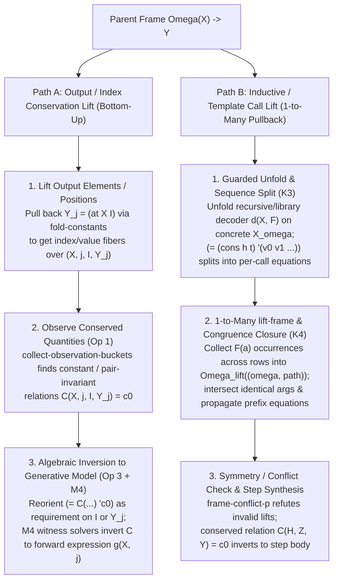

# `lisploop` --- Plan 7R: Loops, Recursion, Callable Functions, and Conserved-Quantity Inversion

> **Status**: Active implementation plan (`plan7-recursion.md`). R1 and R2 completed and audited.
> Cross-checked against `plan7.md`, `prompt4.md`, `architecture.md`, `plan7-recursion2.md`, and the authoritative Lisp source (`package.lisp`, `ast.lisp`, `codec.lisp`, `vm.lisp`, `requirements.lisp`, `frame.lisp`, `enumerate.lisp`, `factor.lisp`, `laws.lisp`, `synthesize.lisp`).

---

## 1. Diagnosis: Specific Omissions of Generality in the Current Kernel

The committed kernel already provides almost all of the foundational machinery required for recursive and higher-order synthesis:
- **Zero-copy homoiconic S-expressions (`ast.lisp`)**: A quoted expression inside a literal `'(+ X0 '1)` *is* the exact S-expression `(+ X0 '1)` with sort `(:code ((0 . :int)) :int)` that the evaluator, anti-unifier, and codec operate on (`deprecated/plan5.md` Sec. 3).
- **Canonical positional environments & runtime value lifting (`ast.lisp`, `vm.lisp`)**: Every expression uses canonical positional variables `X0, X1, ...` (`(var 0 t0)`, `(var 1 t1)`), and `:code-subst` specializes open `:code` templates by substituting either `:code` subtrees in the target scope or lifting runtime values directly into typed literal AST nodes `(lit tau value)` (homoiconic partial application / quasiquotation without lambda-calculus closures).
- **Extensible operator bit-coding (`codec.lisp`)**: `emit-operator-name` and `read-operator-name` already use a 4-bit opcode with Elias-delta extension for indices $\ge 15$.
- **Resumable continuation/task stack (`vm.lisp`)**: `evaluation` already executes via an explicit `tasks` stack and `stack` value list under 1-unit work budgets.
- **Four-operation synthesis engine (`requirements.lisp`, `frame.lisp`, `enumerate.lisp`, `factor.lisp`, `laws.lisp`, `synthesize.lisp`)**: Symmetry/invariance bucketing (Op 1), syntactic/value quotienting & anti-unification (Op 2), pullback/reorientation & learned algebraic propagation (Op 3), and conditional/heuristic fiber condensation (Op 4).

Extending the system to invert looping and recursive programs (`copy`, `map`, `fold`, `sort`), learn higher-order library primitives (`map`, `fold`), and support reentrant search deductions requires correcting **four omissions of generality**:

1. **Inductive Sequence Constructors & Ordering (`ast.lisp`, `vm.lisp`, `requirements.lisp`)**:
   - `(:seq tau)` currently has `:at`, `:concat`, `:gather`, `:member`, `:lookup`, but lacks a scalar-to-sequence constructor (`:cons`), tail projection (`:tail`), sequence length (`:length`), and integer order (`:<`).
   - `fold-constants` in `requirements.lisp` splits tuple equalities `(= (tuple a b) '(v0 v1))` into coordinate equalities, but lacks the exact inductive analogue for sequences: splitting `(= (cons h t) '(v0 v1 ...))` into `(= h 'v0)` and `(= t '(v1 ...))` (and `'nil` against `'()`).
2. **Homoiconic Code Evaluation & Named Recursive Functions (`ast.lisp`, `codec.lisp`, `vm.lisp`)**:
   - The `:code-*` operator family can inspect, match, bind (`:code-bind`), and substitute (`:code-subst`) quoted S-expressions, but lacks `:code-eval` to execute a `(:code inputs sort)` expression on runtime arguments.
   - Operators are restricted to the fixed 21-element `+operator-names+` list. Named functions (with short de novo symbols `:fa`, `:fb`, ... in the language namespace, or supplied control names `:copy`, `:map`, `:fold`, `:insert`, `:sort`) cannot yet be bound in a `language` and invoked recursively or higher-order on the VM task stack.
3. **1-to-Many Call-Site Lifting & Conserved-Quantity Inversion (`requirements.lisp`, `frame.lisp`, `factor.lisp`, `synthesize.lisp`)**:
   - Current frame transforms are 1-to-1 (`pullback-frame`, `orient-observations`) or row subsets (guards/views). Pulling back through a recursive function or higher-order template (`map`, `fold`) unfolds multiple call occurrences per parent observation $(\omega, \text{path})$, requiring a **1-to-many lift** (`lift-frame`) and an `:unresolved` outcome when an oracle self-lookup misses an unobserved trace input.
   - To infer loops and index/value recurrences from outputs rather than only top-down shell guessing, the pipeline needs a stage that **observes conserved quantities** across lifted input/output/index fibers and **algebraically inverts** those conserved laws via M4 propagators into generative expressions.
4. **Top-Down Corpus Abstraction & Deductive Leaf Messages (`factor.lisp`, `synthesize.lisp`)**:
   - `anti-unify` abstracts mismatching subtrees into first-order variables, but when anti-unifying recursive programs (`map_inc` vs `map_double`, `fold_sum` vs `fold_prod`), mismatching subtrees depend on shared inner step terms (`(at X0 '0)`, `(:fa (tail X0))`). Factoring mismatches through their shared step subterms yields closed homoiconic `:code` parameters directly in canonical `(X0, X1, ...)` form (Stitch-style top-down abstraction).
   - Search leaf messages (`prompt4.md` Sec. 8.b) should act as **first-class S-expression deduction rules / learned clauses** (analogous to CDCL / UIP / DIP in SAT) rather than imperative host callbacks.

---

## 2. Detailed Plan

### Phase 1: Minimal Inductive Sequence & Ordering Primitives + Pullback Folding
**Files**: `ast.lisp`, `vm.lisp`, `requirements.lisp`, `package.lisp`

#### 1.1. Sequence & Ordering Primitives
- `:cons`: `(tau, (:seq tau)) -> (:seq tau)` --- prepends a scalar element to a sequence.
- `:tail`: `((:seq tau)) -> (:seq tau)` --- returns `(cdr seq)` when non-empty, and `:bottom` (evaluation error) on `'()`. *(Note: `head` is already `(at seq '0)` and `empty?` is already `(= seq '())`.)*
- `:length`: `((:seq tau)) -> :int` --- returns `(length seq)`.
- `:<`: `(:int, :int) -> :bool` --- strict integer ordering (restricted to `:int`, not `(:gf p)`).

#### 1.2. Sequence Equality Splitting & Guarded Call Unfolding in `fold-constants`
- **Sequence-equality splitting**: Mirroring `:tuple` splitting (`requirements.lisp:160-169`), extend `fold-constants` so:
  - `(= (cons H T) '(v0 v1 ...))` $\longrightarrow$ `(and (= H 'v0) (= T '(v1 ...)))`
  - `(= (cons H T) '())` $\longrightarrow$ `'nil`
- **Guarded call unfolding (`plan7-recursion2.md` K3)**:
  - When `fold-constants` encounters a call to a defined function or `(:code-eval 'body arg0 ...)` where arguments are literals or `provably-total-p`, unfold the body one step at a time while its control guards (`:if`) fold to literals, bounded by `fold-constants`'s existing single-traversal budget. Leave any unreduced call intact on budget cutoff.
  - With these two rules in `fold-constants`, pulling back a parent requirement through *any* recursive or library decoder automatically unrolls concrete recursion steps and splits output sequences into per-element/per-step requirements.

---

### Phase 2: Homoiconic Function Structure, De Novo Naming (M9), and Zero-Copy VM Stack Execution
**Files**: `ast.lisp`, `codec.lisp`, `vm.lisp`, `enumerate.lisp`

#### 2.1. Homoiconic Lisp Function Structure & Short De Novo Symbols
Rather than introducing a procedural/C-like declaration hierarchy or ML closure structs, defined functions mirror the homoiconic S-expression design of `lisploop`:
- **Definitions are named `:code` S-expressions**:
  - A defined function in a `language` (or local `letrec` binding) associates a symbol name with a homoiconic `expression` whose free variables `((0 . t0) ... (k-1 . tk-1))` are its positional parameters `X0, ..., X_{k-1}` and whose `expression-type` is its return type `ret`:
    $$\text{signature}(\texttt{:fa}) = \texttt{(:fn (}t_0 \dots t_{k-1}\texttt{) } \text{ret}\texttt{)}, \qquad \text{body}(\texttt{:fa}) \in \texttt{(:code ((0 . }t_0\texttt{) }\dots\texttt{) ret)}.$$
  - Self-recursion and mutual recursion are written directly as ordinary Lisp operator calls `(:fa (tail X0))` using the function's own symbol `:fa` (and canonicalized to a common self-symbol `:recur` only when comparing two distinct recursive functions during anti-unification).
- **Short De Novo Symbol Names (M9)**:
  - Newly synthesized or abstracted functions are assigned short de novo keyword symbols in the language namespace---e.g. `:fa`, `:fb`, `:fc`, ... (avoiding raw integers, which would collide visually and conceptually with positional variable indices and literals).
  - In Milestone 9, these de novo names serve as the vocabulary tokens whose usage probabilities and context affinities are coupled to the search policy and language tariffs.
- **Higher-Order Arguments via Existing `:code` + `:code-subst` + New `:code-eval`**:
  - Because `(:code inputs sort)` is already a first-class value type in `ast.lisp`, higher-order functions like `:map` and `:fold` simply take a `:code` parameter (e.g. `X1 : (:code ((0 . :int)) :int)`).
  - Calling that code parameter uses a single new symbolic/bridge primitive:
    - `:code-eval`: `((:code ((0 . t0) ... (m-1 . tm-1)) ret), t0, ..., tm-1) -> ret`
  - **Capturing outer variables without non-Lisp closure types**: When a code argument to `:map` or `:fold` needs to capture an outer runtime variable (such as `k` in `map (+ X0 k) xs`), `:code-subst` accepts tuple bindings that are either `:code` expressions in the target scope (`'X0`) or runtime values of the corresponding input type (`k : :int`), lifting runtime values into typed literals `(lit tau k)` inside `'(+ X0 X1)` to produce the specialized `:code` value `'(+ X0 'k)`. `provably-total-code-arg-p` and `try-unfold-call` look through `(:code-eval (:code-subst 'template (tuple ...)) ...)` so requirement pullbacks unfold and propagate directly into captured runtime variables.
- **Compact Call-Site Encoding & $O(1)$ Call-Step Tariff (`ast.lisp`, `codec.lisp`, `vm.lisp`)**:
  - Because registered functions (`:fa`, `:fb`, ...) have fixed monomorphic signatures in `*function-definitions*`, call sites do not re-emit the `:code` type signature into the bitstream (`operator-bit-size`, `emit-operator`, `decode-model`); a call emits only the 2-bit `:app` tag and the operator opcode.
  - Invoking a defined function or `:code-eval` rebinds `evaluation-environment` to already-evaluated arguments on the VM stack and charges `1` unit for the call step in `primitive-cost` (plus `1` unit for `:restore-env`), while the body pays for all operations it executes—avoiding $O(N^2)$ sequence re-traversal tariffs on $O(N)$ structural recursions.
- **Structural Totality (`provably-total-p`) & Cache Invalidation (`invalidate-app-meta`)**:
  - A recursive definition `:fa` is certified structurally total (`analyze-function-body-totality`, unified with `provably-total-p`) if every self-call to `:fa` occurs on the false branch of `(= Xi '())` and passes `(tail Xi)` at parameter position $i$ (or conditionally total on `conditional-code-params` when `:code-eval` is applied to a `:code` parameter).
  - Whenever a function definition is registered or upgraded from an `:oracle-table` to a concrete body (`define-function`), `invalidate-app-meta` evicts cached `:app` entries in `*node-meta*` so existing caller ASTs recompute totality on demand.
- **`:unresolved` Filtering in Exact and Heuristic Search (`enumerate.lisp`, `synthesize.lisp`)**:
  - Both `search-step` and `heuristic-search-step` skip `:unresolved` rows without charging false residual penalties and require `(>= resolved-rows (min 2 (length (frame-rows frame))))` so vacuous self-calls `(fa xs)` that only resolve on a single base-case row are rejected.

#### 2.2. Zero-Copy Homoiconic Execution on the Resumable VM Stack
In `deprecated/plan5.md` (Sec. 3), **zero-copy homoiconicity** coupled with **canonical positional variables (`X0, X1, ...`)** means that a quoted expression `'(+ X0 '1)` or function body is already an immutable AST node over variable IDs `0, 1, ...`.
- Executing a call `(:fa a_0 ... a_{k-1})` or `(:code-eval code-val a_0 ... a_{k-1})` in `execute-instruction` (`vm.lisp`) requires **zero AST copying, zero alpha-renaming, and zero host-stack recursion**:
  1. Pop evaluated arguments $(v_0, \dots, v_{k-1})$ from `evaluation-stack`.
  2. Push `(:restore-env current-environment)` onto `evaluation-tasks`.
  3. Set `evaluation-environment` to the positional binding alist `((0 . v_0) ... (k-1 . v_{k-1}))`.
  4. Push `(:eval body-ast)` onto `evaluation-tasks`.
- **Properties**:
  - Stepping 1 unit at a time is bit-for-bit identical to batched execution (`step-evaluation` / `run-evaluation`).
  - Every recursive call and `:code-eval` charges the standard VM step budget; non-terminating recursion terminates cleanly with `:cutoff`.
  - When evaluating against a partial/oracle table (`Sec. 3.2`), hitting an unobserved table key returns `:unresolved` (joining `:value`, `:error`, and `:cutoff` in `vm.lisp`), so missing trace rows are treated as unrefuted rather than false.

---

### Phase 3: Symmetry/Conservation Inference from Outputs & Direct Context Lifting
**Files**: `frame.lisp`, `enumerate.lisp`, `factor.lisp`, `laws.lisp`, `synthesize.lisp`

To support both **bottom-up discovery of conserved quantities from outputs** and **top-down/inductive lifting of recursive calls**, synthesis uses two dual lifting paths:

#### 3.1. Inferring Conserved Quantities from Outputs $\to$ Algebraic Inversion to Generative Model
When given input-output sequences $(x_\omega, y_\omega)$, we do not want to rely solely on guessing combinator shells; we want the system to **infer symmetry or conservation from the outputs and invert that conservation law into the generative model**:
1. **Stage 1 --- Fiber Inference over Output Elements / Index Addressing**:
   - Lift the output sequence $y_\omega$ into per-element observations $(\omega, j)$ with output index $j \in \{0, \dots, |y_\omega|-1\}$, length $n = (\text{length } x_\omega)$, and element target $y_{\omega, j} = (\text{at } y_\omega\ j)$.
   - When testing an array-indexing hypothesis $y_{\omega, j} = (\text{at } x_\omega\ I)$, `pullback-frame` + `fold-constants`'s existing 1D `:at` fiber inversion (`requirements.lisp:140-158`) automatically reduces `(= (at 'x_w I) 'y_wj)` to the exact fiber of matching source indices $I \in \{i \mid x_{\omega, i} = y_{\omega, j}\}$!
2. **Stage 2 --- Observing Conserved Quantities (`collect-observation-buckets` / `orient-observations`)**:
   - On the joint lifted frame containing $(x_\omega, j, n, I, y_{\omega, j})$ (or on a recursive transition frame containing head $H = (\text{at } x_\omega\ 0)$, tail result $Z = y(\text{tail}(x_\omega))$, and output $Y = y_\omega$), run Operation 1 (`collect-observation-buckets`) to find expressions $C(\dots)$ that are **conserved** across all rows (`constant-p` with value $c_0$, or invariant across `pairs`):
     - *Index conservation (`copy`)*: $C(I, j) = I - j = 0$ is conserved across all $(\omega, j)$.
     - *Index conservation (`reverse`)*: $C(I, j, n) = (I + j) - (n - 1) = 0$ is conserved across all $(\omega, j)$.
     - *Value conservation (`map_inc`)*: $C(x_{\omega, j}, y_{\omega, j}) = y_{\omega, j} - x_{\omega, j} = 1$ is conserved across all $(\omega, j)$.
     - *Step conservation (`fold_sum` / `length`)*: $C(H, Z, Y) = (Y - Z) - H = 0$ (for `sum`) or $Y - Z = 1$ (for `length`) is conserved across all non-empty step transitions.
     - *Permutation / Multiset & Monotonicity conservation (`sort`)*: `(length Y) - (length X) = 0`, `(member Y_j X) = t`, and adjacent-pair order `(< Y_{j+1} Y_j) = nil` are conserved across all outputs.
3. **Stage 3 --- Algebraic Inversion of the Conserved Quantity into the Generative Model**:
   - A conserved quantity $C(\mathbf{u}, T) = c_0$ (where $T$ is the unknown target $I$ or $Y$) is reoriented via `orient-observations` into the requirement `(= C(u, T) 'c_0)`.
   - Applying Operation 3 (`pullback-frame` + M4's learned witness solvers `propagate-requirements` in `laws.lisp`) algebraically inverts `(= C(u, T) 'c_0)` for $T$:
     - $(I + j) - (n - 1) = 0 \xrightarrow{\text{invert for } I} I = (n - 1) - j \implies y_{\omega, j} = \texttt{(at X (- (- (length X) '1) J))}$.
     - $Y_j - X_j = 1 \xrightarrow{\text{invert for } Y_j} Y_j = X_j + 1$.
     - $(Y - Z) - H = 0 \xrightarrow{\text{invert for } Y} Y = H + Z$.

#### 3.2. 1-to-Many `lift-frame`, Congruence Closure, and Oracle Self-Lift (`plan7-recursion2.md` K4, K5)
Complementing bottom-up conservation discovery, pulling back a parent frame $\Omega$ through a recursive definition or higher-order template $d(\mathbf{x}_\omega, F)$ uses a general **1-to-many frame lift** (`lift-frame`):
1. **Unfold & Split**: `pullback-frame` substitutes $d(\mathbf{x}_\omega, F)$ into $A_\omega(Y)$ and runs `fold-constants` (Phase 1.2). On concrete inputs $\mathbf{x}_\omega$, this unrolls the loop/recursion and splits sequence equalities into per-application constraints over terms $F(\mathbf{a})$.
2. **Congruence Closure Across Rows**: Collect all $F(\mathbf{a})$ occurrences via `collect-tree-occurrences`. Because $F$ is pure, a ground equation $F(0, 3) = 3$ from one row substitutes into nested terms $F(F(0, 3), 5) = 8$ in longer rows (union-find congruence closure over hash-consed ground application terms), resolving intermediate accumulators on prefix-closed fold data without any combinator-specific deduction rules.
3. **1-to-Many Child Frame Construction & Symmetry Refutation**:
   - Each distinct ground application $F(\mathbf{a})$ constrained by a conjunct becomes a child observation keyed by `(parent-key . path)` with known inputs $\mathbf{a}$.
   - Identical argument tuples $\mathbf{a}$ across occurrences are intersected by `tighten-same-input-requirements`.
   - **Symmetry test**: If two occurrences have identical lifted context $\mathbf{a}$ but incompatible requirements, `frame-conflict-p` immediately refutes the lift (e.g. refuting element-only `map` on `reverse`, which then lifts the index $j$ and outer sequence $x$ via `dependency-proposals`).
   - **Linkage**: For 1-to-many lifts, position along the unrolled call path provides a natural integer coordinate for `compute-tree-locality-positions`, and adjacent call sites generate shift/step `pairs`.
4. **Oracle Self-Lift for De Novo Recursive Definitions**:
   - To synthesize a new recursive function `:fa` directly on $\Omega$, the conditional shell splits out the base case (e.g. `(= X0 '())`), and on the non-empty branch evaluates self-calls `(:fa (tail X0))` against a partial oracle backed by $\Omega$'s own rows (`:unresolved` on missing keys), followed by authoritative verification of the recursive `:fa` on the root frame in the VM.
   - On `sort(X0)`, lifting $H = \texttt{(at X0 '0)}$ and $Z = \texttt{(:sort (tail X0))}$ on the non-empty branch produces the concrete child frame $\Omega_{\text{insert}}(H, Z) \to Y$. Splitting $\Omega_{\text{insert}}$ on `(= Z '())` and `(< H (at Z '0))` and pulling back `(cons (at Z '0) ?rest)` synthesizes `:insert` and `:sort`.

---

### Phase 4: Top-Down Homoiconic Library Learning (`map`, `fold` via Stitch-Style AU)
**Files**: `factor.lisp`

#### 4.1. Compatibility with Zero-Copy Positional Binding & Stitch-Style Top-Down Abstraction
In DreamCoder, abstracting lambda-calculus terms required expensive bottom-up version spaces because de Bruijn indices shifted under every lambda binder. In `lisploop`, **Phase 2.2's positional binding (`0, 1, ...`) makes higher-order anti-unification zero-copy and native**:
1. **Self-Reference Normalization**: When comparing two recursive definitions `:fa` and `:fb` of matching signature, normalize self-calls `(:fa ...)` and `(:fb ...)` to a canonical self token so their recursive skeletons align.
2. **Common-Subterm Factoring into Positional `:code` Arguments**:
   - When `anti-unify` encounters a mismatch $(L, R)$ whose fillers reference bound parameters or self-calls (e.g. $L = \texttt{(+ (at X0 '0) '1)}$ and $R = \texttt{(* (at X0 '0) '2)}$ in `map_inc` vs `map_double`, or $L = \texttt{(+ (at X0 '0) (:fa (tail X0)))}$ and $R = \texttt{(* (at X0 '0) (:fb (tail X0)))}$ in `fold_sum` vs `fold_prod`):
   - Extract the maximal shared subterms $A_0, \dots, A_{m-1} \in \text{subtrees}(L) \cap \text{subtrees}(R)$ that contain all outer variable / self-call references.
   - Replace each $A_j$ in $L$ and $R$ with canonical positional variable `(v j tau_j)` (`X0`, `X1`, ...).
   - Because `X0, X1, ...` are *already* the exact positional environment expected by `:code-eval` in Phase 2.2, $L'$ and $R'$ become closed `:code` literals (`'(+ X0 '1)` and `'(* X0 '2)`) with **zero variable shifting**, and the shared template replaces the mismatch site with `(:code-eval X_f A_0 ... A_{m-1})`!
3. **Stitch / e-Stitch Efficiency Roadmap**:
   - `discover-subexpression-abstractions` operates top-down over the solved corpus using native `anti-unify`, accepting a new library definition (`:fa`, `:fb`, ... for `map`, `foldr`, `foldl`) only when it strictly reduces total description length $S(L) + \sum_i S(p_i \mid L)$.
   - Because `laws.lisp` already maintains certified equivalence rewrite rules, normalizing corpus expressions (or maintaining e-graph equivalence classes a la e-stitch / babble) plugs directly into top-down anti-unification without changing the representation.

---

### Phase 5: Deductive Leaf Messages & Policy-Decoupled Search (M8)
**Files**: `synthesize.lisp`, `requirements.lisp`, `laws.lisp`

#### 5.1. Composable Expander Proposals Without Baked-In Policy
- A `library-expander` proposes registered library definitions whose return type matches the current target as ordinary `decomposition`s; function-typed (`:code`) parameters become lifted child frames via `lift-frame` (Phase 3.2).
- Proposals are not ranked by hardcoded host rules (such as "equal lengths $\implies$ map"); they compete solely under the existing full-path Stage A description-length + work objective and the 3:1 interleaved reserve schedule.

#### 5.2. Leaf Messages as S-Expression Deduction Rules (CDCL / UIP / DIP Analogue)
Rather than adding an imperative host-code callback `:message-handler`, messages from search leaves (`prompt4.md` Sec. 8.b) are represented as **S-expression constraints and guarded deduction rules** processed by the existing requirement/law machinery:
- **Conflict Clauses (CDCL / Nogood Expressions)**:
  - When a lifted frame conflicts on rows $(\omega_1, \omega_2)$ under context projection $\pi(\mathbf{x})$, or when a conditional case-split on an undecided term $F(\mathbf{a})$ folds to `nil`, the leaf emits a symbolic conflict expression recording the incompatible conjuncts.
  - Within the current problem, this clause prunes any sibling or descendant node whose assumptions entail the conflict (`check-parent-nogoods` generalized from pure column projections to S-expression clauses).
- **Anti-Unification of Conflict Messages (UIP / DIP Generalization)**:
  - Across multiple leaf conflicts in a search tree, anti-unifying the conflict S-expressions via `anti-unify` extracts shared structural refutations (Unique Implication Points / partial conservation laws that must hold for any valid solution), and common subterms in dual implication points (DIP) introduce new intermediate variables (`dependency-proposals`).
- **Lossy Branch Condensations (Heuristics)**:
  - Quantitative leaf outcomes (work spent, residual bits) are recorded as ordinary rows in a search-trace frame, so `condense-heuristic` (`start-heuristic-search`) can induce an approximate priority predictor $\hat{\pi}$ (discarding $\varepsilon$ at deployment) using the exact same synthesis engine.

---

## 3. Milestones & Verification Matrix

Each milestone will be validated by a dedicated test suite in `tests/` (`tests/recursion.lisp`, wired into `tests/run.lisp`), comparing supplied controls against discovered artifacts:

| Milestone | Scope | Verification & Controls |
| :--- | :--- | :--- |
| **R1** | Phase 1.1 & Phase 2: `:cons`, `:tail`, `:length`, `:<`, `:code-eval`, named functions (`:fa`, `:fb`, ...) in `language`, zero-copy VM call stack, `:unresolved`, codec/tariff versions | 1-unit vs batch VM resume parity across deep recursion and `:code-eval`; infinite recursion `:cutoff` vs `:error`; codec roundtrip; `:code-bind` + `:code-eval` closure capture test |
| **R2** | Phase 1.2: Sequence-equality splitting `(= (cons h t) '(...))` and guarded call unfolding in `fold-constants` | Definedness preservation under lazy `:if`; budget cutoff leaves unreduced calls intact; generic pullback through supplied recursive decoders |
| **R3** | Phase 3.1 & 3.2: Conserved-quantity observation + M4 algebraic inversion; 1-to-many `lift-frame` + congruence closure | Bottom-up index/value conservation $\to$ generative inversion on `copy`, `reverse`, `map_inc`; 1-to-many lift on `map` (E1), symmetry conflict refutation on `reverse` (E1c), prefix-closed `fold` including `sumsq`, `horner10`, and `(+ acc (* acc x))` (E3) |
| **R4** | Phase 3.2 (Oracle Self-Lift): De novo recursive synthesis with `:unresolved` oracle + conditional base-case split | End-to-end synthesis of `copy`, `inc-all`, `double-all`, `sum`, `length`, `product`, and `insert` from I/O examples; negative control verifying root VM execution rejects oracle-only fits |
| **R5** | Phase 4: Homoiconic higher-order AU + positional `:code` argument extraction + DL library acceptance | Automatic discovery and registration of `:map` (`:fa`) and `:fold` (`:fb`) from the R4 solved corpus; refactoring savings verification |
| **R6** | Phase 5: Library expander + curriculum synthesis of `sort` (`insert` + `fold`/`sort`) + S-expression leaf nogood clauses | End-to-end synthesis of `sort` and held-out `map`/`fold` tasks using learned library primitives; search-work comparison with and without deductive leaf clauses |
