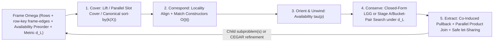

# `lisploop` — Plan 8: Geometric & Topological Unification (SMOCE), Product & Sharing Completeness, and Kernel Simplification

> **Status:** Architectural audit and implementation plan (v3.1 — verified against the pure-kernel / semantic-oracle test refactor), 13 November 2026.
> Audited against the authoritative Common Lisp kernel at commit `54acfa3` (25 kernel files in `load.lisp`, `12,481` LOC + 6 milestone files in `milestones/` via `milestones/load.lisp`, `1,455` LOC), cross-referencing `prompt4.md`, `architecture2.md`, `plan7/plan7.md`, `plan7/plan7-recursion.md`, `plan7/plan7-library.md`, `plan7/plan7-higher-order.md`, `plan7/plan7-m9-policy.md`, `plan8-2.md`, and `tests/README.md`.
> Empirical measurements in §1.3 and Appendix A are accompanied by self-contained pure-kernel reproduction code verified against commit `54acfa3`.

---

## 1. Executive Synthesis: Unifying Structure, Computation, and Space Induction

This plan addresses three foundational questions about the `lisploop` kernel:
1. How syntactic anti-unification (AU) and library refactoring relate mathematically to top-down/bottom-up (TD+BU) computational synthesis, and what should—and should not—be unified.
2. How heuristic condensation, conservation, and `frame` scaffolding generalize into **target geometry** (pluggable/co-induced transformation metrics) and **index topology** (induced orderings, row-keyed cross-row edges, and ontology-free availability preorders).
3. Which missing general primitives unlock structured product spaces, subexpression sharing, and relational dependency folding while **reducing** incidental kernel complexity—and which harder problems (such as unobserved latent state abduction) should be cleanly separated and deferred.

### 1.1 Where `plan8-2.md`'s Restrictive Calibration Holds

1. **Unify the data model and agenda; keep the inner matching and search engines distinct (`plan8-2.md` §4.3).**
   Syntactic AU (`anti-unify` in `unify.lisp:36`) is linear-time ($O(|t|)$) and deterministic because free-algebra constructors (`:cons`, `:tuple`, AST application nodes) are **injective**; all search on the AU side lives in **correspondence** (which functions, rows, or subtrees to align). Computational synthesis (`enumerate.lisp`, `condense.lisp`, `synthesize.lisp`) operates over **many-to-one** primitives (`:+`, `:*`, `:at`, `:fold`), where row alignment is fixed upfront and search lives in **conserved computation**. Replacing AU with enumeration would forfeit $O(|t|)$ determinism; collapsing synthesis into unstratified E-graph saturation would blow up VM budgets. They meet as **complementary operators emitting `decomposition`s and `frame`s onto one full-path MDL agenda**.
2. **Keep the two senses of "fiber" and "table vs. graph" distinct (`plan8-2.md` §3.2–3.3).**
   - *Preimage / value fiber (`plan7/plan7.md` §2):* $\mathrm{Fiber}(\omega) = \{z \mid B_\omega(z) = \mathrm{true}\}$, arising when a non-injective operator aliases inputs. Because constructors are injective, AU yields **point substitutions**, not multi-valued preimage fibers.
   - *Occurrence / bundle fiber (`select-active-fiber-rows` in `frame.lisp:529`):* The $k$ child occurrences $(\omega, c)$ unfolded from a parent object $\omega$ under a 1-to-many cover (`lift-frame` or `collect-tree-occurrences` in `milestones/corpus.lisp:276`).
   - *Star-table vs. graph:* Root-aligned `anti-unify` is isomorphic to `observation-bucket` over root-to-leaf path selectors. True graph topology enters only with **unaligned correspondence** (`discover-subexpression-abstractions` in `milestones/corpus.lisp:722`) and **cross-row linkage** (`pairs`, `anchors`, `frame-edges`).
3. **Verified kernel baselines (`54acfa3`).**
   - Exact search (`search-step` in `enumerate.lisp:455`) currently **ignores `pairs` and `anchors`**; only `observation-job` and Stage A (`condense.lisp`) read them.
   - Functorial inverters in `bootstrap-inverters.lisp:6` are host-coded structural recognizers, not learned `:transformer` rules.
   - `evaluate-frame-descriptors` does not exist in `descriptors.lisp`; `find-knowledge-entries-by-address` (`knowledge.lisp:253`) and `probe-frame-coordinates` (`frame.lisp:598`) have **zero callers** in the synthesis loop.
   - `load.lisp` enforces strict **pure-kernel isolation** (`tests/run.lisp:61-71`): the kernel never calls or exports `milestones/` drivers (`milestones/load.lisp`), and `tests/support.lisp` + `tests/invariants.lisp` test semantic contracts rather than internal struct layouts.

### 1.2 Core Architectural Lacunae Exposed by Audit & Thought Experiments

Using algebra, recursive sequence synthesis, AST refactoring, and stateful transition streams as diagnostic lenses exposes five **domain-general** lacunae in the current kernel:

1. **Product Decomposition, Guard Reuse, & Subexpression Sharing (`#4`):**
   - `compose-model` (`frame.lisp:399-404`) always substitutes child `bindings` inline, inflating $S(M)$ and $W_{\mathrm{run}}(M)$ multiplicatively whenever a derived binding is referenced $\ge 2$ times. Homoiconic `:code-eval` over a `:code` literal provides exact `let`-sharing with **zero new VM opcodes** (§3.2).
   - While `make-additive-residual-decoder` (`decompose.lisp:13`) expands `+` slot-wise on `:tuple`s, `decomposition` (`synthesize.lisp:8`) has only a single `child-id`: non-trivial product targets (`:tuple`s and multi-hole Constructor-AU skeletons $p(?0 \dots ?m)$) either remain monolithic or blow past default `max-depth = 2` (`decompose.lisp:419`) if chained sequentially, and accessing `(at X 0)` on a pair costs **`30` body-bits**.
   - In Stage B Path B2, `find-sound-exception-guard` (`decompose.lisp:81`) defaults to `guard-bound = 20` body-bits (`decompose.lisp:305`) and re-enumerates `:bool` ASTs syntactically from scratch in `observed-predicates` (`decompose.lisp:68`), **discarding `(heuristic-buckets h-model)`** (`condense.lisp:240`), which already holds evaluated feature vectors up to 18 bits. Pairing existing Stage A buckets via `=`/`<` finds 27–32 bit relational guards with **zero extra VM evaluations**.
2. **Host-Coded `correction` vs. Co-Induced `(decoder, :solver)` DSL Metrics (`#1` & `#5`):**
   `correction` (`frame.lisp:1003-1086`) hardcodes one fixed metric per type (`:bool` and `:code` pay full replacement; `:seq-delta` pays elementwise prefix mismatches on shifted sequences). Pairing a binary library decoder $d(\hat{Y}, \delta) \to Y$ with a certified or tentative `:solver` $q(\hat{Y}, Y) \to \delta$ **co-induces** both a Stage A residual metric and its matching Stage B pullback $Y = d(\hat{\pi}(X), Z)$ (§3.1).
3. **Static Positional Row Topology & Ontology-Free Dependency Folding (`#2`):**
   `frame` currently treats `pairs` and `anchors` as static positional-index hints (vulnerable to `frame-rows` permutation) and has no general representation for **availability order** (which columns/ports precede others) or **induced locality** (sorting rows canonically by a synthesized key $k(X)$ to minimize output variation). Furthermore, `decomposition-bindings` (`frame.lisp:392`) evaluate strictly on a single row: cross-element context must enter via **composable higher-order combinator lifts (`lift-frame`)**, never by smuggling neighbor rows into non-composable `bindings` (§3.4).
4. **Numeric vs. Symbolic Reorientation:**
   Operation 3's reorientation helpers (`conserved-quantity-frame` in `frame.lisp:793` + `propagate-requirements` in `laws.lisp:781`) solve equations **numerically per row** (`solve-learned-equality`, `laws.lisp:758`). On a frame whose target rows are already singletons, numeric conservation-inversion merely reproduces the starting frame (`tests/recursion.lisp:543-635`), while degenerate invariants like `(- Y Y) = 0` collapse to `'t`. Useful reorientation on singleton targets requires **target-sensitivity filtering + symbolic solver unwinding (`solve-equality-symbolically`)** over ASTs (§3.3).
5. **Fixed Stage A Fast-Path Budgets & Boundary of Decoupled `lift-frame`:**
   - Adding a single irrelevant scalar input to a lifted `:scan` task increases work $7.5\times$–$26\times$ (`21,023` $\to$ `158,433` / `547,872`, identically at bounds `90` and `110`) because fixed `heuristic-budget` cuts off Stage A just before `exact-heuristic-program` (`synthesize.lisp:479`), triggering ~14 Stage B/sibling expansions; scaling Stage A budget with input arity restores the fast path (`62,942` / `73,335` work).
   - Conversely, when a lifted combinator threads **unobserved or non-injectively projected intermediate state** (whether an unknown recursion accumulator or a hidden world variable), `lift-frame` leaves `t >= 1` rows in `coupled-requirements` (`:unresolved`). Solving coupled/latent intermediate fibers requires joint hypothesis-and-trajectory alternation rather than single-pass lifting—cleanly separated into §5.1 for future investigation.

### 1.3 Verified Empirical Diagnostic Summary at Commit `54acfa3`

| Diagnostic Probe (Runnable in Appendix A) | What It Tests | Result on `54acfa3` | Architectural Takeaway |
| :--- | :--- | :--- | :--- |
| **1. Scalar `:scan` (`s' = s + a`)** | Library fold/scan lifting | **Solved** in `21,023` work | Temporal/sequential framing works via ordinary library `lift-frame` |
| **2. Same + 1 Irrelevant Input** | Arity scaling (`bounds 90 & 110`) | `158,433` (`+/*`) / `547,872` (`+/-/=`) work (identical at 90 & 110) | Bound has no effect; Stage A misses fast path under fixed `heuristic-budget` |
| **3. Same + `:heuristic-budget 30000`** | Arity-scaled Stage A budget | **`62,942` / `73,335` work** | Stage A budget must scale with `(length inputs)` (`P8.2`) |
| **4. Symmetric Tuple `:scan-tup`** | `make-additive-residual-decoder` | **Solved today** in `80,212` work | Additive Path B1 splits `+` per slot when tuple residual `Z` is tiny |
| **5. Conditional Tuple (`207` body-bits)** | Asymmetric per-slot guard (`(at s 0)` = `30` bits) | **Fails** at `800k` & `4M` work (`coupled = 0`) | Needs parallel `product-decomposition`, tuple projection, & bucket-pair guards (`P8.1`) |
| **6. Stage A `heuristic-buckets` Pairing** | `(= b_i b_j)` over Stage A buckets | Finds 27-bit guard `(= X0 (- X1 X2))` in **`30,000` work + `231` checks** | Reusing `heuristic-buckets` (`condense.lisp:240`) eliminates $>500\text{k}$ syntactic guard search (`P8.1`) |
| **7. Partially Observed Tuple (`:scan-proj0`)** | Unobserved intermediate slot | Steps $t \ge 1$ `:coupled` (`:unresolved`) | Marks the exact boundary of decoupled `lift-frame` (deferred in §5.1) |

---

## 2. Intersection Map & Pure-Kernel Simplification (~800–1,050 Kernel LOC Removable)

### 2.1 Where Search Lives Across Mechanisms

| Mechanism | Ambient Space | Shared Part $p$ | Per-Instance $\theta_\omega$ | Where Search Lives |
| :--- | :--- | :--- | :--- | :--- |
| **Aligned AU** (`unify.lisp:36`) | `:code` ASTs (root-aligned) | LGG pattern $p(?0 \dots ?k)$ | Point substitutions $\sigma_\omega$ | **None** ($O(\|t\|)$ closed form); `abstraction.lisp` searches *corpus subsets* |
| **Unaligned Subtree AU** (`milestones/corpus.lisp:722`) | `:code` ASTs (arbitrary paths) | Shared subterm template | Path occurrences + arguments | **Correspondence search** (3:1 `:locality`-scheduled occurrence pairs) |
| **Library AU** (`abstraction.lisp:98, 181`) | Recursive `:function` ASTs | Higher-order combinator (`:code-eval`) | Closed `:code` literals + FO args | **Subset search** + `shared-subterm-cover` continuation factoring |
| **Exact / Stage A Synthesis** (`enumerate.lisp`, `condense.lisp`) | Runtime values $\mathcal{V}_\tau$ | Program $e(X)$ or chart $\hat{\pi}(X)$ | Given `row-known` (+ delta packet $\varepsilon_\omega$) | **Computation search** (size-tiered grammar enumeration over fixed rows) |
| **TD Pullback / Product / Lift** (`frame.lisp`, `fibers.lisp`, `decompose.lisp`) | Requirement predicates $A_\omega(Y)$ | Outer decoder $d(X, Z_0 \dots Z_{m-1})$ | Child fibers $B_{\omega,j}(Z_j)$ | **Decoder & partition search** (vertical target change + horizontal splits) |

### 2.2 Streamlining Targets & Pure-Kernel Boundary (`P8.4`)

At `54acfa3`, `load.lisp` loads **25** self-contained kernel files (`12,481` LOC), strictly isolated from the **6** external milestone drivers in `milestones/` (`1,455` LOC, enforced by `assert-pure-kernel-environment` in `tests/run.lisp:61-71`). Meanwhile, the refactored test harness (`tests/support.lisp`, `tests/invariants.lisp`) checks semantic contracts (`check-anytime-resumption`, `check-synthesis-task`, `check-library-abstractions-contract`) rather than internal struct layouts—making internal kernel consolidation significantly cleaner.

Plan 8 respects the `load.lisp` / `milestones/load.lisp` boundary: **only** the pure ~30-line `frame` constructor `au-substitutions-frame` (`milestones/corpus.lisp:294`) is promoted into `unify.lisp` (with standalone packet harnesses `TREE-CORPUS`/`LAW-CORPUS` remaining in `milestones/corpus.lisp`). Adding **~`550–650` LOC** across `P8.1`–`P8.4` while retiring **~`800–1,050` LOC** inside `load.lisp` leaves the pure kernel net smaller and flatter:

1. **Collapse Dual Pre-M7 Structs in `laws.lisp` onto `knowledge.lisp` (~350–450 LOC saved):**
   Store laws and solvers directly as `knowledge-entry` payloads, retiring standalone `law`, `rewrite-rule`, `rewrite-library`, `certified-solver`, and `solver-library` structs (`laws.lisp:5-60`) and their synchronization wrappers.
2. **Declarative Meta-AST Rules in `bootstrap-inverters.lisp` & `descriptors.lisp` (~250–350 LOC saved):**
   Replace hand-nested host `app`/`lit` `:code-match`/`:code-bind` AST builders with `term` templates and `learn-knowledge-transformer` (`templates.lisp:217`) `(source, target)` pairs.
3. **Single Parameterized `Cover + Orient` Constructor in `frame.lisp` & Unified Nogoods (~200–250 LOC saved):**
   Factor the manual row/schema-copying constructors (`pullback-frame`, `restrict-frame`, `orient-observations`, `conserved-quantity-frame`, `context-label-frame`, `lift-frame`, promoted `au-substitutions-frame`, `make-search-trace-frame`) through one parameterized builder over `frame-edges`, and unify `nogood-clause` / `:uip-clause` (`nogoods.lisp:5, 214`).

---

## 3. The Unified Five-Stage Cycle (SMOCE) & Core Primitives

Both AU/library refactoring and TD+BU synthesis instantiate **one five-stage fibered factorization cycle** over `frame`s:

| Stage | Operation | On Constructors / Syntax (`:code`, `:tuple`, `:cons`) | On Computation & Relational Frames |
| :--- | :--- | :--- | :--- |
| **1. Cover** | Unfold occurrences or induce row order (3:1 window + reserve) | `collect-tree-occurrences`; parallel `:tuple` coordinate slots | `lift-frame` on library combinators; canonical `sort-by(k(X))` variation chains |
| **2. Correspond** | Align occurrences (via `:locality-key`) & match constructors in $O(\|t\|)$ | Root walk; 3:1 `:locality` pairing; `match-pattern`, `fold-equal-tuple` | `row-key` alignment; `infer-fibers` Helly blocks; `dependency-proposals` |
| **3. Orient** | Select `known -> target` under availability $\tau(p) < \tau(q)$ & unwind `:solver`s | Orient `(= lhs rhs)` by `expression-less-p`; symbolic solver unwinding | Forward evaluation; backward `propagate-requirements` (+ tentative `:solver`s); symmetric $C(X,Y)=c_0 \xrightarrow{\text{symbolic}} Y=g(X)$ |
| **4. Conserve** | Minimize $S(p) + S_{\mathrm{rows}}^{d_{\mathcal{L}}}(\varepsilon) + S_{\mathrm{edges}}^{d_{\mathcal{L}}}(\varepsilon) + \lambda W_{\mathrm{run}}$ | Closed-form LGG `anti-unify` + `shared-subterm-cover`; `provably-total-p` | Tiered search + Stage A under `:metric` / $d_{\mathcal{L}}$; Stage A bucket-pair guards; edge-checked `search-step` |
| **5. Extract** | Emit single or parallel `product-decomposition` with `:code-eval` `let`-sharing | `abstraction-parameters`; multi-hole Constructor-AU `p(?0..?m)`; `:uip-clause` | Co-induced $d(\hat{\pi}(X), Z)$ pullback; parallel product join; definedness-safe `:code-eval` `let`-frames |



### 3.1 Target Geometry: Pluggable & Co-Induced `(decoder, :solver)` Metrics *(Priority #1 & #5)*

Heuristic condensation is **coordinate-chart induction**: Stage A finds $\hat{\pi}(X)$ placing targets near $0$ displacement under a transformation action, and Stage B pulls targets back along that action.
1. **Explicit `:metric` AST Hook:** `frame`, `start-heuristic-search`, `condense-heuristic`, and `start-synthesis` accept an optional total `:code` AST `M : (tau, tau) -> :int` (`0` iff equal, metered on `ledger` in `select-closest-witness` at `frame.lisp:1088` and `relational-linkage-residual` at `enumerate.lisp:543`).
2. **Co-Induced `(decoder, :solver)` Pairs:** Register knowledge edges `(:metric-decoder d q tag-bits)` pairing any binary decoder $d : (\tau, \tau_\delta) \to \tau$ with a `provably-total-p` `:solver` $q : (\tau, \tau) \to \tau_\delta$ (certified or tentative `#5`: `:+` $\leftrightarrow$ `:-`, `:shift-seq` $\leftrightarrow$ `:argmax-corr`, `:code-subst` $\leftrightarrow$ `anti-unify`, or conserved-sum / moment-difference estimators guarded by `witness-replays-p` and 3:1 `propagation-fallback` in `laws.lisp:823-825`).
   - *Stage A:* `correction` evaluates the top-$k$ ($k \le 4$) type-matching `(d, q)` pairs, scoring $S_{\mathrm{tag}}(d) + \text{value-bit-size}(\delta, \tau_\delta)$ whenever $d(\hat{y}, q(\hat{y}, y)) = y$ (capped by default `correction-bit-size`).
   - *Stage B:* `make-metric-residual-decoder` proposes $Y = d(\hat{\pi}(X), Z)$ (`Z : tau_delta`) for the winning `d`, generalizing Path B1 (`decompose.lisp:13`) from `+` to shifts, scalings, and `:code` template edits while preserving zero-false-pruning Galois soundness (`tests/invariants.lisp:120-235`).

### 3.2 Product Completeness, Safe `let`-Sharing, & Bucket-Pair Guards *(Priority #4)*

1. **Definedness-Safe Homoiconic `let`-Sharing in `compose-model` (`frame.lisp:399`, #4):**
   Count free-variable uses of each binding `(id_r . b_r)` across `(instantiate decoder (list (cons child-id child-model)) :var)`. Whenever sharing multi-use bindings strictly improves `candidate-score` ($S(M) + \lambda_{\mathrm{run}} W_{\mathrm{run}}(M)$) over inline substitution **and** each hoisted `b_r` is either `(provably-total-p b_r)` (`ast.lisp:826`) or strictly demanded on all execution paths of `body` (so call-by-value `:code-eval` cannot introduce eager evaluation errors that lazy `:if` branches avoided; cf. `tests/invariants.lisp:57-70`), emit `(:code-eval (lit (:code ...) body) b_0 ... b_{r-1})`. Uses existing `vm.lisp` metering and `call-unfolding` (`requirements.lisp:331-348`) with **zero new primitives**.
2. **Parallel Multi-Hole `product-decomposition` & Alpha-Invariant Tuple Projection (`synthesize.lisp`, `proposals.lisp`):**
   - Expose scalar/component bindings `(at (var id_i tup-type) '0) ... (at (var id_i tup-type) '(k-1))` keyed directly on `schema-inputs` `(id . type)` pairs (never assuming contiguous `0..n-1` IDs, preserving `schema-inputs` alpha-renaming invariance in `tests/invariants.lisp:288-341`) for small `:tuple` inputs ($k \le 6$), avoiding repeated 30-bit `:at` trees.
   - Add an AND-join `product-slots` mode on `synthesis-node` for any injective constructor skeleton (`(tuple ?0 ... ?{k-1})` or Constructor-AU LGG $p(?0 \dots ?m)$ from promoted `au-substitutions-frame` in `unify.lisp`) whose per-row requirements factor into independent per-hole conjuncts (preserving Galois soundness, `tests/invariants.lisp:120-235`). All holes solve **in parallel at constant depth `d + 1`** (without decrementing computational `max-depth` on pure constructor unpacking), charging every child step directly to `synthesis-job-ledger` so unit-step `check-anytime-resumption` (`tests/support.lisp:120-169`) holds identically.
3. **Stage-A Feature-Bucket Guard Discovery (`decompose.lisp:81`):**
   Before running `observed-predicates`, `find-sound-exception-guard` pairs already-computed Stage A feature buckets in `(heuristic-buckets h-model)` (`condense.lisp:240`) with `=` and `<` up to 32 body-bits, finding relational exception guards across arithmetic, sequence, and tuple tasks with zero redundant VM evaluations.

### 3.3 Symbolic Equation Unwinding (`solve-equality-symbolically`)

To make Operation 3's conservation-reorientation productive on singleton-target frames (avoiding circular numeric round-tripping in `tests/recursion.lisp:543-635` and degenerate `(- Y Y) = 0` invariants):
1. **Target-Sensitivity Check:** Accept joint invariant $C(\mathbf{x}, Y) = c_0$ only when `Y` occurs free in $C$ and perturbing $y_\omega \mapsto y'_\omega$ changes $C(\mathbf{x}_\omega, y)$ on $\ge 1$ row.
2. **Symbolic Unwinding:** Apply certified `:solver` witness ASTs **symbolically** to `(= C(X, Y) 'c_0)` (checking solver domain guards across `row-known`) to emit closed-form candidate $Y = g(X)$ directly (e.g., `(= (- (+ Y X0) X1) '0) => (- X1 X0)`), or simplified non-identity requirement `(= h(Y) g(X))`. Reserve numeric `conserved-quantity-frame` strictly for unoriented relational tables where $Y$ is not yet the target.

### 3.4 Row-Keyed `frame-edges`, Canonical `sort-by` Induction *(Priority #2)*, & Availability Preorders

1. **Row-Keyed Checked `frame-edges` vs. Single-Row `bindings`:**
   - Replace positional-index `pairs`/`anchors` on `frame` (`frame.lisp:12`) with typed `frame-edges` (`:equal`, `:distinct`, `:persistence`, `:recurrence`) **keyed by `row-key`** (preserving `frame-rows` permutation invariance in `tests/invariants.lisp:237-287`), enforced for hard edges in `search-step` (`enumerate.lisp:455`), priced for soft `:persistence` in `relational-linkage-residual` (`enumerate.lisp:543`), and canonicalized in `child-scope-signature` (`synthesize.lisp:199`) and `nogood-clause` (`nogoods.lisp:5`).
   - **`decomposition-bindings` (`frame.lisp:392`) remain strictly single-row** so `compose-model` always produces a self-contained AST. Cross-element input context (`x_{i-1}, x_i`, sliding windows, accumulators) enters **exclusively** through composable higher-order combinator lifts (`lift-frame` on `:foldr`, `:scan`, `:map-adj`, etc.).
2. **Canonical `sort-by(k(X))` Topology & `:locality-key` Induction (#2):**
   On frames without pre-existing chain edges, sort rows along each `:<`-comparable feature bucket $k(X)$ in Stage A's `(heuristic-buckets h-model)` (`O(|B|)` passes, zero VM runs), breaking ties on equal $k(x_\omega)$ by a canonical `row-known` comparator rather than input list position (guaranteeing shuffle invariance, `tests/invariants.lisp:237-287`). When induced chain variation $\sum_{(u,v) \in E_k} d_{\mathcal{L}}(y_u, y_v) + \text{description-size}(k)$ beats the unpermuted baseline, attach $E_k$ as `:persistence` `frame-edges` (plus extremal `:distinct` anchors) and register $k(X)$ as a reusable `:locality-key` for 3:1 unaligned correspondence.
3. **Ontology-Free Availability Preorder (`schema`):**
   Instead of baking domain roles (`:state`, `:action`, `:next-state`) into `schema` (`ast.lisp:7`), optional column metadata maps `schema-inputs` variable IDs `p` (preserving alpha-renaming invariance) to an **availability index** $\tau(p)$ in a preorder $(\mathcal{T}, \le)$: predicting a target at $\tau_{\mathrm{target}}$ may read only inputs with $\tau(p) < \tau_{\mathrm{target}}$ (and never `row-key`). Symmetric invariant search temporarily drops `<` to find $C(W) = c_0$, then symbolically unwinds for the maximal-$\tau$ port.

### 3.5 Idempotent Continual-Learning Consolidation Hygiene *(#6)*

Extend `consolidate-knowledge-library` (`consolidate.lisp:363`) and `persistence.lisp:89-99` while preserving **strict fixed-point consolidation + serialization idempotence** on unchanged state (`tests/invariants.lisp:420-448`):
1. **Second-Order Theory Motifs (`plan7/plan7-library.md` §2.2):** Deduplicated quotienting of connected `(:refactored-by :foldr)` + `:associative` + `:identity` `:law` edge stars into reusable **Monoid / Fold-Homomorphism** motifs licensing `:foldr <-> :foldl` / `:scan` rewrites on new instances.
2. **Cross-Prime `(:gf p)` Solver AU:** Idempotent domain-erased `anti-unify` across finite-field `:solver` witnesses to lift parametric `:int` solver conjectures.
3. **Net-Utility Cold-Archive Demotion (`plan7/plan7.md` §4.9):** Track $\mathrm{NetUtility}(e) = \sum \Delta S_{\mathrm{saved}}(e) - \lambda_{\mathrm{search}} \sum W_{\mathrm{dispatch + failed\text{-}lift}}(e)$ from ingested job ledgers, advancing staleness epochs **only when non-empty workload batches are ingested** (so zero-workload `consolidate-knowledge-library` + `serialize`/`deserialize` round-trips remain an exact fixed point) and demoting non-amortizing entries without live `:depends-on` callers to `:active-p nil`.

---

## 4. Streamlined Four-Phase Implementation Roadmap (`P8.1` – `P8.4`)

All phases ship inside `load.lisp` and test cleanly under pure-kernel `sbcl --script tests/run.lisp kernel` (`assert-pure-kernel-environment`, `with-clean-kernel-state`, `check-anytime-resumption`, `check-synthesis-task`, and `tests/invariants.lisp`):

| Phase | Scope & Files | Verification Gate (with Invariant, Held-Out, & Negative Controls) |
| :--- | :--- | :--- |
| **`P8.1` Product Decomposition, Safe `let`-Sharing (#4), & Bucket-Pair Guards** | `frame.lisp` (definedness-safe `compose-model` `:code-eval` sharing), `unify.lisp` & `package.lisp` (promote pure `au-substitutions-frame`), `synthesize.lisp` (`product-slots` constant-depth AND-join), `proposals.lisp` (alpha-invariant `:tuple` projections + Constructor-AU + `:decoder-template` AU), `decompose.lisp` (`heuristic-buckets` `=`/`<` guard pairing up to 32 bits). | Multi-use total/demanded bindings emit smaller `:code-eval` ASTs unfolding in `requirements.lisp:331-348` while partial non-demanded bindings stay guarded (`tests/invariants.lisp:7-118`); Constructor-AU & Probe 5 conditional `:tuple` solve with unit-step `check-anytime-resumption`, Galois soundness, alpha-renaming invariance, and held-out generalization. |
| **`P8.2` Co-Induced DSL Metrics (#1), Heuristic `:solver`s (#5), & Arity-Scaled M9 Policy** | `frame.lisp` (`frame-metric` + `(:metric-decoder d q)` in `correction`), `condense.lisp`, `decompose.lisp` (`make-metric-residual-decoder`), `bootstrap-inverters.lisp` (`:argmax-corr` & moment `:solver`s + 3:1 `propagation-fallback`), `synthesize.lisp` (**arity-scaled `node-stage-a-model` budget** + `*max-eager-proposals-per-node*`), `descriptors.lisp` (`evaluate-frame-descriptors` + address lookup), `persistence.lisp`. | Shifted sequences & `:code` ASTs price smoothly via `(:shift-seq, :argmax-corr)` and `(:code-subst, anti-unify)` and pull back with Galois soundness; Probe 2 irrelevant-input `:scan` drops under `80,000` work; 3:1 fallback preserves completeness on ambiguous correlations. |
| **`P8.3` Row-Keyed `frame-edges`, Canonical `sort-by` (#2), Preorders, & Symbolic Unwinding** | `ast.lisp` (`schema` ID-keyed availability preorder $\tau$), `frame.lisp` (`row-key` `frame-edges`), `enumerate.lisp` (hard edge checks in `search-step`), `synthesize.lisp` (`child-scope-signature`), `proposals.lisp` (canonical `sort-by` bucket variation pass $\to$ `:persistence` edges + `:locality-key`), `laws.lisp` (`solve-equality-symbolically` + target-sensitivity filter). | Hard `frame-edges` prune invalid exact candidates; permuted/shuffled tables recover identical latent ordering key $k(X)$ and `candidate-size` (`tests/invariants.lisp:237-287`, while random-noise negative controls induce no edges); `solve-equality-symbolically` derives `reverse` index map directly from `I + j - (n-1) = 0`. |
| **`P8.4` Theory Motifs, Library Amortization/Eviction, & Pure-Kernel Cleanup (#6)** | `consolidate.lisp`, `persistence.lisp`, `laws.lisp`, `templates.lisp`, `bootstrap-inverters.lisp`, `descriptors.lisp`, `frame.lisp`, `nogoods.lisp`: Monoid motif stars, cross-prime `(:gf p)` solver AU, workload-gated net-utility demotion, and ~800–1,050 kernel LOC deduplication (§2.2, keeping `milestones/` isolated). | Net `load.lisp` kernel LOC decreases vs. `54acfa3` with `make test` (`test-kernel` + `test-milestones`) 100% green; repeated `consolidate-knowledge-library` + `serialize`/`deserialize` holds strict fixed-point idempotence (`tests/invariants.lisp:420-448`); Monoid motif transfers `:foldr <-> :foldl`; `GF(5)/GF(7)` solvers lift to `:int`; planted decoy entries demote to `:active-p nil`. |

---

## 5. Deferred Frontiers & Future Investigation

The following open problems are cleanly separated from Core Plan 8 so the kernel stays general, minimal, and domain-agnostic:

1. **Coupled Intermediate Fibers & Latent Accumulator / State Abduction:**
   When `lift-frame` unfolds a recursive helper or sequence combinator whose intermediate accumulator is unobserved (`coupled-requirements` in `frame.lisp:684`, Appendix A Probe 7), single-pass lifting cannot decouple steps $t \ge 1$. A general resolution—applicable equally to synthesizing hidden recursion accumulators (`reverse-acc`), loop invariants, and non-Markovian dynamical systems—must address four coupled requirements documented during audit:
   - *Explicit Prediction / Calling Contracts:* Distinguishing **open-loop rollout** (valid only for endogenous memory determined by observed inputs) from **prequential filtering** (required for exogenous per-episode parameters, where filter updates read newly arrived observations under $\tau(o_{t+1}) < \tau(o_{t+2})$ and price latent channel bit-capacity $C_{\mathrm{cap}}(\tau_L)$).
   - *Latent-Hole Decoder Proposal:* Proposing $F(\dots, Z)$ via iterated Stage A on residual row subsets (regime multiplexers) or per-instance Stage A + AU shells rather than clustering input-confounded raw residuals.
   - *Joint $(L, U)$ Alternation:* Resolving soft-persistence ties across unprobed corridors via alternating Viterbi/constraint-propagation over finite fibers and Stage A/B synthesis of transition laws, validated on held-out horizons and Markovian negative controls.
2. **Unaligned Set/Graph Correspondence & Fuel-Bounded Fixed-Point Combinators:**
   Extending `:locality-key` canonical ordering with minimum-$d_{\mathcal{L}}$ bipartite set matching across `(:seq (:tuple ...))` elements and structurally fueled `(:fix-seq fuel init step)` closure for variable-degree graph traversal.
3. **Active Intervention & Disambiguating Query Selection *(Item 3 — `prompt4.md` §3b)*:**
   Selecting inputs or online actions whose predicted outcomes maximally split surviving candidate programs or narrow ambiguous preimage fibers under $d_{\mathcal{L}}$.
4. **Branch-Closing Controllers, Static Totality Extensions, & Discriminative Descriptors *(Item 7)*:**
   Monotone full-path-price branch closing and marginal $J_{\mathrm{procedure}}$ stopping (`plan7/plan7.md` §1.5, §4.8); bounded `:int` descent, `(tail (tail X_i))`, and non-lockstep `merge` totality in `analyze-function-body-totality` (`ast.lisp:698`, `plan7/plan7-recursion.md` §2.3); discriminative separator `:descriptor` synthesis (`plan7/plan7-m9-policy.md` §4.3) and variable-compute compositional address decoding (`prompt4.md` §9).
5. **Stage-A-Seeded Decoder-Shell AU & Firewall-Typed Object-Language Views (`plan8-2.md` §4.2, §6.5):**
   General 1-edit residual shell anti-unification and reifying `frame` views as object-language values behind a static capability firewall barring candidate access to `row-key`.

---

## 6. Implementation Record & Departures from the Plan

This section records what was built for `P8.1`–`P8.4`, what each gate measured, and where the code departs from §3–§4. The Lisp source remains authoritative; file and function names below are the ones to grep for. `make test` is green throughout (kernel + milestones).

### 6.1 Corrections to the Plan Text Found on Audit

- `plan8-2.md` (§1.1, §5.5) is not in the repository or its history.
- The kernel at `54acfa3` is `12,472` lines over the 25 files of `load.lisp`, not `12,481`.
- `frame-pairs` and `frame-anchors` were already keyed by `row-key`. Only their Stage A *price* (the unpermuted baseline) depended on position, so §3.4.1's "replace positional-index `pairs`/`anchors`" overstated the problem.
- `heuristic-buckets` holds features of the frame's observation language, so the features available to pair in §3.2.3 and to sort by in §3.4.2 are those the node's Stage A reached within its own budget. Neither mechanism evaluates anything further.
- Every line reference checked matched the source, and Appendix A reproduced exactly.

### 6.2 Status by Phase

| Phase | Delivered | Not Delivered |
| :--- | :--- | :--- |
| **`P8.1`** | `:code-eval` let-sharing in `compose-model` (`let-call`, `bind-model`); product slots with an AND-join (`product-join`, `product-slot-frame`, `compose-product-model`) for `:tuple` targets and Constructor-AU; `component-bindings` for tuple inputs; `feature-pair-predicates` guards; `au-substitutions-frame` promoted to `unify.lisp` | `:decoder-template` AU |
| **`P8.2`** | `stage-a-budget` arity scaling; `*max-eager-proposals-per-node*`; `frame-metric`; `(:metric-decoder d q tag-bits)` edges priced in Stage A (`priced-correction`) and pulled back in Stage B (`metric-residual-decompositions`); `:shift-seq` / `:argmax-corr` (`install-sequence-shift-metric`); AU `code-edit` corrections; `evaluate-frame-descriptors` + `frame-addressed-entries` | Moment-difference solvers; Stage B pullback for `:code` edits (the `:code` metric is pricing only) |
| **`P8.3`** | `solve-equality-symbolically`, `target-sensitive-p`, `orient-conserved-quantity`; hard `frame-edges` checked in exact search (`:edges` phase, `violated-edge`) and at root verification; `schema-availability` + `orient-available`; `induce-row-order` + `:locality-key` | `:recurrence` edges; Stage A pricing of `:persistence` edges; edge canonicalization in `nogood-clause`; calling `with-induced-row-order` from node expansion |
| **`P8.4`** | Monoid fold motifs (`induce-fold-motifs`, kind `:motif`); cross-prime solver lifting (`lift-field-solvers`); net-utility archiving (`amortize-library-entries`, `:active-p nil`); laws and their certificates stored as `knowledge-entry` values; M4 discovery harness moved out of the kernel | Net kernel LOC decrease; learned `(source, target)` transformers in place of `bootstrap-inverters.lisp`; retiring `rewrite-library` / `propagator-library` (see §6.6) |

New kernel test modules: `tests/structural.lisp`, `tests/metrics.lisp`, `tests/topology.lisp`, `tests/theories.lisp`. `make test` runs 168 kernel and 39 milestone tests (148 and 39 at `54acfa3`).

### 6.3 Gate Measurements

| Gate | Before | After | Verdict |
| :--- | :--- | :--- | :--- |
| Probe 2, irrelevant-input `:scan` (< `80,000` work) | `158,461` | `34,067` (4 inputs `44,425`; 5 inputs `62,706`) | Met |
| Probe 5, conditional `:tuple` scan | Fails at `800k` and `4M` | Solves at ~`698,000` work with `:heuristic-budget 16000`, unit-step resumption identical | Met only with an explicit budget: unsolved at the default `:heuristic-budget 2000`, because the second slot's Stage A needs ~`16,000`–`20,000` work to reach the two features its guard compares |
| Probe 4, symmetric `:tuple` scan (not a gate) | `80,212` | `112,979` | Regressed: a lifted proposal with a wrong initial-state guess now spends a quadrupled Stage A budget in full |
| Shifted sequences price and pull back | — | `(shift-seq X0 X1)` at ~`180,000` work with `:heuristic-budget 60000` | Met; metric VM work is large beside the default Stage A budget |
| Hard edges prune; shuffled tables recover the same key and size; noise induces no edges | — | `tests/topology.lisp` | Met |
| `reverse` index map from `I + j - (n-1) = 0` | — | `tests/topology.lisp` | Met |
| Repeated consolidation + `serialize`/`deserialize` is a fixed point | Held | Holds for the general library (`tests/invariants.lisp`) and, each tested on its own, for motifs and archived entries (`tests/theories.lisp`) and lifted solvers (`tests/topology.lisp`) | Met |
| Monoid motif transfers `:foldr <-> :foldl` | — | A third instance gets its `:foldr = :foldl` law in under `2,000` work, no search (`tests/theories.lisp`) | Met |
| `GF(5)/GF(7)` solvers lift to `:int` | — | `tests/topology.lisp` | Met |
| Planted decoy entries demote to `:active-p nil` | — | Archived on the third workload batch; a decoy with a live caller is kept (`tests/theories.lisp`) | Met |
| Net `load.lisp` kernel LOC decreases vs. `54acfa3` | `12,472` | `13,771` (`+1,299`) | **Not met** (§6.6) |

### 6.4 Departures, with Reasons

**`P8.1`**

1. *Product slots are sibling nodes sharing a join, not a mode on one node.* §3.2.2 asks for a `product-slots` mode on `synthesis-node`. Each slot is instead an ordinary child node whose `decomposition` carries the shared `slots` list and `structural-p`; `add-synthesis-node` gives proposals with an `eq` slots list one `product-join`, and `join-slot-candidate` enqueues the composed product at the parent once every slot has a model. This reuses the agenda, ledger, and resumption machinery unchanged, which is what makes unit-step `check-anytime-resumption` hold without special cases.
2. *Structural nodes inherit their parent's price.* `node-depth` skips structural proposals as planned, but that was not enough: the parent's own monolithic search kept outbidding its slots. `node-price` gives a structural node the minimum of its own and its parent's price, and `action-priority` parks a slot that is already satisfied.
3. *Constructor-AU slot frames come from folding, not from `au-substitutions-frame`.* A new fold rule in `requirements.lisp` (`fold-equal-code-apply`) splits `(= (code-apply f (tuple ...)) 'tree)` by injectivity, so `product-slot-frame` handles `:tuple` and Constructor-AU products by one path. `au-substitutions-frame` is promoted as planned and `tests/structural.lisp` checks the two constructions agree.
4. *`component-bindings` renumbers the child's inputs from 0* in the order of `schema-inputs`, whatever ids the parent carries. This keeps alpha-renaming invariance, and it is limited to homogeneous tuples of at most `*product-arity-limit*` (6) components. The `:components` projection is proposed only for scalar targets, since a compound target may need the tuple whole.
5. *Guard discovery runs the grammar search first.* §3.2.3 says to pair feature buckets *before* `observed-predicates`. Pairs-first displaced the `(= Xi '())` guard that the inductive sequence lift depends on, so `find-sound-exception-guard` consults `feature-pair-predicates` only when the grammar finds no exact separator. The plan's "zero redundant VM evaluations" still holds for the pairs themselves.
6. *Let-sharing has one rule beyond §3.2.1:* the quoted body must be `provably-total-p` by itself. Otherwise totality that the inline form derived from an enclosing guard is lost once the body sits behind `:code-eval`. Sharing is chosen on strict size improvement (ties stay inline), and a child the decoder uses several times is shared the same way as a binding.

**`P8.2`**

7. *Arity scaling applies only to lifted nodes.* `stage-a-budget` is base × 2 (lifted or recursive child) × `(max 1 (1- arity))²`, the last factor for lifted nodes alone. Scaling every node broke `recursion-r4-insert-and-sort-synthesis` and Probe 5 by starving exact search.
8. *A metric decoder is an ordinary `:solver` entry* that inverts a binary decoder at its second argument, marked by a `(:metric-decoder d q tag-bits)` edge (`register-metric-decoder`). There is no separate registry, and `metric-decoders` reads the top entries by type.
9. *Rules for defined functions are applied before folding.* `prepare-synthesis-node` propagates with `callable-rules-library` first, because folding unfolds a defined-function decoder call and the solver would then have nothing to match.
10. *Witness selection became a staged `:witness` phase* in `heuristic-search`, charging metric VM work to category `:heuristic-metric`, so that work is metered and resumable like the rest of Stage A.
11. *`:shift-seq`'s solver is registered as a non-unique conjecture* (`:solve-shift-seq-by-correlation`), so it is used tentatively under the existing 3:1 `propagation-fallback`, as §3.1.2 intends.
12. *`derive-frame` keeps a metric only when the target type is unchanged.*

**`P8.3`**

13. *`frame-edges` sit alongside `pairs`/`anchors`* rather than replacing them (see §6.1). `pairs` and `anchors` still carry the soft linkage price; `edges` add hard `:equal`/`:distinct` checks and record `:persistence` chains.
14. *A pullback drops hard edges unless its decoder is the identity,* as do the other target-changing transforms. An edge is a statement about the parent's target values and does not transfer to a child of another type.
15. *`:persistence` edges are recorded but not priced in Stage A.* Pricing them through the existing pair residual penalized exact models whose targets legitimately differ along the chain.
16. *`induce-row-order` compares the chain against two baselines,* the targets priced independently and their star (every target as a correction of the best single one). Without the star, targets that are merely alike in no order induced a spurious key. The key is charged its `body-size`.
17. *`solve-equality-symbolically` requires unique rules* and returns `(values solution guards certified-p)`; `orient-conserved-quantity` falls back to the numeric `conserved-quantity-frame` when the symbolic route does not close.
18. *Behaviour change:* `start-search` and `start-synthesis` call `assert-inputs-available` and refuse a frame offering inputs its availability preorder withholds. Callers apply `orient-available` first.

### 6.5 Budget Sensitivity

Three results above depend on budgets the defaults do not supply, and should be read as "the mechanism works" rather than "the policy finds it":

- Probe 5 needs `:heuristic-budget 16000` (§6.3).
- The shifted-sequence task needs `:heuristic-budget 60000`; each metric evaluation runs the solver on the VM.
- Arity scaling trades Probe 2's gain for Probe 4's regression. A budget that grows only while Stage A is still finding new features would likely keep the former without the latter; that is untried.

### 6.6 `P8.4`: What Was Built, and Why the LOC Gate Is Not Met

**Delivered**

- *Monoid fold motifs* (`consolidate.lisp`, `induce-fold-motifs`, run as the `:consolidate` hook of the new kind `:motif`). Each `:law` that states an operator's associativity or identity gets the edge saying so (`(:associative op)`, `(:identity op (e))`). A function refactored through a fold as `(fold X 'e '(op X0 X1))` whose operator has both edges is an instance. When the instances of two folds of one signature cover two or more operators and agree on probe sequences, the equation of the two folds is registered as a `:motif`, a relation the VM decides. Every instance, including ones that arrive later, then gets the law `F(X) = other-fold(X, e, step)` as a sampled conjecture induced by the motif.
- *Cross-prime solver lifting* (`lift-field-solvers`). `:solver` entries of one operator and position over two or more prime fields whose witnesses and guards anti-unify without a hole, once the field is erased, give `:int` the same solver as a conjecture that is neither certified nor unique (edge `:lifted-from`).
- *Net-utility archiving* (`amortize-library-entries`). A lifted function is credited the body bits a call to it saved each verified solution and charged `*search-weight*` (`1/1024`) bits per unit of search its failed lifts consumed, plus one unit per lift proposed. `:net-utility` accumulates; `:stale-epochs` counts consecutive batches that left it worse off. An entry in debt for `*archive-epochs*` (3) batches that no active entry calls is marked `:active-p nil`: still defined and callable, liftable when named outright, no longer proposed by `candidate-library-definitions`.
- *Cleanup.* A law is now an unregistered `:law` `knowledge-entry` (`make-law`), its certificate is the entry's own (`attest-knowledge-entry`, with `:assignments`, `:active` and `:work`), and `register-knowledge-law` copies it into a library. The structs `law` and `law-certificate`, `law-snapshot`, and `knowledge-entry->law` are gone. A propagation rule is always a prepared `:solver` entry; the separate discovery-made rule and its evidence flags are gone, and `make-knowledge-solver` builds an entry without registering it. The M4 discovery harness (`arithmetic-relation`, `solve-discovery`, `validate-arithmetic-solver`, `prepare-propagator-library`, about 120 lines) moved to `milestones/algebra-discovery.lisp`, since only milestone drivers use it; the kernel no longer mentions `solve-discovery`. The shape and boundary facets of `synthesize-io-descriptor-specs` are driven by one table instead of six emit sites.

**Departures**

19. *Motif transfer emits a sampled law, not a rewrite rule.* A sequence law cannot be validated exhaustively, so the `:foldr = :foldl` equation is a `:conjecture` and `as-rewrite-library` will not use it. It licenses a proposal; it does not rewrite. The motif relates folds of identical input types and steps that read `(op X0 X1)` exactly; `:scan` is not covered.
20. *Motif formation needs two operators, transfer needs none.* One instance is recorded but forms nothing; once a motif exists, a new instance inherits its law on the next consolidation.
21. *Archiving covers functions the library lifts,* which is where dispatch and failed-lift work arise. Solvers, descriptors and other kinds are not amortized. The ledger does not attribute propagator dispatch to individual rules.
22. *Epochs are per entry and advance only for entries a batch lifted.* An entry no job touched is unchanged, so an empty batch is exactly a no-op and the fixed-point gate holds.
23. *Live callers are found by scanning active entries' code* for calls (`entry-live-callers`); there is no `:depends-on` edge in the kernel to follow.
24. *The exchange rate is a free parameter.* `*search-weight*` is linear as §3.5.3 states. At `1/1024` a failed lift that burns `10,000` work costs about 10 bits against roughly 110 bits saved per win of `:map`. A string of expensive unsolved tasks can still put a useful, caller-less combinator in debt; a logarithmic charge (`log2` of failed work, as in Levin's `Kt`) would be scale-free and is untried.
25. *Removed API:* `consolidate-knowledge-library` no longer takes `:solve-discoveries`, `as-propagator-library` no longer takes a ledger or solve discoveries (milestone code calls `discovery-propagator-library`), and `register-knowledge-solver` no longer accepts a `solve-discovery`. No test or driver used the first and last.

**The LOC gate**

The kernel is `13,771` lines against `12,472` at `54acfa3`. `P8.4`'s own balance is about `-230` for the cleanup and `+255` for motifs and archiving. Two things account for the gap:

- The four phases added about `1,530` lines (`1,274` in `P8.1`–`P8.3`, `255` in `P8.4`) where §2.2 budgeted `550–650`.
- §2.2's `800–1,050` removable lines are not there to remove at this commit. A reachability scan from the kernel tests finds no dead definition and one milestone-only one (`fiber-pairs-and-anchors`, 12 lines); a clone scan finds a single repeated five-line window in the kernel, the validators of two `define-knowledge-kind` forms. Item by item:
  1. *Structs in `laws.lisp`* (`350–450` estimated, `177` realized, of which about `120` moved to `milestones/`). `rewrite-library` and `propagator-library` are prepared views that hold compiled programs and caches, not duplicates of an entry, so they stay. `certify-solver-entry` and law validation both check finite domains exhaustively but treat a forward error differently (not a solution vs. a refutation), so they were not merged.
  2. *Declarative rules in `bootstrap-inverters.lisp` and `descriptors.lisp`* (`250–350` estimated, `32` realized). The builders already use `term` templates. Replacing them with transformers learned from `(source, target)` pairs is a research change, not a cleanup: the one transformer the tests learn is `(code-child X0 0)`, within `20,000` work, and the inverters are `:code-match` / `:code-bind` / `:code-subst` trees many times that size. Whether enumeration can reach them was not measured.
  3. *One frame constructor and unified nogoods* (`200–250` estimated, `6` realized). `derive-frame` already is the parameterized constructor, and a UIP clause already is a `nogood-clause`.

Meeting the gate as written would take retiring a whole mechanism, for example serving Path B1's additive residual through metric decoders or dropping `filter-map-decompositions` in favour of general lifts. Both change search behaviour and budgets, and neither was attempted.

---

## Appendix A. Self-Contained Pure-Kernel Diagnostic Probes at Commit `54acfa3`

Run directly via `sbcl --script` from repository root at commit `54acfa3` (uses only pure `load.lisp`, zero `milestones/` dependencies):

```lisp
(load "load.lisp")
(in-package #:lisploop)
(clear-knowledge-library)

(let* ((tup (tuple-type :int :int))
       (seq-int (sequence-type :int))
       (seq-tup (sequence-type tup))
       (step-int (code-type '((0 . :int) (1 . :int)) :int))
       (step-tup (code-type (list (cons 0 tup) (cons 1 :int)) tup)))
  (define-function :scan (list (cons 0 seq-int) (cons 1 :int) (cons 2 step-int)) seq-int
    (lambda (self)
      (let* ((actions (var 0 seq-int)) (state (var 1 :int)) (step (var 2 step-int))
             (next (term `(code-eval ,step ,state (at ,actions 0)))))
        (term `(if (= ,actions ()) () (cons ,next (,self (tail ,actions) ,next ,step))) seq-int))))
  (define-function :scan-tup (list (cons 0 seq-int) (cons 1 tup) (cons 2 step-tup)) seq-tup
    (lambda (self)
      (let* ((actions (var 0 seq-int)) (state (var 1 tup)) (step (var 2 step-tup))
             (next (term `(code-eval ,step ,state (at ,actions 0)))))
        (term `(if (= ,actions ()) () (cons ,next (,self (tail ,actions) ,next ,step))) seq-tup))))
  (define-function :scan-proj0 (list (cons 0 seq-int) (cons 1 tup) (cons 2 step-tup)) seq-int
    (lambda (self)
      (let* ((actions (var 0 seq-int)) (state (var 1 tup)) (step (var 2 step-tup))
             (next (term `(code-eval ,step ,state (at ,actions 0)))))
        (term `(if (= ,actions ()) () (cons (at ,next 0) (,self (tail ,actions) ,next ,step))) seq-int))))

  ;; 1. Exact AST bit-size diagnostic on conditional product rules
  (let* ((s (var 0 tup)) (a (var 1 :int))
         (s0 (term `(at ,s 0))) (s1 (term `(at ,s 1)))
         (cond-tup (term `(tuple (+ ,s0 ,a) (if (= (+ ,s0 ,a) ,s1) (+ ,s1 ,a) ,s1))))
         (proj-in '((0 . :int) (1 . :int) (2 . :int)))
         (ps0 (var 0 :int)) (ps1 (var 1 :int)) (pa (var 2 :int))
         (g-proj (term `(= (+ ,ps0 ,pa) ,ps1)))
         (b-proj (term `(if (= (+ ,ps0 ,pa) ,ps1) (+ ,ps1 ,pa) ,ps1))))
    (format t "[Bits] (at s 0)=~D, monolithic-tuple=~D, proj-guard=~D (default-g-bound=20), proj-branch=~D~%"
            (body-size s0 (list (cons 0 tup) (cons 1 :int)))
            (body-size cond-tup (list (cons 0 tup) (cons 1 :int)))
            (body-size g-proj proj-in) (body-size b-proj proj-in)))

  ;; 2. Symmetric tuple scan: solved today via make-additive-residual-decoder
  (let* ((in-tup (list (cons 0 seq-int) (cons 1 tup)))
         (f-sym (make-frame (make-schema :inputs in-tup :target seq-tup)
                            (list (make-row :key 0 :known '((1 2) (0 10))
                                            :requirement (singleton-requirement seq-tup '((1 11) (3 13))))
                                  (make-row :key 1 :known '((-1 3) (5 2))
                                            :requirement (singleton-requirement seq-tup '((4 1) (7 4)))))))
         (lang-tup (make-language :int in-tup
                                  :operators (list (op :+ :int) (op :- :int) (op :tuple tup) (op :at tup) (op :scan-tup))
                                  :literals '(0 1)))
         (j-sym (start-heuristic-synthesis f-sym lang-tup 160 :library-proposals-p t :library-functions '(:scan-tup))))
    (resume-synthesis j-sym 400000 :stop-on-first t)
    (format t "[Symmetric Tuple Scan] solved=~S work=~D~%"
            (not (null (synthesis-job-best j-sym))) (ledger-total (synthesis-job-ledger j-sym))))

  ;; 3. Asymmetric conditional tuple scan: lifts with coupled=0, fails synthesis at 800k
  (let* ((in-tup (list (cons 0 seq-int) (cons 1 tup)))
         (f-cond (make-frame (make-schema :inputs in-tup :target seq-tup)
                             (list (make-row :key 0 :known '((1 1) (0 2))
                                             :requirement (singleton-requirement seq-tup '((1 2) (2 3))))
                                   (make-row :key 1 :known '((1 1) (0 3))
                                             :requirement (singleton-requirement seq-tup '((1 3) (2 3))))
                                   (make-row :key 2 :known '((-1 -1) (4 2))
                                             :requirement (singleton-requirement seq-tup '((3 2) (2 1)))))))
         (lang-cond (make-language :int in-tup
                                   :operators (list (op :+ :int) (op :- :int) (op := :int) (op :if :int)
                                                    (op :tuple tup) (op :at tup) (op :scan-tup))
                                   :literals '(0 1))))
    (multiple-value-bind (l-cond c-cond)
        (lift-frame f-cond (app (op :scan-tup) (var 0 seq-int) (var 1 tup) (var 2 step-tup)) 2 step-tup nil)
      (let ((j-cond (start-heuristic-synthesis f-cond lang-cond 260 :library-proposals-p t :library-functions '(:scan-tup))))
        (resume-synthesis j-cond 800000 :stop-on-first t)
        (format t "[Conditional Tuple Scan] lift-rows=~D coupled=~D solved@800k=~S work=~D~%"
                (length (frame-rows l-cond)) (length c-cond)
                (not (null (synthesis-job-best j-cond))) (ledger-total (synthesis-job-ledger j-cond))))))

  ;; 4. Stage A heuristic-buckets pair-guard discovery on projected 3-input frame
  (let* ((proj-in '((0 . :int) (1 . :int) (2 . :int)))
         (rows (loop for (s0 s1 a) in '((0 2 1) (1 2 1) (2 3 1) (3 4 -1) (2 4 -1) (5 2 -1) (3 2 -1))
                     for i from 0
                     collect (make-row :key i :known (list s0 s1 a)
                                       :requirement (singleton-requirement :int (if (= (+ s0 a) s1) (+ s1 a) s1)))))
         (f-proj (make-frame (make-schema :inputs proj-in :target :int) rows))
         (lang-proj (make-language :int proj-in :operators (list (op :+ :int) (op :- :int) (op := :int) (op :if :int)) :literals '(0 1)))
         (led (make-ledger))
         (hm (condense-heuristic f-proj lang-proj :work-limit 30000 :ledger led))
         (mask (heuristic-hit-mask f-proj hm))
         (ib (remove-if-not (lambda (b) (eq :int (ast-type (car b)))) (heuristic-buckets hm)))
         (exact-g (loop for ((e1 . v1) . rest) on ib
                        thereis (loop for (e2 . v2) in rest
                                      when (equal (mapcar #'equal v1 v2) (mapcar #'not mask))
                                        return (term `(= ,e1 ,e2))))))
    (format t "[Stage-A Bucket-Pair Guard] stage-a-work=~D buckets=~D exact-guard=~S~%"
            (ledger-total led) (length ib) exact-g))

  ;; 5. Arity scaling diagnostic: bound invariance vs. Stage A heuristic-budget
  (let* ((in-3 (list (cons 0 seq-int) (cons 1 :int) (cons 2 :int)))
         (f-irr (make-frame (make-schema :inputs in-3 :target seq-int)
                            (list (make-row :key 0 :known '((1 1) 0 7) :requirement (singleton-requirement seq-int '(1 2)))
                                  (make-row :key 1 :known '((2 -1 3) 1 9) :requirement (singleton-requirement seq-int '(3 2 5)))
                                  (make-row :key 2 :known '((-2 4) 5 3) :requirement (singleton-requirement seq-int '(3 7))))))
         (lang-3 (make-language :int in-3 :operators (list (op :+ :int) (op :* :int) (op :scan)) :literals '(0 1))))
    (dolist (cfg '((90 nil) (110 nil) (90 30000)))
      (destructuring-bind (bnd hb) cfg
        (let ((j (apply #'start-heuristic-synthesis f-irr lang-3 bnd
                        :library-proposals-p t :library-functions '(:scan)
                        (when hb (list :heuristic-budget hb)))))
          (resume-synthesis j 1000000 :stop-on-first t)
          (format t "[Arity Scaling] bound=~D h-budget=~S => work=~D~%"
                  bnd hb (ledger-total (synthesis-job-ledger j)))))))

  ;; 6. Partially observed accumulator boundary: steps t >= 1 remain coupled
  (let ((f-proj0 (make-frame (make-schema :inputs (list (cons 0 seq-int) (cons 1 tup)) :target seq-int)
                             (list (make-row :key 0 :known '((1 1) (0 0))
                                             :requirement (singleton-requirement seq-int '(1 2)))))))
    (multiple-value-bind (l2 c2)
        (lift-frame f-proj0 (app (op :scan-proj0) (var 0 seq-int) (var 1 tup) (var 2 step-tup)) 2 step-tup nil)
      (format t "[Partial Accumulator Boundary] rows=~D coupled=~D~%" (length (frame-rows l2)) (length c2)))))
