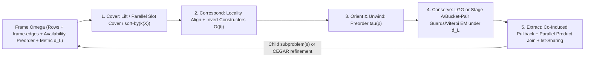
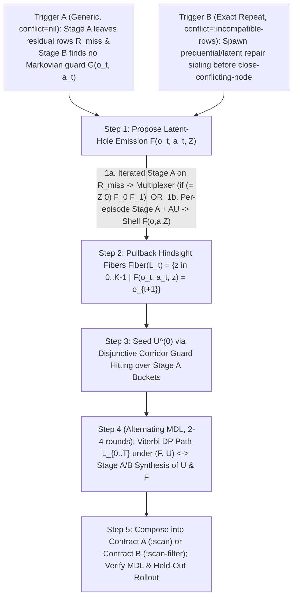

# `lisploop` — Plan 8: Unified Cover–Correspond–Orient–Conserve–Extract, Pluggable Metrics, Product & Relational Scaffolding, and Latent World Modeling

> **Status:** Architectural audit and implementation plan (v2, revised after adversarial technical review), 13 November 2026.
> Audited against the authoritative Common Lisp kernel at commit `b6e289e` (24 kernel modules in `load.lisp`, `12,433` LOC + 5 milestone modules in `milestones/`, `1,401` LOC), cross-referencing `prompt4.md`, `architecture2.md`, `plan7.md`, `plan7-recursion.md`, `plan7-library.md`, `plan7-higher-order.md`, `plan7-m9-policy.md`, and `plan8-2.md`.
> Every empirical benchmark and bit-size figure in §1.3 and Appendix A is accompanied by self-contained reproduction code verified against commit `b6e289e`.

---

## 1. Executive Synthesis & Cross-Audit (`b6e289e` Reality Check)

This plan reconciles anti-unification (AU), top-down/bottom-up (TD+BU) synthesis, pluggable Stage A/B geometry, and relational `frame` scaffolding, and establishes the exact architectural path to non-Markovian `[observation] -> [action] -> [observation]` world modeling.

### 1.1 Where `plan8-2.md`'s Restrictive Calibration Holds

1. **Share the data model and agenda; do not merge the inner algorithms (`plan8-2.md` §4.3).**
   Syntactic AU (`anti-unify` in `unify.lisp:36`) is linear-time ($O(|t|)$) and deterministic because free-algebra constructors (`:cons`, `:tuple`, AST application nodes) are **injective**; all search on the AU side lives in **correspondence** (which functions, rows, or subtree occurrences to align). Computational synthesis (`enumerate.lisp`, `condense.lisp`, `synthesize.lisp`) searches over **many-to-one** operators (`:+`, `:*`, `:at`, `:fold`), where row correspondence is fixed upfront and search lives in **conserved computation**. They meet as **distinct operators emitting `decomposition`s and `frame`s onto one full-path MDL agenda**.
2. **Keep the two senses of "fiber" and "table vs. graph" distinct (`plan8-2.md` §3.2–3.3).**
   - *Preimage / value fiber (`plan7.md` §2):* $\mathrm{Fiber}(\omega) = \{z \mid B_\omega(z) = \mathrm{true}\}$, arising only when a non-injective operator aliases inputs. Injectivity of syntax constructors means AU produces **point substitutions**, not multi-valued preimage fibers.
   - *Occurrence / bundle fiber (`select-active-fiber-rows` in `frame.lisp:529`):* The $k$ child occurrences $(\omega, \text{coord})$ unfolded from one parent object $\omega$ under a 1-to-many cover (`lift-frame` or `collect-tree-occurrences`).
   - *Star-table vs. graph:* Root-aligned `anti-unify` is isomorphic to `observation-bucket` over root-to-leaf path selectors. True graph topology enters only with **unaligned correspondence** (`discover-subexpression-abstractions` in `milestones/corpus.lisp:583`, cross-step entity tracking) and **cross-row edges** (`pairs`, `anchors`, `frame-edges`).
3. **Kernel audit baselines (`plan8-2.md` §2.5, §3.5, §6.5, §8).**
   - Exact search (`search-step` in `enumerate.lisp:455`) **ignores `pairs` and `anchors`**; only `observation-job` and Stage A (`condense.lisp`) read them.
   - Functorial inverters in `bootstrap-inverters.lisp:6` are host-coded structural recognizers, not general AU over `:inverts` edges.
   - `evaluate-frame-descriptors` does not exist in `descriptors.lisp`; descriptors run per entry in `score-entry-by-descriptors` (`descriptors.lisp:688`).
   - Reifying `frame`s as object-language values (`plan8-2.md` §6.5) belongs **last**, behind a static firewall preventing candidate ASTs from reading `row-key`.

### 1.2 Six Calibrated Findings & Audit Corrections

1. **Reorientation requires *symbolic* solver unwinding to advance singleton frames.**
   `plan8-2.md` (§4.1) omits Operation 3's Reorientation (`orient-observations` in `frame.lisp:255`, `conserved-quantity-frame` in `frame.lisp:793`, `propagate-requirements` in `laws.lisp:781`). However, on a frame whose target rows are *already* singletons, discovering $C(\mathbf{x}, Y) = c_0$, pulling back via `conserved-quantity-frame`, and running numeric per-row `propagate-requirements` (`solve-learned-equality` in `laws.lisp:761`) **merely reproduces the starting singleton frame** (`tests/recursion.lisp:559-640`), while degenerate invariants like `(- Y Y) = 0` collapse to `'t`. Useful conservation-inversion on singleton targets requires **target-sensitivity filtering** plus **symbolic solver unwinding (`solve-equality-symbolically`)** over ASTs (§3.3 Move 4).
2. **Exact empirical boundary of `:tuple` mechanics, Stage B guard discovery, and `let`-sharing (High-Priority #4).**
   Empirical testing on `b6e289e` (Appendix A.2) sharpens the `:tuple` diagnosis:
   - **Already works:** `retype-function-definition` (`templates.lisp:183`) retypes `:scan` to `(:tuple :int :int)`; `lift-frame` (`frame.lisp:684`) unfolds fully-observed `:scan-tup` with `coupled = 0`; and `make-additive-residual-decoder` (`decompose.lisp:13`) **already** expands additive decoders slot-by-slot `(tuple (+ (at base 0) (at Z 0)) ...)`, solving symmetric tuple motion `(s0 + a, s1 + a)` today in **`80,212`–`100,903` work** (emitting `Z = (tuple X1 X1)`).
   - **Why push-on-contact fails at `800k` and `4M` work (four compounding bottlenecks, not one):**
     1. *Bit cost & monolithic child hole:* `(at s 0)` costs **`30` body-bits** (`63` description-bits), and monolithic push-on-contact is **`207` body-bits** (`250` description-bits); `Z` in `make-additive-residual-decoder` and Path B2 `(if G base Z)` is still a single tuple-typed `child-var`, not independent scalar subproblems.
     2. *Depth blowup under sequential splitting:* Chaining $k$ coordinates sequentially consumes $k$ levels of `max-depth` (default `2` in `decompose.lisp:419`). Coordinate factoring must be a **parallel multi-hole `product-decomposition`** (`depth + 1` for all $k$ slots simultaneously; note `child-scope-signature` in `synthesize.lisp:199` is strictly a `scope-cache` key, not a joiner).
     3. *Guard bound & syntactic `:bool` enumeration:* Even *after* projecting `(s0, s1, a)` to 2-bit scalar variables, the contact guard `(= (+ s0 a) s1)` is **`27` body-bits** (vs. default `guard-bound` of **`20`** in `decompose.lisp:305`, and `51` body-bits for the block rule), and `observed-predicates` (`decompose.lisp:68`) fails to reach it in `500,000` work because it syntactically re-enumerates `:bool` ASTs instead of pairing the **22–30 `:int` feature buckets already computed by Stage A** in `(heuristic-buckets h-model)` (`condense.lisp:240`)! Pairing `heuristic-buckets` with `=`/`<` finds `(= X1 (+ X0 X2))` in **`30,000` Stage A work + `231` bucket-pair checks** (`0` extra VM runs).
     4. *Inline binding duplication (`compose-model` in `frame.lisp:399-404`, **#4**):* Multi-use projected/derived bindings inline multiplicatively unless shared via homoiconic `:code-eval` `let`-frames (§3.3 Move 0a).
3. **Two distinct non-Markovian regimes require two explicit prediction contracts (Open-Loop Rollout vs. Prequential Filtering).**
   - **Endogenous memory** (a deterministic function of $(o_0, a_{0..t-1})$, e.g., `stuck(A, B)` after observed contact) supports **Contract A — Open-Loop Rollout** `(o_0, actions) -> (o_1 ... o_T)` via `:scan`.
   - **Exogenous episode latents** (`plan8-2` Case 3, $s' = s + a \cdot k$ where two episodes share identical `(o_0, actions)` and produce different outputs) are **impossible** under Contract A (`:incompatible-rows` at the root!). They require **Contract B — Online Prequential Filtering** via `:scan-filter`: predicting $\hat{o}_{t+1} = F(o_t, a_t, L_t)$ from pre-$t+1$ state $L_t$, updating $L_{t+1} = U(o_t, a_t, o_{t+1}, L_t)$ *after* $o_{t+1}$ arrives, pricing unavoidable pre-exposure misses in prequential MDL, and **pricing latent channel bit-capacity** $C_{\mathrm{cap}}(\tau_L)$ so memorizing raw observations is penalized (§4.2).
4. **Hindsight latent discovery requires explicit latent-hole decoder generation and alternating MDL—not one-pass persistence intersection.**
   - In `synthesize.lisp:426-430`, `conflict` skips Stage A and closes the node, and in multi-object worlds exact `(o_t, a_t)` collisions rarely occur (`conflict = nil`); the generic trigger is **Stage B Markovian guard failure on persistent Stage A residuals** (§4.4).
   - Latent fibers $\mathrm{Fiber}(L_t)$ exist only relative to a proposed $F(o_t, a_t, L_t)$, generated by **iterated Stage A on miss-row subsets $\to$ regime multiplexer** (or per-episode Stage A + AU), *not* by clustering action-confounded raw residuals $L \cdot \Delta(a_t)$.
   - Soft `:persistence` alone ties `(0, 0, 1, 1)` and `(0, 0, 0, 1)` (1 flip each), while hard equality would collapse $L_3 = 1$ into $L_0 = 0$. Pinning the switch to contact step $t=1$ requires **joint MDL alternation** between latent trajectories and transition law $U$ (§4.4).
5. **Pluggable & Co-Induced `(decoder, :solver)` DSL Metrics (High-Priority #1) & Ontology-Free Availability Preorder.**
   Stage A metrics and Stage B decoders co-induce one another via library `(decoder, :solver)` pairs (paired with tentative correlational `:solver`s `#5`, §3.1). On `schema`, hardcoded `:state`/`:action`/`:next-state` roles are replaced by an **ontology-free availability preorder** $\tau(p) < \tau(q)$, while all cross-step reading uses **composable combinator lifts (`lift-frame`)** rather than non-composable cross-row `bindings` (§4.2–4.3).
6. **True mechanism of input-arity scaling (`P8.2` Stage A budget scaling).**
   Adding one irrelevant scalar input to scalar `:scan` increases work from `21,023` to `158,433`–`547,872` ($7.5\times$–$26\times$), **identically** at `description-limit` `90` and `110`. The bound is irrelevant: fixed `heuristic-budget` cuts off Stage A *just before* `(+ s a)` under wider 3-input enumeration, missing `exact-heuristic-program` (`synthesize.lisp:479`) and expanding ~14 sibling/Stage B nodes. Raising `:heuristic-budget` to `30,000` restores the fast path (`62,942`–`73,335` work), motivating **arity-scaled Stage A budgets** in `P8.2`.

### 1.3 Verified Empirical Benchmark Summary at Commit `b6e289e`

| Probe Case (Runnable in Appendix A) | Framing / Rule | Result on `b6e289e` | Exact Mechanism / Bottleneck |
| :--- | :--- | :--- | :--- |
| **1. Scalar Markov (`plan8-2` Case 1)** | `s' = s + a` (`:scan`) | **Solved** in `21,023` work | Stage A hits `exact-heuristic-program` fast path |
| **2. Scalar + 1 Irrelevant Input** | `s' = s + a`, unused `z` (`bounds 90 & 110`) | **Solved** in `158,433` (`+/*`) / `547,872` (`+/-/=`) work (identical at 90 & 110) | Fixed Stage A `heuristic-budget` misses fast path, expanding ~14 Stage B/sibling nodes |
| **3. Same + Stage A Budget `30,000`** | `s' = s + a`, unused `z` (`:heuristic-budget 30000`) | **Solved** in `62,942` (`+/*`) / `73,335` (`+/-/=`) work | Restores Stage A exact fast path; proves Stage A budget must scale with input arity (`P8.2`) |
| **4. Scalar Visible Mode (`plan8-2` Case 2)** | `s' = s + a*k` (`k` visible) | **Solved** via `:code-subst` in `1,263,978` work | Needs passthrough DIP + 3-var expression enumeration |
| **5. Scalar Exogenous Hidden `k` (`Case 3`)** | `s' = s + a*k` (`k` omitted, equal `(o_0, a)`) | **Fails** (`:incompatible-rows` in `271` work) | Impossible open-loop; requires **Contract B (`:scan-filter`)** + per-episode AU (`P8.5`) |
| **6. Tuple Symmetric Motion** | `s' = (s0 + a, s1 + a)` (`:scan-tup`) | **Solved today** in `80,212`–`100,903` work | `make-additive-residual-decoder` splits `+` per slot; `Z = (tuple X1 X1)` is tiny |
| **7. Tuple Push-on-Contact** | `207` body-bits (`(at s 0)` = `30` bits) | **Fails** at `800k` and `4M` work (`coupled = 0`) | Monolithic tuple `Z`, sequential depth $> 2$, default `guard-bound = 20` $< 27$, syntactic guard search |
| **8. Projected Contact + Stage A Bucket Pairs** | `(s0, s1, a)` projected; pair `heuristic-buckets` by `=` | Finds exact 27-bit guard `(= X1 (+ X0 X2))` in **`30,000` work + `231` pair checks** | Reusing `heuristic-buckets` (`condense.lisp:240`) bypasses $>500\text{k}$ syntactic `:bool` enumeration (`P8.1`) |
| **9. Tuple Slot 1 Hidden (`:scan-proj0`)** | Output `(at next 0)` only | Step 0 partial; steps $t \ge 1$ `:coupled` (`:unresolved`) | `congruence-close-code-evals` requires ground tuple witness; needs `P8.5` latent synthesis |

---

## 2. Current Intersection, Gap Map, & Kernel Streamlining Targets

### 2.1 Where Search Lives Across Mechanisms

| Mechanism | Ambient Space | Shared Part $p$ | Per-Instance $\theta_\omega$ | Where Search Lives |
| :--- | :--- | :--- | :--- | :--- |
| **Aligned AU** (`unify.lisp:36`) | `:code` ASTs (root-aligned) | LGG pattern $p(?0 \dots ?k)$ | Point substitutions $\sigma_\omega$ | **None** ($O(\|t\|)$ closed form); `abstraction.lisp` searches *corpus subsets* |
| **Unaligned Subtree AU** (`milestones/corpus.lisp:583`) | `:code` ASTs (arbitrary paths) | Shared subterm template | Path occurrences + arguments | **Correspondence search** (3:1 locality-scheduled occurrence pairs) |
| **Library AU** (`abstraction.lisp:98, 181`) | Recursive `:function` ASTs | Higher-order combinator (`:code-eval`) | Closed `:code` literals + FO args | **Subset search** + `shared-subterm-cover` continuation factoring |
| **Exact / Stage A Synthesis** (`enumerate.lisp`, `condense.lisp`) | Runtime values $\mathcal{V}_\tau$ | Program $e(X)$ or heuristic $\hat{\pi}(X)$ | Given `row-known` (+ delta packet $\varepsilon_\omega$) | **Computation search** (size-tiered grammar enumeration over fixed rows) |
| **TD Pullback / Product / Lift** (`frame.lisp`, `fibers.lisp`, `decompose.lisp`) | Requirement predicates $A_\omega(Y)$ | Outer decoder $d(X, Z_0 \dots Z_{m-1})$ | Child fibers $B_{\omega,j}(Z_j)$ / regime labels | **Decoder & partition search** (vertical target change + horizontal row splits) |

### 2.2 Online vs. Offline Contact Boundary

- **Active Contacts:**
  1. `consolidate-library-functions` (`abstraction.lisp:466`) $\to$ `library-decompositions` (`proposals.lisp:297`) $\to$ `lift-frame` (`frame.lisp:684`).
  2. `anti-unify-nogood-clauses` (`nogoods.lisp:214`) + stateless 1-step DIP context repair (`nogoods.lisp:456`).
  3. `match-pattern` inside `:code-match` / `:code-bind` (`vm.lisp:113`) for `:law` rewriters and `:transformer` rules.
- **Missing Core Capabilities Addressed in §§3–4:**
  1. **Inline-only `compose-model` (`frame.lisp:399-404`, #4)** & **single-hole `decomposition` (`synthesize.lisp:8`)** + syntactic-only `observed-predicates` (`decompose.lisp:68`).
  2. **Host-coded `correction` (`frame.lisp:1003-1086`, #1)** & missing **tentative parameter `:solver`s (#5)**.
  3. **Static row topology (#2)** (`sort-by` ordering keys not synthesized from Stage A feature buckets).
  4. **Offline-only Constructor AU** (`au-substitutions-frame` in `milestones/corpus.lisp:294`) & **numeric-only `solve-learned-equality`** (`laws.lisp:761`, lacking symbolic AST unwinding).
  5. **Append-only consolidation (#6)** (lacking Monoid/Fold motif quotienting, cross-prime solver AU, and net-utility cold-archive demotion).

### 2.3 Verified `plan7-m9-policy.md` Audit Against `b6e289e`

| M9 Component | Kernel Status (`b6e289e`) | Authoritative Location & Gap |
| :--- | :--- | :--- |
| **M9.1** `:max-fibers` + 3:1 window + CEGAR | **Implemented** | `requirements.lisp:306`, `frame.lisp:529`, `synthesize.lisp:845`; `probe-frame-coordinates` (`frame.lisp:598`) has **0 callers** |
| **M9.2** Smooth `:seq-delta` & fast guards | **Host-only / 1D partial** | `correction` (`frame.lisp:1003`); generalized to pluggable/co-induced DSL metrics in `P8.2` |
| **M9.3** Compositional address index | **Unused in retrieval** | `find-knowledge-entries-by-address` (`knowledge.lisp:253`) — **0 callers in `proposals.lisp`** |
| **M9.4** Frame descriptor cache & eager cap | **Missing** | Per-entry `score-entry-by-descriptors` only; no `*max-eager-proposals-per-node*`; fixed Stage A budget ignores input count |

### 2.4 Kernel Indirection Audit & Codebase Streamlining Map (~950–1,300 LOC Removable)

Plan 8 adds ~`750–900` LOC of new capability while retiring **~`950–1,300` LOC** of historical dual-track indirection (`P8.7`):
1. **Unify `laws.lisp` onto `knowledge.lisp` (~350–450 LOC saved):** Store laws and solvers directly as `knowledge-entry` payloads, retiring parallel `law`, `rewrite-library`, `certified-solver`, and `solver-library` structs and adapter glue.
2. **Compile `bootstrap-inverters.lisp` & `descriptors.lisp` via `learn-knowledge-transformer` / `term` (~250–350 LOC saved):** Replace nested host `app`/`lit` meta-AST builders with declarative `(source, target)` rule pairs.
3. **Unify the 10 Bespoke Frame Builders in `frame.lisp` & Absorb `milestones/corpus.lisp` (~350–500 LOC saved):** Factor `pullback-frame`, `restrict-frame`, `orient-observations`, `conserved-quantity-frame`, `au-substitutions-frame`, etc. through one parameterized **`Cover + Orient`** constructor over `frame-edges`, and unify `nogood-clause` / `:uip-clause` (`nogoods.lisp:5, 214`).

---

## 3. The Five-Stage Unified Operator: Cover–Correspond–Orient–Conserve–Extract (SMOCE)

### 3.1 Concrete Geometry & Topology Mechanics (Non-Metaphorical Specification)

1. **Target Geometry — Pluggable & Co-Induced `(decoder, :solver)` DSL Metrics *(High Priority — #1, Phase `P8.2`)*:**
   - *Explicit `:metric` AST Hook:* Add `(metric nil)` slot to `frame` (and `:metric` keyword to `start-heuristic-search`, `condense-heuristic`, `start-synthesis`), holding an optional total `:code` AST `M : (tau, tau) -> :int` (`0` iff equal, metered on `ledger` inside `select-closest-witness` at `frame.lisp:1088` and `relational-linkage-residual` at `enumerate.lisp:543`).
   - *Co-Induced `(decoder, :solver)` Metric Registry:* Define knowledge edge `(:metric-decoder decoder-expr solver-id tag-bits)` for any binary action $d : (\tau, \tau_\delta) \to \tau$ paired with a `provably-total-p` `:solver` $q : (\tau, \tau) \to \tau_\delta$ (certified or tentative `#5`, e.g., `:+` $\leftrightarrow$ `:-`, `:shift-seq` $\leftrightarrow$ `:argmax-corr`, `:code-subst` $\leftrightarrow$ `anti-unify`). During `correction(predicted, target, type)`:
     1. Evaluate the top-$k$ ($k \le 4$) type-matching `(d, q)` pairs (charging `ledger` `:heuristic-residual`): compute $\delta = q(\hat{y}, y)$, verify $d(\hat{y}, \delta) = y$, and score $S_{\mathrm{tag}}(d) + \text{value-bit-size}(\delta, \tau_\delta)$, capped by plain `correction-bit-size`.
     2. Record the winning `(d, delta)` in the row's residual entry `(row-key :metric d delta)`.
     3. In Stage B (`decompose.lisp`), `make-metric-residual-decoder` groups missed rows by their winning `d` and proposes **pullback decoder $Y = d(\hat{\pi}(X), Z)$** (`Z : tau_delta`), directly generalizing Path B1 (`+`) to arbitrary learned group/monoid actions!
2. **Index Topology — Synthesized `sort-by(k(X))` Output-Variation `frame-edges` *(#2, Phase `P8.3`)*:**
   - Given a frame with `:<`-orderable feature buckets in Stage A's `(heuristic-buckets h-model)` (`condense.lisp:240`) and no pre-existing `:succ`/`:persistence` edges:
     1. For each non-constant scalar/lexicographic bucket $k(X) = (v_{\omega_1}, \dots, v_{\omega_n})$ (`O(|B|)` candidates, zero extra VM evaluations), sort row indices by $k(\mathbf{x}_\omega)$ to form chain edges $E_k = \{(\pi_i, \pi_{i+1})\}$ (with equal-$k$ ties forming `:equal` pairs and extremal quantiles forming `:distinct` anchors).
     2. Compute target variation $V(E_k) = \sum_{(u,v) \in E_k} d_{\mathcal{L}}(y_u, y_v)$ on singleton/witness rows against the unpermuted baseline $V_0$.
     3. When $V(E_k) + \text{description-size}(k) < V_0$, attach $E_k$ as `:persistence` `frame-edges` (guiding Stage A's `relational-linkage-residual`) and register $k(X)$ as a `:locality-key` descriptor in `*knowledge-library*`.

### 3.2 The Five Stages

| Stage | Mathematical Operation | On Syntax / Constructors (`:code`, `:tuple`, `:cons`) | On Interpreted Computation & Trajectories |
| :--- | :--- | :--- | :--- |
| **1. Cover** *(Unfold / Order)* | Map $\Omega$ to occurrence fiber $\{(\omega, c)\}$ or `sort-by(k(X))` chain + 3:1 window & reserve | `collect-tree-occurrences`; parallel `:tuple` slot cover `(row, slot-j)` | `lift-frame` (`:scan`, `:scan-filter`, `:map-adj`); `sort-by(k(X))` `:persistence` chains; entity cover |
| **2. Correspond** *(Align & Match)* | Align occurrences (via `:locality-key`) & invert injective constructors in $O(\|t\|)$ | Root walk; 3:1 `:locality` pairing; `match-pattern`, `fold-equal-tuple`, `fold-equal-cons` | Row key alignment; minimum-$d_{\mathcal{L}}$ bipartite entity tracking; `infer-fibers` blocks |
| **3. Orient** *(Preorder & Solve)* | Partition ports under availability preorder $\tau(p) < \tau(q)$ (§4.2) & run symbolic/numeric `:solver`s | Orient `(= lhs rhs)` by `expression-less-p`; symbolic solver unwinding | **Rollout (`:scan`)** | **Filtering (`:scan-filter`)** | **Symmetric** $C(W)=c_0 \xrightarrow{\text{symbolic}} Y=g(X)$ | **Abductive** $F(o_t, a_t, Z)=o_{t+1}$ |
| **4. Conserve** *(MDL + Variation)* | Minimize $S(p) + S_{\mathrm{rows}}^{d_{\mathcal{L}}}(\varepsilon) + S_{\mathrm{edges}}^{d_{\mathcal{L}}}(\varepsilon) + C_{\mathrm{cap}} + \lambda W_{\mathrm{run}}$ | Closed-form LGG `anti-unify` + `shared-subterm-cover`; `provably-total-p` | Tiered search + Stage A under $d_{\mathcal{L}}$; Stage A bucket-pair guards; alternating Viterbi/Stage A-B |
| **5. Extract** *(`let`-Share & Join)* | Emit single or parallel `product-decomposition` with `:code-eval` `let`-sharing | `abstraction-parameters`; multi-hole Constructor-AU `p(?0..?m)`; `:uip-clause` | Co-induced $d(\hat{\pi}(X), Z)$ pullback; parallel tuple join; `:code-eval` `let`-frames; `:scan` / `:scan-filter` |



### 3.3 Concrete Unification Moves (Prioritizing #4 and #1 First)

- **Move 0a *(High Priority — #4)* — Homoiconic `let`-Sharing in `compose-model` (`frame.lisp:399`):**
  Count free-variable occurrences of each binding `(id_r . b_r)` in `(instantiate decoder (list (cons child-id child-model)) :var)`. Whenever sharing bindings referenced $\ge 2$ times strictly lowers `candidate-score` ($S(M) + \lambda_{\mathrm{run}} W_{\mathrm{run}}(M)$) relative to inline substitution, emit:
  $$(\texttt{:code-eval}\;\; (\texttt{lit}\;\; (\texttt{:code}\;\; ((0 . \tau_0)\dots(r{-}1 . \tau_{r-1}))\;\; \tau_{\mathrm{out}})\;\; \mathrm{body})\;\; b_0\dots b_{r-1}).$$
  Requires **zero new VM opcodes**, preserves `O(1)` `provably-total-p` (`ast.lisp:826`), and unfolds transparently in `call-unfolding` (`requirements.lisp:347`).
- **Move 0b *(High Priority)* — Parallel Multi-Hole `product-decomposition`, Tuple Projection, & Bucket-Pair Guards (`synthesize.lisp`, `decompose.lisp`, `proposals.lisp`):**
  1. *Tuple-Input Projection:* Automatically bind scalar/element projections `(at X_i '0) ... (at X_i '(k-1))` for small `:tuple` inputs ($k \le 6$), eliminating the **30-body-bit** cost of repeated `(at s j)` trees (with Move 0a sharing multi-use projections).
  2. *Parallel Multi-Hole `product-decomposition` (fixing sequential depth blowup):* Extend `synthesis-node` with an AND-join product mode (`product-slots`: list of `(hole-id child-type child-frame)` when row requirements factor into independent per-hole conjuncts via `fold-equal-tuple` / `match-pattern`). All $k$ coordinate subproblems spawn **in parallel at the same computational depth** (and pure constructor unpackings do not decrement `max-depth`), reassembling `(tuple e_0 ... e_{k-1})` as soon as every slot has a verified child expression. *(When row requirements couple slots, e.g. `(= (+ (at Y 0) (at Y 1)) 5)`, product factoring declines cleanly.)*
  3. *Stage-A Bucket-Pair Guard Discovery (fixing `guard-bound = 20` & syntactic `:bool` enumeration):* Upgrade `find-sound-exception-guard` (`decompose.lisp:81`) to **first** test `(= b_i b_j)` and `(< b_i b_j)` across pairs of already-evaluated Stage A feature buckets in `(heuristic-buckets h-model)` (`condense.lisp:240`, up to combined body-bits $\le 32$) before falling back to `observed-predicates`. On push-on-contact, `(+ s0 a)` (`14` bits) and `s1` (`3` bits) are already in `heuristic-buckets`, discovering `(= X1 (+ X0 X2))` (`27` bits) in `231` vector comparisons with **zero extra VM evaluations**.
- **Move 1 *(High Priority — #1 & #5)* — Pluggable Metrics, Co-Induced `(decoder, :solver)` Pullbacks, & Heuristic Solvers:**
  Implement §3.1's `:metric` AST hook + `(:metric-decoder d q)` Stage A/B bridge alongside tentative `:certified-p nil, :unique-p nil` parameter `:solver`s (`:argmax-corr` lag search for shifted sequences/grids, conserved-sum / first-moment difference estimators), safeguarded by `witness-replays-p` and 3:1 `propagation-fallback` (`laws.lisp:821-824`).
- **Move 2 *(#2)* — Synthesized `sort-by(k(X))` Output-Variation `frame-edges`:**
  Implement §3.1(2)'s `O(|B|)` bucket-sorting topology pass and `:locality-key` registration.
- **Move 3 — Constructor AU as a Parallel Multi-Hole Expander (`unify.lisp` + `proposals.lisp`):**
  Promote `au-substitutions-frame` (`milestones/corpus.lisp:294`) into `load.lisp`, emitting LGG constructor skeletons $p(?0 \dots ?m)$ directly into Move 0b's parallel `product-decomposition`, and anti-unify `:decoder-template` entries in `remember-decoder-template` (`proposals.lisp:654`).
- **Move 4 — Sensitivity-Checked Symbolic Equation Unwinding (`laws.lisp` + `proposals.lisp`):**
  Fix circular per-row conservation-inversion:
  1. **Target-Sensitivity Filter:** Accept joint invariant $C(\mathbf{x}, Y) = c_0$ only if `Y` occurs free in $C$ and perturbing $y_\omega \mapsto y'_\omega$ alters $C(\mathbf{x}_\omega, y)$ on $\ge 1$ row (rejecting `(- Y Y) = 0` and `(* 0 Y) = 0`).
  2. **Symbolic Unwinding (`solve-equality-symbolically`):** Apply certified `:solver` witness ASTs **symbolically** to `(= C(X, Y) 'c_0)` (verifying solver domain guards on `row-known`) to emit closed-form candidate $Y = g(X)$ directly—or, if $C(X, h(Y)) = c_0$ unwinds to `(= h(Y) g(X))` for non-identity $h$, emit the simplified requirement frame. Reserve numeric `conserved-quantity-frame` strictly for unoriented relational tables where $Y$ was not already the target.
- **Move 5 — Stage-A-Seeded Decoder-Shell AU *(Exploratory, `P8.8`)*:**
  Anti-unify 1-edit variations of Stage A's $\hat{\pi}(X)$ across missed rows or episodes (used in §4.4 to propose parametric emission shells like `(+ s (* Z a))`).

---

## 4. Frames, Availability Preorders, Prediction Contracts, & Latent Abduction

### 4.1 Exact Reach and Limits of `:tuple` for Dependency Structuring

| Use Case | `:tuple` Support | Kernel Mechanism & Boundary |
| :--- | :--- | :--- |
| **Fixed-arity transition / stencil** `(o_t, a_t, o_{t+1})` | **Yes** | `orient-observations` (`frame.lisp:255`) projects columns under availability preorder $\tau$ |
| **Fixed-$N$ object mechanics** `((x_0, y_0), ...)` | **Yes (with Moves 0a & 0b)** | `lift-frame` (`coupled = 0`) + parallel `product-decomposition` + Stage A bucket-pair guards |
| **Fixed-$N$ latent accumulator** `(Obs, Latent)` | **Runtime yes; `lift-frame` observed-only** | Deployed `:scan` / `:scan-filter` runs `(Obs, Latent)` cleanly; learning unobserved `Latent` requires §4.4 |
| **Variable-count entities & edges** $G_t = (V_t, E_t)$ | **Inside `(:seq (:tuple ...))`** | Canonicalized `:locality-key` sequences + fuel-bounded `:fix-seq` (§4.5) |

### 4.2 Ontology-Free Availability Preorder & Two Explicit Prediction Contracts

1. **Availability Preorder Instead of Baked-In `:state`/`:action`/`:next-state` Roles:**
   To leave framing free "à la physics" rather than hardcoding `[state, action, next-state]` into `schema`, optional column/element metadata carries only an **availability index** $\tau(p)$ in a preorder $(\mathcal{T}, \le)$ (supplied by stream arrival order—e.g. $\tau(o_t) = 2t,\; \tau(a_t) = 2t+1,\; \tau(o_{t+1}) = 2t+2$—or induced by `sort-by`).
   - **Causal admissibility rule:** Predicting a target at availability $\tau_{\mathrm{target}}$ may read only ports with $\tau(p) < \tau_{\mathrm{target}}$ (and never `row-key`). Symmetric invariant discovery temporarily relaxes `<` on a window to find $C(W) = c_0$, then symbolically unwinds (§3.3 Move 4) for the maximal-$\tau$ port in terms of strictly earlier ports; abductive training probes read recorded $\tau \le T$ solely to infer training-time latent fibers.
2. **Two Explicit Prediction Contracts for Non-Markovian Worlds:**
   - **Contract A — Open-Loop Rollout (`:scan`, Endogenous Memory):**
     - *Signature:* `(o_0, (a_0 ... a_{T-1})) -> (o_1 ... o_T)` via `(scan-state actions (tuple o_0 l_0) step)`.
     - *Update & Emission:* `step((o_t, L_t), a_t) -> (F(o_t, a_t, L_t), U(o_t, a_t, L_t))`—intermediate observations $o_1 \dots o_T$ are **never read from data at rollout time**.
     - *Scope:* Solves history-determined symbolic linkages (`Control 2b`: `stuck(A, B)` toggled by contact/splitter events). **Provably rejects** exogenous episode parameters when identical `(o_0, actions)` yield distinct trajectories.
   - **Contract B — Online Prequential Filtering (`:scan-filter`, Exogenous Latents & Regimes):**
     - *Signature:* `(o_0, ((a_0, o_1) ... (a_{T-1}, o_T))) -> (\hat{o}_1 ... \hat{o}_T)`.
     - *Causal Step Order ($\tau$-admissible!):* At step $t$, **first** emit prediction $\hat{o}_{t+1} = F(o_t, a_t, L_t)$ ($\tau(o_t), \tau(a_t), \tau(L_t) < 2t+2$); **then**, after $o_{t+1}$ arrives at $\tau = 2t+2$, update belief $L_{t+1} = U(o_t, a_t, o_{t+1}, L_t)$ for step $t+1$ (which predicts $o_{t+2}$ at $2t+4 > 2t+2$).
     - *Prequential MDL & Latent Capacity Pricing:* Because step $0$ cannot know an exogenous episode parameter $k$ before $o_1$ arrives, candidates are scored on **cumulative prequential MDL** across episodes:
       $$J_{\mathrm{filter}}(F, U, L_0) \;=\; S(F) + S(U) + S(L_0) + N_{\mathrm{steps}} \cdot C_{\mathrm{cap}}(\tau_L) + \sum_{e, t} d_{\mathcal{L}}(\hat{o}_{e, t+1}, o_{e, t+1}) + \lambda W_{\mathrm{run}},$$
       where $C_{\mathrm{cap}}(\tau_L)$ charges latent bottleneck bit-width ($\lceil \log_2 K \rceil$ bits/step for finite regime `:gf K`/`:bool`, or per-step `value-bit-size` of $L_t$). Because $\hat{o}_{t+1}$ uses $L_t$ (not $L_{t+1}$) and $L_t$ pays $C_{\mathrm{cap}}$, neither "latent = next observation" nor unbounded history-recording sequences can cheat MDL.

### 4.3 `frame-edges` vs. Composable Combinator Lifts (No Cross-Row `bindings` Smuggling)

A strict separation keeps `compose-model` 100% sound:
- **`decomposition-bindings` (`frame.lisp:392`) remain strictly single-row.** A child binding never reads a neighboring row's `row-known` directly, because a single-row root AST cannot access neighboring table rows at test time.
- **`frame-edges` (`:equal`, `:distinct`, `:persistence`, `:recurrence`) act exclusively on candidate/target outputs across rows:** hard predicates (`:equal`, `:distinct`, `:recurrence`) are checked in `search-step` (`enumerate.lisp:455`), while soft `:persistence` ($d_{\mathcal{L}}(M(u), M(v))$) is priced in `relational-linkage-residual` (`enumerate.lisp:543`).
- **All cross-step input context (`o_t, a_t, o_{t+1}, L_t`) enters via composable higher-order combinator lifts (`lift-frame`)**—`:map-adj` (1-step Markov transitions), `:scan` (Contract A open-loop rollout), `:scan-filter` (Contract B prequential filter), or `:lag-2-scan` (velocity dynamics)—so `compose-lifted-model` (`frame.lisp:770`) always reconstructs a self-contained, root-executable AST.

### 4.4 Latent World-Model Synthesis: Decoder Proposal + Alternating Viterbi/Stage A–B MDL

This section replaces one-pass hindsight/persistence heuristics with a concrete, closed-loop algorithm addressing Triggers, Latent-Hole Decoder Generation, and Joint $(L, U, F)$ Optimization:



1. **Triggers (Fixing `synthesize.lisp:426-430` Interaction):**
   - *Trigger A (Generic multi-object case, `conflict = nil`):* Stage A runs on lifted step frame `(o_t, a_t) -> o_{t+1}`, finds free-motion baseline $F_0(o_t, a_t)$, and Stage B's bucket-pair + `observed-predicates` guard search finds **no sound Markovian guard $G(o_t, a_t)$** (or leaves high residual bits across all eager branches).
   - *Trigger B (Exact `(o_t, a_t)` collision, `conflict = :incompatible-rows`):* In `prepare-synthesis-node` (`synthesize.lisp:443`), alongside `dip-repairs`, emit a latent-abduction sibling (routing Contract A if history prefixes up to $t$ differ between colliding steps, or Contract B `:scan-filter` if full root inputs collide as in `Case 3`).
2. **Step 1 — Generating Latent-Hole Decoders $F(o_t, a_t, Z)$ (Without Clustering Confounded Residuals):**
   - *Generator 1a (Iterated Residual Stage A $\to$ Discrete Regime Multiplexer):* Restrict the step frame to Stage A's missed rows `R_miss = restrict-frame(frame, miss-keys)` and run Stage A again! On push/stuck blocks, $B$'s motion on `R_miss` is **not** a constant cluster—it is the simple function $F_1(o_t, a_t) = x_B + \Delta(a_t)$! Repeat up to $K \le 4$ while each new law $F_k$ reduces residual bits by more than $S(F_k) + N_{\mathrm{steps}}\lceil\log_2(k+1)\rceil$, assembling:
     $$F(o_t, a_t, Z) \;=\; (\texttt{if}\; (\texttt{=}\; Z\; 0)\; F_0(o_t, a_t)\; F_1(o_t, a_t)), \qquad Z \in \{0, \dots, K-1\}.$$
   - *Generator 1b (Per-Episode Stage A + AU Shell):* When episodes conflict (`Case 3`), condense Stage A separately per episode (`(+ s a)` on ep 0, `(+ s (* 2 a))` on ep 1), normalize (`(+ s (* 1 a))`), and `anti-unify` into parametric shell $F(s, a, Z) = \texttt{(+ s (* Z a))}$.
3. **Step 2 — Well-Defined Hindsight Fiber Pullback:**
   Pull each recorded step $(o_t, a_t, o_{t+1})$ back through the explicit decoder $F(o_t, a_t, Z)$ (`pullback-frame` + `propagate-requirements`):
   - Step $t=0$ ($A$ moves, $B$ stays; only $F_0$ matches): $\mathrm{Fiber}(L_0) = \{0\}$.
   - Step $t=1$ ($A$ moves into contact with $B$, $B$ does not move yet): $\mathrm{Fiber}(L_1) = \{0\}$.
   - Step $t=2$ ($C$ moves, $\Delta_A(a_2) = 0 \implies F_0(o_2, a_2) = F_1(o_2, a_2) = x_B$): **both match** $\implies \mathrm{Fiber}(L_2) = \{0, 1\}$.
   - Step $t=3$ ($A$ and $B$ move together; only $F_1$ matches): $\mathrm{Fiber}(L_3) = \{1\}$.
4. **Step 3 & Step 4 — Resolving Persistence Ties via Corridor Hitting + Alternating Viterbi–Synthesis:**
   Soft `:persistence` alone gives equal 1-flip cost to $(0, 0, \mathbf{1}, 1)$ (switch after contact step $t=1$) and $(0, 0, \mathbf{0}, 1)$ (switch after $C$-move step $t=2$). What breaks the tie is **joint MDL of $(L, U)$ across episodes**:
   - *Corridor Seeding ($U^{(0)}$):* Confirmed `0 -> 0` steps give negative constraints $\neg G^+(o_t, a_t)$, while each `0 -> ... -> 1` bridge $I_e^+ = [t_{\text{last }0}, t_{\text{first }1})$ (here $\{1, 2\}$) gives a **disjunctive clause** $\bigvee_{t \in I_e^+} G^+(o_{e,t}, a_{e,t})$. Scanning Stage A bucket-pair predicates for the shortest guard hitting every $I_e^+$ across episodes without firing on `0 -> 0` immediately selects `contact-p` (which holds in every episode's bridge at $t=1$, whereas unrelated $C$-motions do not!).
   - *Alternating Coordinate Descent (2–4 rounds):*
     1. **E-step (Viterbi DP over Finite Fibers):** Given current $(F^{(r)}, U^{(r)})$ (falling back to soft inertia cost $\gamma$ bits on ties), run Viterbi DP per episode over $L_{0..T}$ to produce **ground** trajectories $\hat{L}_{e, 0..T}$ minimizing $\sum_t [d_{\mathcal{L}}(o_{t+1}, F^{(r)}(o_t, a_t, L_t)) + d_{\mathcal{L}}(L_{t+1}, U^{(r)}(\dots, L_t))]$.
     2. **M-step (Stage A/B Synthesis of $U^{(r+1)}$ and $F^{(r+1)}$):** Construct grounded frame `(o_t, a_t, [o_{t+1} under Contract B], L_t) -> L_{t+1}` and run Stage A + bucket-pair Stage B to synthesize $U^{(r+1)}$ (and re-fit $F^{(r+1)}$), halting when joint MDL stops improving.

### 4.5 Multi-Object Correspondence & Bounded `:fix-seq` Closure

- **Canonical Entity Ordering:** Represent variable-size object sets as `(:seq ObjTuple)` sorted by learned `:locality-key`, aligned across steps by minimum-$d_{\mathcal{L}}$ bipartite matching during Cover/Correspond.
- **Fuel-Bounded Relational Closure (`:fix-seq`):** Certify `(:fix-seq fuel init step)` in `analyze-function-body-totality` (`ast.lisp:700`) via structural descent on `fuel : (:seq tau)`, enabling transitive force/blocking propagation across `E_t : (:seq (:tuple :int :int :int))`.

### 4.6 Second-Order Theory Motifs, Cross-Prime Solver AU, & Library Eviction *(#6)*

Extend `consolidate-knowledge-library` (`consolidate.lisp:363`) with:
1. **Monoid / Fold-Homomorphism Edge-Star Motifs (`plan7-library.md` §2.2):** Quotient connected `(:refactored-by :foldr)` + `:associative` + `:identity` `:law` stars to license `:foldr <-> :foldl` and `:scan` fusion automatically on new instances.
2. **Cross-Prime `(:gf p)` Solver Anti-Unification:** Domain-erased `anti-unify` across finite-field `:solver` witnesses to lift parametric `:int` solver conjectures.
3. **Net-Utility Cold-Archive Demotion (`plan7.md` §4.9):** Track $\mathrm{NetUtility}(e) = \sum \Delta S_{\mathrm{saved}}(e) - \lambda_{\mathrm{search}} \sum W_{\mathrm{dispatch + failed\text{-}lift}}(e)$ on `ledger`, demoting negative-utility entries (with no live `:depends-on` callers) to `:active-p nil` cold archive after $K$ epochs.

---

## 5. Phased Implementation Roadmap, Rigorous Experiment Ladder, & Risk Register

### 5.1 Ordered Kernel Implementation Steps (`P8.1` – `P8.8`, Prioritizing #4 and #1 First)

| Phase | Concrete Scope, Signatures, & Files | Why This Order |
| :--- | :--- | :--- |
| **`P8.1` Homoiconic `let`-Sharing (#4), Parallel `product-decomposition`, & Bucket-Pair Guards** *(Moves 0a & 0b)* | `frame.lisp` (`compose-model` `:code-eval` sharing), `synthesize.lisp` (`product-slots` parallel AND-join at constant depth), `proposals.lisp` (30-bit `:tuple` input projections), `decompose.lisp` (`find-sound-exception-guard` pairing `heuristic-buckets` with `=`/`<` up to 32 bits before `observed-predicates`). | **Top-priority unblocker.** Directly resolves all four bottlenecks of Probe Case 7 (push-on-contact tuple `:scan`) and prevents exponential inlining across the kernel. |
| **`P8.2` Pluggable / Co-Induced DSL Metrics (#1), Heuristic `:solver`s (#5), & Arity-Scaled M9 Budgets** *(Move 1)* | `frame.lisp` (`frame-metric` + `(:metric-decoder d q)` in `correction`), `condense.lisp`, `decompose.lisp` (`make-metric-residual-decoder`), `bootstrap-inverters.lisp` (`:argmax-corr` & moment `:solver`s with 3:1 `propagation-fallback`), `synthesize.lisp` (**arity-scaled `node-stage-a-model` budget** + `*max-eager-proposals-per-node*`), `descriptors.lisp` (`evaluate-frame-descriptors` + address lookup). | **Top-priority geometric & scaling multiplier.** Fixes the $26\times$ Stage A fast-path miss under extra inputs (Probe Cases 2–3) and equips Stage A/B with learned shift & `:code-subst` metrics. |
| **`P8.3` Checked `frame-edges`, Availability Preorder, & `sort-by` Topology Induction (#2)** *(Move 2)* | `ast.lisp` (`schema` availability preorder $\tau$, ontology-free), `frame.lisp` (`frame-edges`: `:equal`, `:distinct`, `:persistence`, `:recurrence`), `enumerate.lisp` (hard edge checks in `search-step`), `synthesize.lisp` (`child-scope-signature`), `proposals.lisp` (`sort-by` variation pass over Stage A buckets $\to$ `:persistence` edges + `:locality-key`). | Concrete phase for §3.1(2) topology discovery and sound output-edge checking without cross-row `bindings` smuggling. |
| **`P8.4` Parallel Constructor-AU, Symbolic Equation Unwinding, & `:scan-filter` Combinators** *(Moves 3 & 4)* | `unify.lisp`, `laws.lisp` (`solve-equality-symbolically` + target-sensitivity check), `proposals.lisp` (promoting `au-substitutions-frame` onto parallel `product-decomposition`; `:decoder-template` AU; registering `:map-adj`, `:scan`, `:scan-filter`). | Replaces circular numeric conservation round-trips with symbolic AST unwinding and installs both Contract A and Contract B combinators. |
| **`P8.5` Regime-Multiplexer Proposal & Alternating Viterbi/Stage A–B Latent Synthesis** | `decompose.lisp`, `fibers.lisp`, `synthesize.lisp`: Trigger A (Markovian guard failure) + Trigger B (`:incompatible-rows` repair); iterated `R_miss` Stage A $\to$ multiplexer $F(o_t, a_t, Z)$ & per-episode AU shells; disjunctive corridor guard seeding + 2–4 round Viterbi DP $\leftrightarrow$ Stage A/B synthesis under $C_{\mathrm{cap}}(\tau_L)$ pricing. | Grounded, non-magical latent state synthesis for both Contract A (endogenous bonds) and Contract B (exogenous episode parameters). |
| **`P8.6` Multi-Object Correspondence Cover & Bounded `:fix-seq` Closure** | `frame.lisp`, `abstraction.lisp`, `ast.lisp`: minimum-$d_{\mathcal{L}}$ bipartite entity tracking (guided by `:locality-key`) + `:fix-seq` structural fuel totality in `analyze-function-body-totality` (`ast.lisp:700`). | Scales from fixed-$N$ tuples to variable-$N$ object lists and transitive multi-body chains. |
| **`P8.7` Theory Motifs, Cross-Prime Solver AU, Eviction, & Kernel Cleanup (#6)** | `consolidate.lisp`, `laws.lisp`, `bootstrap-inverters.lisp`, `descriptors.lisp`, `frame.lisp`, `nogoods.lisp`: Monoid/Fold motif stars, cross-prime `(:gf p)` solver AU, net-utility cold-archive demotion, and ~950–1,300 LOC consolidation (§2.4). | Sublinear continual-learning scaling and a net-leaner kernel. |
| **`P8.8` Exploratory: General Stage-A-Seeded Shell AU & First-Class Views** *(Move 5)* | `decompose.lisp` and object-language `frame` views (`plan8-2.md` §6.5) behind a static view-vs-candidate `row-key` type firewall. | Deferred until `P8.1`–`P8.7` pass all held-out and negative-control rungs. |

### 5.2 Rigorous Verification Matrix (`tests/world-model.lisp` — Held-Out Rollouts & Negative Controls)

Every world-model test rung enforces **two anti-overfitting gates**: (i) **Held-Out Episode Generalization** on unseen action sequences, shifted initial positions, and longer horizons $T_{\mathrm{test}} = 2\,T_{\mathrm{train}}$ (refuting step-index counters $L_{t+1} = L_t + 1$), and (ii) **MDL Negative Controls** verifying latent capacity $K > 1$ is *rejected* when dynamics are Markovian or purely random.

1. **Rung 0 — Core Substrate Multipliers (`P8.1` + `P8.2`):**
   - *`let`-Sharing (`#4`):* Nested multi-use bindings emit `:code-eval` `let`-frames with strictly lower `candidate-score` than inlining and unfold in `requirements.lisp:347`.
   - *Co-Induced Metrics & Arity Scaling (`#1`, `#5`):* Shifted sequences price via `(:shift-seq, :argmax-corr)` at $O(\log |\Delta|)$ bits and pull back in Stage B; arity-scaled Stage A budget solves Probe Case 2 (`s' = s + a` + irrelevant input) in $< 80,000$ work.
2. **Rung 1 — Markovian Push-on-Contact Mechanics & Unordered `sort-by` Induction (`P8.1` – `P8.3`):**
   - *Positive:* 6-episode push-on-contact `:scan-tup` (`207` body-bits raw, `coupled = 0`) solved via tuple projection + parallel `product-decomposition` + Stage A bucket-pair guard `(= X1 (+ X0 X2))`, verified zero-error on 10 held-out episodes of length $T_{\mathrm{test}} = 12$.
   - *Topology (`#2`):* Shuffled rows `(t, o_t, a_t, o_{t+1})` recover $k(X) = t$ via `sort-by` output-variation drop.
   - *Negative Control 1:* When latent abduction (`P8.5`) is enabled on Rung 1's Markovian episodes, $C_{\mathrm{cap}}(\tau_L) + S(U)$ ensures stateless `:scan` ($K=1$) strictly beats any $K \ge 2$ latent model.
3. **Rung 2 — Separated Contracts for Exogenous vs. Endogenous Hidden State (`P8.4` – `P8.5`):**
   - *Control 2a (Exogenous $k$, **Contract B Prequential `:scan-filter`**):* Hidden per-episode $s' = s + a \cdot k$ (`plan8-2` Case 3). Verify Contract A rightly reports root `:incompatible-rows`, while Contract B synthesizes prequential filter `(scan-filter obs actions '0 step)` via per-episode Stage A + AU, paying residual bits only on the first non-zero action of each held-out episode ($k \in \{-2, 3\}$ unseen in training if integer-valued, or unseen action orders for discrete $k$) and `0` error on all subsequent steps!
   - *Control 2b (Endogenous Bond, **Contract A Open-Loop `:scan`**):* Cursor + 2 objects (+ distractor $C$ so whole states never repeat); contact at $t_1$ sets `stuck(A, B) = 1`, unprobed during $C$-moves of variable length $1..4$, exposed at $t_3$, reset by splitter at $t_5$. Verify residual Stage A multiplexer + corridor/Viterbi alternation synthesizes open-loop `:scan` over `(Obs, :bool)` with **100% exact rollout on held-out episodes with $5$-step unprobed gaps**.
   - *Negative Control 2 (Unstructured Noise):* Corrupting 2 single steps with inconsistent random jumps leaves baseline free-motion + 2 residual packets cheaper than adding a latent state + spurious guard $U$.
4. **Rung 3 — Transitive Multi-Body Chains & Consolidation Hygiene (`P8.6` – `P8.7`):**
   - Unaligned `(:seq ObjTuple)` ($N \in \{2..5\}$) with transitive `A-B-C-wall` blocking via `:locality-key` correspondence + `:fix-seq`, tested on held-out $N=6$ object scenes; plus Monoid motif transfer, cross-prime solver AU, and decoy cold-archive eviction (`#6`).
5. **Rung 4 — Raw 2D Grid Observations (`P8.6` + Spatial Cover):**
   - Connected-component cover from `(:seq (:seq :int))` grids into Rung 3's trajectory frame.

### 5.3 Risks, Scale Boundaries, and Soundness Invariants

1. **Stage A Fast-Path Sensitivity to Input Arity:** Scaling `node-stage-a-model` budget with `(length inputs)` and pruning irrelevant projections via `sufficient-statistic-values-p` (`proposals.lisp:428`) are essential to prevent $26\times$ Stage B fallback cascades.
2. **Bounding Metric & Viterbi Overhead:** Restrict co-induced metric evaluation in `correction` to top-$4$ `provably-total-p` solvers per type, and cap `P8.5` to $K \le 4$ discrete regimes and $\le 4$ Viterbi/Stage A–B iterations, metered on `ledger`.
3. **Final-State-Only Trajectories (`plan8-2` Case 4):** Without intermediate observations $o_1 \dots o_{T-1}$, neither residual Stage A nor prequential filtering has per-step targets; multi-step coupled witness search or online active intervention (§6.1) is required.
4. **Cache & Causality Soundness:** `child-scope-signature` (`synthesize.lisp:199`) and `nogood-clause` (`nogoods.lisp:5`) include canonicalized `frame-edges` and `frame-metric`; root verification enforces strict $\tau(p) < \tau_{\mathrm{target}}$ availability under Contract A or Contract B with zero `row-key` access.

---

## 6. Future Investigation (Explicitly Deferred Beyond Core Plan 8)

1. **Active Intervention & Disambiguating Action Selection *(Item 3 — `prompt4.md` §3b)*:**
   In live interactive `[obs] -> [act] -> [obs]` episodes, choose actions $a_t$ whose predicted outcomes $F_m(o_t, a_t, L_t)$ maximally split surviving world models or narrow ambiguous `Fiber(L_t)` sets under $d_{\mathcal{L}}$.
2. **Evidence-Based Branch Closing & Active $J_{\mathrm{procedure}}$ Stopping *(Item 7a — `plan7.md` §1.5, §4.8 Item 3)*:**
   Close branches whose full-path bit price monotonely worsens across multi-step expansions, and halt search when marginal expected compression drops below $\lambda_{\mathrm{search}} \Delta W_{\mathrm{search}}$.
3. **Static Totality Extensions Beyond Lockstep Sequence Descent *(Item 7b — `plan7-recursion.md` §2.3)*:**
   Extend `analyze-function-body-totality` (`ast.lisp:700`) to bounded `:int` descent (`(< '0 X_i)` with `(- X_i '1)`), nested `(tail (tail X_i))`, and lexicographic multi-sequence descent (`merge`).
4. **Discriminative Policy Descriptor Synthesis & Variable-Compute Address Decoding *(Item 7c — `plan7-m9-policy.md` §4.3, `prompt4.md` §9)*:**
   Synthesize separator `:descriptor`s when winning and failing library entries collide on prototype profiles, and upgrade `find-knowledge-entries-by-address` (`knowledge.lisp:253`) to variable-compute address decoding.

---

## Appendix A. Self-Contained Reproducible Probes at Commit `b6e289e`

Run directly via `sbcl --script` from repository root at commit `b6e289e`:

```lisp
(load "load.lisp")
(in-package :lisploop)
(clear-knowledge-library)

(let* ((tup (tuple-type :int :int))
       (seq-int (sequence-type :int))
       (seq-tup (sequence-type tup))
       (step-int (code-type '((0 . :int) (1 . :int)) :int))
       (step-tup (code-type (list (cons 0 tup) (cons 1 :int)) tup)))
  (define-function :scan (list (cons 0 seq-int) (cons 1 :int) (cons 2 step-int)) seq-int
    (lambda (self)
      (let* ((actions (var 0 seq-int)) (state (var 1 :int)) (step (var 2 step-int))
             (next (term `(code-eval ,step ,state (at ,actions 0)))))
        (term `(if (= ,actions ()) () (cons ,next (,self (tail ,actions) ,next ,step))) seq-int))))
  (define-function :scan-tup (list (cons 0 seq-int) (cons 1 tup) (cons 2 step-tup)) seq-tup
    (lambda (self)
      (let* ((actions (var 0 seq-int)) (state (var 1 tup)) (step (var 2 step-tup))
             (next (term `(code-eval ,step ,state (at ,actions 0)))))
        (term `(if (= ,actions ()) () (cons ,next (,self (tail ,actions) ,next ,step))) seq-tup))))
  (define-function :scan-proj0 (list (cons 0 seq-int) (cons 1 tup) (cons 2 step-tup)) seq-int
    (lambda (self)
      (let* ((actions (var 0 seq-int)) (state (var 1 tup)) (step (var 2 step-tup))
             (next (term `(code-eval ,step ,state (at ,actions 0)))))
        (term `(if (= ,actions ()) () (cons (at ,next 0) (,self (tail ,actions) ,next ,step))) seq-int))))

  ;; 1. Exact AST bit-size audit on push-on-contact
  (let* ((s (var 0 tup)) (a (var 1 :int))
         (s0 (term `(at ,s 0))) (s1 (term `(at ,s 1)))
         (contact (term `(tuple (+ ,s0 ,a) (if (= (+ ,s0 ,a) ,s1) (+ ,s1 ,a) ,s1))))
         (proj-in '((0 . :int) (1 . :int) (2 . :int)))
         (ps0 (var 0 :int)) (ps1 (var 1 :int)) (pa (var 2 :int))
         (g-proj (term `(= (+ ,ps0 ,pa) ,ps1)))
         (b-proj (term `(if (= (+ ,ps0 ,pa) ,ps1) (+ ,ps1 ,pa) ,ps1))))
    (format t "[Bits] (at s 0)=~D, monolithic-contact=~D, proj-guard=~D (default-g-bound=20), proj-block=~D~%"
            (body-size s0 (list (cons 0 tup) (cons 1 :int)))
            (body-size contact (list (cons 0 tup) (cons 1 :int)))
            (body-size g-proj proj-in) (body-size b-proj proj-in)))

  ;; 2. Symmetric tuple scan: solved today via make-additive-residual-decoder
  (let* ((in-tup (list (cons 0 seq-int) (cons 1 tup)))
         (f-sym (make-frame (make-schema :inputs in-tup :target seq-tup)
                            (list (make-row :key 0 :known '((1 2) (0 10))
                                            :requirement (singleton-requirement seq-tup '((1 11) (3 13))))
                                  (make-row :key 1 :known '((-1 3) (5 2))
                                            :requirement (singleton-requirement seq-tup '((4 1) (7 4)))))))
         (lang-tup (make-language :int in-tup
                                  :operators (list (op :+ :int) (op :- :int) (op :tuple tup) (op :at tup) (op :scan-tup))
                                  :literals '(0 1)))
         (j-sym (start-heuristic-synthesis f-sym lang-tup 160 :library-proposals-p t :library-functions '(:scan-tup))))
    (resume-synthesis j-sym 400000 :stop-on-first t)
    (format t "[Symmetric Tuple Scan] solved=~S work=~D~%"
            (not (null (synthesis-job-best j-sym))) (ledger-total (synthesis-job-ledger j-sym))))

  ;; 3. Push-on-contact tuple scan: lifts with coupled=0, fails synthesis at 800k
  (let* ((in-tup (list (cons 0 seq-int) (cons 1 tup)))
         (f-push (make-frame (make-schema :inputs in-tup :target seq-tup)
                             (list (make-row :key 0 :known '((1 1) (0 2))
                                             :requirement (singleton-requirement seq-tup '((1 2) (2 3))))
                                   (make-row :key 1 :known '((1 1) (0 3))
                                             :requirement (singleton-requirement seq-tup '((1 3) (2 3))))
                                   (make-row :key 2 :known '((-1 -1) (4 2))
                                             :requirement (singleton-requirement seq-tup '((3 2) (2 1)))))))
         (lang-push (make-language :int in-tup
                                   :operators (list (op :+ :int) (op :- :int) (op := :int) (op :if :int)
                                                    (op :tuple tup) (op :at tup) (op :scan-tup))
                                   :literals '(0 1))))
    (multiple-value-bind (l-push c-push)
        (lift-frame f-push (app (op :scan-tup) (var 0 seq-int) (var 1 tup) (var 2 step-tup)) 2 step-tup nil)
      (let ((j-push (start-heuristic-synthesis f-push lang-push 260 :library-proposals-p t :library-functions '(:scan-tup))))
        (resume-synthesis j-push 800000 :stop-on-first t)
        (format t "[Push-on-Contact Tuple Scan] lift-rows=~D coupled=~D solved@800k=~S work=~D~%"
                (length (frame-rows l-push)) (length c-push)
                (not (null (synthesis-job-best j-push))) (ledger-total (synthesis-job-ledger j-push))))))

  ;; 4. Stage A bucket-pair guard discovery on projected push-on-contact
  (let* ((proj-in '((0 . :int) (1 . :int) (2 . :int)))
         (rows (loop for (s0 s1 a) in '((0 2 1) (1 2 1) (2 3 1) (3 4 -1) (2 4 -1) (5 2 -1) (3 2 -1))
                     for i from 0
                     collect (make-row :key i :known (list s0 s1 a)
                                       :requirement (singleton-requirement :int (if (= (+ s0 a) s1) (+ s1 a) s1)))))
         (f-blk (make-frame (make-schema :inputs proj-in :target :int) rows))
         (lang-blk (make-language :int proj-in :operators (list (op :+ :int) (op :- :int) (op := :int) (op :if :int)) :literals '(0 1)))
         (led (make-ledger))
         (hm (condense-heuristic f-blk lang-blk :work-limit 30000 :ledger led))
         (mask (heuristic-hit-mask f-blk hm))
         (ib (remove-if-not (lambda (b) (eq :int (ast-type (car b)))) (heuristic-buckets hm)))
         (exact-g (loop for ((e1 . v1) . rest) on ib
                        thereis (loop for (e2 . v2) in rest
                                      when (equal (mapcar #'equal v1 v2) (mapcar #'not mask))
                                        return (term `(= ,e1 ,e2))))))
    (format t "[Projected Bucket-Pair Guard] stage-a-work=~D buckets=~D exact-guard=~S~%"
            (ledger-total led) (length ib) exact-g))

  ;; 5. Scalar scan + 1 irrelevant input: bound invariance vs. Stage A budget scaling
  (let* ((in-3 (list (cons 0 seq-int) (cons 1 :int) (cons 2 :int)))
         (f-irr (make-frame (make-schema :inputs in-3 :target seq-int)
                            (list (make-row :key 0 :known '((1 1) 0 7) :requirement (singleton-requirement seq-int '(1 2)))
                                  (make-row :key 1 :known '((2 -1 3) 1 9) :requirement (singleton-requirement seq-int '(3 2 5)))
                                  (make-row :key 2 :known '((-2 4) 5 3) :requirement (singleton-requirement seq-int '(3 7))))))
         (lang-3 (make-language :int in-3 :operators (list (op :+ :int) (op :* :int) (op :scan)) :literals '(0 1))))
    (dolist (cfg '((90 nil) (110 nil) (90 30000)))
      (destructuring-bind (bnd hb) cfg
        (let ((j (apply #'start-heuristic-synthesis f-irr lang-3 bnd
                        :library-proposals-p t :library-functions '(:scan)
                        (when hb (list :heuristic-budget hb)))))
          (resume-synthesis j 1000000 :stop-on-first t)
          (format t "[Scalar + Irrelevant Input] bound=~D h-budget=~S => work=~D~%"
                  bnd hb (ledger-total (synthesis-job-ledger j))))))))
```
