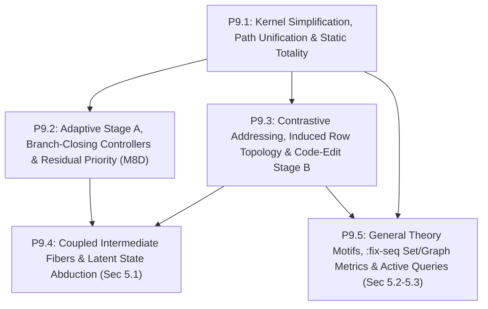

# Plan 9: Closing Heuristic Induction, Generalizing the Kernel, & Homoiconic Consolidation

## 1. Ground-Truth Baseline & Executive Diagnosis

All 25 files loaded by [load.lisp](file:///home/tlh24/lisploop/load.lisp#L1-L9) (`14,555` total lines including comments/blanks; `175` kernel tests / `417,884` checks and `39` milestone tests / `186,768` checks passing) were audited against [plan8.md](file:///home/tlh24/lisploop/plan8.md) and the [plan7.md](file:///home/tlh24/lisploop/plan7/plan7.md) suite.

`P8.1`–`P8.4` established strong primitives—definedness-safe `:code-eval` let-sharing, Galois-sound product slots, Constructor-AU, Stage A feature-pair guards, co-induced `(:metric-decoder)` pairs, availability preorders, symbolic conservation unwinding, monoid fold motifs, and entry amortization. However, auditing the Common Lisp source reveals **four systemic gaps** between the architectural vision and current implementation:

1. **Half-Wired Heuristic Seams & Budget Fragility:** Several `P8` and `M8D`/`M9` mechanisms exist and pass unit tests in isolation, yet are **unwired in `start-heuristic-synthesis`**, bypassed by default parameters, or coupled to static work multipliers that either starve Stage A (requiring manual `:heuristic-budget 16000` or `60000` overrides) or burn $4\times$ budgets on wrong lifted branches.
2. **Procedural Host Special Cases Violating Homoiconicity:** Important inductive knowledge—such as the 7 sequence descriptors in [descriptors.lisp](file:///home/tlh24/lisploop/descriptors.lisp#L327-L516), the `[f(x) for x in xs if p(x)]` recognizer in [proposals.lisp](file:///home/tlh24/lisploop/proposals.lisp#L148-L298), the 3-arg monoid-fold recognizer in [consolidate.lisp](file:///home/tlh24/lisploop/consolidate.lisp#L540-L720), and the hardcoded trace target in [consolidate.lisp](file:///home/tlh24/lisploop/consolidate.lisp#L20-L53)—lives in procedural Common Lisp rather than as typed ASTs/templates in `*knowledge-library*`.
3. **Localized Omissions of Generality:** Key mechanisms stop one step short of their natural algebraic generality—static totality in [ast.lisp](file:///home/tlh24/lisploop/ast.lisp#L782-L851) accepts only single-step `(tail Xi)` on a single sequence parameter; Stage A prices `:code-edit` deltas without a Stage B `:code` pullback; `coupled-requirements` are priced (`+16` bits each) but never solved or relaxed; and descriptor mining is purely unary/positive rather than contrastive across confused library entries.
4. **Missed Net-LOC Reduction Gate ([plan8.md](file:///home/tlh24/lisploop/plan8.md#L337-L347)):** Pre-Plan-8 modules still carry ~600+ lines of verbose pre-`term`/`map-ast` AST construction and bespoke host recognizers duplicated by newer general mechanisms. Simplifying these *first* creates room to complete heuristic induction while shrinking the kernel.

---

## 2. Four-Lens Audit of the Lisp Source

### 2.1 Loose Ends & Unwired Seams in Heuristic Induction

| Area | Authoritative Lisp Source | Exact Loose End / Fragility |
|---|---|---|
| **Static `stage-a-budget` & VM metric tariff** | [synthesize.lisp](file:///home/tlh24/lisploop/synthesize.lisp#L359-L394), [laws.lisp](file:///home/tlh24/lisploop/laws.lisp#L1179-L1192), [metrics.lisp](file:///home/tlh24/lisploop/tests/metrics.lisp#L214) | `stage-a-budget` scales by `2 * (max 1 (1- arity))^2` *only* inside lifted branches, burning full $4\times$ budgets on dead lifted branches (Probe 4 regression `80k -> 113k`) while leaving non-lifted multi-input frames unscaled. Meanwhile `metric-delta` re-validates both solver and `(app operator (lit ...) (lit ...))` from scratch per `(candidate, row)` inside Stage A's enumeration budget, forcing `:heuristic-budget 60000` on `:shift-seq`. |
| **M8D `:heuristic` priority predictor** | [synthesize.lisp](file:///home/tlh24/lisploop/synthesize.lisp#L404-L461), [consolidate.lisp](file:///home/tlh24/lisploop/consolidate.lisp#L20-L89) | When a `:heuristic` entry is active, `node-priority` **replaces** the exact full-path MDL formula instead of predicting a residual $\hat{\Delta}$ around it. Worse, `make-search-trace-frame` ignores `synthesis-episode-returns` and fits a hardcoded host formula `(+ f0 (* 2 f1) (floor work 64) ...)` on 4 features while `priority-predictor-function` passes 6 features. |
| **Dominated branches & stopping** | [synthesize.lisp](file:///home/tlh24/lisploop/synthesize.lisp#L860-L1085) | Dominated branches never close: even when a node's structural minimal root AST already exceeds `synthesis-job-best`, 1-in-4 round-robin keeps scheduling it. `resume-synthesis` lacks marginal $J_{\mathrm{procedure}}$ stopping ([plan8.md](file:///home/tlh24/lisploop/plan8.md#L417-L448)), and `*max-eager-proposals-per-node*` defaults to `nil` while `promote-next-deferred-proposal` waits until *every* active node in the entire DAG is exhausted. |
| **Induced row topology & `:persistence`** | [proposals.lisp](file:///home/tlh24/lisploop/proposals.lisp#L798-L902), [frame.lisp](file:///home/tlh24/lisploop/frame.lisp#L18-L26), [enumerate.lisp](file:///home/tlh24/lisploop/enumerate.lisp#L591-L671) | `induce-row-order` and `with-induced-row-order` have **zero callers** outside [topology.lisp](file:///home/tlh24/lisploop/tests/topology.lisp#L183-L226). `:persistence` edges are ignored by Stage A because pricing them as strict-equality `frame-pairs` penalized smoothly drifting trajectories ([plan8.md](file:///home/tlh24/lisploop/plan8.md#L307-L310)). |
| **`:code-edit` Stage B gap** | [frame.lisp](file:///home/tlh24/lisploop/frame.lisp#L1361-L1421), [decompose.lisp](file:///home/tlh24/lisploop/decompose.lisp#L30-L67) | Stage A prices `:code` AST misses smoothly by `code-edit-correction`, but `heuristic-decompositions` has no Stage B pullback to synthesize the residual AST edits of a near-miss `:code` base program. |
| **Compositional addressing & descriptors** | [descriptors.lisp](file:///home/tlh24/lisploop/descriptors.lisp#L689-L710), [knowledge.lisp](file:///home/tlh24/lisploop/knowledge.lisp#L258-L262), [proposals.lisp](file:///home/tlh24/lisploop/proposals.lisp#L345-L385) | `frame-addressed-entries` and `find-knowledge-entries-by-address` have **zero callers** in `proposals.lisp`; `library-decompositions` evaluates all descriptors up to Tier 2 flatly across all candidate functions, and `consolidate-policy-descriptors` never synthesizes contrastive separators between entries sharing an address. |

### 2.2 Omissions of Generality

1. **Static Totality ([ast.lisp](file:///home/tlh24/lisploop/ast.lisp#L782-L851)):**
   `analyze-function-body-totality` only accepts `(= Xi '())` guards and single `(tail Xi)` calls on one fixed `decreasing-param-id`. It rejects:
   - Multi-step suffix descent `(tail (tail Xi))` under nested emptiness guards;
   - Non-lockstep / lexicographic multi-sequence descent (`merge`, `zip-longest`);
   - Bounded `:int` descent (`(< 0 k)` with `(- k 1)` or `(/ k 2)`), which forced `:shift-seq` in [bootstrap-inverters.lisp](file:///home/tlh24/lisploop/bootstrap-inverters.lisp#L314-L320) to recurse over a dummy sequence spine and blocks library-only `(:fix-seq fuel init step)`.
2. **Certified-Descriptor Pullback vs. Bespoke `filter-map` ([proposals.lisp](file:///home/tlh24/lisploop/proposals.lisp#L148-L298)):**
   `filter-map-decompositions` spends 150 LOC on custom subsequence alignment specifically for `(:map (:filter xs 'p) Z)`. Algebraically, `map` has certified `:DESC/LEN-EQ` ($\mathrm{len}(\mathrm{map}(s, h)) = \mathrm{len}(s)$). Pulling any outer function's certified structural postcondition (`:DESC/LEN-EQ`, etc.) back through an inner producer $s = g(x, c_1)$ yields the exact intermediate constraint $\mathrm{len}(g(x_r, c_1)) = \mathrm{len}(y_r)$ for *any* outer length-preserving combinator (`map`, `reverse`, `shift-seq`, etc.) composed with *any* producer (`filter`, `tail`, `concat`, etc.).
3. **Coupled Intermediate Fibers ([frame.lisp](file:///home/tlh24/lisploop/frame.lisp#L801-L970), [synthesize.lisp](file:///home/tlh24/lisploop/synthesize.lisp#L459)):**
   When `lift-frame` or `product-slot-frame` encounters coupled cross-occurrence or cross-slot obligations (e.g., unobserved accumulator states in `reverse-acc` or hidden tuple coordinates in Probe 7 `:scan-proj0`), `coupled-requirements` are stored passively on the node with no constraint propagation, fiber clustering, or latent-state lifting.
4. **Motif & Amortization Scope ([consolidate.lisp](file:///home/tlh24/lisploop/consolidate.lisp#L391-L432), [consolidate.lisp](file:///home/tlh24/lisploop/consolidate.lisp#L540-L720)):**
   - `induce-fold-motifs` only inspects 3-arg folds (`(xs base step)`) with `:associative` + `:identity` laws, missing `:scan`, involutions, homomorphisms, and general law-star quotienting.
   - `amortize-library-entries` uses linear `*search-weight* = 1/1024` (penalizing good combinators during deep unsolved searches instead of Levin $\log_2 W$ cost) and ignores `:decoder-template`, `:solver`, and `:descriptor` utility.
5. **Missing Difference/Moment Solvers & Intra-Task Shell AU ([plan8.md](file:///home/tlh24/lisploop/plan8.md#L120-L126), [plan8.md](file:///home/tlh24/lisploop/plan8.md#L222-L229)):**
   - Linear/polynomial recurrences along induced row orders or probe pairs lack finite-difference `:solver` / `:transformer` witnesses.
   - `:decoder-template` anti-unification ([proposals.lisp](file:///home/tlh24/lisploop/proposals.lisp#L50-L135)) only runs across *completed* tasks, never across Stage A near-miss candidates within a task.

### 2.3 Simplification & Homoiconic Consolidation Ledger (Targeting Net LOC Reduction)

> [!IMPORTANT]
> To honor the homoiconic mandate and recover the missed `P8.4` LOC gate, every new capability should lean on `knowledge-entry` data + existing VM/search/AU primitives while retiring overlapping procedural host code.

| Target Module | Current Host Duplication / Boilerplate | Homoiconic / Unified Replacement | Est. Net LOC Delta |
|---|---|---|---|
| [proposals.lisp](file:///home/tlh24/lisploop/proposals.lisp#L148-L298) | `subsequence-alignments`, `alignment-mask`, `filter-map-decompositions` (150 LOC) + verbose `app`/`op` AST builders | General certified-descriptor pullback over inner sequence producers + `term` surface syntax | **-85 LOC** |
| [decompose.lisp](file:///home/tlh24/lisploop/decompose.lisp#L6-L67) & [frame.lisp](file:///home/tlh24/lisploop/frame.lisp#L1423-L1475) | Parallel Path B1 (`make-additive-residual-decoder`) vs. `metric-residual-decompositions` + pre-`term` builders | Unify scalar & functorially-lifted tuple `:+` under `:metric-decoder` (with minimal cold-library default) | **-45 LOC** |
| [descriptors.lisp](file:///home/tlh24/lisploop/descriptors.lisp#L327-L516) | 190-LOC procedural `synthesize-io-descriptor-specs` hand-building 7 `:int`-seq ASTs | Declarative seed `:descriptor` table written with `term` + polymorphic instantiation via [templates.lisp](file:///home/tlh24/lisploop/templates.lisp#L36-L182) + contrastive search | **-95 LOC** |
| [consolidate.lisp](file:///home/tlh24/lisploop/consolidate.lisp#L540-L720) | 180-LOC monoid-fold-specific `induce-fold-motifs` + synthetic trace target | Compact law-star signature indexer + data-driven `:motif` templates + episode-return trace frame | **-60 LOC** |
| [nogoods.lisp](file:///home/tlh24/lisploop/nogoods.lisp#L280-L543) & [bootstrap-inverters.lisp](file:///home/tlh24/lisploop/bootstrap-inverters.lisp#L28-L150) | Pre-Plan-8 manual `app`/`op`/`lit`/`var` trees & custom AST walkers | `term` templates and `map-ast` / `walk-typed-ast` | **-80 LOC** |

This ~`-365` LOC cleanup creates sufficient headroom to land Phases `P9.1`–`P9.4` **below** the current `14,555` total kernel line count.

---

## 3. Prioritized Implementation Plan (`P9.1` – `P9.5`)

### Phase `P9.1` — Kernel Simplification, Path Unification & Static Totality Foundation
*Why first:* Shrinks the kernel upfront, pays down Plan 8 technical debt, and unlocks bounded integer/multi-sequence recursion needed by metrics, controllers, and `:fix-seq` without adding VM opcodes.

1. **`P9.1a` — Generalize Static Totality ([ast.lisp](file:///home/tlh24/lisploop/ast.lisp#L660-L851)):**
   - Track non-empty suffix depth per sequence variable (`k`-non-empty from nested `(= Xi '())` / `(= (tail Xi) '())` or `(< c (length Xi))` guards) so `(at Xi c)` and `(tail (tail Xi))` typecheck as total when $c < k$.
   - Generalize single-parameter `decreasing-param-id` to a **lexicographic / multi-argument termination measure** over sequence parameters (strict `tail^+` descent on at least one parameter while earlier/ranked parameters do not grow, enabling `merge` and simplifying `:seq-corr`) and **guarded `:int` descent** (`(< 0 n)` or `(< c n)` with `(- n k)` for $k \ge 1$ or `(/ n k)` for $k \ge 2$).
   - Simplify `:shift-seq` in [bootstrap-inverters.lisp](file:///home/tlh24/lisploop/bootstrap-inverters.lisp#L314-L320) to recurse directly on `k` when `(< 0 k)` (`O(k)` instead of `O(|xs|)`).
2. **`P9.1b` — Unify Residual Decoders & Certified-Descriptor Composition ([decompose.lisp](file:///home/tlh24/lisploop/decompose.lisp#L6-L67), [proposals.lisp](file:///home/tlh24/lisploop/proposals.lisp#L148-L298)):**
   - Extend [bootstrap-inverters.lisp](file:///home/tlh24/lisploop/bootstrap-inverters.lisp#L251-L284) to lift binary `:metric-decoder`s componentwise across homogeneous/heterogeneous `:tuple` types, and fold Path B1 (`make-additive-residual-decoder`) into `metric-residual-decompositions` (retaining a 5-line default `:+`/`:-` fallback when `*knowledge-library*` has no registered `:int`/field solvers).
   - Replace `subsequence-alignments` / `alignment-mask` / `filter-map-decompositions` with **certified-descriptor pullback composition**: when an outer combinator $g$ has a certified binary I/O descriptor $D(s, y)$ (such as `:DESC/LEN-EQ`) violated by raw input $x$, propose an inner sequence binding $s = f(x, c_1)$ constrained by pulling $D(s, y_r)$ back onto $f$, then lift $g(s, c_2)$ normally.
3. **`P9.1c` — Homoiconic Descriptor Templates, `term` Sweep & Levin Amortization ([descriptors.lisp](file:///home/tlh24/lisploop/descriptors.lisp#L327-L516), [consolidate.lisp](file:///home/tlh24/lisploop/consolidate.lisp#L391-L432)):**
   - Replace procedural `synthesize-io-descriptor-specs` with compact declarative `term` schemas instantiated polymorphically via `infer-function-template` / `instantiate-function-template` across any element type $\tau$ (not just `:int`).
   - Sweep remaining verbose `app`/`op` AST construction in `nogoods.lisp` and `bootstrap-inverters.lisp` to `term` / `map-ast`.
   - Upgrade `amortize-library-entries` from linear `(* *search-weight* work)` to `integer-length` ($\lceil \log_2(1 + W) \rceil$) charging, and extend credit/archiving to `:decoder-template`, tentative `:solver`, and `:descriptor` entries.

---

### Phase `P9.2` — Adaptive Stage A, Branch-Closing Controllers & Residual Priority (`M8D` + `§5.4 C.1`)
*Why second:* Directly resolves `plan8.md` §6.3/§6.5's budget sensitivities (Probe 4 regression, Probe 5 & `:shift-seq` manual budget overrides) and stops wasting search work on dominated branches.

1. **`P9.2a` — Prepared/Cached Metric Pricing & Diminishing-Returns Stage A ([laws.lisp](file:///home/tlh24/lisploop/laws.lisp#L1164-L1196), [condense.lisp](file:///home/tlh24/lisploop/condense.lisp#L100-L245), [synthesize.lisp](file:///home/tlh24/lisploop/synthesize.lisp#L359-L394)):**
   - Cache `validated-program`s for both the solver witness/guard and forward decoder operator on `metric-decoders`, and memoize `(decoder-id predicted target) -> (packet . bits)` per Stage A condensation scope (charging replay work on cache miss and O(1) lookup tariff on identical row-output collisions).
   - Replace the rigid `lifted-p`-only `(arity-1)^2` Stage A budget with **adaptive bucket-yield continuation**: give every node a base enumeration quantum (scaled gently by input count regardless of `lifted-p`), and extend Stage A in bounded quanta *only* while new semantic buckets or `heuristic-score` improvements arrive—terminating early on flat/dead lifted branches while reaching deep multi-input combinations on live ones.
   - *Gate:* Probe 5 (`conditional-tuple-scan`) and `shifted-sequence` both solve at **default** `:heuristic-budget 2000` with unit-step resumption parity, and Probe 4 recovers its pre-`P8` work efficiency (`<= 85,000` work).
2. **`P9.2b` — Exact Lower-Bound Pruning, Stagnation Suspension & $J_{\mathrm{procedure}}$ Stopping ([synthesize.lisp](file:///home/tlh24/lisploop/synthesize.lisp#L860-L1085)):**
   - **Sound Exact Branch Closure:** Compute `node-min-root-bits(node)` by substituting a minimal-bit typed placeholder into the reconstructed root AST; whenever `synthesis-job-best` exists (with `run-weight = 0`) and `node-min-root-bits(node) >= (candidate-size best)`, close the node (`:pruned-by-bound`) immediately—zero false pruning, including across 1-in-4 round-robin!
   - **Soft Stagnation & Eager Staging:** Set a default `*max-eager-proposals-per-node*` (e.g., `6`) and trigger `promote-next-deferred-proposal` when active heuristic children stagnate past their marginal horizon rather than waiting for full-tree exhaustion.
   - **Marginal $J_{\mathrm{procedure}}$ Stopping:** Add `:discovery-weight` ($\lambda_{\text{discover}}$, default `nil` to preserve exact existing `:stop-on-first nil` semantics) to `resume-synthesis` implementing $J_{\mathrm{procedure}}(p) = L_{\text{packet}}(p) + \lambda_{\text{discover}} W_{\text{discover}}$, halting once a valid solution exists and remaining open branches cannot beat the current $J_{\mathrm{procedure}}$ even at their lower bound.
3. **`P9.2c` — Residual $\hat{\Delta}$ Priority Learning Aligned to Episode Returns ([consolidate.lisp](file:///home/tlh24/lisploop/consolidate.lisp#L20-L89), [synthesize.lisp](file:///home/tlh24/lisploop/synthesize.lisp#L404-L461)):**
   - Build `make-search-trace-frame` directly from `synthesis-episode-returns` over the full 6-feature vector `(full-path-prog-bits, residual-bits, depth, constrained-rows, policy-score, coupled-count)`.
   - Train `:heuristic` ASTs to predict the **residual error** $\hat{\Delta} = J_{\text{empirical}} - J_0$ around the principled MDL baseline $J_0$, and evaluate `node-priority` as $J_0 + \mathrm{clamp}(\hat{\Delta})$ so uncertified learned heuristics refine rather than overwrite MDL routing.

---

### Phase `P9.3` — Contrastive Addressing, Induced Row Topology & `:code` Residual Pullback
*Why third:* Wires all disconnected `P8.2`/`P8.3`/`M9` subsystems into live synthesis and closes symbolic Stage B & intra-task template discovery.

1. **`P9.3a` — Contrastive `:descriptor` Synthesis & Variable-Compute Compositional Addressing ([descriptors.lisp](file:///home/tlh24/lisploop/descriptors.lisp#L580-L710), [consolidate.lisp](file:///home/tlh24/lisploop/consolidate.lisp#L328-L363), [proposals.lisp](file:///home/tlh24/lisploop/proposals.lisp#L345-L385)):**
   - During `consolidate-policy-descriptors`, group active `:function` entries by `(signature, compositional-name)`. For any collision bucket of size $\ge 2$ (e.g., `:reverse` vs. `:sort`, `:foldr` vs. `:foldl`, `:map` vs. `:map-twice`), generate small distinguishing input-output frames and run bounded `start-observation-search` to synthesize a contrastive `:descriptor` entry separating the pair, refreshing their compositional addresses.
   - Wire `frame-addressed-entries` into `library-decompositions` using **tiered progressive evaluation** (`Tier 0` syntactic/type $\to$ `Tier 1` structural length/empty $\to$ `Tier 2` sampled content evaluated *only* for candidate functions surviving Tier 0/1 or sharing a collision bucket).
2. **`P9.3b` — Wire Induced Row Order, Smooth `:persistence` Pricing & Difference Solvers ([proposals.lisp](file:///home/tlh24/lisploop/proposals.lisp#L798-L902), [condense.lisp](file:///home/tlh24/lisploop/condense.lisp#L50-L125), [synthesize.lisp](file:///home/tlh24/lisploop/synthesize.lisp#L495-L565)):**
   - Call `with-induced-row-order` after Stage A (reusing `heuristic-buckets` at zero extra feature-enumeration work!) so ordered frames and `:locality-key` entries are induced automatically during synthesis.
   - Price `:persistence` edges in Stage A by **second-order / residual-step coherence**: reward candidates whose per-row residual deltas $\delta_t = q(\hat{y}_t, y_t)$ stay constant or vary smoothly along `:persistence` edges (avoiding the strict-equality penalty that broke `P8.3` when targets drift).
   - Add finite-difference / linear-slope witness rules along adjacent ordered rows (or unit-perturbation pairs) as library `:solver` / Stage B linear-trend proposals (`plan8.md` §3.1.2).
3. **`P9.3c` — `:code-edit` Stage B Pullback & Intra-Task Decoder-Shell AU ([decompose.lisp](file:///home/tlh24/lisploop/decompose.lisp#L30-L67), [proposals.lisp](file:///home/tlh24/lisploop/proposals.lisp#L50-L135)):**
   - Add `code-edit-residual-decompositions`: when `target` is expression `:code` and Stage A's `p(X)` yields `:code-edit` packets across constrained rows, anti-unify the target trees relative to `p(X)` so Stage B synthesizes only the edit subtrees via `:code-subst` / `:code-apply` product slots.
   - Seed task-local decoder shells (`§5.5`) by anti-unifying the top $k$ distinct Stage A alternative programs (`heuristic-alternatives`) when they share an outer operator skeleton that misses only at a subterm hole.

---

### Phase `P9.4` — Coupled Intermediate Fibers & Latent State Abduction (`plan8.md` §5.1)
*Why fourth:* Builds directly on `P9.1`–`P9.3`'s totality, product-slot pruning, and Stage A residual features to solve the hardest open inductive frontier (`reverse-acc`, hidden-state `:scan-proj0` Probe 7).

1. **Explicit Open-Loop vs. Prequential Contracts:**
   - Represent prequential step frames via `P8.3`'s `schema-availability` preorder (`y_{<t}` available at step $t$) vs. open-loop trajectory frames (`y` unobserved inside the recurrence), keeping both pathways clean and type-checked.
2. **Cross-Step Coupled Requirement Relaxation (`reverse-acc` / Non-Prefix-Closed Folds):**
   - When `lift-frame` produces `coupled-requirements` linking unobserved intermediate values $(z_{r,0}, \dots, z_{r,m})$, run bounded fixed-point propagation (`fold-constants` + `propagate-requirements` + `infer-fibers`) across the coupled system before falling back to root replay, pinning intermediate witnesses wherever inverse solvers or base-case boundary equations determine them.
3. **Latent State Augmentation via Stage A Regime Fibers (Probe 7 `:scan-proj0`):**
   - When a 1D scan/recurrence fails with `lift-incompatible-rows` nogoods that no observable parent input separates (DIP finds no observed separator), abduct a minimal discrete latent component $h_t \in \mathtt{:bool}$ (or `:int` residual delta) seeded by `infer-fibers` / Stage A regime masks along the sequence spine, lifting the recurrence state from $\tau$ to `(:tuple tau :bool)` and solving the resulting 2-slot product step via `P8.1`'s `product-slot-frame`!

---

### Phase `P9.5` — General Theory Motifs, `:fix-seq` Set/Graph Correspondence & Active Queries (`§5.2`, `§5.3`, `P8.4+`)
*Why fifth:* Completes the remaining research frontiers cleanly inside `*knowledge-library*` with minimal kernel code.

1. **Data-Driven Law-Star Motifs ([consolidate.lisp](file:///home/tlh24/lisploop/consolidate.lisp#L540-L720)):**
   - Generalize `induce-fold-motifs` from hardcoded 3-arg monoid folds to general relational law-star quotienting over `(:governs op)` + `(:refactored-by comb)` subgraphs (covering `:scan` state-threading laws, homomorphism/distributivity transfers `map + foldr`, and involution motifs).
2. **`:fix-seq` & Unaligned Set/Graph Metrics ([plan8.md](file:///home/tlh24/lisploop/plan8.md#L371-L415)):**
   - Define polymorphic `(:fix-seq fuel init step)` as an ordinary library `:function` (now provably total thanks to `P9.1a`'s bounded `:int` descent—zero new VM opcodes!).
   - Install a permutation-invariant multiset/chamfer `:metric-decoder` for `(:seq tau)` gated by set/permutation `:descriptor`s so unaligned correspondence frames condense smoothly in Stage A.
3. **Active Disambiguating Query Selection (`plan8.md` §5.3):**
   - Add a ~40-LOC pure-kernel helper `propose-disambiguating-input(candidates inputs &key library budget)` that constructs a `frame` with requirement `(not (= (eval p1 X) (eval p2 X)))` (or pairwise set dispersion across top candidates) and invokes `start-search` to find the minimum-MDL total input $x^*$ separating competing hypotheses.

---

## 4. Non-Negotiable Kernel Invariants & Verification Gates

Every sub-phase `P9.x` must pass `make test` plus new focused property/regression tests enforcing:
1. **Pure-Kernel Isolation:** `load.lisp` never references `milestones/`.
2. **Unit-Step Anytime Resumption Parity:** All Stage A adaptive continuations, metric memo lookups, and branch-closing transitions pay staged debt via `pay-debt` so `quantum = 1` and batch runs produce identical claims, optimal MDL sizes, and ledger totals (`check-anytime-resumption`).
3. **Zero-False-Pruning Galois Soundness:** Exact branch closure uses proven minimal AST bit lower bounds; tentative narrowings, uncertified descriptors, heuristic horizon suspensions, and latent-state abductions always preserve the 3:1 canonical/fallback reserve.
4. **Metamorphic & Persistence Fixed Points:** Row-permutation invariance (`canonical-row-order`), `schema-inputs` alpha-renaming invariance, and exact idempotence of zero-workload `consolidate-knowledge-library` + `serialize`/`deserialize` round-trips ([invariants.lisp](file:///home/tlh24/lisploop/tests/invariants.lisp)).
5. **Net Kernel LOC Gate:** Total lines across `load.lisp` modules after `P9.1`–`P9.3` must be **strictly less** than the current `14,555` baseline.

---

## 5. Key Decisions for Alignment Before Implementation

1. **Ordering of Simplification vs. Feature Closure:** Do you agree with starting in **`P9.1`** (totality generalization + unifying Path B1 / `filter-map` / procedural descriptors + Levin amortization to bank ~300+ LOC of simplification first), then **`P9.2`** (adaptive Stage A + branch closing + residual M8D priority)?
2. **Scope of Latent-State Abduction (`P9.4`):** Should `P9.4` target bounded discrete/residual state lifting (`tau -> (:tuple tau :bool | :int)` seeded by `infer-fibers` + solved by `product-slot-frame` on tasks like `reverse-acc` and Probe 7 `:scan-proj0`), rather than building a heavyweight numerical Viterbi/EM engine in host Lisp?
3. **Default Stopping Contract (`P9.2b`):** To preserve 100% backward compatibility with existing tests, should `resume-synthesis` keep `:discovery-weight nil` by default while `start-heuristic-synthesis` optionally accepts `:discovery-weight` (or a `:controller` entry in `*knowledge-library*`) for marginal $J_{\mathrm{procedure}}$ stopping?
