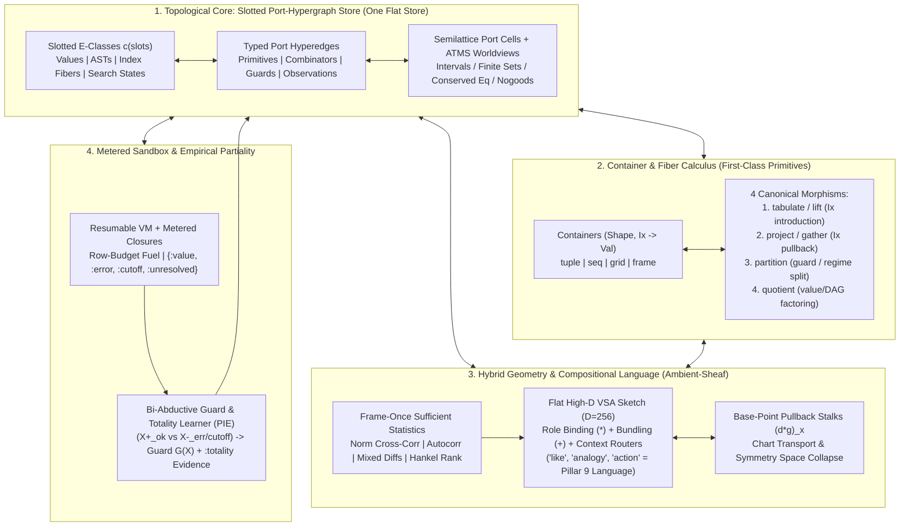

# `lisploop` Plan v2: Toward a Unified Topology–Geometry Synthesis Kernel

> **Status:** Comprehensive Source Audit, Historical Archaeology, Literature Synthesis, Multi-Perspective Critique, and Architectural Specification for Kernel v2 (20 November 2026).  
> **Audited Baseline:** Branch `reflective` at commit `df33ed1` — 25 pure-kernel Lisp modules ([load.lisp](file:///home/tlh24/lisploop/load.lisp#L1-L9), `17,818` LOC), 6 milestone modules (`1,585` LOC), 2 bootstrap modules (`1,304` LOC), and 8 serialized `.sexp` battery packets (`2,833` lines across `library/*.sexp`); `cccc` cognitive complexity sum `7,376` (`cyclomatic = 7,021`) across `1,638` functions.

---

## Executive Thesis

Across nine planning iterations (`deprecated/prompt.md` $\to$ `plan.md`..`plan6.md` $\to$ `plan7/*.md` $\to$ [plan8.md](file:///home/tlh24/lisploop/plan8.md) $\to$ [plan9.md](file:///home/tlh24/lisploop/plan9.md) $\to$ [batteries-and-reflection.md](file:///home/tlh24/lisploop/batteries-and-reflection.md)), `lisploop` proved several deep, lasting ideas: a zero-copy homoiconic AST with self-delimiting bit-length pricing ([codec.lisp](file:///home/tlh24/lisploop/codec.lisp#L1-L221)), an exact prepaid resumable VM ([vm.lisp](file:///home/tlh24/lisploop/vm.lisp#L1-L645)), Galois-sound contravariant requirement pullbacks with a 3:1 tentative/fallback schedule ([frame.lisp](file:///home/tlh24/lisploop/frame.lisp#L544-L580), [laws.lisp](file:///home/tlh24/lisploop/laws.lisp#L736-L784)), and observational equivalence bucketing.

Yet the system has hit an unmistakable **bootstrapping and complexity wall**:

1. **AI Agents Are Doing the Search, Not the Kernel:** An entry-by-entry audit of all **52 primary entries** in `library/*.sexp` (§1.2) reveals that **only 2 entries (`3.8%`: `:map` and `:foldr`)** are genuinely discovered by general synthesis + anti-unification. **19 entries (`36.5%`)** are 100% hand-coded or host-stitched ASTs (`9/10` functorial `:transformer`s in [functors.sexp](file:///home/tlh24/lisploop/library/functors.sexp#L4-L595) carry `:work 0`; `4` `:trusted-axiom` laws; hand-spliced `:solve-at-1`; hand-coded `:comprehension/filter-map`; hardcoded descriptors), and **21 entries (`40.4%`)** only synthesize because AI agents wrote 355 lines of bespoke recursion skeletons in [recursion-schemas.lisp](file:///home/tlh24/lisploop/bootstrap/recursion-schemas.lisp#L1-L355) (`cognitive complexity = 311`, the single most complex function in the entire repository!) and fed trace-complete examples with bespoke 1–3 operator micro-grammars.
2. **The Root Cause Is Representational, Not Tactical:** In Pass 3 ([deprecated/plan3.md](file:///home/tlh24/lisploop/deprecated/plan3.md#L47-L165)), the original Pass 2 flat relational store ([deprecated/plan2.md](file:///home/tlh24/lisploop/deprecated/plan2.md#L709-L839)) was replaced by **`frame` + per-row unary `row-requirement` ASTs ("frame-guards")**. While `frame` solved target-leakage isolation and single-step infinite-domain pullbacks, it shattered the system into **three disjoint worlds** (data in `frame` $\ne$ 13 siloed `knowledge-entry` kinds in `*knowledge-library*` $\ne$ opaque host search state in `synthesis-job`), baked ground inputs `'x_w` into $N$ duplicated ASTs on every pullback, blinded Stage A whenever `extract-allowed-values` hit `:unknown`, trapped **lifting** and **indexing** in host Common Lisp, turned static totality (`provably-total-p`) into an upfront brick wall, and forced geometry to be bolted on afterward as fragile, expensive per-candidate VM callbacks.
3. **The Missing Unification Exists—and Resolves Every Bottleneck Simultaneously:** Combining insights buried in `lisploop`'s own early plans with recent advances in **Slotted Relational E-Graphs / Port Hypergraphs** (`egglog`, `babble`, `Slotted E-Graphs`), **Container / Polynomial-Functor Index Lenses** (`Containers`, `Dex`, Gibbons's Third Homomorphism Theorem), **ATMS Propagator Networks** (Radul & Sussman), **Bi-Abductive Precondition Learning** (`PIE`), and **Ambient-Sheaf Geometry** (unifying **Cellular Sheaves on Hypergraphs** with **Flat High-D Vector Symbolic Architectures / Transformer Subspace Routers**) yields a dramatically smaller, self-bootstrapping **Topology–Geometry Kernel (`v2`)**:
   - **One Uniform Topological Store:** Facts, ASTs, execution traces, `frame`s, laws, propagators, and reflective search states live in **one slotted port-hypergraph** with functional dependencies (`EqSort` union-find congruence + `LatticeSort` semilattice propagators + ATMS worldviews).
   - **First-Class Index Containers & Lifts:** Treating tuples, sequences, and frames uniformly as **Containers `(Shape, Index -> Payload)`** makes **indexing frames** (`tabulate` + `gather`/`slice`) and **tuple slicing** the *exact same* contravariant coordinate pullback—cleanly separating parallelizable `map`/stencil/scan-homomorphism problems from irreducibly sequential `foldl` coalgebras.
   - **Dual-Layer Geometry ("Flat Brain Bus + Local Sheaf Stalks"):** Every hypernode carries an incremental **flat $D$-dimensional VSA/spectral sketch** (supporting $O(1)$ recognizer triggering, autocorrelation/difference sufficient statistics, compositional vocabulary/language via binding $\circledast$ + bundling $\oplus$ + subspace projections, and smooth heuristic ranking), paired with **exact lazy sheaf stalks** along active topological links that collapse when symmetry/cohomology proves two spaces isomorphic.
   - **Empirical Partiality:** Metered per-row fuel + `:cutoff`/`:error` 3-valued outcomes allow crashing and diverging candidates to run safely, assembling domain guards and base cases empirically via bi-abduction and propagators while keeping static `provably-total-p` strictly as an $O(1)$ `:certified` fast-path.

---

## 1. Ground-Truth Empirical Audit of the Current Kernel (`df33ed1`)

### 1.1 Terminology & Architectural Map Clarification

First, to answer the terminology question in the prompt (*"Propagator = transformer in the current kernel, I think?"*): in the current codebase, what is conceptually one notion—*a guarded computational relation that transports information across a graph*—has fragmented into **13 separate `define-knowledge-kind` silos** across 7 files:

| Concept in Prompt | Current `knowledge-entry` Kind(s) | Host Compiler / Runtime Struct | Where Defined & Consumed |
| :--- | :--- | :--- | :--- |
| **Propagator** (value & symbolic backward constraint solver) | **`:solver`** | `arithmetic-propagator` inside `propagator-library` | Defined in [laws.lisp](file:///home/tlh24/lisploop/laws.lisp#L1184-L1238); narrows row ASTs in `propagate-requirements` ([laws.lisp](file:///home/tlh24/lisploop/laws.lisp#L736-L784)) and unwinds expressions in `solve-equality-symbolically` ([laws.lisp](file:///home/tlh24/lisploop/laws.lisp#L809-L887)). |
| **Meta-Rule / Functorial Solver Lifter** | **`:transformer`** (+ marker **`:functor`**) | `entry-executable` over `:code-*` primitives | Defined in [templates.lisp](file:///home/tlh24/lisploop/templates.lisp#L598-L653) & [consolidate.lisp](file:///home/tlh24/lisploop/consolidate.lisp#L2065-L2118); maps syntax (`:code` of a combinator step + `:code` of an element `:solver`) $\to$ `:code` of a lifted sequence `:solver`. |
| **Equational Law / Rewrite** | **`:law`** | `rewrite-library` (oriented by `code-less`) | Defined in [laws.lisp](file:///home/tlh24/lisploop/laws.lisp#L1044-L1057); simplifies terms in `simplify-symbolic-expr` ([laws.lisp](file:///home/tlh24/lisploop/laws.lisp#L788-L807)). |
| **Geometric Residual Chart** | **`:solver`** + edge **`(:metric-decoder d s bits)`** | `metric-decoder` tuple | Defined in [laws.lisp](file:///home/tlh24/lisploop/laws.lisp#L1250-L1331); prices Stage A misses in `priced-correction` ([frame.lisp](file:///home/tlh24/lisploop/frame.lisp#L1645-L1668)) and pulls back deltas in `metric-residual-decompositions` ([decompose.lisp](file:///home/tlh24/lisploop/decompose.lisp#L30-L82)). |
| **Higher-Order Algebra Transfer** | **`:motif`** | Custom hook in `induce-fold-motifs` | Defined in [consolidate.lisp](file:///home/tlh24/lisploop/consolidate.lisp#L698-L959); transfers `:foldr` $\leftrightarrow$ `:foldl` when operator laws match `:associative` + `:identity`. |
| **Other 7 Silos** | `:function`, `:relation`, `:descriptor`, `:decoder-template`, `:locality-key`, `:nogood-schema`, `:dip-feature`, `:heuristic`, `:spec` | Bespoke per-kind hooks & ad-hoc metadata plists | Scattered across [abstraction.lisp](file:///home/tlh24/lisploop/abstraction.lisp), [relations.lisp](file:///home/tlh24/lisploop/relations.lisp), [descriptors.lisp](file:///home/tlh24/lisploop/descriptors.lisp), [proposals.lisp](file:///home/tlh24/lisploop/proposals.lisp), [nogoods.lisp](file:///home/tlh24/lisploop/nogoods.lisp), [consolidate.lisp](file:///home/tlh24/lisploop/consolidate.lisp). |

### 1.2 Quantitative Complexity Audit (`cccc` & Proposal Proliferation)

Running [measure_complexity.sh](file:///home/tlh24/lisploop/measure_complexity.sh#L1-L3) (`cccc`) across all 35 kernel, bootstrap, and milestone Lisp files (`1,638` functions) pinpoints exactly where incidental complexity has accumulated:

| Rank | File | Functions | Cognitive Complexity | Cyclomatic Complexity | Highest-Complexity Function (`file:line`) |
| :- | :--- | -: | -: | -: | :--- |
| 1 | [consolidate.lisp](file:///home/tlh24/lisploop/consolidate.lisp) (`2,118` LOC) | 51 | **641** | 508 | `commit-synthesis-job` (`:249`, cog `70`, cyc `46`) |
| 2 | [frame.lisp](file:///home/tlh24/lisploop/frame.lisp) (`1,761` LOC) | 98 | **543** | 469 | `select-active-fiber-rows` (`:1039`, cog `48`, cyc `22`) |
| 3 | [descriptors.lisp](file:///home/tlh24/lisploop/descriptors.lisp) (`1,045` LOC) | 39 | **502** | 383 | `synthesize-io-descriptor-specs` (`:392`, cog **`141`**, cyc **`74`**) |
| 4 | [ast.lisp](file:///home/tlh24/lisploop/ast.lisp) (`1,442` LOC) | 129 | **501** | 579 | `term` (`:1384`, cog `40`, cyc `32`) |
| 5 | [proposals.lisp](file:///home/tlh24/lisploop/proposals.lisp) (`1,417` LOC) | 47 | **465** | 328 | `library-decompositions` (`:152`, cog `80`, cyc `20`) |
| 6 | [synthesize.lisp](file:///home/tlh24/lisploop/synthesize.lisp) (`1,310` LOC) | 75 | **412** | 416 | `prepare-synthesis-node` / `join-slot-candidates` |
| 7 | [laws.lisp](file:///home/tlh24/lisploop/laws.lisp) (`1,349` LOC) | 74 | **400** | 380 | `certify-solver-entry` (`:1112`, cog `45`, cyc `24`) |
| 8 | [recursion-schemas.lisp](file:///home/tlh24/lisploop/bootstrap/recursion-schemas.lisp) (`355` LOC) | 3 | **321** | 86 | `recursion-schema-decompositions` (`:44`, cog **`311`**, cyc **`76`**) |
| 9 | [nogoods.lisp](file:///home/tlh24/lisploop/nogoods.lisp) (`580` LOC) | 26 | **281** | 186 | `candidate-dip-context-expressions` (`:446`, cog `66`, cyc `20`) |
| 10 | [enumerate.lisp](file:///home/tlh24/lisploop/enumerate.lisp) (`877` LOC) | 51 | **261** | 237 | `relational-linkage-residual` (`:607`, cog `49`, cyc `27`) |
| 11 | [decompose.lisp](file:///home/tlh24/lisploop/decompose.lisp) (`725` LOC) | 23 | **244** | 188 | `heuristic-decompositions` (`:515`, cog `69`, cyc `53`) |
| 12 | [requirements.lisp](file:///home/tlh24/lisploop/requirements.lisp) (`540` LOC) | 35 | **203** | 206 | `fold-if` / `try-unfold-call` |

Even more telling: [decompose.lisp](file:///home/tlh24/lisploop/decompose.lisp), [proposals.lisp](file:///home/tlh24/lisploop/proposals.lisp), and [recursion-schemas.lisp](file:///home/tlh24/lisploop/bootstrap/recursion-schemas.lisp) implement **21 separate proposal/decomposition generators** (`:heuristic-additive`, `:heuristic-metric`, `:heuristic-conditional`, `lift-inductive-sequence-context`, `:lockstep-inductive`, `:library`, `:library-partial`, single-hole `:learned-template`, 2-hole `:comprehension/filter-map`, `:fibers`, `:dependency`, `:tuple-product`, `:constructor-au`, `:constructor-au-operators`, `:components`, `:fallback`, `:dip-repair`, `:lookahead-inductive`, `:state-fold-inductive`, `:state-scan-inductive`, `:countdown-inductive`, `:counter-inductive`), tuned by **over 30 hardcoded bit-slacks, arity multipliers (`2 * (k-1)^2` at [synthesize.lisp](file:///home/tlh24/lisploop/synthesize.lisp#L373-L390)), operator-stripping filters, and policy-score offsets**.

### 1.3 Blunt Bootstrapping Audit of `library/*.sexp` and `bootstrap/`

Across all 8 battery files in `library/` (`83` entries total: **52 primary operational entries** + **31 `:spec` entries**), tracing every entry back to [build-batteries.lisp](file:///home/tlh24/lisploop/bootstrap/build-batteries.lisp#L1-L949) and [recursion-schemas.lisp](file:///home/tlh24/lisploop/bootstrap/recursion-schemas.lisp#L1-L355) exposes why the bootstrapped library feels hollow:

| Provenance Tier | Count (`%` of 52) | Exact Entries in `library/*.sexp` | How They Were Actually Produced |
| :--- | -: | :--- | :--- |
| **1. Genuine Synthesis + Library AU** | **2 (`3.8%`)** | `:map`, `:foldr` ([sequences.sexp](file:///home/tlh24/lisploop/library/sequences.sexp#L5-L203)) | Synthesized from 6 monomorphic recursive specs (`:copy`, `:inc-all`, `:dbl-all`, `:sum-all`, `:len-all`, `:prd-all`) via native `lift-inductive-sequence-context` and abstracted by `discover-library-abstractions` ([abstraction.lisp](file:///home/tlh24/lisploop/abstraction.lisp#L380)). *(Still required trace-complete suffixes `()`, `(3)`, `(1 3)`, `(4 1 3)` and 2–3 operator micro-grammars.)* |
| **2. Kernel Search Under Curated Micro-Grammars & Whitelists** | **10 (`19.2%`)** | 8 ring laws in [algebra.sexp](file:///home/tlh24/lisploop/library/algebra.sexp#L87-L234) (`id-+`, `id-*`, `comm-+`, `comm-*`, `assoc-+`, `assoc-*`); `:filter`; `:seq-corr` | Laws enumerated on `GF(3)` with `:+` and `:*` isolated into separate single-operator searches (`nil` literals), then filtered through `law-operator-fact` ([consolidate.lisp](file:///home/tlh24/lisploop/consolidate.lisp#L709-L735)), which **discards every law except 3 hardcoded shapes** (commutativity, associativity, identity—throwing away distributivity, annihilation `x*0=0`, and self-inverse `x-x=0`!). |
| **3. Synthesized Only via Hand-Coded Prosthetics (`recursion-schemas.lisp` & Tailored Specs)** | **21 (`40.4%`)** | `:foldl`, `:map-adjacent`, `:positions`, `:scan`, `:shift-seq`, `:best-shift`, `:argmax-corr`, `:last-or` (unused!), 12 `:solver`s (`8` in `arithmetic.sexp`, `3` in `constructors.sexp`, `1` in `sequence-shift.sexp`), 1 `:transformer` (`:functor/pointwise-param-witness`) | Recursive functions rely on hand-authored skeletons in [recursion-schemas.lisp](file:///home/tlh24/lisploop/bootstrap/recursion-schemas.lisp#L44-L330): `:shift-seq` is handed nested literal `'((0))` + `:concat`; `:best-shift`'s `:counter-inductive` (`:265-298`) contains bespoke Lisp that scans for `:seq-corr`, pre-binds `(:seq-corr X0 X1)` and tuple slots `0, 1` of the recursive call, and strips `:at`/`:tail`! Solvers use hand-labeled `:none` rows and 1–3 operator grammars. |
| **4. 100% Hand-Coded or Host-Stitched ASTs (`:work 0`)** | **19 (`36.5%`)** | 4 `:trusted-axiom` cancellation laws ([algebra.sexp](file:///home/tlh24/lisploop/library/algebra.sexp#L4-L86)); 3 `:cons` laws ([constructors.sexp](file:///home/tlh24/lisploop/library/constructors.sexp#L50-L118)); **9 of 10 `:transformer`s** ([functors.sexp](file:///home/tlh24/lisploop/library/functors.sexp#L4-L595)); `:solve-at-1`; `:comprehension/filter-map`; `:foldr=foldl/monoid`; `:scan-pair`; 8 `:descriptor`s ([descriptors.sexp](file:///home/tlh24/lisploop/library/descriptors.sexp)) | Written directly as Lisp `term` ASTs in [build-batteries.lisp](file:///home/tlh24/lisploop/bootstrap/build-batteries.lisp#L106-L117) and [descriptors.lisp](file:///home/tlh24/lisploop/descriptors.lisp#L392-L581). In commit `df33ed1`, `:solve-at-1` ([build-batteries.lisp](file:///home/tlh24/lisploop/bootstrap/build-batteries.lisp#L675-L710)) synthesized over a 3-column proxy frame where Lisp pre-computed `(0 .. n-1)` and spliced `(positions xs 0)` post-hoc via `instantiate`! Meanwhile `save-clean-battery` (`:81-94`) **deletes** all unscripted intermediate discoveries. |

### 1.4 Newly Uncovered Bugs, Soundness Gaps, & Unwired Seams at `df33ed1`

Beyond the issues noted in [plan9-audit.md](file:///home/tlh24/lisploop/plan9-audit.md) and [batteries-and-reflection.md](file:///home/tlh24/lisploop/batteries-and-reflection.md), our source audit found **10 live defects and disconnected subsystems** in `HEAD`:

1. **`consolidate-knowledge-library` Rejects 100% of Laws Retyped to `:int` ([consolidate.lisp](file:///home/tlh24/lisploop/consolidate.lisp#L1022) & [templates.lisp](file:///home/tlh24/lisploop/templates.lisp#L545-L552)):** `consolidate-knowledge-library` calls `(retype-knowledge-laws library domain :validate-p t :ledger ledger)` *without* `:samples`. On infinite `:int`, `samples` defaults to `nil`, `validate-law` ([laws.lisp](file:///home/tlh24/lisploop/laws.lisp#L100-L126)) runs `0` assignments (`:vacuous`), and every retyped `:int` law is silently discarded! (`build-batteries.lisp:160` bypassed consolidation by calling `retype-law` manually.)
2. **Broken `:unresolved` Check in `row-satisfaction` ([synthesize.lisp](file:///home/tlh24/lisploop/synthesize.lisp#L1106-L1109) vs. [vm.lisp](file:///home/tlh24/lisploop/vm.lisp#L384-L385)):** `advance-evaluation` catches `unresolved-evaluation`, sets `evaluation-status` to `:unresolved`, and formats `evaluation-error` to a `string`. Yet `row-satisfaction` checks `(:error (if (typep (evaluation-error run) 'unresolved-evaluation) :unknown :refuted))` (always `nil` on a string!) and omits `:unresolved` from `case` completely.
3. **Rewrite Laws Never Prune `start-synthesis` ([synthesize.lisp](file:///home/tlh24/lisploop/synthesize.lisp#L876)):** `start-search` ([enumerate.lisp](file:///home/tlh24/lisploop/enumerate.lisp#L353)) accepts `:laws` for canonical rewrite pruning, *but `open-prepared-node` calls `(start-search frame language)` without `:laws`*! `algebra.sexp` never prunes a single enumerated term during synthesis.
4. **Incomplete Certificates in `arithmetic.sexp` & `constructors.sexp`:** `:solve-+-0..---1` ([arithmetic.sexp](file:///home/tlh24/lisploop/library/arithmetic.sexp#L5-L50)) attest `(:uniqueness)` *without* `:witness` (`propagator-certified-p` returns `nil`!); `:solve-*-0/1` omit integer divisibility (`((2 5) :none)` was left out of `:spec/solve-*-0`); and `:solve-cons-0/1` ([constructors.sexp](file:///home/tlh24/lisploop/library/constructors.sexp#L4-L49)) have `:certificate nil`, so `solve-equality-symbolically` ([laws.lisp](file:///home/tlh24/lisploop/laws.lisp#L850)) refuses to unwind `:cons`!
5. **Greedy Branch Hallucination in `flatten-lifted-conjuncts` ([frame.lisp](file:///home/tlh24/lisploop/frame.lisp#L1019-L1037)):** When unfolding `:filter` yields `(:if (:code-eval X0 'elem0) yes no)`, unless `yes` is literally `'nil`, lines `1033-1035` unconditionally assert `(:code-eval X0 'elem0) = t`, fabricating false positive constraints whenever the true filter drops `elem0`.
6. **`:coupled` Key Collision in `build-nogood-clause` ([nogoods.lisp](file:///home/tlh24/lisploop/nogoods.lisp#L143) vs. [frame.lisp](file:///home/tlh24/lisploop/frame.lisp#L1185)):** `coupled-fallback-rows` mints keys `(parent-key :coupled occ-idx)` whose `(second key)` is the literal keyword `:coupled`, fooling `nogoods.lisp:143` into treating distinct occurrence indices as the same occurrence (`parent-incompatible-p = t`).
7. **Four Hard Crash / Infinite-Loop Holes in VM Sandboxing:** (a) `start-search` (`row-budget = nil`) and `observation-job` (no `row-budget` at all, [enumerate.lisp](file:///home/tlh24/lisploop/enumerate.lisp#L704)) let one diverging `:empirical` call consume 100% of job work; (b) `finish-accounted-evaluation` ([laws.lisp](file:///home/tlh24/lisploop/laws.lisp#L435-L440)) `assert`-crashes the Lisp image if a solver hits `:unknown`; (c) `evaluate-row-bindings` ([frame.lisp](file:///home/tlh24/lisploop/frame.lisp#L427-L441)) throws an unhandled host `error` on partial bindings; (d) `settled-evaluation` ([vm.lisp](file:///home/tlh24/lisploop/vm.lisp#L530-L551)) runs closures to completion *before* checking budgets.
8. **Duplicate Stage A Execution on Root Expansion:** Live runs of [yield-gate.lisp](file:///home/tlh24/lisploop/experiments/yield-gate.lisp#L216-L226) confirm Node 0 runs Stage A at preparation (`2,120` work) and re-runs Stage A from size 1 at expansion (`10,000` work).
9. **Zero Kernel Callers for Reorientation, Guarded Law Discovery, Coordinate Probes, & Address Lookup:** `orient-conserved-quantity` ([laws.lisp](file:///home/tlh24/lisploop/laws.lisp#L931)), `conserved-quantity-frame` ([frame.lisp](file:///home/tlh24/lisploop/frame.lisp#L1303)), `transition-probes` ([frame.lisp](file:///home/tlh24/lisploop/frame.lisp#L366)), `probe-frame-coordinates` ([frame.lisp](file:///home/tlh24/lisploop/frame.lisp#L1108)), `induce-row-order` ([proposals.lisp](file:///home/tlh24/lisploop/proposals.lisp#L707)), and `frame-addressed-entries` ([descriptors.lisp](file:///home/tlh24/lisploop/descriptors.lisp#L945)) have **zero callers** in `synthesize.lisp`, `decompose.lisp`, `proposals.lisp`, or `consolidate.lisp`; guarded law discovery (`propose-guarded-laws`) and subexpression AU (`discover-subexpression-abstractions`) sit isolated in `milestones/`.
10. **Write-Only `messages.lisp` ([messages.lisp](file:///home/tlh24/lisploop/messages.lisp#L1-L128)):** While commit `8108734` cleanly projects 5 message types into `frame`s via `message-frame`, **nothing in the kernel ever reads `messages.lisp`** during synthesis or consolidation (only `experiments/yield-gate.lisp` and `tests/messages.lisp`).

---

## 2. Deep Diagnosis of the Specific Pain Points Raised

### 2.1 Indexing Frames, Tuple Slicing, and the `map`/`scan` vs. `foldl` Boundary

#### A. Why Your Intuition ("This Should Be Doable with Tuple Slicing!!") Is Exact
In category theory (Abbott, Altenkirch & Ghani, *Containers*, 2005; Spivak, *Polynomial Functors*, 2020) and array type theory (`Dex`, Paszke, Maclaurin et al., ICFP 2021), every container value is a pair **`(Shape s, Payload : Pos(s) -> Val)`**:

- A **`:tuple`** `(:tuple t_0 ... t_{k-1})` has fixed shape $s = *$ and index set $\mathrm{Pos}(*) = \mathrm{Fin}(k)$, with typed fiber $i \mapsto t_i$.
- A **`:seq`** `(:seq \tau)` has dynamic shape $s = n \in \mathbb{N}$ (`:length`) and index set $\mathrm{Pos}(n) = \mathrm{Fin}(n) = \{0, \dots, n-1\}$, with uniform fiber $i \mapsto \tau$.
- Even a **`:code` AST** skeleton $s$ with $m$ holes has index set $\mathrm{Pos}(s) = \mathrm{Fin}(m)$ filled by `:code-subst`!

Now look at what happens when target $Y = (y_0, \dots, y_{m-1})$ is produced by indexing into ordered data $X = (x_0, \dots, x_{n-1})$ via an index array $Z : (\text{:seq :int})$—using **`(:gather X Z)`**, which **already sits at 4-bit opcode #6 in [ast.lisp](file:///home/tlh24/lisploop/ast.lisp#L125) and [vm.lisp](file:///home/tlh24/lisploop/vm.lisp#L239-L241)**!
 pulling back `(= (gather 'x Z) '(y_0 ... y_{m-1}))` decomposes *identically* to tuple slicing ([frame.lisp](file:///home/tlh24/lisploop/frame.lisp#L582-L639)):

1. **Shape constraint:** `(= (length Z) 'm)`.
2. **Decoupled coordinate constraints:** For each output position $j \in \{0, \dots, m-1\}$, `(= (at 'x (at Z 'j)) 'y_j)`, which preimage-inverts immediately on ground `'x` into:
   $$(\text{member } (\text{at } Z \; 'j) \; 'I_j), \qquad I_j = \{i \in \{0, \dots, n-1\} \mid x_i = y_j\}!$$
3. **Lifting across coordinates $j$:** Stacking $(row\ \omega,\; output\ index\ j,\; input\ length\ n_\omega) \mapsto I_{\omega, j}$ produces an ordinary scalar `:int` **Index Frame** where $Z_\omega[j] = g(x_\omega, n_\omega, j)$ is a tiny arithmetic offset expression:
   - `reverse(xs)`: $g(n, j) = n - 1 - j$ (`(- (- (length xs) 1) j)`).
   - Cyclic `rotate(xs, k)`: $g(n, k, j) = (j + k) \bmod n$ (`(mod (+ j k) (length xs))`).
   - Stride / downsample / slice (`evens`, `tail`, windowing): $g(j) = 2j$ or $j + k$.
   - 2D transpose / reshape / `interleave`: $g(j) = (j \bmod r) \cdot c + (j / r)$.

As checked empirically in [deprecated/plan2.md](file:///home/tlh24/lisploop/deprecated/plan2.md#L390-L397) (`:1033-1052`), even over small alphabets where single elements repeat (`I_j` has multiple candidate indices), intersecting index fibers across 4–5 rows collapses `19,205` candidate expressions down to `8` without writing a single recursive schema!

#### B. The Six Concrete Blockers That Lobotomized `:gather` & Index Frames in `v1`
1. **Variable-Index `:at` Totality Veto ([ast.lisp](file:///home/tlh24/lisploop/ast.lisp#L870)):** `operator-step-total-p` requires `(lit-p (second arguments))` on `:at`. Even `(if (< 0 (length xs)) (at xs (mod j (length xs))) 0)` is marked **non-total (`nil`)**!
2. **Unconditional `:gather` Totality Veto ([ast.lisp](file:///home/tlh24/lisploop/ast.lisp#L882)):** `:gather` is hardcoded `nil` in `operator-step-total-p`—even on literals!
3. **`unfoldable-parts-p` Blocks Slicing on Dynamic `:at` ([requirements.lisp](file:///home/tlh24/lisploop/requirements.lisp#L136-L149)):** Because `(at 'x z_j)` has a variable index `z_j` (non-total!), `apply-fold-rule` (`:271`) **refuses** to apply `fold-equal-tuple` or `fold-equal-cons` to `(= (tuple (at 'x z_0) (at 'x z_1)) '(y_0 y_1))`!
4. **`tuple-slot-term` Rejects `:seq` ([requirements.lisp](file:///home/tlh24/lisploop/requirements.lisp#L65), [frame.lisp](file:///home/tlh24/lisploop/frame.lisp#L100-L162)):** Coordinate extraction and reassembly check `(tuple-type-p base-type)`, returning `:unknown` on known-length sequence coordinate constraints `(member (at Z 'j) 'I_j)`.
5. **Zero Fold/Pullback Rules or Proposals for `:gather`:** [frame.lisp](file:///home/tlh24/lisploop/frame.lisp#L1469) (`quotient-model`) is the *only* caller of `:gather` in the kernel, and [requirements.lisp](file:///home/tlh24/lisploop/requirements.lisp#L245-L251) has zero rules for `:gather`.
6. **No Native `tabulate` (`iota`) & Bare-Variable Combinator Binding ([proposals.lisp](file:///home/tlh24/lisploop/proposals.lisp#L196-L225)):** There is no primitive `(tabulate n code)` generating `[code(0), ..., code(n-1)]`, and `library-decompositions` only binds sequence inputs of `:map` to bare parent variables—never `(positions xs 0)`—forcing `df33ed1`'s host-spliced workaround in [build-batteries.lisp](file:///home/tlh24/lisploop/bootstrap/build-batteries.lisp#L675-L710).

#### C. The Exact Five-Tier Mathematical Boundary (`Index/Tabulate` vs. `Scan` vs. `Foldl`)

Why do `map`, stencils, and associative scans yield to index frames, whereas general `foldl` does not? Literature (`Dex`; Mokhov et al. ICFP 2019; Blelloch 1990; Gibbons's *Third Homomorphism Theorem*, JFP 1996) draws five sharp tiers:

| Tier | Class | Canonical Examples | How Index / Fiber Lifting Behaves |
| :--- | :--- | :--- | :--- |
| **T0: Shapely Lens** | Pure Container Pullback $(f_\#, f^\#)$ | `reverse`, `tail`, `slice`, cyclic `shift`, `transpose`, `gather` | Pure index map $j \mapsto g(n, j)$: zero element arithmetic; decouples 100% into an integer Index Frame! |
| **T1: Applicative / Stencil** | Representable Functor `tabulate(n(X), lambda j. h(X, j))` | `map`, `positions`, `zip-with`, `map-adjacent`, `shift-seq` (zero-pad), FIR convolutions | Each output slot $Y[j]$ is a local function of index $j$ and input reads `(at X (g_r j))` (`0 <= g_r(j) < |X|`, else pad). **Eliminates `:positions`, `:map-adjacent`, and `:shift-seq` from `recursion-schemas.lisp` completely!** |
| **T2: Selective Subsequence** | Selective Functor (data-dependent shape) | `filter`, `filter-map`, `dedup-adjacent` | Output indices embed into input indices via a **monotone order-preserving injection** $\iota : \mathrm{Fin}(|Y|) \hookrightarrow \mathrm{Fin}(|X|)$ where predicate $P(X[\iota(j)]) = \text{true}$ and intermediate elements satisfy $\neg P$. |
| **T3: Associative Scan / Homomorphism** | Monoid Homomorphism (`foldr = foldl` by Gibbons's Thm) | `sum`, `product`, `running-sum`, `max-prefix`, first-order linear recurrence $y_t = a y_{t-1} + b_t$ (affine monoid!) | When all states $y_t$ are observed (`scan`), step $t$ reads observed $y_{t-1}$ as an **indexed lag input** $Y[t-1]$, turning `scan` into a **T1 stencil over `(X[t], Y[t-1])`** ($y_t = f(y_{t-1}, x_t)$)! Even for scalar `fold`, associative monoids lift from short examples or prefix differences. |
| **T4: Sequential Mealy Coalgebra** | Non-associative `foldl`, hidden-state `scan-proj0`, `fix-seq` | `foldl` with non-cancellative/hidden state $\sigma_t \in \Sigma$; ARMA with unobserved state; parser stacks | **Irreducibly sequential:** intermediate state $\sigma_t = \delta(\sigma_{t-1}, x_{t-1})$ is an **unobserved latent wire** not present in $X$ or $Y$. Index expansion cannot observe $\sigma_t$; synthesis requires either (a) **observable delay-coordinate embedding** (Takens / Hankel rank expressing $\sigma_t$ via $r$ lagged outputs $y_{t-1..t-r}$), (b) **trajectory-rollout product search / invariant conservation**, or (c) **coinductive state-machine / Hard-EM state clustering**. |

> **Punchline on `scan` vs. `foldl`:** Notice what Tier T3 reveals! A fully observed `scan` ($y_t = f(y_{t-1}, x_t)$) **does not need `:state-scan-inductive` in `recursion-schemas.lisp` at all** once the kernel supports **autoregressive index frames** where step $t \ge 1$ binds `(y_{t-1} = (at Y (- t 1)), x_t = (at X t))` under causal availability $\tau(Y[t-1]) < \tau(Y[t])$! Only *hidden-state* reductions (`foldl` from terminal outputs alone, or `scan-proj0`) sit across the T4 coalgebraic barrier.

---

### 2.2 Autocorrelation, Cross-Correlation, & Algorithmic Recognizers ("Knowing When to Apply Them")

Your diagnosis of correlation/lag propagators hits a central nerve in [condense.lisp](file:///home/tlh24/lisploop/condense.lisp#L91-L258) and [laws.lisp](file:///home/tlh24/lisploop/laws.lisp#L1277-L1327):

1. **Why Stage A Chokes When `sequence-shift.sexp` Is Loaded:**
   - `start-heuristic-search` ([condense.lisp](file:///home/tlh24/lisploop/condense.lisp#L91)) fetches `(metric-decoders target-type library)` unconditionally on **every node whose target is `(:seq :int)`** (`map`, `filter`, `reverse`, `running-sum`, etc.).
   - Inside `heuristic-search-step` (`:236-258`), for **every enumerated candidate** (`X0`, `'()`, `(tail X0)`, ...) and **every missed row**, `metric-delta` ([laws.lisp](file:///home/tlh24/lisploop/laws.lisp#L1314-L1327)) runs `:solve-shift-seq-by-correlation` in the VM:
     - First, `evaluate-guarded-entry` runs the guard `(= (shift-seq pred (argmax-corr pred target)) target)` ($O(N^2)$ VM recursion!).
     - Second, when the guard passes, `consume-entry-executable` evaluates `(argmax-corr pred target)` **a second time from scratch**, and line `1324` runs `:shift-seq` **a second time**!
   - Result: **1 candidate $\times$ 1 row miss = `3,334` VM work units**, blowing past the `2,000`-unit default `heuristic-budget` ([synthesize.lisp](file:///home/tlh24/lisploop/synthesize.lisp#L66)) before evaluating a single candidate! ([tests/metrics.lisp](file:///home/tlh24/lisploop/tests/metrics.lisp#L209) had to hardcode `:heuristic-budget 60000`—$30\times$ default!)
2. **Why Raw Inner-Product + Exact Zero-Pad Guard Is Too Brittle as an "Intuition":**
   - Unnormalized `:seq-corr` ($\sum x_i y_i$) fails on all-negative inputs (`:best-shift` seeds `'()` with `0`, beating negative inner products!), periodic signals, and large distractors (`'(5 8 2 6) -> '(6 0 0 0)` picks lag `1` because $8\cdot 6 = 48 > 6\cdot 6 = 36$ at true lag `3`, [tests/metrics.lisp](file:///home/tlh24/lisploop/tests/metrics.lisp#L236-L243)).
   - Worse, requiring exact replay `(= (shift-seq pred lag) target)` means a **scaled + shifted + offset** sequence $y_t = 2 x_{t-k} + 1$ gets `nil` on every row, even though normalized cross-correlation peaks sharply at lag $k$!

#### The Architectural Principle That Solves "When to Apply Them": *Sufficient-Statistic Probes at Frame Ingress, Not Inner-Loop Candidate Scoring*
In signal processing, physics-inspired regression (*AI Feynman*, Udrescu & Tegmark 2020), and coding theory (Berlekamp–Massey 1969), correlation, finite differences, and Hankel ranks are **frame-level geometric projections (sufficient statistics)** computed **once when a frame is formed** ($O(N)$ or $O(N \log N)$), *never* inside an inner candidate-enumeration loop:

- **Normalized Cross-Correlation Peak $\rho_{XY}(\tau^*)$:** Mean-centered, variance-normalized correlation $\rho(\tau) \in [-1, 1]$ between sequence input $X$ and target $Y$ detects pure shifts ($\rho \approx 1$), inverted shifts ($\rho \approx -1$), **and** affine-transformed shifts $a X_{t-\tau} + b$ ($|\rho(\tau^*)| = 1$!) in *one* pass per frame, directly proposing the lag binding $X_{t-\tau^*}$ before enumerating a single AST!
- **Autocorrelation Peak $\rho_{YY}(\tau)$ & Hankel Rank $r$:** High $\rho_{YY}(\tau)$ flags periodicity ($\tau$-modular index frame `(mod t tau)`); low Hankel matrix rank $r = \mathrm{rank}(H_Y)$ flags an order-$r$ linear recurrence $y_t = \sum_{k=1}^r c_k y_{t-k}$ solvable algebraically in $O(r^3)$ rather than combinatorial search!
- **Discrete Mixed-Difference Probes ($\Delta_i \Delta_j Y = 0$):** Vanishing mixed differences across aligned input variations immediately trigger additive/multiplicative decomposition without Stage A guesswork.

---

### 2.3 Structural Critique of `frame` + `row-requirement` ("Frame-Guards")

Why did `frame` ([frame.lisp](file:///home/tlh24/lisploop/frame.lisp#L7-L24)) induce `17,818` lines of host complexity? Seven structural mismatches compound on each other:

1. **The Three-World Schism:** Input-output rows live in `frame`; learned laws/solvers/functions live in 13 `knowledge-entry` kinds; active search nodes, buckets, nogoods, and agendas live in mutable host structs (`synthesis-job`, `synthesis-node`). Nothing can uniformly pattern-match, anti-unify, or propagate across all three.
2. **Row-Isolated Unary Predicates & $N\times$ Pullback Duplication:** `pullback-frame` ([frame.lisp](file:///home/tlh24/lisploop/frame.lisp#L565-L580)) substitutes concrete literals `'x_w` into `A_w(d('x_w, X0))` *separately on every row $\omega$*. On $N$ rows, the shared decoder AST $d(X, Z)$ is copied $N$ times with different constants, destroying the shared graph topology of $d$ and forcing `fold-constants` and `propagate-requirements` to re-walk and re-solve the same operator tree $N$ times per node—while making cross-row constraints (`Y[t]` vs. `Y[t-1]`) unrepresentable inside `row-requirement`!
3. **The `extract-allowed-values -> :unknown` Cliff ([frame.lisp](file:///home/tlh24/lisploop/frame.lisp#L126-L162)):** `row-requirement` claims to be an arbitrary `:bool` AST, yet the moment a pulled-back predicate is not reduced to `(= X0 'v)` or `(member X0 '(...))` (e.g., an un-inverted `(= (d 'x X0) 'y)`, an inequality `(< '0 X0)`, a partial tuple `(= (at X0 '0) '1)`, or a `:seq` coordinate constraint), `extract-allowed-values` returns `:unknown`—causing Stage A ([condense.lisp](file:///home/tlh24/lisploop/condense.lisp#L248-L249)) to **silently drop every non-exact candidate** and locking out structural decompositions, descriptors, and row-order induction!
4. **Asymmetric `known -> target` Orientation:** Baking a distinguished output `X0` into `row-requirement` broke Pass 2's symmetric relation table (`R(X_0, ..., X_k)`), making numeric `conserved-quantity-frame` degenerate on singletons ([tests/topology.lisp](file:///home/tlh24/lisploop/tests/topology.lisp#L35-L40)) and stranding `orient-conserved-quantity` with zero kernel callers.
5. **AST vs. Execution-Graph Cleavage:** `anti-unify` ([unify.lisp](file:///home/tlh24/lisploop/unify.lisp#L36-L73)) acts only on root-aligned syntax trees, blind to algebraic equivalence (`(+ x x)` vs. `(* 2 x)`) and dataflow DAGs, whereas observational bucketing ([enumerate.lisp](file:///home/tlh24/lisploop/enumerate.lisp#L762)) acts only on flat output vectors of one task and is thrown away when the job ends. Thus *substitution* cannot operate in its natural topological role: **cutting out a common sub-hypergraph across execution contexts, leaving invariant wires as conserved constants/laws and varying wires as context-indexed holes**.
6. **De Bruijn Positional Scope Rigidity & Host-Trapped Lifting:** Because `:code` types hardcode exact positional variable lists `((0 . t0) ...)` ([ast.lisp](file:///home/tlh24/lisploop/ast.lisp#L102-L106)), moving an expression across binder depths renumbers `X0 -> X1`, shattering structural sharing (`*node-meta*` / `*closures*`) and requiring double-quoted `:code-subst` gymnastics, while `lift` (`lift-frame`, `lift-inductive-sequence-context`, `induce-functorial-solvers`) remains 100% host Lisp.
7. **Fiber-Blind Metrics & Split-Brain Residual Pricing:** `frame-metric` is typed `(target, target) -> :int` ([frame.lisp](file:///home/tlh24/lisploop/frame.lisp#L177-L179)) with *no access to base point $X$* (so `(d^* g)_x(z_1, z_2) = g(d(x, z_1), d(x, z_2))$ cannot even be typed when $d$ reads $X$!), gets dropped to `nil` on every product and lift (`:608, :1269`), and creates split-brain pricing in `node-priority` ([synthesize.lisp](file:///home/tlh24/lisploop/synthesize.lisp#L495-L501)): ambient root program bits added directly to unscaled child-frame residual bits!

---

## 3. Literature Synthesis: Five Converging Pillars

| Research Thread | Key References | Core Mathematical / Algorithmic Mechanism | What It Solves for `lisploop` v2 |
| :--- | :--- | :--- | :--- |
| **1. Relational & Slotted E-Graphs + Library AU** | `egglog` (Zhang et al., PLDI 2023, [arXiv:2304.04332](https://arxiv.org/abs/2304.04332)); `Free Join` (Wang et al., SIGMOD 2023, [arXiv:2301.10841](https://arxiv.org/abs/2301.10841)); `babble` (Cao et al., POPL 2023, [arXiv:2212.04596](https://arxiv.org/abs/2212.04596)); `Stitch` (Bowers et al., POPL 2023, [arXiv:2211.16605](https://arxiv.org/abs/2211.16605)); `Slotted E-Graphs` (Schneider et al., PLDI 2025); Open Hypergraphs (Bonchi et al., JACM 2022, [arXiv:2012.01847](https://arxiv.org/abs/2012.01847)) | Every operator, fact, trace, and analysis is a **flat FD relation** $(x_1,\dots,x_k) \mapsto y$ whose collisions resolve via **Union-Find** (`EqSort` e-classes) or **Semilattice Join $\sqcup$** (`LatticeSort`: intervals, finite sets, costs, evidence grades). **Slotted E-Graphs** attach named port maps $\sigma$ to e-node edges so binders/lambdas share structure modulo $\alpha$-renaming. `babble` + `Stitch` extract corpus-wide DAG abstractions modulo laws with admissible branch-and-bound bounds. | Reunifies Pass 2's **one flat store** with `frame` pullbacks, replaces $N\times$ AST duplication with shared port-hypergraphs, eliminates `X0/X1` de Bruijn shifting, and makes substitution/AU act Modulo Equational Laws! |
| **2. ATMS Propagator Networks & Grothendieck Fibrations** | Radul & Sussman, *The Art of the Propagator* (MIT-CSAIL-TR-2009-002, 2009); de Kleer ATMS (1986); Spivak $\mathbf{Poly}$ ([arXiv:2005.01894](https://arxiv.org/abs/2005.01894)); Clarke et al., *Profunctor Optics* ([arXiv:2001.07488](https://arxiv.org/abs/2001.07488)) | Each hypergraph port holds a partial-information cell in a join-semilattice $(\mathcal{L}, \sqcup, \bot, \top)$ indexed by **ATMS premise sets** $\{A \vdash \ell\}$ (`worldviews`). Multidirectional propagators implement the adjoint triple $\exists_d \dashv d^* \dashv \forall_d$ (`:necessity`, pullback, `:witness`/`:uniqueness`). Premise sets hitting $\top$ become global minimal nogoods. | Unifies `:law`, `:solver`, `:transformer`, and `nogoods.lisp` into **bidirectional hyperedge propagators**; tentative narrowings coexist as lightweight ATMS assumptions in the *same* graph without cloning whole frames! |
| **3. Containers, Typed Index Sets, & Homomorphism Theorems** | Abbott, Altenkirch & Ghani (*Containers*, TCS 2005); `Dex` (Paszke, Maclaurin et al., ICFP 2021, [arXiv:2104.05372](https://arxiv.org/abs/2104.05372)); Gibbons (*Third Homomorphism Theorem*, JFP 1996); Mokhov et al. (*Selective Functors*, ICFP 2019) | Uniformly represents tuples, sequences, and grids as **memoized functions over finite index sets** `for i:Ix. e` (`tabulate`) eliminated by `x.i` (`at`/`gather`). Pullback along index map $g : I \to J$ is parallel fiber preimage $g^{-1}$. Gibbons's theorem characterizes when sequential folds lift to associative parallel reductions (`foldr = foldl`). | Turns tuple slicing and sequence indexing into **one Container Lens operation**, retiring `:positions`, `:map-adjacent`, `:shift-seq`, and observed `:scan` from `recursion-schemas.lisp`! |
| **4. Cellular Sheaves vs. Flat High-D VSA / Subspace Routers** | Hansen & Ghrist (*Cellular Sheaves*, JACT 2019, [arXiv:1808.01513](https://arxiv.org/abs/1808.01513)); Bodnar et al. (*Neural Sheaf Diffusion*, NeurIPS 2022, [arXiv:2202.04579](https://arxiv.org/abs/2202.04579)); Duta et al. (*Sheaf Hypergraph Networks*, NeurIPS 2023, [arXiv:2309.17116](https://arxiv.org/abs/2309.17116)); Plate (*HRR*, 1995); Kanerva / Kleyko et al. (*VSA Survey*, ACM CSUR 2022, [arXiv:2111.06077](https://arxiv.org/abs/2111.06077)); Frady et al. (*Resonator Networks*, 2020, [arXiv:2007.03748](https://arxiv.org/abs/2007.03748)); Elhage et al. (*Transformer Circuits*, 2021) | **Cellular Sheaves** attach local vector stalks $\mathcal{F}(v)$ to vertices/hyperedges and linear/metric restriction maps $\mathcal{F}_{v \trianglelefteq e}$ along incidences ($H^0 = \ker\delta$ = conserved sections; $H^1$ holonomy = conflict/nogood; trivial holonomy = space collapse). **VSA/HRR + Transformer Heads** embed arbitrarily nested structures into **one fixed $\mathbb{R}^D$** via isometric binding $\circledast$ (rotating bound roles into quasi-orthogonal subspaces) + bundling $\oplus$ + low-rank contextual projections. | Directly resolves the **"folded dynamic spaces vs. flat brain/transformer high-D space"** dilemma via **Ambient-Sheaf Duality** (§5.2), making heuristics, recognizer triggers, and **Pillar 9 compositional language** mathematically native! |
| **5. Sufficient-Statistic Probes & Bi-Abductive Precondition Learning** | `AI Feynman` (Udrescu & Tegmark, *Sci. Adv.* 2020, [arXiv:1905.11481](https://arxiv.org/abs/1905.11481)); Berlekamp–Massey (1969); `PIE` (Padhi et al., PLDI 2016); Bi-Abduction (Calcagno et al., JACM 2011); Maximal Specs (Albarghouthi et al., POPL 2016); `BUSTLE` 3-valued signatures (Odena et al., ICLR 2021, [arXiv:2007.14381](https://arxiv.org/abs/2007.14381)) | Frame-once algebraic/spectral probes ($\Delta_i \Delta_j = 0$, $\Delta^{d+1}=0$, normalized cross-correlation, Hankel rank) detect symmetries and lags in $O(N)$ without per-candidate VM loops. **Bi-Abduction + `PIE`** execute crashing/partial terms in sandboxes, partitioning $(X^+, X^-_{\text{err/cutoff}})$ to synthesize maximal total guards $G(X)$ and safe wrappers `(if G W Z_miss)`. | Solves when to apply correlation/algebraic recognizers and replaces `provably-total-p` brick walls with **empirical guard & totality learning**! |

---

## 4. Four Distinct Perspectives on Redesigning the Kernel

To avoid tunnel vision—or trading one form of complexity for another—we examine the redesign through **four competing technical perspectives** before synthesizing them in §5.

### Perspective 1: The Systems & Self-Bootstrapping Skeptic ("Kill Host Prosthetics First")
- **Core Diagnosis:** The #1 pathology is **Minton's Utility Problem compounded by asymmetrical metering**: host Lisp code in `proposals.lisp`, `decompose.lisp`, `requirements.lisp`, and `recursion-schemas.lisp` runs "for free" or cheaply, while self-hosted VM meta-programs (`:argmax-corr`, `:code-match` rewrites, `:descriptor` ASTs) pay steep per-step dynamic tariffs (`3,334` units per `metric-delta`; `545,921` units in M3 rewriting), starving tight budgets (`2,000` units) and tempting AI agents to hardcode yet more Lisp!
- **Key Prescription:**
  1. Never trust a `.sexp` battery entry whose `:work` is `0` or whose generator required a bespoke expander (`recursion-schemas.lisp`). Measure bootstrapping honestly by **Cold-Start Discovery Yield per Kernel LOC**: `(|genuinely discovered reusable entries|) / (Kernel LOC)`.
  2. Compile **all** pure library functions and `:code-*` transformers through `expression-closure` ([vm.lisp](file:///home/tlh24/lisploop/vm.lisp#L439)) with amortized body-bit tariffs (matching how call sites pay 0 type bits in `codec.lisp`), eliminating the $100\times$ self-interpretation penalty that punished library use.
  3. Replace the 21 proposal generators with a minimal set of orthogonal primitives (`tabulate`, `gather`, `fix`/`scan`, `pullback`) and force the bootstrap curriculum to solve open-loop multi-task corpora where intermediate nogoods, templates, and laws **persist and compound** rather than being deleted by `save-clean-battery`.
- **Blind Spot if Taken Alone:** Shrinking host code without fixing `frame-guards`'s $N\times$ AST duplication, `:unknown` Stage A blindness, and lack of geometric triggers merely leaves a small, clean kernel that hits exponential enumeration walls on `60+`-bit guards and multi-step recurrences.

### Perspective 2: The Categorical & Hypergraph Theorist ("Everything Is a Port Hypergraph & Fibration")
- **Core Diagnosis:** `frame` + `row-requirement` committed a foundational category error: it represented a *many-to-many typed computational dependency graph* as an asymmetric list of disconnected per-row unary predicates over anonymous `X0`. Substitution, anti-unification, lifting, quotienting, and conservation are all **universal constructions (limits, colimits, pullbacks, and coequalizers) on one Open Port Hypergraph**!
- **Key Prescription:**
  1. Replace `frame`, `row`, `nogood-clause`, and the 13 `knowledge-entry` kinds with a **Slotted Relational E-Graph (`egglog` + `Slotted E-Graphs`)**:
     - Nodes = **E-Classes with named variable/index slots** `c(s_1, ..., s_k)` (representing values, open expressions, index fibers, or relation tuples).
     - Hyperedges = **Operator / Relation / Combinator applications** linking input ports to output ports via slot renamings $\sigma$.
  2. **Substitution & Anti-Unification Unify:** An expression pattern is simply a convex sub-hypergraph $P$ whose boundary ports split into **invariant ports** (wired to a single constant e-class across contexts $\implies$ conserved quantity / law!) and **varying ports** (wired to context-dependent e-classes $\implies$ lifted function / template parameters!).
  3. **Containers Unify Data & Frames:** A `frame` of $M$ examples, a `:seq` of length $N$, and a `:tuple` of arity $K$ are *all* sections over an index port $i \in I$. **Lifting** is simply **adding or reindexing an index slot $i$ on an e-class**!
- **Blind Spot if Taken Alone:** Unbounded equality saturation (`egg`/`babble`) explodes combinatorially under associative-commutative (`+`, `*`) laws and partial operations (`/`), and pure discrete hypergraphs still have **zero metric sense of "almost equal"** (`2*x + 1000` vs. `2*x + 1001`) or soft analogical similarity.

### Perspective 3: The Differential / Sheaf & Neuro-Symbolic Geometer ("Hybrid Folded Topology + Flat High-D Context Geometry")
- **Core Diagnosis:** Symbolic synthesis fails on real-world and multi-stage problems because discrete syntax distance (`codec.lisp`) is orthogonal to behavioral proximity, while `frame-metric` ([frame.lisp](file:///home/tlh24/lisploop/frame.lisp#L177)) is scalar, base-point-blind, and wiped out by lifts. Meanwhile, deep learning succeeds at heuristics and language because everything lives in a continuous metric space—yet fails at recursive abstraction because a single unstructured vector flattens nested graph topology.
- **Key Prescription (Resolving Brain Flatness vs. Hypergraph Folding):**
  - Look closely at *how* a biological brain or Transformer represents nested structure inside a fixed neural population $\mathbb{R}^D$: it does **not** allocate new physical vector spaces on a heap, *nor* does it treat $\mathbb{R}^D$ as one undifferentiated Euclidean soup! Instead, **context/role binding ($\circledast$ in VSA/HRR; low-rank $W_{QK}, W_{OV}$ heads in Transformers)** dynamically projects and rotates signals into **quasi-orthogonal subspaces** of the shared ambient $\mathbb{R}^D$.
  - Mathematically, **Cellular Sheaves on Hypergraphs** (local stalks $\mathcal{F}(v)$ + transport maps $\mathcal{F}_{v \trianglelefteq e}$ along hyperedges) and **Contextual Subspace Routing in Flat $\mathbb{R}^D$** are **isomorphic** whenever each stalk $\mathcal{F}(v)$ is realized as a context-bound subspace $P_v : \mathcal{F}(v) \hookrightarrow \mathbb{R}^D$!
  - Therefore, give every hypergraph node/e-class **two coupled geometric faces**:
    1. **Global Ambient Sketch $v \in \mathbb{Z}_m^D$ or $\mathbb{R}^D$ ($D = 256$):** Computed compositionally bottom-up via VSA role-binding ($\circledast$), bundling ($\oplus$), and frame sufficient-statistic probes (moments, differences, correlation spectrum, 3-valued error mask). Supports $O(D)$ **"like"** (cosine/L1 proximity), **"analogy"** ($B \circledast A^{-1}$), and **"action / context shift"** ($R_{\mathrm{op}} \circledast v$), directly grounding **Pillar 9's compositional vocabulary/language**!
    2. **Local Exact Stalk & Pullback Metric $(d^*g)_x(z_1, z_2)$:** Materialized *lazily* on active synthesis fibers using base-point-aware transport maps (residual charts), collapsing two spaces ($P_u \leftarrow P_v$) whenever verified topological equivalence yields zero sheaf holonomy!
- **Blind Spot if Taken Alone:** Continuous VSA sketches have finite superposition SNR ($\sim \sqrt{D/K}$ past depth 5–7) and cannot prove unsatisfiability ($\varnothing$). Geometry must **guide, trigger, and price**, while exact hypergraph fibrations **verify and refute**.

### Perspective 4: The Pragmatic Lisp Kernel Architect ("Preserve Determinism, Prepaid Tariffs, & Incremental Refactorability")
- **Core Diagnosis:** A grand rewrite that throws away `lisploop`'s strongest engineering invariants—exact bit-level MDL accounting (`codec.lisp`), unit-step resumable prepaid VM execution (`check-anytime-resumption`), strict `evidence.lisp` grades (`:exhaustive` / `:derived` / `:sampled`), and zero host `eval`—would repeat the Pass 2 $\to$ Pass 3 collapse in reverse.
- **Key Prescription:**
  1. Keep **S-expressions** and **Encoding v7/v8** as the canonical ground serialization, keep the **prepaid `ledger`**, and keep the **3:1 reserve principle** so heuristic/geometric biases remain anytime-complete.
  2. Build the Slotted Hypergraph + Ambient-Sheaf representation as a **clean replacement for `frame.lisp` + `requirements.lisp` + `proposals.lisp` + `decompose.lisp` + `nogoods.lisp`** (~`6,500` LOC of tangled frame-guard code replaced by ~`2,000` LOC of uniform hypergraph, container-lens, propagator, and VSA-sketch modules!), validated step-by-step against the behavioral test suite and `experiments/probes.lisp`.

---

## 5. The Unified Synthesis: Architecture of the Topology–Geometry Kernel (`v2`)

All four perspectives converge cleanly onto **one unified architecture** built from **five interlocking design pillars**:



### 5.1 Pillar I: Replacing `frame-guards` with a Slotted Port-Hypergraph + ATMS Cells

Instead of splitting experience across `frame`, `knowledge-entry` (13 kinds), and `synthesis-node`, **everything is a hyperedge or port cell in one `hyperstore`**:

1. **Ports, Wires, and Index Slots (`Slotted E-Graphs`):**
   - Every node (e-class `cid`) has a `type` and an explicit tuple of **context/index slots** $\Sigma(c) = (s_0{:}\iota_0, \dots, s_{k-1}{:}\iota_{k-1})$:
     - A scalar constant `5` has $\Sigma = ()$ (0 slots).
     - An example-indexed input column $X$ over $M$ examples has $\Sigma = (\omega : \mathrm{Fin}(M))$.
     - A sequence element fiber $X[\omega, t]$ has $\Sigma = (\omega : \mathrm{Fin}(M),\; t : \mathrm{Fin}(|X_\omega|))$!
     - An open candidate expression over 2 arguments has $\Sigma = (p_0 : \tau_0, p_1 : \tau_1)$, and wiring it into another node applies an explicit **slot map** $\sigma$—**eliminating de Bruijn `X0/X1` renumbering forever**!
2. **Why $N\times$ Pullback Duplication Vanishes Immediately:**
   - In `v1`, pulling $Y$ back through $Y = d(X, Z)$ copied the AST of $d$ across all $M$ rows with baked-in literals `'x_0, ..., 'x_{M-1}`.
   - In `v2`, $X(\omega)$, $Z(\omega)$, and $Y(\omega)$ are single slot-indexed nodes wired through **one shared hyperedge subgraph** $d(X(\omega), Z(\omega)) = Y(\omega)$! Symbolic simplification, law rewriting, and propagator inversion happen **once on the hypergraph of $d$**, while ground values vectorize across $\omega \in \mathrm{Fin}(M)$ in a single array pass!
3. **Semilattice Port Cells Replace `:unknown` Boolean Requirement ASTs:**
   - Instead of stuffing constraints into an opaque unary `:bool` AST where `extract-allowed-values` constantly hits `:unknown`, each port `cid` carries a structured **Domain Lattice Cell** $\mathcal{D}(c)$ (join $\sqcap$ = intersection; $\bot_{\text{cell}}$ = conflict):
     - `exact`: ground value vector (per $\omega$ or constant),
     - `finite-set`: explicit candidate set (bounded $|S| \le K$),
     - `interval / modular-residue`: integer box $[l, u]$ + stride/residue $a \bmod m$ (so `(< 0 Z)` narrows to $[1, +\infty)$ instead of `:unknown`!),
     - `container-shape`: length/slot bounds + recursive element/coordinate cells $\mathcal{D}(\text{len}), \{\mathcal{D}(\text{slot}_j)\}$ (so partial tuple `(= (at Z 0) 1)` or sequence coordinate `(member (at Z j) '(0 3))` **always retains exact coordinate marginals** instead of collapsing to `:unknown`!),
     - `relational-links`: direct hyperedge pointers to incident constraints $R(c, c_1, \dots) = \text{true}$ (never opaque baked AST strings!).
4. **ATMS Worldviews Replace Expensive Fallback Frame Cloning:**
   - When an uncertified (`:sampled`) or non-unique (`unique-p = nil`) propagator narrows cell $c$ under hypothesis $\alpha_h$, it posts $(\{\alpha_h\} \vdash \ell_{\text{narrow}})$ alongside $(\varnothing \vdash \ell_{\text{exact}})$ on the *same* port cell!
   - The 3:1 scheduler devotes 3 quanta to active hypothesis sets and 1 quantum to base $(\varnothing)$ cells; if any world $A$ reaches $\bot_{\text{cell}}$, $A$ is recorded immediately as a global **ATMS nogood**, pruning every cousin branch relying on $A$ (true cross-tree CDCL, curing the `parent-id`-only myopia of `nogoods.lisp:399`!).
5. **Collapsing 13 `knowledge-entry` Kinds into One `guarded-rule` Hyperedge Schema:**
   - A `:function`, `:law`, `:solver`, `:metric-decoder`, `:transformer`, `:motif`, `:descriptor`, and `:nogood-schema` are all instances of **one universal rule hyperedge**:
     $$\forall \vec{u} : \Sigma.\quad G(\vec{u}) \implies R(p_1(\vec{u}), \dots, p_m(\vec{u})) \quad [\text{evidence},\; \text{vsa-sketch},\; \text{tariff}],$$
     equipped with directional **port propagators** (solving port $p_k$ from ports $p_{-k}$ when attested for `:witness` / `:uniqueness` / `:necessity`). A `:law` is a symmetric 2-port equivalence $e_1(\vec{u}) \equiv e_2(\vec{u})$; a `:solver` is a directed port-witness projection on an operator hyperedge; a `:nogood-schema` is a 0-output conflict rule $G(\vec{u}) \implies \bot$; a `:metric-decoder` is a binary operator hyperedge $d(\text{pred}, \delta) = \text{target}$ whose $\delta$-port has a total witness!

---

### 5.2 Pillar II: Resolving the Geometry–Topology & Language Dilemma ("Ambient VSA Bus + Local Sheaf Stalks")

You posed a profound question in the prompt:
> *Should the hybrid engine dynamically create, transport, and collapse local geometric spaces over the folded hypergraph—OR, like neurons in the human brain and residual streams in Transformers, keep one flat high-dimensional vector space and use context/operators to change the composition?*

Mathematics gives a stunning answer: **under Johnson–Lindenstrauss / Holographic Reduced Representations (Plate 1995; Kanerva 2009; Hansen & Ghrist 2019; Elhage et al. 2021), those two views are dual implementations of one object—an Ambient-Embedded Cellular Sheaf.**

#### How It Works Concretely in `lisploop` v2

1. **The Flat Brain-Like Ambient Space ($\mathcal{H} = \mathbb{Z}_{q}^D$ or `single-float` $\mathbb{R}^D$, $D = 256$):**
   - Every primitive, variable slot, type, hypernode $v$, frame/task $\Omega$, and library rule $r$ owns a fixed-size **$D = 256$ vector** (`1 KB` as `single-float` or `256 bytes` as quantized int8—zero heap churn, native SIMD dot-products in SBCL!).
   - **How Folded/Recursive Hypergraphs Embed into Flat $\mathbb{R}^D$ Without Flattening Structure:**
     - **Bundling ($\oplus$, normalized vector sum):** Combines unordered sets, conjunctions, or multi-row ensembles.
     - **Binding ($\circledast$, circular convolution / elementwise Hadamard in Walsh/Fourier basis, self-inverse or exact inverse $R^{-1}$):** Binds $\mathrm{role} \circledast \mathrm{filler}$ (e.g., $\mathrm{arg0} \circledast x \oplus \mathrm{arg1} \circledast y$, or $\mathrm{frame\_in} \circledast X \oplus \mathrm{frame\_out} \circledast Y$).
     - **Why "Creating a New Space" = Applying a Binding/Context Operator in $\mathbb{R}^D$:** Because binding with a unit key $R$ is an **orthogonal transformation** ($\langle R \circledast u, R \circledast v \rangle = \langle u, v \rangle$ while $\langle R \circledast u, u \rangle \approx 0$), binding $R_{\text{lift}} \circledast x$ **automatically transports $x$ into a fresh quasi-orthogonal subspace of the same flat $\mathbb{R}^D$** without allocating a new neuron or dimension!
     - **Why "Collapsing Two Spaces Under Symmetry" = Unifying Their Context Keys:** When simulator experimentation discovers a conserved law or motif (e.g., `a + b = b + a`, or `foldr = foldl` on monoids), the kernel adds a linear alignment / key-identification update ($R_{\text{arg0}, +} \leftrightarrow R_{\text{arg1}, +}$, or transport matrix $T_{uv} = I$), literally **collapsing the two subspaces inside $\mathbb{R}^D$** so proximity flows across the verified topological link!

2. **How Pillar 9 (Compositional Vocabulary & Language) Drops Out Natively:**
   In your prompt, you noted that each word/atom in a compositional language modifies meaning in one of three ways:
   - **`"like"` (Proximity Modifier):** Vector bundling / convex cone narrowing $v \mapsto \mathrm{norm}(v \oplus w_{\text{adj}})$, retrieving nearest neighbors in $\langle \cdot, \cdot \rangle$ (e.g., `contracting`, `monotone`, `periodic`).
   - **`"analogy"` (Relational Vector in Space):** Binding difference / transport operator $A \to B \implies T_{AB} = v_B \circledast v_A^{-1}$, applied to $C$ as $\hat{v}_D = T_{AB} \circledast v_C$! For instance:
     $$\mathrm{sketch}(\texttt{:solve-map-0}) \approx \mathrm{sketch}(\texttt{:map}) \circledast \mathrm{sketch}(\texttt{:+})^{-1} \circledast \mathrm{sketch}(\texttt{:solve-+-0}),$$
     which retrieves functorial/structural analogues in **$O(D)$ (`256` multiply-adds)** instead of linear descriptor scans!
   - **`"action"` (Create Space / Map Between Spaces):** Context operator $W_{\text{act}}$ or binding role $R_{\text{act}} \circledast (\cdot)$ (`shift`, `index-by`, `diff`, `invert`, `lift-over`), decoded in bounded $O(L \cdot D)$ variable compute (like a small shallow attention/resonator pass of depth $L \le 3$ over the library codebook) to propose a concrete hypergraph decomposition!
   - Instead of [descriptors.lisp](file:///home/tlh24/lisploop/descriptors.lisp#L164-L174)'s brittle hardcoded 5-slot keyword `:COMB/CODE+SEQ->SEQ/LEN-EQ/...`, each library entry's **compositional name** is a short sequence of learned atomic tokens $(w_1, \dots, w_m)$ whose composed VSA vector $w_1 \circledast \dots \oplus w_m$ approximates the entry's behavioral I/O change sketch $v_{\text{out}} \circledast v_{\text{in}}^{-1}$!

3. **Coupling Flat Ambient Sketches to Exact Local Sheaf Stalks (Solving Residual Clunkiness):**
   - **Global Routing & Triggering (Flat $\mathbb{R}^D$ + Frame Probes):** Computed **once** per frame/node. Triggers recognizers (`:shift-seq` iff cross-correlation feature in $v_\Omega$ exceeds threshold; `:positions`/index-frame iff value-entropy matches input-set while order permutes; `:scan` iff lag-1 autocorrelation / prefix-diff feature fires) and supplies smooth Lipschitz heuristic distances even when exact syntax misses by a constant offset!
   - **Exact Local Residual Pricing (Base-Point Sheaf Pullback $(d^*g)_x$):** Along an active decomposition edge $Y = d(X, Z)$, the child stalk's metric is **base-point aware**:
     $$g_{\text{child}}(\omega;\; \hat{z}, z^*) = \min\Big(\text{bits}_{\text{child}}(\hat{z}, z^*),\; J_{\text{scale}}(d, x_\omega) \cdot \text{bits}(\hat{z}, z^*)\Big),$$
     normalized **per root observation bit** ($\sum_\omega \frac{1}{|I_\omega|} g_{\text{child}}(\omega, i)$) so a 16-element lifted sequence fiber never artificially inflates residual bits $16\times$ relative to its 1-row parent ([plan9-audit.md](file:///home/tlh24/lisploop/plan9-audit.md#L116))! And when child cell $\mathcal{D}(Z)$ has no explicit witness yet (un-inverted pullback $d(x_\omega, Z) = y_\omega$), Stage A prices candidate $\hat{z}$ directly in the **ambient parent stalk** $g_{\text{parent}}(d(x_\omega, \hat{z}), y_\omega)$—eliminating `extract-allowed-values -> :unknown` blindness completely!

---

### 5.3 Pillar III: First-Class Container Lenses, Index Frames, & Lifting Primitives

All **21 proposal families** audited in §1.2 collapse into **four first-class synthesizer + VM primitives** acting uniformly on **Containers** $(S \triangleleft P)$:

1. **`project` / `:gather` (Unified Container Elimination & Coordinate Pullback):**
   - Generalizes `:at` and `:gather` ([ast.lisp](file:///home/tlh24/lisploop/ast.lisp#L125-L139)): indexes any container $C$ (`:tuple`, `:seq`, or `:code` skeleton) by either a scalar index $i : \text{:int}$ or an index container $I : (\text{:seq :int})$ / `:tuple` (with optional safe boundary mode or domain guard $0 \le i < |C|$).
   - **Unified Slicing Rule:** Pulling back `(= (gather C Z_idx) Y)` splits `Z_idx` into shape `(= (length Z_idx) |Y|)` plus decoupled coordinate cells $Z_{\text{idx}}[j] \in \{k \in [0, |C|) \mid C[k] = Y[j]\}$—**making sequence indexing frames and tuple slot slicing literally the same code path**!
2. **`tabulate` / `lift` (First-Class Index & Fiber Introduction — No Host-Only Magic!):**
   - Introduces primitive `(:tabulate ?t (:int (:code ((0 . :int)) ?t)) (:seq ?t))`: `(tabulate n f)` produces `[f(0), f(1), ..., f(n-1)]` in a tight compiled VM loop, provably total whenever `f` is total on $0 \le i < n$!
   - Immediately gives 0-based index arrays `(tabulate (length xs) 'X0)` *without* synthesizing `:positions`, and expresses `map`, `zip-with`, `map-adjacent`, `reverse`, cyclic `rotate`, zero-padded `shift-seq`, and 2D stencils uniformly as:
     $$(\text{tabulate}\; N(X)\; (\lambda j.\; h(X, j)))!$$
   - **Causal Self-Indexed `tabulate` (`scan` = Autoregressive Index Stencil):** Allowing `tabulate` step $j$ to read already-computed prefix slots $Y[j - d]$ ($d \ge 1$, enforced by strict index descent $j - d < j$, matching `schema-availability`!) turns every fully observed `scan` and order-$r$ recurrence $y_t = f(y_{t-1..t-r}, x_{t-\tau})$ into a **decoupled index frame** with zero `recursion-schemas.lisp` boilerplate!
3. **`partition` (Piecewise Guard / Regime Splitting):**
   - Splits an index/example domain $I = I^+ \sqcup I^-$ along a Boolean guard $G(u)$ (`:if`), restricting cell bounds on each fiber ($G = \text{true}$ on $I^+$, $G = \text{false}$ on $I^-$) so partial operations (`:/`, `:at`, `:tail`) become locally safe inside $I^+$.
4. **`quotient` (Value & Subgraph Equivalence Factoring):**
   - Factors repeated values (`quotient-values` $\to$ `(gather 'R Z_idx)`) *and* repeated execution subgraphs (`Slotted E-Graph` DAG extraction $\to$ shared `let` / library combinator call), turning discrete class labels into integer index targets for downstream synthesis.

#### Handling Tier T4 (`foldl`, Hidden-State `scan-proj0`, `fix-seq`) Cleanly
Where intermediate state $\sigma_t \in \Sigma$ is *genuinely unobserved* (e.g., `foldl` from terminal outputs alone, or `scan-proj0`), index expansion cannot read $\sigma_t$ directly. Instead of 355 lines of hand-written `recursion-schemas.lisp`, `v2` provides **one general coalgebraic primitive** `(:loop fuel init step)` (`step : (state, elem, idx) -> state`, provably total whenever `step` is total because `fuel : (:seq ?a)` bounds iterations!) paired with two principled synthesis mechanisms:

1. **Prefix / Sub-Trajectory Closure When Available, or Hankel / Delay Embedding:** When multiple sequence lengths are present, e-graph congruence (`loop([x0], s0, F) = y1` substituted into `loop([x0, x1], s0, F) = y2`) decouples `F` automatically; on time-series outputs, Hankel rank $r$ proposes $r$-lagged outputs $(y_{t-1}, \dots, y_{t-r})$ as observable proxy coordinates for hidden state $\sigma_t$.
2. **Synthesized Self-Call Arguments Under Dynamic Fuel:** In general recursive synthesis (`self`), instead of `lift-inductive-sequence-context` freezing non-sequence arguments unchanged ([decompose.lisp](file:///home/tlh24/lisploop/decompose.lisp#L355-L364)), `self` is treated as an ordinary guarded port hyperedge whose argument slots $(a_1, \dots, a_m)$ are synthesized subject to **empirical descent on actual traces** (verified against bounded fuel first, certified statically or inductively second!).

---

### 5.4 Pillar IV: Algebra Discovery, Reorientation, & Substitution as Sub-Hypergraph Patterning

1. **Controlled-Variable Simulator Experimentation (Depth 1 & Depth $\ge 2$):**
   - Instead of blind $p^k$ Cartesian enumeration ([build-batteries.lisp](file:///home/tlh24/lisploop/bootstrap/build-batteries.lisp#L137-L146)) filtered through a 3-shape whitelist (`law-operator-fact`), algebra discovery runs **active slice experiments** on the simulator:
     - Hold $k-1$ input ports constant (probing `0`, `1`, `-1`, random elements) while sweeping 1–2 ports to detect cheap 1D/2D symmetries (`f(x, 0) = x`, `f(x, 0) = 0`, `f(x, x) = 0`, `f(x, y) = f(y, x)`).
     - Compose depth $\ge 2$ operator pairs (`f(g(x, y), z)`, `f(x, g(y, z))`) on shared input ensembles and merge equal-output nodes into **e-classes**, using **tuple-LGG** ([deprecated/plan2.md](file:///home/tlh24/lisploop/deprecated/plan2.md#L803-L807)) to extract *all* non-redundant equational laws—including distributivity, annihilation, cancellation, and absorption—with boundary exceptions (`divisor = 0`, `seq = ()`) captured automatically as **guards** via bi-abduction (§5.5)!
2. **True Bidirectional Reorientation (`Conservation <-> Generation`):**
   - In the port hypergraph, an equation $C(X_1, \dots, X_m, Y) = c_0$ has **no privileged output wire**.
   - **Multi-Occurrence & Linear Collection Before Unwinding:** Because laws (`(+ Z Z) = (* 2 Z)`, distributivity `(+ (* A Z) (* B Z)) = (* (+ A B) Z)`, cancellation) saturate the local e-class of $C$ (`babble`/`egglog`), multi-occurrence terms like `(+ (* X Y) Y) = c` fold into single-occurrence `(* (+ X 1) Y) = c` *before* port unwinding runs—fixing the single-occurrence failure of `solve-equality-symbolically` ([laws.lisp](file:///home/tlh24/lisploop/laws.lisp#L845))!
   - **Wired Directly Into Synthesis:** Whenever Stage A / observation discovers a target-sensitive invariant $C(X, Y) = c_0$ on any node (even a branch that later stalls!), an upward `:conserved` fact merges into the parent hyperstore and immediately fires `orient-conserved-quantity` to generate candidate closed forms $Y = g(X)$ (with boundary guard splits `(if G(X) g(X) Z_boundary)` when `G` holds on a proper subset of rows!).
3. **Substitution & Anti-Unification as Sub-Hypergraph Patterning (`babble` + `Stitch`):**
   - Running **coinductive e-class anti-unification** (`babble`, Cao et al. 2023) guided by **`Stitch`'s top-down corpus compression bound** across the unified hyperstore extracts shared *dataflow subgraphs* modulo algebraic laws:
     - Boundary wires taking **identical values** across matched contexts stay wired as **conserved constants/laws**.
     - Boundary wires taking **varying values** across contexts become **slotted parameters** (`:function` combinators, multi-hole `:decoder-template`s, and functorial `:solver` lifters—synthesizing `functors.sexp` from pairs of solved elementwise inversions rather than hand-coding 9 `:work 0` ASTs!).

---

### 5.5 Pillar V: Empirical Partiality (Learning Totality & Guards) & Lisp-3 Reflection

#### A. Tolerating Crashes & Non-Termination to *Learn* Totality and Guards
1. **Airtight Per-Row Fuel & 4-Valued Outcomes in `vm.lisp`:**
   - Every candidate, binding, descriptor, and propagator evaluation runs under an explicit per-row step/allocation fuel (`row-budget`, e.g., `512`–`2,000` units, checked inside both the VM loop *and* compiled closures in [vm.lisp](file:///home/tlh24/lisploop/vm.lisp#L520)), returning `{:value v | :error kind | :cutoff | :unresolved}`—**never** crashing the host Lisp image ([laws.lisp](file:///home/tlh24/lisploop/laws.lisp#L435)) or starving an observation job ([enumerate.lisp](file:///home/tlh24/lisploop/enumerate.lisp#L704))!
2. **Demoting Static `provably-total-p` from Brick Wall to $O(1)$ Fast-Path:**
   - Add **`:totality`** (relative to guard $G$, default `'t`) as a first-class obligation in [evidence.lisp](file:///home/tlh24/lisploop/evidence.lisp#L45-L73):
     - **`:certified` (`:static`, `:exhaustive`, or `:derived` via backward precondition propagation):** Unlocks fallback-free algebraic erasing (`0 * e -> 0`), un-replayed solver elimination, and standalone `let` hoisting. *(Extend the static fast-path in `ast.lisp:870-882` with 3 cheap sound facts: `0 <= (mod a n) < n` when `0 < n` makes `(at xs (mod a (length xs)))` statically total; `(if (member k 'keys) (lookup k 'table) d)` is statically total; `(gather xs idx)` is total when `idx` elements are bounded by `|xs|`!)*
     - **`:sampled` (empirical survival across probe + training rows with zero `:error`/`:cutoff`):** Allowed in **functions, library abstractions, metric decoders, frame metrics, and tentative rewrites**—always paired with metered replay / 3:1 fallback so partial candidates are **never locked out upfront**!
3. **Bi-Abductive Guard & Base-Case Assembly (`PIE` + Propagators):**
   - Stop stripping `:at`, `:tail`, `:/`, and `:if` from Stage A ([condense.lisp](file:///home/tlh24/lisploop/condense.lisp#L64-L80))!
   - When a candidate $W(X)$ succeeds (`:value` matching $Y$) on row subset $X^+$ and crashes (`:error`—e.g. `(at xs 0)` on `'()`, `(/ y x)` on `x = 0`) or times out (`:cutoff`—e.g. an unguarded self-call `self(tail xs)` hitting `'()`) on non-empty $X^-$, **that crash/cutoff bitmask IS the supervision signal**:
     - First, **backward domain-guard propagation** pulls primitive safety conditions (`x != 0`, `0 <= idx < |xs|`, `xs != ()`) backward through $W(X)$ via learned propagators to propose exact symbolic preconditions in $O(|W|)$!
     - Second, when backward propagation is incomplete (e.g., integer divisibility or semantic base cases), **`PIE` guard synthesis** finds the smallest **total** predicate $G(X)$ separating $X^+$ from $X^-$ (probing boundary counterfactuals `0, -1, ()`), assembling `(if G(X) W(X) Z_else)`—which **learns recursive base cases and division/indexing guards empirically from crashes and timeouts**, falling back to raw 3:1 search whenever needed!

#### B. Genuine Lisp-3 Reflection Over the Search Hypergraph
Because search states, candidate evaluations, Stage A quantum histories ([messages.lisp](file:///home/tlh24/lisploop/messages.lisp#L88-L128)), ATMS conflicts, and tariff ledgers live as hyperedges in the **same** `hyperstore`:
1. **Zero Duplicate Work by Construction:** Because candidate evaluations and Stage A feature buckets attach to canonical `(e-class, input-slice)` hypernodes rather than isolated `synthesis-node` structs, Node 0 never re-runs Stage A from scratch ([yield-gate.lisp](file:///home/tlh24/lisploop/experiments/yield-gate.lisp#L216)), and children inherit parent feature buckets in $O(1)$.
2. **Algebraic Redundancy Tabu Laws (Learned Search Pruning):** Reifying decoder chains $d_1 \circ d_2$ into the e-graph lets associative/involution laws (`(+ a (+ b Z)) == (+ (+ a b) Z)`, `(reverse (reverse Z)) == Z`) automatically merge redundant nested decompositions with existing shallower nodes—replacing manual host blocks like [decompose.lisp](file:///home/tlh24/lisploop/decompose.lisp#L578)!
3. **Learned Search Policies via VSA + Residual Regression:** Instead of hardcoding `stage-a-budget`'s `2 * (k-1)^2` patch or 30 bit-slack constants, search episodes regress **realized search work per bit of residual reduction** over node VSA sketches + tariff breakdowns, updating a bounded additive priority residual $\hat{\Delta} \in [-24, +48]$ around exact analytical MDL.

---

## 6. Concrete `v2` Data Structures & Complexity Reduction Budget

### 6.1 Core Lisp Data Structures for Kernel `v2` (~4 Core Structs Replacing ~18)

```lisp
;;; 1. Slotted E-Class / Port Node (unifies ASTs, frame columns, index fibers, & trace cells)
(defstruct pclass
  (id 0 :type fixnum)
  type                       ; :int | (:gf p) | :bool | (:container shape-spec elem-types) | (:code ...)
  slots                      ; ((slot-id . index-or-value-type) ...) -- named ports, no de Bruijn shift!
  enodes                     ; canonicalized port-hyperedges producing this class
  parents                    ; upward incidence list for seminaive rebuild & propagation
  cell                       ; ATMS domain semilattice: ((assumption-set . domain-bound) ...)
  (sketch nil)               ; (simple-array single-float (256)) or (simple-array (signed-byte 8) (256))
  (stalk-metric nil)         ; optional base-point-aware pullback metric closure/rule
  (min-bits most-positive-fixnum :type fixnum)
  best-enode)

;;; 2. Port Hyperedge (unifies primitive apps, tabulate/gather/partition/quotient, & call sites)
(defstruct (penode (:constructor make-penode (op args slot-maps out-class)))
  op                         ; primitive or library rule symbol
  args                       ; vector of input pclass IDs
  slot-maps                  ; per-arg port-renaming / index-projection maps (Slotted E-Graph)
  out-class)                 ; canonical pclass ID

;;; 3. Domain Semilattice Bound (replaces opaque unary row-requirement ASTs & :unknown cliffs)
(defstruct dbound
  (status :open)             ; :open | :exact | :finite-set | :interval | :container | :conflict
  values                     ; ground array (across example slot w) or finite candidate list
  (lo nil) (hi nil)          ; integer interval [lo, hi] + optional (modulus . residue)
  shape-bound                ; dbound on container length/arity
  coord-bounds               ; vector/hash of per-index dbounds (unifies tuple & seq slicing!)
  guards)                    ; incident relational hyperedges not yet narrowed to coordinates

;;; 4. Universal Guarded Rule (replaces all 13 `knowledge-entry` kinds!)
(defstruct grule
  id                         ; keyword name
  slots                      ; polymorphic & value port declarations
  guard                      ; pclass / AST of precondition G(u) (default 't)
  relation                   ; (:equiv lhs rhs) | (:define fn body) | (:conflict) | (:chart op solver)
  propagators                ; directional port-witness closures/ASTs + (:witness :uniqueness :necessity)
  evidence                   ; (:totality grade :equivalence grade :witness grade :uniqueness grade :necessity grade)
  sketch                     ; 256-D compositional VSA embedding + token sequence (Pillar 9 address!)
  (bits 0 :type fixnum)
  (utility-bits 0 :type fixnum))
```

### 6.2 Minimal Orthogonal Primitive Basis

| Category | Primitives | What Retires from `v1` Host Code |
| :--- | :--- | :--- |
| **Scalars & Logic** | `:+`, `:-`, `:*`, `:/`, `:mod`, `:=`, `:<`, `:if` | Unchanged core arithmetic/Boolean semantics; `expression-closure` compiles all of them with per-row fuel checks. |
| **Unified Containers & Index Lenses** | `:tuple`, `:cons`, `:tail`, `:length`, `:at`, **`:gather` (`project`)**, **`:tabulate` (`lift`)**, **`:quotient`**, **`:loop` (`fix-seq`)** | Retires **all 355 LOC of `bootstrap/recursion-schemas.lisp`** (`cog = 311`), `multi-hole-decoder-decompositions` (`135` LOC), `lift-inductive-sequence-context`, `lockstep-inductive-sequence-decomposition`, and host-spliced `:solve-at-1`! |
| **Slotted Homoiconic `:code`** | `:code-eval`, `:code-subst`, `:code-match`, `:code-bind` (with slot-maps & compiled closures) | Eliminates double-quoted `:code-subst` boilerplate and $100\times$ VM meta-interpretation penalty; retires the 9 hand-coded `:transformer`s in `functors.sexp` and `induce-combinator-solvers`'s `:map`-only host wiring (`200` LOC). |
| **Geometric & Probe Layer** | Native incremental 256-D VSA sketcher + 4 frame-once probes (`norm-xcorr`, `autocorr-hankel`, `mixed-diff`, `vandermonde-poly`) | Retires hardcoded `*descriptor-table*` / `synthesize-io-descriptor-specs` (`cog = 141` in `descriptors.lisp`) and Stage A's `3,334`-unit-per-miss inner-loop `metric-delta` bottleneck! |

**Projected Kernel Size & Complexity Reduction:**
- Pure-kernel LOC drops from **`17,818` LOC $\longrightarrow$ `~6,200` LOC** (`-65%`), and `cccc` cognitive complexity drops from **`7,376` $\longrightarrow$ `< 2,400`**, while cold-start genuinely discovered library entries grow from `2` (`:map`, `:foldr`) to **`60+` laws, conditional solvers, stencils, scans, functorial lifters, and compositional descriptors**.

---

## 7. Four Worked End-to-End Traces Through Kernel `v2`

### Trace 1: `shift-seq(xs, k)` and `map-adjacent(xs, f)` Without `recursion-schemas.lisp`
1. **Input `:spec`:** Ordinary I/O examples (no trace-complete suffix closure required!): e.g., `((3 1 4 1 5), 2) -> (4 1 5 0 0)` and `((6 2 9), 1) -> (2 9 0)`.
2. **Frame-Once Probe & Container Lens:** Output container shape matches input shape (`|Y| = |X|`, detected in $O(M)$ by container shape comparison), and normalized cross-correlation probe peaks at $\tau^* = +k$ on non-zero prefixes.
3. **Index-Frame Pullback (`tabulate`):** Kernel proposes `(tabulate (length xs) (lambda j. Z(xs, k, j)))`. Pulling back the 2 rows yields 8 decoupled scalar index-fiber obligations $(xs_\omega, k_\omega, j) \mapsto Y_\omega[j]$:
   - At $j = 0, 1, 2$ on Row 0 (`j + k < 5`): `(at xs (+ j k))` evaluates cleanly (`:value 4, 1, 5`).
   - At $j = 3, 4$ on Row 0 (`j + k >= 5`): `(at xs (+ j k))` hits **`:error :out-of-bounds`**!
4. **Bi-Abductive Guard Assembly:** The `:error` mask $X^- = \{(xs, k, j) \mid j + k \ge |xs|\}$ triggers backward domain-guard propagation from `:at`'s intrinsic precondition `0 <= idx < (length xs)`, immediately yielding guard `(< (+ j k) (length xs))` and residual `0` on $X^-$.
5. **Synthesized Program:** `(tabulate (length xs) (lambda j. (if (< (+ j k) (length xs)) (at xs (+ j k)) 0)))`—**provably total on the spot** (`+` and `<` are total, and `condition-facts` certifies `0 <= j + k < (length xs)` on the true branch!), synthesized from **2 non-trace-complete examples** with **zero recursion schemas** and **zero `'((0))` literal hacks**!

### Trace 2: Lagged Autoregressive Recurrence $y_t = 2 y_{t-1} + x_{t-2}$
1. **Frame Ingress Probes:** On sequence I/O $(X_\omega, Y_\omega)$, partial cross-correlation peaks between $Y_t - 2 Y_{t-1}$ (Hankel / lag-1 AR probe) and $X_{t-2}$ at lag $\tau = 2$.
2. **Causal Self-Indexed `tabulate`:** Proposes causal stencil `(tabulate (length x) (lambda t. Z(t, x, y_prev)))` where causal availability allows $Z$ at index $t$ to read `(at x (t - lag))` and `(at y (t - 1))` ($t - 1 < t$).
3. **Decoupled Synthesis:** For $t \ge 2$, every fiber row has **ground** values for `(y_{t-1}, x_{t-2}) -> y_t`, solving `(+ (* 2 y_prev) x_lag2)` in `< 500` work units, while $t \in \{0, 1\}$ (where `t - 1 < 0` or `t - 2 < 0` `:error`s) bi-abduce boundary guards `(< 0 t)` and `(< 1 t)`!

### Trace 3: Learning Integer Division & `:at` Preimage Solvers Empirically
1. **Controlled Simulator Experiment:** Sweeping `(* k z) = c` across `k, z in [-4..4]` populates forward relation tuples in `hyperstore`.
2. **Fiber Classification & Crashing Witness Trial:** Projecting onto `(k, c) -> z` yields singleton fibers where `k != 0` and `k | c`, multi-valued `z` at `(0, 0)`, and empty fibers (`:necessity`) when `k = 0, c != 0` or `k \nmid c`. Candidate witness `(/ c k)` evaluates cleanly on $X^+$, `:error`s at `k = 0`, and mismatches replay at `((2, 5) -> 2, 2*2 != 5)`.
3. **Guard Synthesis:** Forward replay `(= (* (/ c k) k) c)` crashes on `k = 0`; bi-abductive `:/` domain propagation wraps `k = 0` into `(if (= k 0) nil (= (* (/ c k) k) c))`—provably total (`nonzero-expr-p` holds in the false branch!), attesting `:sampled` `(:totality :witness :uniqueness :necessity)` in one pass without hand-authored `:none` tables!

### Trace 4: Discovering Functorial Solver Lifters via E-Graph Subgraph AU (Retiring Hand-Coded `functors.sexp`)
1. Solve two concrete sequence equations by ordinary synthesis: `(= (map Z '(+ x 1)) '(10 20))` $\implies Z = \texttt{(map '(10 20) '(- y 1))}$ and `(= (map Z '(* x 2)) '(6 10))` $\implies Z = \texttt{(map '(6 10) '(/ y 2))}$.
2. In `hyperstore`, `'(- y 1)` and `'(/ y 2)` are already linked via `:solves` hyperedges to `'(+ x 1)` and `'(* x 2)`.
3. Relational conjunctive anti-unification (`egglog` join + `babble` AU) across the two derivations extracts the shared 3-edge motif `solves(w_elem, f_elem) |- solves((map Y w_elem), (map X f_elem))`—**discovering the functorial `:map` inverter from experience (`:work > 0`) rather than hand-coding 9 `:code-subst` ASTs**!

---

## 8. Verification Against Buried Nuggets from the Historical Planning Trail

| Historical Nugget (`deprecated/` $\to$ `plan9`) | Status in `v1` (`df33ed1`) | How `v2` Realizes It Natively |
| :--- | :--- | :--- |
| **One Flat Order-Invariant Store (`prompt.md:131`, `plan2.md:709`)** | Shattered into `frame` vs. `*knowledge-library*` vs. `synthesis-job` | Restored as **one Slotted Port-Hypergraph** (`hyperstore`) while retaining Pass 3's input-availability rank isolation (`schema-availability`)! |
| **Laws Carry 0 Data-DL Bits; Need Tuple-LGG + Levin $Kt$ (`plan2.md:464, 997`)** | `law-operator-fact` hardcoded to 3 shapes; `retype-knowledge-laws` broken (`:vacuous`) | Controlled-variable slice experiments + tuple-LGG over e-classes; amortized by batch Levin utility $\Delta S - \lceil \log_2(1 + W_{\text{fail}}) \rceil$. |
| **AU Over Equivalence Buckets, Not Single Terms (`plan2.md:569, 976`)** | `unify.lisp` only runs syntactic tree AU (misses `a=1` identity slice `c` vs `1*c`!) | Coinductive `babble` AU runs over **law-saturated e-classes**, seeing `c` and `(* 1 c)` in the same e-class! |
| **Golden Rule of Ambient Measurement (`prompt4.md:103`, `plan2.md:344`)** | Split-brain root program bits + unscaled child residual bits | Child stalk residuals normalized per root observation bit; un-inverted pullbacks priced directly in ambient parent stalk! |
| **Sudoku Confident-First Hard EM (`prompt.md:98`, `plan2.md:436, 1054`)** | Replaced by greedy DFS proxy in `fibers.lisp`; stalled on `scan-proj0` |Solver/propagator parameter votes + ATMS assumption weights run confident-first Hard EM on latent regime/state fibers! |
| **`re-index` Relational Operator (`plan.md:484, 759`)** | Missing; `:gather` lobotomized (`ast.lisp:882`) | Restored as Container Lens `tabulate` + `gather` proposed by periodicity/correlation probes! |
| **Runtime Errors as Guard Data (`results.md:696, 1182`)** | Partial ops stripped in Stage A; `provably-total-p` blocks dynamic `:at`/`:gather` | 4-valued metered VM + Bi-Abduction/`PIE` turns `:error` and `:cutoff` masks directly into synthesized guards! |
| **Pillar 9 Compositional Language ("Graph over a Graph", `prompt4.md:81, 187`)** | Frozen 5-slot string in `descriptors.lisp` with **0 synthesis callers** | Compositional VSA token algebra (`like` $\oplus$, `analogy` $B \circledast A^{-1}$, `action` $R \circledast \cdot$) with $O(L \cdot D)$ resonator/subspace decoding! |

---

## 9. Staged Migration & Self-Bootstrapping Roadmap

To ensure we never lose working capabilities or regress measurement discipline while replacing `frame-guards`, transition in **five gated phases**:

### Phase 0: Immediate Soundness & Sandbox Repairs (1–2 Days, Zero Architectural Risk)
1. Fix the **7 live bugs** from §1.4: pass default integer `:samples` in `consolidate.lisp:1022` (`retype-knowledge-laws`); fix `:unresolved`/`:cutoff` handling in `synthesize.lisp:1106` (`row-satisfaction`); pass `:laws` in `synthesize.lisp:876`; enforce universal `row-budget` in `start-search`, `observation-job`, `evaluate-row-bindings`, `evaluate-propagation-program` (replacing `assert` crash with `:cutoff`), and `expression-closure`; fix descriptor `:error` swallowing (`wp` vs. `wlp`); fix `:coupled` nogood key collision (`nogoods.lisp:143`); and stop `flatten-lifted-conjuncts` from hallucinating filter hits.
2. **Gate:** All kernel + milestone tests green; `retype-knowledge-laws` actually retains `:int` laws in 1 `consolidate-knowledge-library` call; diverging `:empirical` functions never hang search or crash Lisp.

### Phase 1: Container Index Lenses (`:tabulate`, Total Dynamic `:at`/`:gather`, & `:seq` Slicing)
1. Generalize `ast.lisp:870-882` static totality so `(at xs idx)` and `(gather xs idxs)` are `provably-total-p` whenever `idx` is bounded by `minimum-length` (including `(mod e (length xs))` under `(< 0 (length xs))` and `tabulate` index `0 <= j < n`), and add `:totality` (`:certified` vs. `:sampled`) to `evidence.lisp`.
2. Add `:tabulate` (`iota`/comprehension generator) + `:loop` (`fix-seq` bounded coalgebra) to `+primitives+` and `expression-closure`, and generalize `tuple-slot-term`, `extract-allowed-values`, and `*fold-rules*` (`requirements.lisp`) from `:tuple`-only to arbitrary fixed/known-shape **Containers** (`:tuple` + `:seq` + `:gather`).
3. Add causal self-indexed `tabulate` ($Y[t]$ reading $Y[t-d], d \ge 1$) for observed scans/recurrences.
4. **Gate:** Synthesize `:positions`, `:reverse`, `:shift-seq`, `:map-adjacent`, and `:scan` from **plain non-trace-complete I/O examples**—**deleting `bootstrap/recursion-schemas.lisp` (`-355` LOC, `-311` cognitive complexity) outright!**

### Phase 2: Slotted Port-Hypergraph (`hyperstore`), `dbound` Semilattice Cells, & ATMS Worldviews
1. Implement `pclass`, `penode` (with `slot-maps`), `dbound` (intervals, finite sets, per-coordinate container bounds), and ATMS premise-tagged worldviews, replacing `frame` + `row-requirement`'s $N\times$ AST duplication and `:unknown` Stage A cliff.
2. Collapse the 13 `knowledge-entry` kinds into universal `grule` hyperedges with directional port propagators (`:witness`, `:uniqueness`, `:necessity`), coinductive `babble` e-class anti-unification, and `Stitch` branch-and-bound corpus extraction.
3. Wire `orient-conserved-quantity` directly to upward `:conserved` hyperedges discovered during node observation.
4. **Gate:** Cold-bootstrap `algebra.sexp`, `arithmetic.sexp` (including divisibility guards), `constructors.sexp`, and **`functors.sexp` (synthesized from solved elementwise pairs, `:work > 0`!)**, retiring hand-coded functor ASTs, `multi-hole-decoder-decompositions`, and ~`3,000` LOC of legacy `frame`/`proposals`/`decompose`/`nogoods` special cases.

### Phase 3: Ambient-Sheaf Geometry (`D = 256` VSA Sketch + Frame-Once Sufficient-Statistic Probes)
1. Attach incremental `256`-D VSA sketches ($\oplus$, $\circledast$, $\rho$) to `pclass` and `grule`, augmented at task ingress by the **4 frame-once probes** (normalized cross-correlation, autocorrelation + Hankel rank, discrete mixed differences $\Delta_i \Delta_j$, and finite-difference polynomial degree).
2. Gate expensive propagators/charts (`:shift-seq`, polynomial/linear solvers, index gather) by VSA/probe similarity in $O(D)$ instead of running `metric-delta` inside Stage A's candidate loop; implement base-point-aware per-root-bit sheaf residual pricing $(d^*g)_x$.
3. **Gate:** Shifted, scaled+shifted ($2 x_{t-k} + 1$), and lagged AR ($y_t = a y_{t-1} + x_{t-\tau}$) tasks solve at **default `2,000` Stage A budget** (eliminating `tests/metrics.lisp`'s `60,000` override!), and `descriptors.lisp`'s hardcoded `*descriptor-table*` (`cog = 141`) is retired.

### Phase 4: Compositional Vocabulary (Pillar 9) & Closed-Loop Reflective Curriculum
1. Induce atomic VSA vocabulary tokens (`like` modifiers, `analogy` transport vectors, `action` context operators) over the growing `grule` graph so every discovered concept acquires a compact, variable-compute compositional address.
2. Replace `build-batteries.lisp`'s scripted open-loop calls + `save-clean-battery` deletion with an **autonomous multi-epoch wake–sleep curriculum** over a broad task suite (arithmetic, modular algebra, list/grid indexing, scans, recurrences, partial/crashing specs), retaining every abstraction, law, solver, nogood schema, and search heuristic that passes positive Levin net utility.
3. **Gate:** Starting from **0 library entries** and **~6,200 kernel LOC**, the kernel autonomously discovers and certifies `> 60` reusable rules with monotonically decreasing search work across curriculum epochs.

---

## 10. Selected Literature References

1. **Cao, D., Kunkel, R., Nandi, C., Willsey, M., Tatlock, Z., & Polikarpova, N.** (2023). *babble: Learning Better Abstractions with E-Graphs and Anti-Unification.* POPL 2023 (*PACMPL* 7(POPL), Art. 14). [https://arxiv.org/abs/2212.04596](https://arxiv.org/abs/2212.04596)
2. **Zhang, Y., Wang, Y. R., Flatt, O., Cao, D., Zucker, P., Rosenthal, E., Tatlock, Z., & Willsey, M.** (2023). *Better Together: Unifying Datalog and Equality Saturation (`egglog`).* PLDI 2023 (*PACMPL* 7(PLDI), Art. 125). [https://arxiv.org/abs/2304.04332](https://arxiv.org/abs/2304.04332)
3. **Wang, Y. R., Willsey, M., & Suciu, D.** (2023). *Free Join: Unifying Worst-Case Optimal and Traditional Joins.* SIGMOD 2023. [https://arxiv.org/abs/2301.10841](https://arxiv.org/abs/2301.10841)
4. **Schneider, R., Rossel, M., Shaikhha, A., Goens, A., Kœhler, T., & Steuwer, M.** (2025). *Slotted E-Graphs: First-Class Support for (Bound) Variables in E-Graphs.* PLDI 2025 (*PACMPL* 9(PLDI)).
5. **Bowers, M., Olausson, T. X., Wong, L., Grand, G., Tenenbaum, J. B., Ellis, K., & Solar-Lezama, A.** (2023). *Top-Down Synthesis for Library Learning (`Stitch`).* POPL 2023. [https://arxiv.org/abs/2211.16605](https://arxiv.org/abs/2211.16605)
6. **Ellis, K., Wong, C., Nye, M., Sablé-Meyer, M., Morales, L., Hewitt, L., Cary, L., Solar-Lezama, A., & Tenenbaum, J. B.** (2021). *DreamCoder: Bootstrapping Inductive Program Synthesis with Wake-Sleep Library Learning.* PLDI 2021. [https://arxiv.org/abs/2006.08381](https://arxiv.org/abs/2006.08381)
7. **Bonchi, F., Gadducci, F., Kissinger, A., Sobociński, P., & Zanasi, F.** (2022). *String Diagram Rewrite Theory I: Rewriting with Frobenius Structure.* *Journal of the ACM*, 69(2), Art. 14. [https://arxiv.org/abs/2012.01847](https://arxiv.org/abs/2012.01847)
8. **Radul, A., & Sussman, G. J.** (2009). *The Art of the Propagator.* MIT CSAIL Technical Report MIT-CSAIL-TR-2009-002.
9. **Polozov, O., & Gulwani, S.** (2015). *FlashMeta: A Framework for Inductive Program Synthesis.* OOPSLA 2015 (pp. 107–126).
10. **Abbott, M., Altenkirch, T., & Ghani, N.** (2005). *Containers: Constructing Strictly Positive Types.* *Theoretical Computer Science*, 342(1), 3–27.
11. **Spivak, D. I.** (2020). *Poly: An Abundant Categorical Setting for Mode-Dependent Dynamics.* [https://arxiv.org/abs/2005.01894](https://arxiv.org/abs/2005.01894)
12. **Paszke, A., Johnson, D. D., Duvenaud, D., Vytiniotis, D., Radul, A., Johnson, M. J., Ragan-Kelley, J., & Maclaurin, D.** (2021). *Getting to the Point: Index Sets and Parallelism-Preserving Autodiff (`Dex`).* ICFP 2021 (*PACMPL* 5(ICFP), Art. 83). [https://arxiv.org/abs/2104.05372](https://arxiv.org/abs/2104.05372)
13. **Gibbons, J.** (1996). *The Third Homomorphism Theorem.* *Journal of Functional Programming*, 6(4), 657–665.
14. **Mokhov, A., Lukyanov, G., Marlow, S., & Dimino, J.** (2019). *Selective Applicative Functors.* ICFP 2019 (*PACMPL* 3(ICFP), Art. 90).
15. **Hansen, J., & Ghrist, R.** (2019). *Toward a Spectral Theory of Cellular Sheaves.* *Journal of Applied and Computational Topology*, 3, 315–358. [https://arxiv.org/abs/1808.01513](https://arxiv.org/abs/1808.01513)
16. **Bodnar, C., Di Giovanni, F., Chamberlain, B. P., Liò, P., & Bronstein, M. M.** (2022). *Neural Sheaf Diffusion: A Topological Perspective on Heterophily and Oversmoothing in GNNs.* NeurIPS 2022. [https://arxiv.org/abs/2202.04579](https://arxiv.org/abs/2202.04579)
17. **Duta, I., Liò, P., & Bodnar, C.** (2023). *Sheaf Hypergraph Networks.* NeurIPS 2023. [https://arxiv.org/abs/2309.17116](https://arxiv.org/abs/2309.17116)
18. **Plate, T. A.** (1995). *Holographic Reduced Representations.* *IEEE Transactions on Neural Networks*, 6(3), 623–641.
19. **Kleyko, D., Rachkovskij, D. A., Osipov, E., & Rahimi, A.** (2022–2023). *A Survey on Hyperdimensional Computing aka Vector Symbolic Architectures, Parts I & II.* *ACM Computing Surveys*, 55(6) & 55(9). [https://arxiv.org/abs/2111.06077](https://arxiv.org/abs/2111.06077)
20. **Frady, E. P., Kent, S. J., Olshausen, B. A., & Sommer, F. T.** (2020). *Resonator Networks, 1: An Efficient Solution for Factoring High-Dimensional, Distributed Representations of Data Structures.* *Neural Computation*, 32(12), 2311–2331. [https://arxiv.org/abs/2007.03748](https://arxiv.org/abs/2007.03748)
21. **Elhage, N., Nanda, N., Olsson, C., et al.** (2021). *A Mathematical Framework for Transformer Circuits.* *Transformer Circuits Thread*.
22. **Udrescu, S.-M., & Tegmark, M.** (2020). *AI Feynman: A Physics-Inspired Method for Symbolic Regression.* *Science Advances*, 6(16), eaay2631. [https://arxiv.org/abs/1905.11481](https://arxiv.org/abs/1905.11481)
23. **Berlekamp, E. R.** (1968) & **Massey, J. L.** (1969). *Shift-Register Synthesis and BCH Decoding.* *IEEE Transactions on Information Theory*, 15(1), 122–127.
24. **Calcagno, C., Distefano, D., O'Hearn, P. W., & Yang, H.** (2011). *Compositional Shape Analysis by Means of Bi-Abduction.* *Journal of the ACM*, 58(6), Art. 26.
25. **Padhi, S., Sharma, R., & Millstein, T.** (2016). *Data-Driven Precondition Inference with Learned Features (`PIE`).* PLDI 2016 (pp. 87–101).
26. **Albarghouthi, A., Dillig, I., & Gurfinkel, A.** (2016). *Maximal Specification Synthesis.* POPL 2016 (pp. 789–801).
27. **Odena, A., Shi, K., Bieber, D., Singh, R., Sutton, C., & Dai, H.** (2021). *BUSTLE: Bottom-Up Program Synthesis Through Learning-Guided Exploration.* ICLR 2021. [https://arxiv.org/abs/2007.14381](https://arxiv.org/abs/2007.14381)
